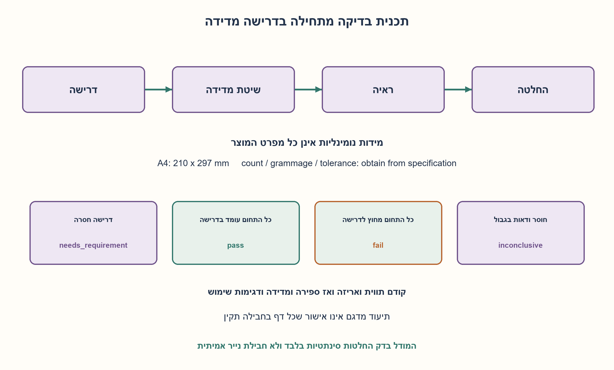
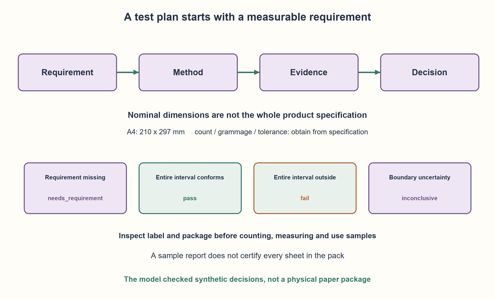

# PREP-159 — איך בודקים חבילת דפי A4? מדרישות לראיות

פתרון מוצע בסיוע AI; ביקורת אנושית ממתינה. הקושי לא כויל.

[צילום מקור פרטי](../sources/2026-10-30-batch40-12.png)

הצע בדיקות לחבילת דפים A4.

## עברית

איך בודקים חבילת דפי A4? מדרישות לראיות

הציעו תכנית בדיקות לחבילת דפי A4. ציינו מה צריך לברר תחילה, אילו כשלים מחפשים, איך בודקים, מהי התוצאה הצפויה, ואיך מתעדפים ומדווחים על מגבלות.

המקור אינו מציין כמות דפים, משקל מרחבי, סבילות מידות, חומר אריזה, ייעוד למדפסת מסוימת או תנאי אחסון. אין להמציא נתונים אלה כדרישות. הציגו קריטריונים מותנים במפרט, הבחינו בין בדיקה לכל החבילה לבין מדגם, והפרידו הצעת ניסוי מתוצאה שנמדדה בפועל.

1. לפני שבודקים תקינות, לפי איזה מפרט אפשר להחליט שמשהו אינו תקין?
2. חלקו את המוצר לאריזה, תכולה ודף בודד, ואז הוסיפו שימוש ואחסון לפי הייעוד. לכל רעיון כתבו שיטה ותוצאה צפויה.
3. בדקו גם כמות ומידות, פיזור פגמים בתוך החבילה, והזנה או כתיבה בציוד המוצהר. מדידה בגבול דורשת סבילות ואי־ודאות; מדגם מוצלח אינו מוכיח שכל הדפים תקינים.

### תחילה מבררים מה החבילה מבטיחה
מפרט קבלה נדרש לפני בדיקת עובר/נכשל. אבקש את הכמות המוצהרת, מידות וסבילות, משקל מרחבי אם מוצהר, שימושים נתמכים ותנאי אחסון. A4 מציין מידות נומינליות של 210×297 מ״מ, כפי שמופיע בטבלת [ISO 216:2007 בתצוגה הרשמית](https://preview.sist.si/sist-preview/36631/c0883203ea25445c9992bb09343620c5/ISO-216-2007.pdf). אין בכך קביעה שהחבילה מכילה 500 דפים, שמשקלה 80 גרם למ״ר או שסבילות מסוימת הובטחה. מאמתים את התקן והמפרט החלים במקום להשלים אותם בדמיון.

### בדיקות מעשיות עם מטרה ותוצאה צפויה

| תחום | שיטה וראיה | קריטריון קבלה |
| --- | --- | --- |
| זהות ותווית | צילום תווית, דגם, אצווה, כמות ושימוש מוצהר | התווית עקבית עם הזמנה ומפרט; מידע חסר נרשם |
| אריזה לפני פתיחה | בדיקת אטימה, רטיבות, מעיכות וקרעים | אין נזק הפוסל הגנה או תכולה לפי דרישות המוצר |
| כמות ותכולה | ספירה ישירה של כל החבילה אחרי תיעוד האריזה | הכמות תואמת למוצהר; אין כמות ברירת מחדל |
| מידות וחיתוך | מדידת שתי צלעות במספר דפים ובכמה נקודות; בדיקת פינות וריבועיות | עמידה בסבילות מוסכמת עם אי־ודאות המדידה |
| אחידות ופגמים | דפים מהחלק העליון, האמצעי והתחתון וגם כמה מיקומים אקראיים | אין תערובת גדלים או פגמי קיפול, כתמים וקרעים החורגים מדרישה |
| משקל ועובי | אם הובטחו, מודדים בציוד מתאים ובתנאי סביבה מוגדרים | השוואה לטווח המוצהר; לא מסיקים מספר דפים ממשקל בלי הנחות |
| כתיבה והדפסה | דוגמת שימוש חד־צדדית ודו־צדדית אם נתמכת, בדיקת מריחה וחדירה | התוצאה עונה לייעוד ולספים המוצהרים בציוד הרלוונטי |
| הזנה | סדרת הדפסה בציוד נתמך, תיעוד חסימות והזנה כפולה | שיעור תקלות בגודל המדגם לעומת דרישת אמינות מוגדרת |
| אחסון והובלה | השוואת דוגמה לפני ואחרי תנאים מותרים לפי המפרט | נשמרות התכונות שהובטחו; לא דורשים עמידות לכל מצב קיצון |
| פתיחה ושימוש חוזר | פתיחה, הוצאת דפים ואחסון היתרה | אין נזק או זיהום שהמוצר אמור למנוע; מתעדים נוחות בהתאם לייעוד |

סדר הבדיקות חשוב: צילום אריזה לפני פתיחתה, בדיקות זהות וכמות לפני ניסויי שימוש יקרים, ושמירת דוגמת בסיס להשוואה אם עורכים ניסוי סביבה. לפגם קריטי עשויה להידרש בדיקה מלאה; בדגימה צריך להגדיר גודל ובחירה ולא לטעון לכיסוי מלא.

### תנאי קצה וראיות שליליות
כדאי לוודא שהתכנית תגלה גם חבילה חסרה או עודפת, דף בודד בגודל שגוי באמצע, פינה מעוכה רק בתחתית, מדידה בדיוק בגבול, ותווית חסרת נתון. אלה תרחישי בדיקה מוצעים; אין טענה שנמצאו בפועל. אפשר לבדוק את לוגיקת ההחלטה באמצעות נתונים סינתטיים לפני שמודדים מוצר.

### דוגמה להחלטת מדידה
אם מידה צפויה היא a עם סבילות δ ואי־ודאות המדידה היא u, תוצאת המדידה m מייצגת כאן מרווח שמרני [m−u, m+u]. במודל המוצע: כל המרווח בתוך [a−δ, a+δ] נותן עובר; כל המרווח מחוץ נותן נכשל; חפיפה בגבול היא לא־מכרעת ודורשת מדידה טובה יותר או כלל החלטה מוסכם. אם δ לא הוגדרה, התוצאה היא דרישה חסרה. זהו כלל החלטה שהצענו, לא דרישת ISO שהועתקה.

הקוד מדגים החלטות כאלה וכמות מול הצהרה, ללא חיבור למכשיר מדידה. בדוח ארשום דרישה, דגימות, ציוד, תנאים, ערכים, אי־ודאות, תוצאה ומה לא נבדק. בדיקות הנתונים הסינתטיים בקוד אינן אישור איכות או עמידה בתקן של חבילת נייר אמיתית.

```python
"""Synthetic acceptance decisions, not measurements of an actual paper pack."""
from fractions import Fraction


def interval_decision(measured, uncertainty, target, tolerance):
    """Guard band: pass only if the whole measurement interval conforms."""
    measured, uncertainty = Fraction(measured), Fraction(uncertainty)
    if uncertainty < 0:
        raise ValueError("uncertainty must be nonnegative")
    if target is None or tolerance is None:
        return "needs_requirement"
    target, tolerance = Fraction(target), Fraction(tolerance)
    if tolerance < 0:
        raise ValueError("tolerance must be nonnegative")
    observed = measured - uncertainty, measured + uncertainty
    allowed = target - tolerance, target + tolerance
    if allowed[0] <= observed[0] and observed[1] <= allowed[1]:
        return "pass"
    if observed[1] < allowed[0] or observed[0] > allowed[1]:
        return "fail"
    return "inconclusive"


def sheet_dimensions(width, height, uncertainty, tolerance=None):
    """A4 nominal 210x297 mm; tolerance is supplied, never inferred here."""
    if width <= 0 or height <= 0:
        raise ValueError("positive measured dimensions required")
    short, long = sorted((width, height))
    return {"short_side": interval_decision(short, uncertainty, 210, tolerance),
            "long_side": interval_decision(long, uncertainty, 297, tolerance)}


def count_decision(observed, declared=None):
    if type(observed) is not int or observed < 0:
        raise ValueError("observed count must be a nonnegative integer")
    if declared is None:
        return "needs_requirement"
    if type(declared) is not int or declared < 0:
        raise ValueError("declared count must be a nonnegative integer")
    return "pass" if observed == declared else "fail"
```




## English

Testing an A4 paper pack: from requirements to evidence

Propose a test plan for an A4 paper pack. State what to clarify first, which failure modes to target, how to test, expected outcomes, priorities and reporting limitations.

The source supplies no sheet count, grammage, dimensional tolerance, packaging material, printer compatibility or storage limits. Do not invent those as requirements. Make acceptance conditional on specifications, distinguish full-pack checks from sampling, and separate a proposed experiment from an actual measured result.

1. Which specification lets you decide that an observed property is defective?
2. Separate package, contents and individual sheets, then add intended use/storage. Give every idea a method and expected result.
3. Include count, dimensions, defect distribution and feeding/writing on declared equipment. Boundary measurements need tolerance and uncertainty; a passing sample does not prove every sheet good.

### First establish what the pack promises
A pass/fail decision needs acceptance requirements. Ask for declared count, dimensions/tolerances, grammage if claimed, intended uses and storage limits. A4 has nominal dimensions 210×297 mm in the [official ISO 216:2007 preview table](https://preview.sist.si/sist-preview/36631/c0883203ea25445c9992bb09343620c5/ISO-216-2007.pdf). This does not imply 500 sheets,80g/m² or any particular promised tolerance. Verify applicable specifications instead of inventing them.

### Practical tests with methods and expected outcomes

| Area | Method and evidence | Acceptance criterion |
| --- | --- | --- |
| Identity/label | Record label, model, lot, count and intended use | Consistent with order/specification; missing data recorded |
| Package before opening | Inspect seals, moisture, crushing and tears | No damage violating required protection or contents condition |
| Count/contents | Count the entire pack after documenting its package | Matches declared count; no assumed default |
| Dimensions/cutting | Measure both sides of several sheets at multiple points;inspect corners/squareness | Meets agreed tolerance with measurement uncertainty considered |
| Uniformity/defects | Sample top, middle, bottom and randomly chosen depths | No mixed sizes or folds, stains, tears beyond requirements |
| Grammage/thickness | If claimed, use suitable equipment under defined conditions | Matches declared range; do not infer count from weight without assumptions |
| Writing/printing | Test supported single/duplex use;inspect smearing and show-through | Meets intended use and declared limits on relevant equipment |
| Feeding | Run a supported device;record jams and multiple-sheet feeds | Observed rate and sample size compared with a defined reliability requirement |
| Storage/transport | Compare baseline with a sample exposed to specified allowed conditions | Promised properties retained; no universal extreme-condition requirement |
| Opening/reuse | Open, remove sheets and store the remainder | No damage/contamination the product must prevent; assess usability for its purpose |

Sequence matters:document the package before opening, check identity/count before costly use trials, and retain a baseline if testing environment effects. Critical defects may need full inspection. Define sample size and selection without claiming full coverage.

### Boundary and negative evidence
The plan should detect missing/extra sheets, a single wrong-size sheet in the middle, bottom-only corner damage, measurements at a tolerance boundary and a missing label field. These are proposed scenarios, not observed defects. Synthetic observations can exercise decision logic before measuring a product.

### A measurement-decision example
For target a, tolerance δ and uncertainty u, let measured m represent conservative interval[m−u, m+u]. The proposed rule passes when that entire interval lies inside[a−δ, a+δ], fails when entirely outside, and returns inconclusive when it overlaps the boundary. Improve the measurement or agree on another decision rule. An unspecified δ yields needs_requirement. This is an authored decision rule, not a copied ISO requirement.

The code demonstrates these decisions and observed-versus-declared counts without a measuring-device connection. Record requirements, samples, equipment, conditions, values, uncertainty, results and untested areas. Synthetic code checks do not certify a physical paper pack or its standards conformity.

```python
"""Synthetic acceptance decisions, not measurements of an actual paper pack."""
from fractions import Fraction


def interval_decision(measured, uncertainty, target, tolerance):
    """Guard band: pass only if the whole measurement interval conforms."""
    measured, uncertainty = Fraction(measured), Fraction(uncertainty)
    if uncertainty < 0:
        raise ValueError("uncertainty must be nonnegative")
    if target is None or tolerance is None:
        return "needs_requirement"
    target, tolerance = Fraction(target), Fraction(tolerance)
    if tolerance < 0:
        raise ValueError("tolerance must be nonnegative")
    observed = measured - uncertainty, measured + uncertainty
    allowed = target - tolerance, target + tolerance
    if allowed[0] <= observed[0] and observed[1] <= allowed[1]:
        return "pass"
    if observed[1] < allowed[0] or observed[0] > allowed[1]:
        return "fail"
    return "inconclusive"


def sheet_dimensions(width, height, uncertainty, tolerance=None):
    """A4 nominal 210x297 mm; tolerance is supplied, never inferred here."""
    if width <= 0 or height <= 0:
        raise ValueError("positive measured dimensions required")
    short, long = sorted((width, height))
    return {"short_side": interval_decision(short, uncertainty, 210, tolerance),
            "long_side": interval_decision(long, uncertainty, 297, tolerance)}


def count_decision(observed, declared=None):
    if type(observed) is not int or observed < 0:
        raise ValueError("observed count must be a nonnegative integer")
    if declared is None:
        return "needs_requirement"
    if type(declared) is not int or declared < 0:
        raise ValueError("declared count must be a nonnegative integer")
    return "pass" if observed == declared else "fail"
```




## חומר משלים / Supporting material

```json
{
  "assumptions": {
    "he": [
      "זהו תכנון בדיקות, ולא דיווח על חבילה פיזית שנבדקה.",
      "נתוני הכמות, המשקל המרחבי, הסבילות, הייעוד והאחסון מתקבלים מהתווית או ממפרט מוסכם.",
      "מידות A4 הנומינליות הן 210×297 מ״מ; סבילות קבלה אינה מוסקת כאן מהשם בלבד.",
      "בדיקות שימוש וסביבה תלויות בתנאים שהיצרן מצהיר עליהם ובציוד מדידה מתאים."
    ],
    "en": [
      "This is a test-plan exercise, not a report on an inspected physical pack.",
      "Count, grammage, tolerances, intended use and storage limits come from the label or agreed specification.",
      "Nominal A4 dimensions are 210×297 mm; acceptance tolerances are not inferred here from the name alone.",
      "Use/environment tests depend on declared conditions and suitable measurement equipment."
    ]
  },
  "optimality": {
    "he": "אין סט בדיקות מזערי יחיד בלי מודל כשלים ותקציב. סדר מוצע: בדיקות זולות ועתירות סיכון לפני ניסויי שימוש וסביבה. בדיקת כל N הדפים עולה לפחות O(N) פעולות התבוננות/ספירה; דגימה של M דפים עולה O(M) ואינה הוכחה שכל החבילה תקינה. מודל החלטת מרווח המדידה משתמש במספר קבוע של פעולות לכל תצפית.",
    "en": "There is no unique minimum test set without a fault model and budget. Inspect cheap/high-risk properties before use and environment trials. Inspecting/counting all N sheets requires O(N) observations; M sampled sheets use O(M) and do not prove the whole pack conforms. The interval-decision model uses a constant number of operations per observation."
  },
  "verification": {
    "he": "נבדק מודל סינתטי בלבד: 85 מרווחי מדידה מול אורקל קבוצות עצמאי, 32 החלפות כיוון של מידות, 515 צירופי כמות נמדדת/מוצהרת וחמש דחיות קלט. הסבילות של 1 מ״מ בנתוני הבדיקה היא נתון דמה להמחשת גבולות, לא סבילות ISO או דרישת מוצר. לא נבדקו חבילה, מדפסת, תנאי סביבה או עמידה בתקן.",
    "en": "Only synthetic logic was tested:85 measurement intervals against an independent set oracle,32 dimension-orientation swaps,515 observed/declared count combinations and five invalid cases. The 1 mm fixture tolerance is invented for boundary demonstrations, not an ISO tolerance or product requirement. No pack, printer, environment or standards conformity was tested."
  },
  "edge_cases": {
    "he": [
      "אין כמות מוצהרת: מסמנים דרישה חסרה, לא מניחים 500 דפים.",
      "אין סבילות: אין מסקנת עובר רק משום שהמידה קרובה ל־A4.",
      "מדידה בגבול עם אי־ודאות עשויה להיות לא מכרעת.",
      "חבילה עם נזק מקומי עשויה להיכשל אף שהדף העליון תקין.",
      "הזנת מספר דפים יחד היא כשל שימוש שונה מחוסר דפים בחבילה."
    ],
    "en": [
      "No declared count: mark a missing requirement, do not assume 500 sheets.",
      "No tolerance: closeness to A4 nominal dimensions alone is not a pass decision.",
      "A boundary measurement with uncertainty can be inconclusive.",
      "Localized damage can be missed by checking only the top sheet.",
      "Multiple-sheet feeding is a different use failure from a missing-sheet count."
    ]
  },
  "common_mistakes": {
    "he": [
      "לרשום רשימת רעיונות בלי תוצאה צפויה ושיטת מדידה.",
      "להמציא כמות, משקל או סבילות קבלה ולייחס אותם למקור.",
      "לבדוק רק את הדף הראשון ולהכריז שכל החבילה תקינה.",
      "לבדוק התאמה לכל מדפסת או לכל תנאי לחות בלי שזו דרישה.",
      "להציג בדיקת קוד סינתטית כאילו נמדד נייר פיזי."
    ],
    "en": [
      "Listing ideas without expected results and measurement methods.",
      "Inventing count, grammage or tolerances and attributing them to the source.",
      "Inspecting only the first sheet and certifying the whole pack.",
      "Requiring compatibility with every printer or humidity condition without such a requirement.",
      "Presenting synthetic code checks as physical paper measurements."
    ]
  },
  "interview_answer": {
    "he": "אתחיל במפרט: כמות, מידות וסבילות, משקל, ייעוד ותנאי אחסון. אחר כך אבנה בדיקות עם שיטה ותוצאה צפויה: תווית ואריזה, ספירה, מידות ופגמים במדגם מפוזר, ואז כתיבה והדפסה בציוד המוצהר ותנאי אחסון מוגדרים. אתעד מדידות, אי־ודאות, כיסוי ומגבלות; דרישה חסרה אינה עובר.",
    "en": "Start with specifications:count, dimensions/tolerances, grammage, intended use and storage. Then define methods and expected outcomes for label/package, count, dimensions and defects in a distributed sample, followed by writing/printing on declared devices and specified storage conditions. Record observations, uncertainty, coverage and limits; a missing requirement is not a pass."
  },
  "source_ambiguities": {
    "he": [
      "המקור מבקש להציע בדיקות בלבד, בלי נתוני מוצר או קריטריוני קבלה.",
      "מידות A4 נתמכות בתקן; שאר הדרישות דורשות תווית או מפרט ולא הומצאו.",
      "שיוך Apple מדווח בצילום ולא אומת עצמאית."
    ],
    "en": [
      "The source asks only for proposed tests, with no product data or acceptance limits.",
      "The standard supports A4 nominal dimensions; other requirements must come from a label/specification and are not invented.",
      "Apple attribution is source-reported, not independently verified."
    ]
  },
  "solution_extensions": {
    "he": [
      {
        "question": "איך תשתנה התכנית אם יש רק עשר דקות לבדיקה?",
        "answer_direction": "דרגו סיכונים ועלות: זהות, אריזה, כמות ומידות מדגמיות תחילה; בחרו דגימת שימוש אחת בהתאם לייעוד. תעדו מה לא נבדק, ואל תהפכו צמצום כיסוי לאישור מלא.",
        "principle": "תיעדוף תחת תקציב מחייב דיווח על סיכון שיורי."
      }
    ],
    "en": [
      {
        "question": "How does the plan change if testing has only ten minutes?",
        "answer_direction": "Rank risk and cost:identity, package, count and sampled dimensions first; choose one use sample matching intended purpose. State what remains untested instead of certifying full coverage.",
        "principle": "Budgeted prioritization requires reporting residual risk."
      }
    ]
  },
  "technical_references": {
    "he": [
      {
        "title": "ISO 216:2007 — תחום התקן ומצב הפרסום",
        "url": "https://www.iso.org/standard/36631.html"
      },
      {
        "title": "תצוגה מקדימה רשמית של ISO 216 — טבלת מידות A4",
        "url": "https://preview.sist.si/sist-preview/36631/c0883203ea25445c9992bb09343620c5/ISO-216-2007.pdf"
      }
    ],
    "en": [
      {
        "title": "ISO 216:2007 — Scope and publication status",
        "url": "https://www.iso.org/standard/36631.html"
      },
      {
        "title": "Official ISO 216 preview — A4 dimension table",
        "url": "https://preview.sist.si/sist-preview/36631/c0883203ea25445c9992bb09343620c5/ISO-216-2007.pdf"
      }
    ]
  }
}
```
