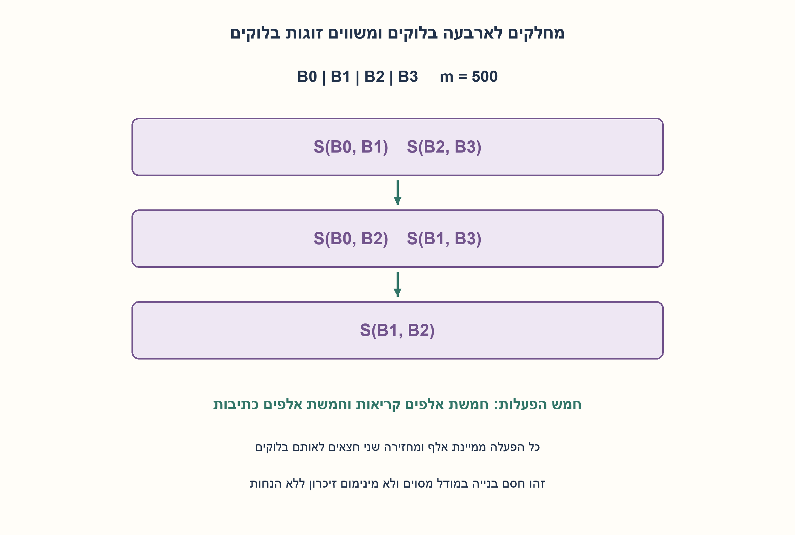
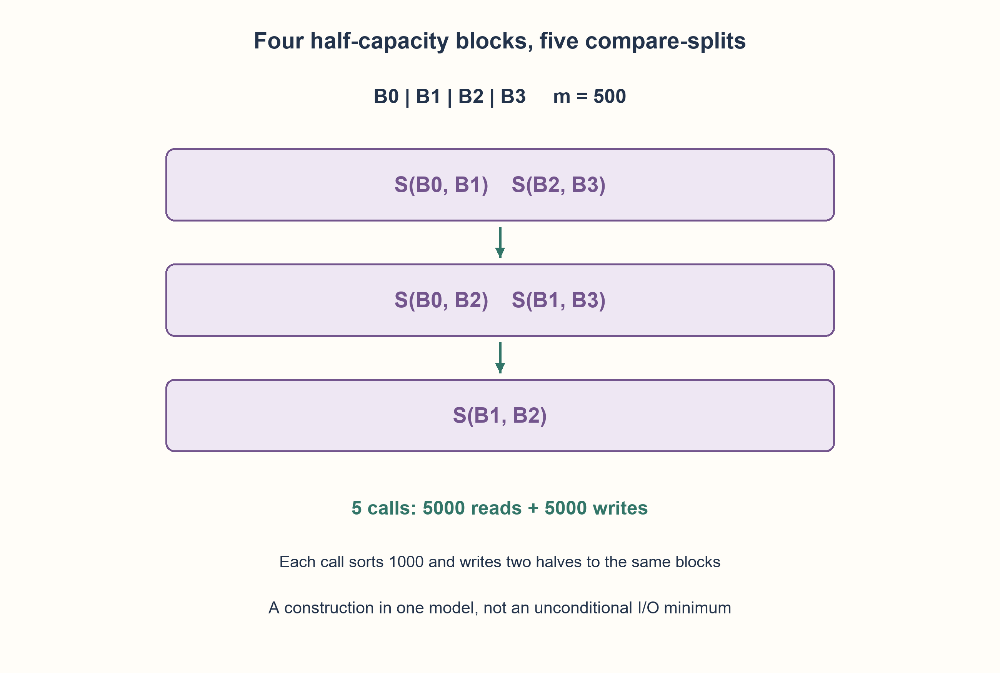

# PREP-160 — מיון אלפיים ערכים בעזרת קופסת מיון של אלף — מודל גישות לזיכרון

פתרון מוצע בסיוע AI; ביקורת מקצועית אנושית ממתינה.

## מקור פרטי / Private source

נניח שב memory יש מערך של 2000 מספרים לא ממויינים. בתוך הcpu יש קופסה שחורה שיכולה למיין כל פעם 1000 תווים. כיצד היית ממיין בכמה שפחות גישות לזיכרון? והשאלה הנוספת: כיצד היית מממש את הקופסה השחורה?

[צילום מקור פרטי](../sources/2026-10-30-batch70-05.png)

## נוסח ערוך

בזיכרון יש 2000 מספרים לא ממוינים. בתוך ה־CPU קיימת קופסה שממיינת 1000 פריטים בכל הפעלה. כיצד תמיינו תוך מעט גישות לזיכרון, וכיצד תממשו את הקופסה עצמה?

המקור אומר מספרים ואז תווים ואינו מגדיר רוחב, זיכרון פנימי, יחידת גישה, מקום הפלט או האם מותר להשוות מחוץ לקופסה. נבחר ערכי מספר שלם ומיון עולה עם כפילויות. הפרידו שלושה מודלים: זיכרון פנימי מספיק עם השוואות חופשיות; מיון מקטעים שחוזרים לזיכרון ומיזוג סקלרי; ובנייה שמשווה סדר רק דרך קופסת 1000. ספרו העברות של ערך בודד לזיכרון חיצוני, לא עסקאות cache או DRAM. הראו בנייה נכונה ואל תטענו למינימום כללי בלי מודל וחסם. למימוש הקופסה הציגו גם רשת compare-exchange קבועה, ללא טענה לסינתזה או להשהיה פיזית.

### שלושה רמזים

1. לפני שסופרים גישות, היכן נשמרים הנתונים אחרי קריאה והאם מותר למזג מחוץ לקופסה?
2. בבנייה שמשתמשת רק בקופסה, חלקו לארבעה בלוקים של 500. מיון זוג בלוקים מחזיר חצי קטן וחצי גדול.
3. נסו זוגות בלוקים (0,1),(2,3), אחריהם (0,2),(1,3), ולבסוף (1,2). זו בניית חמש הפעלות; חשבו קריאה וכתיבה לכל הפעלה בנפרד.

### הצעה לפתרון

### מספר הגישות תלוי במה נחשב זיכרון
אם מותר לשמור את כל הקלט ואת שטח המיזוג בתוך ה־CPU, אפשר לקרוא 2000 פעם אחת, למיין שני חצאים בקופסה, למזג פנימית ולכתוב 2000 לפלט חדש:4000 העברות ערכים. במודל הפלט החדש כל 2000 תאי הפלט חייבים להיכתב וכל קלט צריך להיקרא במקרה הגרוע, ולכן 2N הוא החסם המתאים במודל הזה. זו אינה תשובה ללא הנחת מקום פנימי; וגם אין כאן מינימום הפעלות קופסה, כי השוואות חופשיות יכולות למיין בלעדיה.

אם כל חצי ממוין חוזר לזיכרון החיצוני לפני מיזוג סקלרי, שני המיונים עולים 2000 קריאות ו־ 2000 כתיבות. המיזוג קורא שוב 2000 וכותב 2000:8000 בבנייה הישירה הזאת. caching, פלט בתוך הקלט וגדלי בלוק אחרים יכולים לשנות את המניין. בלי נתונים אלה המקור אינו מגדיר אופטימום I/O יחיד.

### בנייה שלומדת סדר רק מהקופסה
חלקו לארבעה בלוקים B0..B3 של 500. פעולה S(i, j) קוראת את שני הבלוקים לקופסה, ממיינת 1000, וכותבת את 500 הקטנים לבלוק i ואת 500 הגדולים ל־j. הפעילו S(0,1), S(2,3), S(0,2), S(1,3), S(1,2). אחרי ההפעלה האחרונה שרשור ארבעת הבלוקים ממוין. זו חמש הפעלות,5000 קריאות ו־ 5000 כתיבות במודל שכל הפעלה טוענת ומחזירה את כל הקלט, ללא שימור פנימי בין הפעלות. אין השוואות סדר מחוץ לקופסה, ואין טענת מינימום לחמש או לעשרת אלפים העברות.

נימוק: לאחר שתי הפעולות הראשונות כל זוג מקורי ממוין. לבדיקת נכונות אפשר לסווג ערכים כ־ 0/1 ביחס לכל סף: מיון וסיווג מתחלפים, ואם התוצאה לא ממוינת קיים סף שמגלה בה 1 לפני 0. נסמן m=500 ואת כמויות האפסים בארבעת הבלוקים a, b, c, d. אחרי המיון הראשון b>0 מחייב a=m, ו־d>0 מחייב c=m. לאחר מיון הבלוקים הנמוכים יחד והגבוהים יחד, אם החצי הנמוך של זוג הגבוהים מכיל אפס, החצי הראשון כבר מלא אפסים; ואם החצי האחרון מכיל אפס, גם החצי השני מלא אפסים. לכן הבלוק הראשון והאחרון במקומם, ורק שני האמצעיים עשויים להתערבב. S(1,2) מסדרת אותם. הטיעון לכל סף מוכיח מיון לערכים כלליים, כולל שוויון.

### דוגמת מימוש לקופסת 1000
רשת bitonic קבועה יכולה לרפד ל־ 1024 נתיבים באמצעות תגי ריפוד שגדולים מכל ערך אמיתי, ואז להחזיר רק 1000. אין צורך להמציא מספר סופי שישמש אינסוף. בניית bitonic ממיינת תחילה חלקים בכיוונים מנוגדים; השוואת איברים במרחק חצי מפרידה חצי קטן וחצי גדול, ששניהם bitonic, ומיזוג רקורסיבי מסדר אותם. עשרת גדלי המקטעים נותנים 1+...+10=55 שכבות, ובכל אחת 512 משווים:28,160 תאי compare-exchange. כל תא צריך משווה ברוחב הערך ובוררי ניתוב; התג והרוחב משפיעים על שטח ותזמון. זו בנייה ולא מינימום שערים. pipeline משנה latency וצריך רישום ויישור נתיבים; לחלופין אפשר לממש מיון תוכנה או שימוש סדרתי במשווים תחת חוזה אחר.

נבדקו 15,332 מצבי ספירת אפסים בארבעה בלוקים קטנים ו־ 100 קלטי 2000 מדגמיים מול מיון מלא עצמאי. רשת הקופסה נבדקה בכל 2047 קלטי 0/1 עד אורך 10, ב־ 20 קלטי 1000 ובמיון 2000 מקצה לקצה. מנייני ההעברות הם של מודל התוכנה, לא מדידת מערכת זיכרון.

```python
"""Explicit external-word transfer model and a padded bitonic box example.

The compare/split construction invokes the box five times. No scalar ordering
comparison exists outside the callback. Python's memory list models EXTERNAL
RAM, not extra internal CPU capacity. Each call reads/writes capacity words.
"""


def sorter_only(values, box, *, capacity=1000):
    if type(capacity) is not int or capacity < 2 or capacity % 2:
        raise ValueError("box capacity must be positive, even and at least two")
    if len(values) != 2 * capacity:
        raise ValueError("input needs exactly twice the box capacity")
    memory = list(values)
    block = capacity // 2
    calls = reads = writes = 0
    for left, right in ((0, 1), (2, 3), (0, 2), (1, 3), (1, 2)):
        # These two sorted half-capacity blocks fit the primitive together.
        addresses = list(range(left * block, (left + 1) * block))
        addresses += list(range(right * block, (right + 1) * block))
        loaded = [memory[index] for index in addresses]
        reads += capacity
        ordered = box(loaded)
        calls += 1
        if len(ordered) != capacity:
            raise ValueError("box output must retain its input count")
        for index, value in zip(addresses, ordered, strict=True):
            memory[index] = value
        writes += capacity
    return memory, {"box_calls": calls, "external_reads": reads, "external_writes": writes}


def bitonic_box(values):
    """Ascending numeric sort; padding is a tag, not a guessed numeric infinity."""
    n = len(values)
    padded = 1
    while padded < n:
        padded *= 2
    data = [(0, value) for value in values] + [(1, 0)] * (padded - n)
    comparisons = stages = 0
    span = 2
    while span <= padded:
        distance = span // 2
        while distance:
            stages += 1
            for index in range(padded):
                partner = index ^ distance
                if partner > index:
                    ascending = (index & span) == 0
                    comparisons += 1
                    if (data[index] > data[partner]) == ascending:
                        data[index], data[partner] = data[partner], data[index]
            distance //= 2
        span *= 2
    return [value for padding, value in data[:n]], {"padded_lanes": padded, "comparator_cells": comparisons, "stages": stages}
```




### assumptions

[
  "רוחב וערכי קלט מוגדרים כמספרים שלמים; כפילויות מותרות ומיון עולה.",
  "גישת זיכרון היא העברת ערך חיצוני בודד; כל הנחות הקיבולת והניתוב נפרדות."
]

### optimality

בנייה קופסה־בלבד:5 קריאות,5000 קריאות זיכרון ו־ 5000 כתיבות. לא מינימום כללי. bitonic מרופד:55 שכבות ו־ 28160 משווים, בלי אופטימום פיזי.

### edge_cases

[
  "כפילויות, שליליים, חלוקה לא נוחה של ערכים בין בלוקים.",
  "ריפוד חייב להיות מזוהה בתג; קופסה שמחזירה מספר פריטים שגוי נדחית."
]

### common_mistakes

[
  "לבלבל קריאות קופסה עם עסקאות זיכרון.",
  "להניח שאין מקום פנימי נוסף, או להפך שיש 2000 תאים, בלי להצהיר.",
  "להציג בנייה של חמש הפעלות כמינימום בלי הוכחה."
]

### interview_answer

אברר קיבולת פנימית ויחידת גישה. עם מספיק מקום יש קריאה וכתיבה אחת לכל איבר. כשמותר רק למיין 1000 בכל פעם, אפשר בנייה של ארבעה בלוקי 500 וחמש compare-split; המינימום הכללי אינו נקבע מהמקור.

### source_ambiguities

מספרים לעומת תווים, קיבולת, העברות, השוואות חיצוניות ופלט אינם מוגדרים. אלה חוזים נפרדים; PREP-098 ממזגת קלט שכבר ממוין ואינה אותה שאלה.

### verification

15332 מצבי בלוקים,100 דגימות 2000,2047 בדיקות bitonic קטנות ו־ 20 מלאות; אורקל מיון מלא. Python בלבד.

### solution_extensions

[
  {
    "question": "מה משתנה אם מודדים עסקאות cache-line במקום ערכים?",
    "direction": "צריך רוחב שורה, קיבולת ומדיניות cache וסדר גישות; אי אפשר לחלק אוטומטית את המניין במספר קבוע.",
    "principle": "מודל העלות הוא חלק מהבעיה."
  }
]

## Edited prompt

External memory contains 2000 unsorted values. A CPU black box sorts 1000 items per invocation. How would you sort using few memory accesses, and implement the box itself?

The source switches from numbers to characters and omits width, internal capacity, transfer unit, output location and external comparisons. Choose ascending integers with duplicates. Separate three models: sufficient internal workspace with free comparisons; round-trip sorted chunks followed by scalar merging; and a construction learning order only through the 1000-sorter. Count external single-value transfers, not cache/DRAM transactions. Demonstrate correctness without an unconditional minimum claim. Also give a fixed compare-exchange network for the box, without synthesis or physical-delay claims.

### Three hints

1. Before counting accesses, where do loaded values live, and may comparisons occur outside the box?
2. For a box-only construction use four blocks of 500. Sorting two blocks leaves a lower half and an upper half.
3. Try pairs(0,1),(2,3), then(0,2),(1,3), finally(1,2). This uses five calls; count each call's loads and stores separately.

### Proposed solution

### Access counts depend on what memory means
With enough CPU workspace for the entire input and merge output, read 2000 once, sort two halves in the box, merge internally and write 2000 to a fresh output:4000 value transfers. In that model every fresh output cell must be written and every input inspected in the worst case, giving the appropriate 2N lower bound. This depends on internal capacity and does not minimize box calls: free comparisons could sort without it.

If sorted halves must be stored externally before scalar merging, the two sorts read 2000/write 2000, then merging rereads 2000/writes 2000:8000 in this straightforward construction. Caching, in-place output and transfer blocks change accounting. The source therefore does not define a unique unconditional I/O optimum.

### Learn order only from the box
Use four 500-value blocks B0..B3. S(i, j) loads both, sorts 1000, and writes the lower 500 to block i and upper 500 to j. Apply S(0,1), S(2,3), S(0,2), S(1,3), S(1,2). Their final concatenation is sorted. Five calls read 5000/write 5000 in the explicit round-trip model with no retention across calls. No ordering comparison occurs outside the box. Five calls and 10000 transfers are sufficient, not claimed minimal.

For correctness classify values as 0/1 at any threshold. Sorting commutes with thresholding; any unsorted result would expose 1 before 0 at some threshold. Let m=500 and a, b, c, d be block zero counts after the first paired sorts. Then b>0 implies a=m, and d>0 implies c=m. After comparing the two lower blocks and the two upper blocks, if the lower half of the upper-block pair contains any zero, the first block is already all zeros; if the last block contains a zero, the second block is also all zeros. Thus the first/last blocks are positioned, and only the middle two can overlap. S(1,2) orders those. Correctness at every threshold proves general numeric sorting, including duplicates.

### An example 1000-value box implementation
A fixed bitonic network can pad to 1024 lanes with tags greater than every real entry, then retain 1000 outputs. No guessed finite numeric infinity is needed. Bitonic construction sorts neighboring parts in opposite directions; half-distance comparisons separate low/high halves, each still bitonic, and recursive merging orders them. Ten span sizes give 1+...+10=55 layers,512 comparators each:28,160 compare-exchange cells. Each needs a value-width comparator and routing muxes; width/tags affect actual area and delay. This is a construction, not minimum gates. Pipelining changes latency and requires registers/path alignment. Software sorting or sequential comparator reuse are alternatives under other contracts.

15,332 compressed binary block-count cases plus 100 seeded 2000-value inputs matched independent full sorting. The bitonic box passed all 2047 binary inputs through length 10,20 full-capacity inputs and one end-to-end 2000-value construction. Transfer counts are executed model accounting, not physical memory-system measurements.

```python
"""Explicit external-word transfer model and a padded bitonic box example.

The compare/split construction invokes the box five times. No scalar ordering
comparison exists outside the callback. Python's memory list models EXTERNAL
RAM, not extra internal CPU capacity. Each call reads/writes capacity words.
"""


def sorter_only(values, box, *, capacity=1000):
    if type(capacity) is not int or capacity < 2 or capacity % 2:
        raise ValueError("box capacity must be positive, even and at least two")
    if len(values) != 2 * capacity:
        raise ValueError("input needs exactly twice the box capacity")
    memory = list(values)
    block = capacity // 2
    calls = reads = writes = 0
    for left, right in ((0, 1), (2, 3), (0, 2), (1, 3), (1, 2)):
        # These two sorted half-capacity blocks fit the primitive together.
        addresses = list(range(left * block, (left + 1) * block))
        addresses += list(range(right * block, (right + 1) * block))
        loaded = [memory[index] for index in addresses]
        reads += capacity
        ordered = box(loaded)
        calls += 1
        if len(ordered) != capacity:
            raise ValueError("box output must retain its input count")
        for index, value in zip(addresses, ordered, strict=True):
            memory[index] = value
        writes += capacity
    return memory, {"box_calls": calls, "external_reads": reads, "external_writes": writes}


def bitonic_box(values):
    """Ascending numeric sort; padding is a tag, not a guessed numeric infinity."""
    n = len(values)
    padded = 1
    while padded < n:
        padded *= 2
    data = [(0, value) for value in values] + [(1, 0)] * (padded - n)
    comparisons = stages = 0
    span = 2
    while span <= padded:
        distance = span // 2
        while distance:
            stages += 1
            for index in range(padded):
                partner = index ^ distance
                if partner > index:
                    ascending = (index & span) == 0
                    comparisons += 1
                    if (data[index] > data[partner]) == ascending:
                        data[index], data[partner] = data[partner], data[index]
            distance //= 2
        span *= 2
    return [value for padding, value in data[:n]], {"padded_lanes": padded, "comparator_cells": comparisons, "stages": stages}
```




### assumptions

[
  "Integer values, duplicates allowed, ascending order.",
  "An access is one external value transfer; capacity/routing assumptions are explicit and separate."
]

### optimality

Box-only construction:5 calls,5000 reads/5000 writes, without a global minimum. Padded bitonic:55 layers/28160 comparators, without physical optimality.

### edge_cases

[
  "Duplicates, negatives and adversarial block distribution.",
  "Padding requires a tag; wrong-count primitive output is rejected."
]

### common_mistakes

[
  "Confusing box calls with memory transactions.",
  "Silently assuming either no additional workspace or room for all 2000.",
  "Calling a five-call construction minimal without proof."
]

### interview_answer

Clarify internal capacity and transfer units. Enough workspace permits one read/write per item. A box-only construction uses four 500-blocks and five compare-splits; the source alone does not specify a global optimum.

### source_ambiguities

Numbers versus characters, capacity, transfers, external comparisons and output are unspecified. Separate contracts; PREP-098 starts with sorted inputs and is different.

### verification

15332 block cases,100 full inputs,2047 small bitonic checks and 20 full-capacity cases versus full sorting. Python only.

### solution_extensions

[
  {
    "question": "What changes when counting cache-line transactions?",
    "direction": "Specify line size, capacity, cache policy and access order; dividing the scalar count by a constant is not generally valid.",
    "principle": "The cost model belongs to the problem."
  }
]
