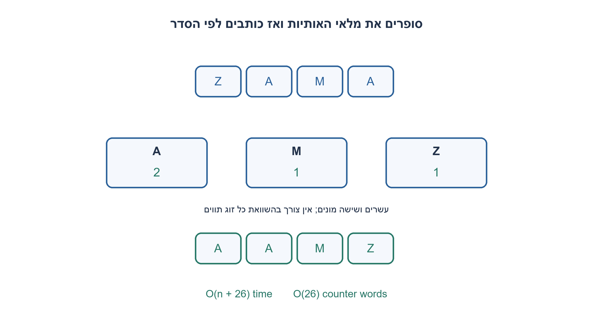
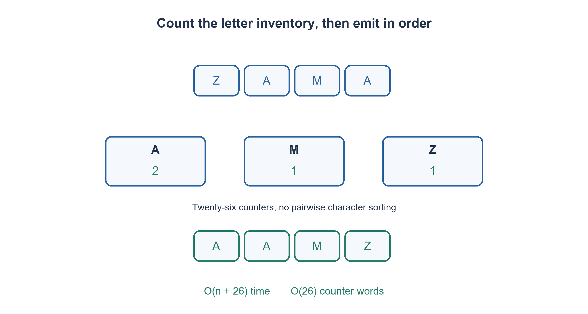

# PREP-160 — מיון אלפיים ערכים בעזרת קופסת מיון של אלף — מודל גישות לזיכרון

פתרון מוצע בסיוע AI; ביקורת מקצועית אנושית ממתינה. הקושי אינו מכויל.

## עברית

### סעיף נוסף: מימוש קופסה למיון אלף אותיות A–Z
נתונים 1000 תווים, שכל אחד מהם אות ASCII גדולה A..Z. ממשו את קופסת המיון המחזירה אותם בסדר עולה, כאשר מותר לבחור כל מבנה נתונים. שימרו את מספר ההופעות של כל אות.

זהו מימוש מיוחד לאלפבית של 26 אותיות, לצד שאלת הזיכרון החיצוני המקורית של 2000 ערכים; מודלי גישות הזיכרון הקודמים נשארים בתוקף. מימוש הייחוס משנה מערך תווים במקום, אינו כולל terminator בגודל הקלט, ומאמת את התחום לפני שינוי. הוא תומך גם באורכים אחרים לצורכי הכללה ובדיקה.

1. האם צריך להשוות כל זוג תווים כאשר יש רק 26 ערכים אפשריים?
2. ספרו כמה פעמים כל אות מופיעה במערך מונים קבוע.
3. אחרי הספירה כתבו A כמספר הופעותיה, אחריה B וכן הלאה עד Z. בצעו אימות תחום לפני הכתיבה.

### מנצלים תחום קטן, לא קופסה שחורה כללית
נאתחל 26 מונים לאפס. נסרוק את הקלט, נאמת שכל תו בתחום A..Z ונגדיל counts[char−A]. אחרי שכל הקלט תקין נעבור על המונים בסדר ונכתוב כל אות כמספר הופעותיה. למשל Z,A,M,A הופך ל־A,A,M,Z. אין צורך בערימה או במיון השוואתי.

אחרי הספירה counts[i] שווה לריבוי האות A+i בקלט. בשלב הכתיבה כל אות נכתבת בדיוק מספר זה, ולכן לא נעלמת הופעה ולא נוצרת חדשה. סדר המעבר על המונים מבטיח פלט לא־יורד. שני התנאים יחד מוכיחים שהפלט הוא תמורה ממוינת של הקלט. אימות כל התווים לפני הכתיבה משאיר את המערך ללא שינוי אם נמצא תו לא חוקי.

עבור n תווים ואלפבית בגודל σ=26 הזמן O(n+σ) והמקום O(σ) מילות מונה, כלומר לינארי וקבוע בהתאמה לאלפבית הזה. כל מונה צריך להכיל עד n, ולכן O(log(n+1)) ביטים; עבור אלף תווים מספיקים עשרה ביטים למונה מתמטי. קוד C משתמש ב־size_t ולא דוחס אותם. חסם Ω(n log n) למיון השוואתי אינו מחייב מיון בתחום קטן שניגש למונה לפי הערך.

התווים הם הנתונים עצמם, ולכן העתקי A אינם נבדלים זה מזה. אם כל אות מחוברת לרשומה עם payload וסדר היציבות חשוב, ספירת כמויות וכתיבה מחדש של אותיות בלבד תאבד את הרשומות. נדרש counting sort יציב עם מיקומי יעד או מבנה מתאים; אין לטעון שהקוד הזה ממיין רשומות ביציבות.

העלות הזאת גם אינה פותרת לבד את ספירת גישות הזיכרון בשאלת 2000 הערכים: צריך לדעת מה נטען פנימה, מה רוחב הגישה והאם הקופסה מקבלת כל מספר או רק אותיות. הסעיף הנוכחי מסביר מימוש של קופסה תחת חוזה אלפבית מצומצם. נבדקו 9,843 מקרים מול מיון עצמאי, כולל קלט באורך אלף, תחום שגוי ושמירת הקלט בכשל; C99 הודר והורץ בנפרד באותה רתמה.

```python
"""In-place uppercase ASCII counting sort; input need not contain unique letters."""


def sort_uppercase(letters):
    if any(not isinstance(ch, str) or len(ch) != 1 or not 'A' <= ch <= 'Z' for ch in letters):
        raise ValueError('single uppercase ASCII letters required')
    counts = [0] * 26
    for ch in letters:
        counts[ord(ch) - ord('A')] += 1
    write = 0
    for index, count in enumerate(counts):
        for _ in range(count):
            letters[write] = chr(ord('A') + index)
            write += 1
    return letters


def uppercase_sorted_text(text):
    """Execution adapter; the core operation modifies its character list."""
    return ''.join(sort_uppercase(list(text)))
```


```c
/* C99 on an ASCII execution-character-set target. Validate before mutation. */
#include <stdbool.h>
#include <stddef.h>
bool sort_uppercase(char *letters, size_t length) {
    size_t counts[26] = {0};
    if (length != 0 && letters == NULL) return false;
    for (size_t i = 0; i < length; ++i) {
        unsigned char c = (unsigned char)letters[i];
        if (c < 'A' || c > 'Z') return false;
        ++counts[c - 'A'];
    }
    size_t write = 0;
    for (size_t letter = 0; letter < 26; ++letter)
        for (size_t n = 0; n < counts[letter]; ++n)
            letters[write++] = (char)('A' + letter);
    return true;
}
```




## English

### Additional part: implement a box sorting one thousand A–Z letters
Given 1000 characters, each an uppercase ASCII letter A..Z, implement the sorting box in ascending order using any data structure. Preserve every letter’s multiplicity.

This is a 26-letter-alphabet specialization alongside the original 2000-value external-memory question; earlier memory-access models remain intact. The reference mutates the character array in place, excludes any string terminator from the length, and validates the domain before mutation. Other lengths are supported for generalization and testing.

1. Are pairwise character comparisons necessary when only 26 values can occur?
2. Count occurrences in a fixed array of 26 counters.
3. After counting, write A its count times, then B, through Z. Validate the domain before overwriting.

### Exploit the small domain rather than a general comparison box
Initialize 26 zero counters. Scan input, validate A..Z, and increment counts[character−A]. Once the entire input is valid, visit counters in order and emit each letter that many times. Z,A,M,A becomes A,A,M,Z. No heap or comparison sort is required.

After counting, counts[i] equals the input multiplicity of letter A+i. Emitting exactly that many copies neither loses nor invents an occurrence. Visiting counters in alphabet order makes output nondecreasing. Together these properties prove a sorted permutation. Validating all input before output leaves the array unchanged if a character is invalid.

For n characters and alphabet size σ=26, time is O(n+σ) and auxiliary storage O(σ) counter words: linear time and constant space for this alphabet. Each counter must represent up to n and needs O(log(n+1)) bits; one thousand characters need ten mathematical bits per counter. C uses size_t rather than compressed fields. The Ω(n log n) comparison-sort lower bound does not constrain direct indexing into a small value domain.

Here characters are the data, so separate copies of A are indistinguishable. If each letter keys a payload record requiring stable order, emitting letters alone discards records. Stable counting sort then needs destination positions or a suitable structure; this reference does not claim to stably sort records.

This also does not by itself answer the original 2000-value memory-access count: transfer size, internal storage and whether the box accepts arbitrary numbers or only letters remain relevant. This part implements a box under a restricted alphabet contract. 9,843 cases matched independent sorting, including length one thousand, invalid domain and no mutation on failure; C99 was separately compiled and executed in the native harness.

```python
"""In-place uppercase ASCII counting sort; input need not contain unique letters."""


def sort_uppercase(letters):
    if any(not isinstance(ch, str) or len(ch) != 1 or not 'A' <= ch <= 'Z' for ch in letters):
        raise ValueError('single uppercase ASCII letters required')
    counts = [0] * 26
    for ch in letters:
        counts[ord(ch) - ord('A')] += 1
    write = 0
    for index, count in enumerate(counts):
        for _ in range(count):
            letters[write] = chr(ord('A') + index)
            write += 1
    return letters


def uppercase_sorted_text(text):
    """Execution adapter; the core operation modifies its character list."""
    return ''.join(sort_uppercase(list(text)))
```


```c
/* C99 on an ASCII execution-character-set target. Validate before mutation. */
#include <stdbool.h>
#include <stddef.h>
bool sort_uppercase(char *letters, size_t length) {
    size_t counts[26] = {0};
    if (length != 0 && letters == NULL) return false;
    for (size_t i = 0; i < length; ++i) {
        unsigned char c = (unsigned char)letters[i];
        if (c < 'A' || c > 'Z') return false;
        ++counts[c - 'A'];
    }
    size_t write = 0;
    for (size_t letter = 0; letter < 26; ++letter)
        for (size_t n = 0; n < counts[letter]; ++n)
            letters[write++] = (char)('A' + letter);
    return true;
}
```




## חומר משלים / Supporting material

```json
{
  "assumptions": {
    "he": [
      "ASCII A..Z בלבד; n=1000 בשאלה, המימוש כללי.",
      "אורך אינו כולל terminator; C מניח charset ASCII ותאי קלט תקפים."
    ],
    "en": [
      "ASCII A..Z only; the task uses n=1000 while the reference is general.",
      "Length excludes a terminator; C assumes an ASCII execution charset and valid input storage."
    ]
  },
  "optimality": {
    "he": "O(n+26) זמן ו־26 מונים, O(log(n+1)) ביטים לכל מונה. אין טענת מיון יציב של רשומות או שינוי חסמי I/O המקוריים.",
    "en": "O(n+26) time and 26 counters of O(log(n+1)) bits each. No stable-record-sort claim or revision of prior I/O bounds."
  },
  "verification": {
    "he": "9,843 מקרי Python ו־C מול מיון עצמאי: אורכים 0..8 מעל A,M,Z, קלט באורך 1000 ותחום שגוי. GCC C99 מחמיר עבר בסביבה מבודדת.",
    "en": "9,843 Python and C cases against independent sorting: lengths 0..8 over A,M,Z, length 1000 and invalid domain. Strict isolated GCC C99 compilation passed."
  },
  "edge_cases": {
    "he": [
      "ריק; אותה אות אלף פעמים; A ו־Z; כפילויות; אות קטנה; NUL בתוך טווח האורך."
    ],
    "en": [
      "Empty; one letter repeated one thousand times; A/Z; duplicates; lowercase; NUL within the declared length."
    ]
  },
  "common_mistakes": {
    "he": [
      "שימוש במונה קטן שלא מכיל 1000.",
      "שינוי המערך לפני סיום אימות התחום.",
      "החלת אלפבית 26 על מספרים כלליים.",
      "טענה ליציבות של payload שלא נשמר."
    ],
    "en": [
      "A counter too narrow to represent 1000.",
      "Mutating before domain validation completes.",
      "Applying a 26-letter alphabet to arbitrary numbers.",
      "Claiming stability for discarded payload records."
    ]
  },
  "interview_answer": {
    "he": "אלפבית קטן מאפשר 26 מונים ואז כתיבה בסדר האותיות. אספור כל הופעה ואשמור ריבוי; זה מימוש מיוחד של הקופסה ולא שינוי של מודל הזיכרון החיצוני.",
    "en": "A small alphabet permits 26 counters followed by ordered emission. Preserve every multiplicity; this specializes the box without changing the external-memory model."
  },
  "source_ambiguities": {
    "he": "המקור החדש מגביל במפורש לאותיות A–Z ומתיר מבני נתונים; הוא נשמר כסעיף מימוש לצד שאלת 2000 הערכים הכללית.",
    "en": "The new source explicitly restricts input to A–Z and permits data structures; it is retained as an implementation part beside the general 2000-value question."
  },
  "solution_extensions": {
    "he": [
      {
        "question": "כיצד תשתנה השיטה אם האלפבית עצום ורוב הערכים לא מופיעים?",
        "answer_direction": "השוו מערך מונים גדול למילון ספירות ומיון המפתחות שהופיעו; המקום והזמן תלויים במספר הערכים השונים ובסדר הנדרש.",
        "principle": "תחום ערכים קטן הוא משאב אלגוריתמי."
      }
    ],
    "en": [
      {
        "question": "What changes for a huge mostly unused alphabet?",
        "answer_direction": "Compare a dense counter array with sparse counts plus sorting observed keys; costs depend on distinct keys and required order.",
        "principle": "A small value domain is an algorithmic resource."
      }
    ]
  }
}
```
