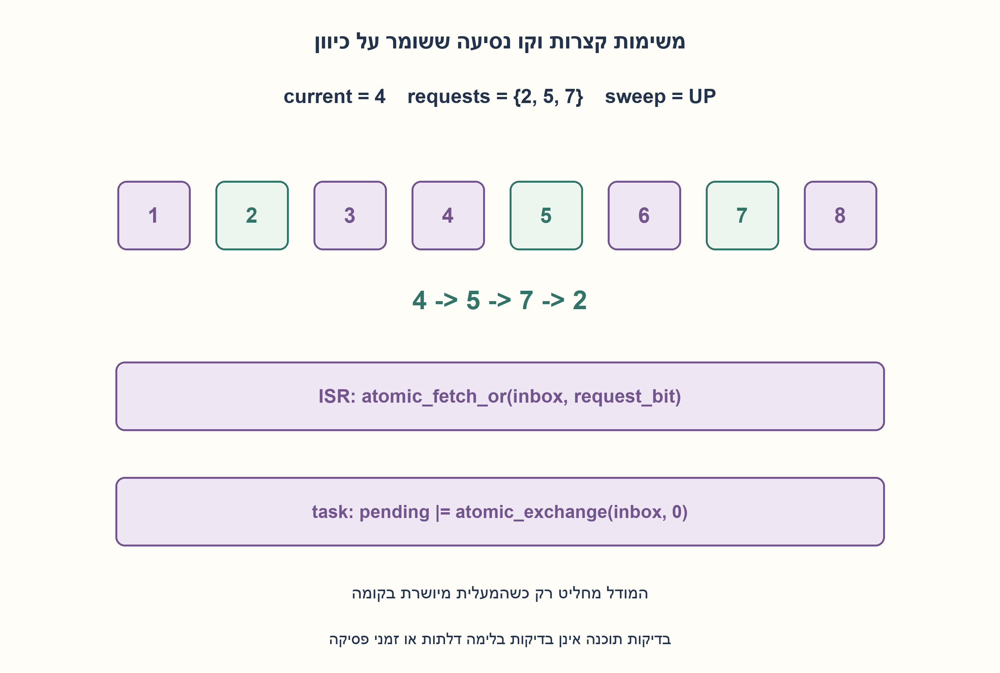
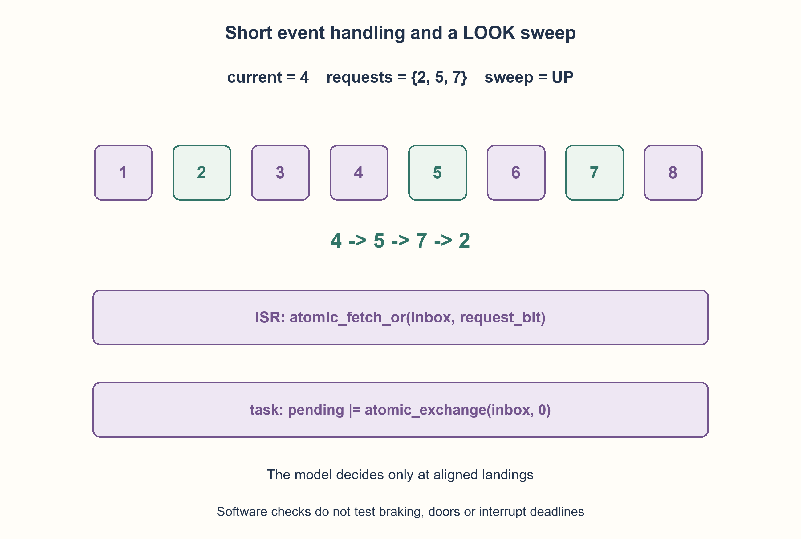

# PREP-161 — מעלית שמונה קומות — בקשות מפסיקה ותזמון שירות

פתרון מוצע בסיוע AI; ביקורת מקצועית אנושית ממתינה.

## מקור פרטי / Private source

נתון בניין בן שמונה קומות עם מעלית. נתונות הפונקציות void EngineUp(), void EngineDown(), void EngineStop(), STATE EngineStateGet(), enum STATE { UP=0, DOWN, STOP }; int EngineGetCurrFloor(). פסיקת חומרה קוראת בכל לחיצה על כפתור במעלית ל־void EnignePressedFloor(int floor), המקבלת את הקומה שבה נלחץ כפתור המעלית. 1. כתוב קוד שמממש אלגוריתם של מעלית. 2. התייחס למבנה הנתונים ולתכנון הכללי ואז כתוב את הקוד על דף. 3. התייחס לבעיות RT וכיצד לפתור אותן.

[צילום מקור פרטי](../sources/2026-10-30-batch70-12.png)

## נוסח ערוך

נתון בניין בן 8 קומות וה־API: void EngineUp(), void EngineDown(), void EngineStop(), STATE EngineStateGet(), enum STATE {UP=0, DOWN, STOP}, int EngineGetCurrFloor(). הפסיקה קוראת ל־void EnignePressedFloor(int floor). שגיאת הכתיב בשם הפונקציה נשמרת כדי להתאים למקור. תכננו מבנה נתונים, אלגוריתם וקוד, ודונו בבעיות RT.

נבחר קומות 1..8 ובקשה היא קומת יעד. לחיצות כפולות מתאחדות. אין במקור מידע על דלתות, יישור לקומה, בלימה, שגיאות חיישן או זמן תגובת מנוע, ולכן אין ממנו תוכנת מעלית פיזית בטוחה מלאה. במודל הלוגי בלבד control_step נקראת בנקודות החלטה שבהן המעלית מיושרת בקומה; ה־API יציב והפקודות חלות לפני יציאה לקומה הבאה. עצירה בקומה מבוקשת נחשבת שירות במודל, בלי להמציא API של דלת. המימוש בפייתון מדמה סדר אירועים סריאלי; הסבירו אילו פעולות אטומיות נדרשות למימוש פסיקה אמיתי.

### שלושה רמזים

1. למה אסור לחכות בתוך פסיקת כפתור עד שהמעלית תגיע?
2. רק שמונה קומות: אפשר לסמן בקשות בביטים ולהשאיר את הפעלת המנוע למשימה אחת.
3. הפסיקה מבצעת atomic OR לתיבת בקשות. המשימה מרוקנת באטומיות, ממשיכה בכיוון כל עוד יש בקשות קדימה, ועוברת לכיוון ההפוך כשאין. הגעות ויישור דורשים חוזה חיישנים נפרד.

### הצעה לפתרון

### הפסיקה אוספת, משימה אחת מחליטה
נחזיק inbox של 8 ביטים, pending של 8 ביטים וכיוון סריקה. הפסיקה בודקת קומה ומסמנת ביט בלבד; היא אינה מפעילה מנוע, סורקת תור, מדפיסה או ממתינה. במימוש אמיתי נדרשים atomic_fetch_or(inbox, bit) ובמשימת הבקרה pending |= atomic_exchange(inbox,0). אפשר במקום אטומיות חומרה קטע קריטי קצר ומוגבל שמונע פסיקה מקומית, בהתאם לפלטפורמה. אין להשתמש במנעול חוסם או להסתמך על GIL של Python בתוך ISR.

החלפה אטומית מפרידה אירועים: בקשה שקדמה לניקוז נמצאת ב־pending; בקשה שאחריו נשארת לדריכה הבאה. OR לא אטומי עלול לאבד בקשה כאשר שתי פעולות קוראות מסכה ישנה ואז כותבות כל אחת ביט אחר. משימה אחת בלבד משנה pending ואת כיוון הנסיעה, ולכן אין תחרות על פקודות המנוע. גם מחיקת בקשת הקומה הנוכחית אינה מוחקת בקשה חדשה שנשארה ב־inbox.

### מדיניות LOOK פשוטה
בנקודת החלטה מיושרת, אם יש בקשה לקומה הנוכחית עוצרים ומסירים אותה. אחרת ממשיכים למעלה אם זה כיוון הסריקה ויש בקשות גבוהות יותר, או למטה באופן סימטרי. כשאין בקשות קדימה הופכים כיוון. ממצב מנוחה נבחר היעד הקרוב, ובשוויון הנמוך. כשאין בקשות עוצרים. למשל בקומה 4, בכיוון מעלה ובקשות 2,5,7, סדר השירות הוא 5,7,2. זו מדיניות תקפה, לא מינימום זמן המתנה.

כל הבדיקות מוגבלות לשמונה ביטים או שמונה קומות, ולכן יש חסם עבודה קבוע לכל אירוע במודל. דרישות התזמון האמיתיות עדיין מחייבות WCET, זמן פסיקה וחסימות, תדירות דגימת חיישנים, תקציבי תגובה וניתוח קדימויות. אם מותרות הגעות אינסופיות בקצב שרירותי אין מכאן חסם המתנה כולל; עבור אצווה סופית בלי הגעות חדשות כל בקשה תטופל בסריקה ובחזרה. בדיקת סטטוס מנוע אינה לבדה הוכחת הגעה מיושרת: יש לדרוש משוב קומה ופרוטוקול עצירה/דלת מתאים לפני פריסה.

אינווריאנט: כל ביט לא מטופל נשאר ב־inbox או pending עד שירות; פקודות התנועה נבחרות רק לעבר בקשה בתחום 1..8. המימוש המצורף הוא מודל Python של אירועים סריאליים עם השמות שבמקור, ולא ISR מקבילי, תזמון RT או בקר בטיחות. נבדקו 6144 שילובי קומה, מסכת בקשות וכיוון, כולל טיפול בכל אצווה סופית, לחיצות כפולות, בקשה אחרי מחיקה ודחיית קומות שגויות. מודל נפרד מדגים אובדן עדכון ללא אטומיות. לא נבדקו מעלית, דלתות או זמני תגובה פיזיים.

```python
"""Serialized landing-decision model, not deployable ISR or elevator firmware.

The source APIs do not supply doors, alignment, faults or braking guarantees.
control_step is called only at a known aligned landing, with commands taking
effect before departure. The event loop serializes button posts and steps.
A real ISR needs atomic fetch_or and an atomic exchange/drain, not this Python
read/modify/write. One task owns engine calls and sweep direction.
"""
from enum import IntEnum


class STATE(IntEnum):
    UP = 0
    DOWN = 1
    STOP = 2


class ElevatorController:
    def __init__(self, engine):
        self.engine = engine
        self.inbox = self.pending = 0
        self.direction = STATE.STOP

    def EnignePressedFloor(self, floor):
        """Preserve the source API typo; post a coalesced request only."""
        if type(floor) is not int or not 1 <= floor <= 8:
            raise ValueError("valid floors are one through eight")
        self.inbox |= 1 << (floor - 1)

    def control_step(self):
        # Serialized here; a real task must atomically exchange the ISR inbox.
        self.pending |= self.inbox
        self.inbox = 0
        floor = self.engine.EngineGetCurrFloor()
        state = self.engine.EngineStateGet()
        if type(floor) is not int or not 1 <= floor <= 8 or state not in STATE:
            raise ValueError("model requires a valid aligned landing and state")
        bit = 1 << (floor - 1)
        if self.pending & bit:
            self.engine.EngineStop()
            self.pending &= ~bit
            return floor  # Model service event; no door-open API is invented.
        if not self.pending:
            self.engine.EngineStop()
            self.direction = STATE.STOP
            return None
        below = self.pending & (bit - 1)
        above = self.pending & ~((bit << 1) - 1)
        if self.direction == STATE.UP:
            self.direction = STATE.UP if above else STATE.DOWN
        elif self.direction == STATE.DOWN:
            self.direction = STATE.DOWN if below else STATE.UP
        else:
            targets = [f for f in range(1, 9) if self.pending & (1 << (f - 1))]
            target = min(targets, key=lambda f: (abs(f - floor), f))
            self.direction = STATE.UP if target > floor else STATE.DOWN
        if self.direction == STATE.UP:
            self.engine.EngineUp()
        else:
            self.engine.EngineDown()
        return None
```




### assumptions

[
  "קומות 1..8, בקשות יעד ודריכה סריאלית רק בנקודות יישור במודל.",
  "פסיקה אמיתית דורשת inbox אטומי ודריכה ממשימת בעלות יחידה; אין API של דלת או תקלה במקור."
]

### optimality

O(8) עבודה לאירוע ומסכות בגודל קבוע; לא מינימום המתנה או הוכחת WCET פיזית.

### edge_cases

[
  "לחיצה בקומה הנוכחית, בקשות כפולות, שתי בקשות יחד והיפוך כיוון בגבול.",
  "בקשה מיד אחרי ניקוז או שירות; קומה 0/9 נדחית."
]

### common_mistakes

[
  "המתנה או קריאת מנוע ארוכה בתוך ISR.",
  "מסכת OR לא אטומית או ניקוז שמוחק בקשה חדשה.",
  "הנחת זיהוי יישור או דלת שאינם ב־API."
]

### interview_answer

אשמור בקשות בביטים, אעדכן inbox באטומיות מהפסיקה ומשימת בקרה יחידה תנהל LOOK. אדרוש חוזה הגעה ובלימה, ואנתח WCET וקדימויות; מודל הקוד אינו לבדו בקר בטיחות פיזי.

### source_ambiguities

לא הוגדרו מספרי קומות, זמן דגימה, יישור, דלתות, השהיית מנוע או סנכרון. הם נשארים הנחות ומגבלות גלויות. שם EnignePressedFloor נשמר.

### verification

6144 מצבים, דגימות בקשות חוזרות, לאחר שירות וארבע דחיות קומה; סימולציה סריאלית בלבד.

### solution_extensions

[
  {
    "question": "איך מרחיבים למעליות רבות?",
    "direction": "נדרש משגר בקשות משותף וחוזה בעלות, עם פונקציית מטרה ותקציבי זמן חדשים; מסכת שמונה ביטים אינה פותרת שיבוץ צי.",
    "principle": "מדיניות שיבוץ וסנכרון הן שכבות נפרדות."
  }
]

## Edited prompt

An eight-floor building supplies void EngineUp(), EngineDown(), EngineStop(); STATE EngineStateGet(); enum STATE {UP=0, DOWN, STOP}; int EngineGetCurrFloor(). Hardware calls void EnignePressedFloor(int floor); preserve the source spelling. Design data structures, algorithm/code and RT handling.

Choose floors 1..8 and destination requests, coalescing duplicate presses. Doors, landing alignment, braking, sensor faults and motor response are unspecified, so these APIs alone do not define complete safe physical elevator software. The logical model calls control_step only at known aligned-landing decision instants with stable APIs and commands applied before departure. Stopping at a requested landing counts as service in the model; no door API is invented. Python models serialized events; separately explain atomic operations required by a real ISR.

### Three hints

1. Why must a button ISR never wait for the destination?
2. Eight floors fit a request bitmask; one task can own all engine commands.
3. ISR atomically ORs the request into an inbox. The task atomically drains it, keeps direction while requests remain ahead and reverses otherwise. Arrival/alignment needs its own sensor contract.

### Proposed solution

### ISR collects; one task decides
Use an eight-bit inbox, eight-bit pending mask and sweep direction. ISR validates the floor and sets a bit only: no motor operation, queue scan, printing or waiting. Real implementation needs atomic_fetch_or(inbox, bit) and task-side pending |= atomic_exchange(inbox,0). A short bounded local-interrupt critical section may substitute according to platform. Do not block on a mutex or assume Python's GIL supplies ISR synchronization.

Atomic draining partitions events: earlier requests enter pending, later requests stay in inbox for the next turn. Nonatomic OR can lose a request when two updates read an old mask and overwrite each other. One task owns pending, sweep direction and engine commands. Clearing a serviced floor cannot erase a newly posted request still in inbox.

### A simple LOOK policy
At an aligned decision instant, stop/clear a request for the current floor. Otherwise continue up when sweeping up and requests remain higher, or down symmetrically. Reverse when no request remains ahead. From rest choose the nearest destination, breaking equal distance toward the lower floor. With no requests stop. At floor 4 sweeping up with requests 2,5,7, serve 5,7,2. This is a valid policy, not minimum waiting time.

Each event examines at most eight bits/floors, giving bounded logical work. Actual RT guarantees still need WCET, interrupt latency/blocking, sensor polling rate, reaction budgets and priority analysis. Arbitrarily arriving requests imply no unconditional whole-system wait bound; a finite batch without new arrivals is drained by the sweep and return. Motor state alone does not establish aligned arrival: require suitable floor feedback and braking/door protocols before deployment.

Invariant: every unserved bit remains in inbox or pending until service; motion commands target pending floors within 1..8. Supplied Python is a serialized event model preserving source API names, not a concurrent ISR, RT timing proof or safety controller.6,144 initial floor/mask/direction combinations verified finite-batch service, duplicate presses, post-clear requests and invalid floors. A separate witness demonstrates nonatomic lost updates. No physical elevator, door or response timing was tested.

```python
"""Serialized landing-decision model, not deployable ISR or elevator firmware.

The source APIs do not supply doors, alignment, faults or braking guarantees.
control_step is called only at a known aligned landing, with commands taking
effect before departure. The event loop serializes button posts and steps.
A real ISR needs atomic fetch_or and an atomic exchange/drain, not this Python
read/modify/write. One task owns engine calls and sweep direction.
"""
from enum import IntEnum


class STATE(IntEnum):
    UP = 0
    DOWN = 1
    STOP = 2


class ElevatorController:
    def __init__(self, engine):
        self.engine = engine
        self.inbox = self.pending = 0
        self.direction = STATE.STOP

    def EnignePressedFloor(self, floor):
        """Preserve the source API typo; post a coalesced request only."""
        if type(floor) is not int or not 1 <= floor <= 8:
            raise ValueError("valid floors are one through eight")
        self.inbox |= 1 << (floor - 1)

    def control_step(self):
        # Serialized here; a real task must atomically exchange the ISR inbox.
        self.pending |= self.inbox
        self.inbox = 0
        floor = self.engine.EngineGetCurrFloor()
        state = self.engine.EngineStateGet()
        if type(floor) is not int or not 1 <= floor <= 8 or state not in STATE:
            raise ValueError("model requires a valid aligned landing and state")
        bit = 1 << (floor - 1)
        if self.pending & bit:
            self.engine.EngineStop()
            self.pending &= ~bit
            return floor  # Model service event; no door-open API is invented.
        if not self.pending:
            self.engine.EngineStop()
            self.direction = STATE.STOP
            return None
        below = self.pending & (bit - 1)
        above = self.pending & ~((bit << 1) - 1)
        if self.direction == STATE.UP:
            self.direction = STATE.UP if above else STATE.DOWN
        elif self.direction == STATE.DOWN:
            self.direction = STATE.DOWN if below else STATE.UP
        else:
            targets = [f for f in range(1, 9) if self.pending & (1 << (f - 1))]
            target = min(targets, key=lambda f: (abs(f - floor), f))
            self.direction = STATE.UP if target > floor else STATE.DOWN
        if self.direction == STATE.UP:
            self.engine.EngineUp()
        else:
            self.engine.EngineDown()
        return None
```




### assumptions

[
  "Floors 1..8, destination requests and serialized aligned-landing model steps.",
  "Real ISR needs an atomic inbox and single task ownership; source has no door/fault API."
]

### optimality

O(8) bounded logical work per event and fixed masks; no waiting-time optimum or physical WCET proof.

### edge_cases

[
  "Current-floor press, duplicates, concurrent arrivals and direction reversal.",
  "Request after draining/service; floors 0/9 rejected."
]

### common_mistakes

[
  "Waiting/long engine calls in the ISR.",
  "Nonatomic OR or draining that erases a new request.",
  "Assuming alignment/door feedback absent from the API."
]

### interview_answer

Store request bits, post atomically from ISR and let one task run LOOK. Require arrival/braking contracts and analyze WCET/priorities; the model alone is not a physical safety controller.

### source_ambiguities

Floor numbering, sampling, alignment, doors, engine delay and synchronization are unspecified. Explicit assumptions/limits remain; preserve EnignePressedFloor spelling.

### verification

6144 configurations, duplicate/post-service requests and four invalid floors; serialized simulation only.

### solution_extensions

[
  {
    "question": "How would several elevators be coordinated?",
    "direction": "Add shared dispatch, ownership and an explicit scheduling objective/deadlines; one eight-bit mask does not solve fleet allocation.",
    "principle": "Dispatch policy and synchronization are separate layers."
  }
]
