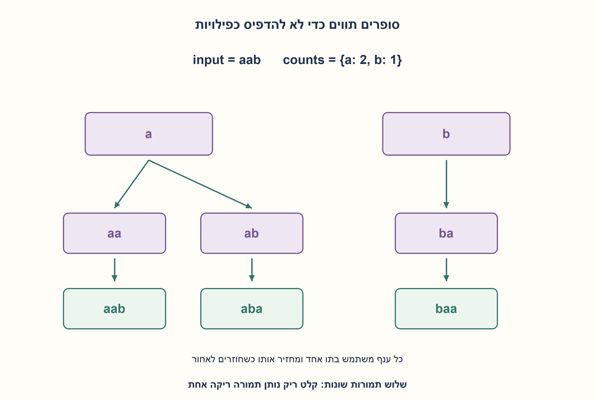
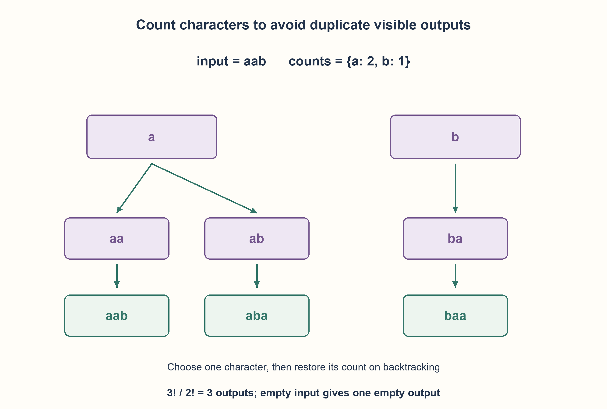

# PREP-162 — הדפסת כל התמורות השונות של מחרוזת

פתרון מוצע בסיוע AI; ביקורת מקצועית אנושית ממתינה.

## מקור פרטי / Private source

כתוב פונקציה אשר מקבלת מחרוזת ומדפיסה את כל הפרמוטציות האפשריות שלה.

[צילום מקור פרטי](../sources/2026-10-30-batch70-20.png)

## נוסח ערוך

כתבו פונקציה המקבלת מחרוזת ומדפיסה את כל התמורות האפשריות שלה.

הבהרות: כשיש תווים חוזרים נדפיס כל מחרוזת שונה פעם אחת. מחרוזת ריקה נותנת תמורה ריקה אחת, ולכן הדפסה אחת של שורה ריקה. סדר הפלט אינו חשוב. בקוד Python תו פירושו code point, לא אשכול גרפי שלם. הציגו גם מחולל שמחזיר תמורה אחת בכל פעם ועטיפת הדפסה; אל תשמרו את כל הפלט כחלק מעזר האלגוריתם. הגבילו את ניתוח העלות לפי מספר התווים השונים ומספר התמורות בפועל.

### שלושה רמזים

1. איזה תו יכול להיות הבא בתחילת תמורה, וכמה עותקים שלו נשארו?
2. שמרו ספירה לכל תו. בחירה צורכת עותק ובחזרה מהרקורסיה מחזירים אותו.
3. כשהקידומת באורך הקלט הדפיסו או yield אותה. בחרו רק תו שספירתו חיובית; תווים שווים אינם יוצרים ענפים נפרדים.

### הצעה לפתרון

### בונים קידומת מתוך מלאי תווים
נחזיק מיפוי תו→כמות וקידומת זמנית. בכל עומק ננסה כל תו שיש ממנו עותק, נוריד ספירה, נוסיף לקידומת, נמשיך ונחזיר את המצב לפני הניסיון הבא. כשהקידומת באורךn ניצור ממנה מחרוזת ו־yield. עטיפת הדפסה רק עוברת על המחולל ומדפיסה כל תוצאה, ולכן אינה צוברת את כל הפלט.

עבור aab נקבל aab, aba, baa. שני העותקים של a זהים מבחינת הפלט: ענף לפי תו ולא לפי מיקום מונע כפילויות. מחרוזת ריקה מגיעה מיד לתנאי הסיום ומייצרת "" פעם אחת.

אינווריאנט: הקידומת יחד עם הכמויות שנותרו מכילות בדיוק את מולטיסט הקלט. כל בחירה שומרת זאת; כל תמורה חוקית מתחילה בתו זמין ולכן מופיעה באחד הענפים, וכל ענף מוציא מחרוזת אחת חוקית ללא שיכפול של בחירות שוות. מספר הפלטים הוא P=n!/∏c!, כאשר c הן שכיחויות התווים.

עם σ תווים שונים, מספר צמתי הקידומת לכל היותר(n+1)P, ובכל אחד סורקים עדσ אפשרויות. חסם זמן פשוט הוא O(σnP), כולל O(n) לבניית כל פלט; זהו חסם בנייה ולא טענת אופטימליות מדויקת. כתיבת הפלט לבדה דורשת Ω(nP) תווים כאשר n>0. העזר O(n+σ) מעבר לפלט הנמסר לקורא, כולל מחסנית הרקורסיה. שמירת list(generator) אצל הקורא מוסיפה Θ(nP) מקום. עומק רקורסיה ויכולת ההדפסה מגבילים קלט גדול.

נבדקו 1093 מחרוזות על שלושה תווים עד אורך 6 מול קבוצת תמורות־מיקומים עצמאית, ו־ 40320 פלטים של שמונה תווים שונים. נבדקו כפילויות, עברית, ריק ועטיפת ההדפסה. אין קשר לאקראיות של PREP-022 שמפיקה תמורה אחת בלבד.

```python
"""Unique visible permutations of Python Unicode code points, any order."""


def unique_permutations(text):
    if not isinstance(text, str):
        raise ValueError("text must be a string")
    counts = {}
    for character in text:
        counts[character] = counts.get(character, 0) + 1
    alphabet = tuple(counts)
    path = []

    def visit():
        if len(path) == len(text):
            yield "".join(path)
            return
        for character in alphabet:
            if counts[character] == 0:
                continue
            counts[character] -= 1
            path.append(character)
            yield from visit()
            path.pop()
            counts[character] += 1

    return visit()


def print_permutations(text, write=print):
    for permutation in unique_permutations(text):
        write(permutation)
```




### assumptions

[
  "פלטים שונים בלבד, בכל סדר; ריק נותן תמורה ריקה אחת.",
  "תווים הם code points בקוד Python; recursion מותרת."
]

### optimality

O(σnP) חסם פשוט ו־O(n+σ) עזר; כתיבת הפלט Ω(nP). לא זמן קבוע ולא מקום כל הפלט כחלק מעזר.

### edge_cases

[
  "ריק, תו יחיד, כל התווים שווים, כל התווים שונים.",
  "תווים חוזרים ותווים שאינם ASCII."
]

### common_mistakes

[
  "להדפיס עותקים זהים בגלל הבחנה במיקומים.",
  "לא להחזיר ספירה אחרי רקורסיה.",
  "לטעון O(n!) זמן בלי עלות תווי הפלט או O(1) מקום למרות מחסנית."
]

### interview_answer

אבחר כל תו זמין למיקום הבא מתוך מפת ספירות, ואז אחזיר אותו בחזרה מהרקורסיה. אוציא כל עלה דרך מחולל וכך אקבל כל תמורה שונה פעם אחת.

### source_ambiguities

המקור לא הגדיר כפילויות, ריק או סוג תו; ההבהרות מפורשות. זו אינה תמורה אקראית של PREP-022.

### verification

1093 מחרוזות ו־ 40320 פלטים שונים, מול itertools.permutations באורקל בלבד.

### solution_extensions

[
  {
    "question": "מה אם צריך את התמורה הבאה בסדר מילוני בלבד?",
    "direction": "זהו ממשק אחר: next_permutation על סדר ממוין, עם טיפול בחזרות; אינו מחייב שמירת כל התמורות.",
    "principle": "ממשק הפלט משנה את האלגוריתם."
  }
]

## Edited prompt

Write a function receiving a string and printing every permutation.

Clarifications: repeated characters produce each distinct visible string once. Empty input has one empty permutation, printed as one blank line. Output order is unrestricted. Python characters mean Unicode code points rather than grapheme clusters. Provide a generator plus a printing wrapper, without retaining all outputs as auxiliary state. Analyze cost using the distinct-character count and actual output count.

### Three hints

1. Which character can be next, and how many copies remain?
2. Keep a count per character; choosing consumes one copy and backtracking restores it.
3. At input length emit the prefix. Branch only on characters with positive count; equal copies do not form separate branches.

### Proposed solution

### Build a prefix from character inventory
Maintain character counts and a temporary prefix. At each depth choose any character with remaining copies, decrement, append, recurse and restore before the next choice. At length n join the prefix and yield it. The printing wrapper consumes the generator without accumulating outputs.

For aab emit aab, aba, baa. The two a copies are visibly identical, so branching on a character rather than its original position avoids duplicates. Empty input immediately emits the empty string once.

Invariant: prefix plus remaining counts equals the input multiset. Every choice preserves it; every valid permutation starts with an available character and occurs in a branch, while identical copies create no duplicate branch. Output count is P=n!/∏c!, where c are multiplicities.

For σ distinct characters, at most(n+1)P prefix nodes each scan at most σ options, giving the simple construction bound O(σnP), including O(n) per emitted string. No tight optimality claim. Writing output alone costs Ω(nP) characters for n>0. Auxiliary storage is O(n+σ), including recursion, excluding outputs retained by the caller. Calling list(generator) adds Θ(nP) output storage. Recursion/output capacity limits large instances.

1,093 ternary-alphabet strings through length 6 matched an independent position-permutation set; eight distinct characters produced 40,320 outputs. Tests cover duplicates, Hebrew, empty input and the printing wrapper. Unlike PREP-022 this enumerates all outputs rather than generating one random permutation.

```python
"""Unique visible permutations of Python Unicode code points, any order."""


def unique_permutations(text):
    if not isinstance(text, str):
        raise ValueError("text must be a string")
    counts = {}
    for character in text:
        counts[character] = counts.get(character, 0) + 1
    alphabet = tuple(counts)
    path = []

    def visit():
        if len(path) == len(text):
            yield "".join(path)
            return
        for character in alphabet:
            if counts[character] == 0:
                continue
            counts[character] -= 1
            path.append(character)
            yield from visit()
            path.pop()
            counts[character] += 1

    return visit()


def print_permutations(text, write=print):
    for permutation in unique_permutations(text):
        write(permutation)
```




### assumptions

[
  "Distinct visible outputs, any order; empty input has one empty permutation.",
  "Python code points; recursion allowed."
]

### optimality

Simple O(σnP) bound/O(n+σ) auxiliary space; output writing Ω(nP). Not constant time and not hiding retained output storage.

### edge_cases

[
  "Empty, singleton, all equal/all distinct.",
  "Repeated and non-ASCII characters."
]

### common_mistakes

[
  "Printing duplicate strings from distinct equal positions.",
  "Not restoring counts after recursion.",
  "Ignoring output characters or recursion storage in complexity claims."
]

### interview_answer

Choose each available character from a count map and restore it on backtracking. Yield each leaf to generate every distinct permutation once.

### source_ambiguities

Source omits duplicates, empty input and character units; explicit choices are separate from random-permutation PREP-022.

### verification

1093 strings and 40320 distinct outputs versus itertools.permutations used only by the oracle.

### solution_extensions

[
  {
    "question": "What if only the next lexicographic permutation is needed?",
    "direction": "Use a next_permutation interface from sorted order with duplicate handling; it need not store all outputs.",
    "principle": "Output interfaces change algorithms."
  }
]


## מקור נוסף — 31.10.2026, מקבץ110

[צילום מקור פרטי 7](../sources/2026-10-31-batch21-07.png)

כתוב פסאודו־קוד של מערכת שמקבלת מערך ומדפיסה את כל הקומבינציות של כל האיברים במערך.

שיוכי מקור מדווחים: Apple.

נוספה וריאציה בשתי השפות; הנוסח, הפתרון והרמזים הקודמים נשמרו. הפתרון המורחב ממתין לביקורת מקצועית.

[הווריאציה המלאה / Full variant](prep-162-array_meanings_batch21-addendum.md)
