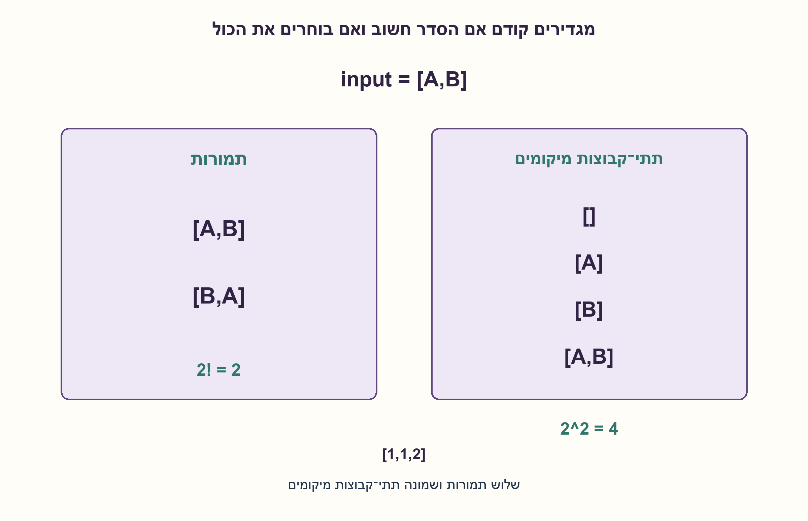
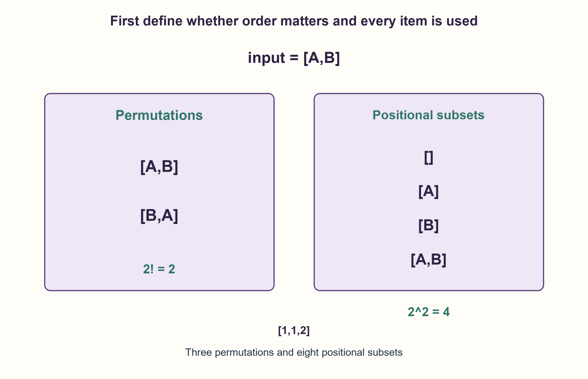

# PREP-162 — מערך: תמורות או תתי־קבוצות?

פתרון מוצע בסיוע AI; ביקורת מקצועית ממתינה. הנוסח והרמזים המקוריים נשמרים.

[צילום מקור פרטי](../sources/2026-10-31-batch21-07.png)

כתוב פסאודו־קוד של מערכת שמקבלת מערך ומדפיסה את כל הקומבינציות של כל האיברים במערך.

## עברית

### וריאציה: 'כל הקומבינציות' של מערך
המקור החדש מבקש פסאודו־קוד שמקבל מערך ומדפיס את כל הקומבינציות של איבריו. המונח אינו קובע אם רוצים תמורות של כל האיברים, תתי־קבוצות, או צירופים בגודל k שלא צוין. הסבירו את ההבדל והציגו שתי פרשנויות נפרדות:

א. הדפיסו כל סדר שונה של כל איברי המערך, תוך שימוש בכל הופעה פעם אחת וללא חזרה על מערך ערכים זהה. במימוש המוצע ערכים ניתנים לגיבוב ויחס השוויון שלהם יציב.
ב. הפיקו את כל תתי־הקבוצות של מיקומי המערך, בכל הגדלים כולל הריק; בתוך כל פלט שומרים על סדר הקלט. מיקומים שונים נחשבים שונים גם אם הערכים שווים.

למשל [A,B] נותן בסעיף א את [A,B] ואת [B,A], ובסעיף ב את [],[A],[B],[A,B], בסדר פלט כלשהו. עבור [1,1,2] יש שלוש תמורות ערכים שונות, אבל שמונה תתי־קבוצות מיקומים שחלקן נראות זהות בערכים. המערך המקורי אינו משתנה. זו הרחבה של שאלת תמורות המחרוזת; המקור אינו מחייב את שתי הפרשנויות יחד.

1. קודם הגדירו אם סדר חשוב ואם חייבים להשתמש בכל האיברים. בלי זה אין משמעות יחידה למספר הפלטים.
2. בתמורות בוחרים ערך הבא מתוך התדירויות שנותרו. בתתי־קבוצות מחליטים לכל מיקום אם לכלול אותו או לא.
3. בתמורות: הפחיתו ספירה, הוסיפו למסלול, רקורסיה ושחזור. בתתי־קבוצות: שני ענפים לכל אינדקס ושומרים את הסדר המקורי. מערך ריק נותן פלט ריק אחד בשתי הפרשנויות.

### אותם איברים, שתי שאלות שונות
בתמורה משתמשים בכל ההופעות והסדר חשוב. תת־קבוצה בוחרת רק חלק מן המיקומים; סידור מחדש אינו יוצר תת־קבוצה חדשה. צירוף בגודל k הוא אותה בחירה עם דרישה למספר איברים קבוע, ולכן צריך לדעת את k.

### א. תמורות ערכים שונות
מכינים מילון תדירויות. בכל עומק בוחרים ערך שספירתו חיובית, מקטינים את הספירה ומוסיפים אותו למסלול. כשהמסלול באורך n מפיקים עותק שלו. אחרי החזרה מהרקורסיה מסירים את הערך ומשחזרים את הספירה. אין שינוי במערך הקלט.

האינווריאנט הוא שמסלול יחד עם התדירויות שנותרו מכילים בדיוק את אוסף ההופעות המקורי. כל תמורה שונה קובעת מסלול בחירות יחיד לפי ערכיה, ולכן מופקת פעם אחת; כל בחירה של ערך שנותר מקדמת למסלול תקין, ולכן כל התמורות מופקות. עבור [1,1,2] נקבל [1,1,2],[1,2,1],[2,1,1], בלי להדפיס שוב בגלל שתי הזהויות של הערך 1.

אם יש d ערכים שונים בתדירויות c1,...,cd, מספר הפלטים הוא `P=n!/(c1!···cd!)`. הפלט המפורש לבדו דורש Ω(nP) העתקות איברים עבור n>0. המימוש סורק עד d ערכים בכל צומת, ומספר קידומותיו לכל היותר (n+1)P; לכן חסם עליון בטוח הוא O(n+d·n·P+1) תחת פעולות גיבוב ושוויון בעלות קבועה בתוחלת. זה אינו מוצג כחסם זמן הדוק או אופטימליות לכל שיטה. זיכרון העזר O(n+d), בלי לאגור את כל הפלט.

### ב. תתי־קבוצות של מיקומים
סורקים את האינדקסים בסדר. לכל אינדקס יוצרים ענף שאינו בוחר אותו וענף שכן בוחר אותו; אחרי הענף הנבחר משחזרים את המסלול. בסוף מפיקים עותק. מסלול החלטות בינארי קובע בדיוק תת־קבוצה אחת של מיקומים, ולכן יש 2^n פלטים. כשערכים חוזרים, שתי בחירות שונות יכולות להדפיס אותם ערכים; כאן זו תוצאה נכונה של הגדרת המיקומים, לא תקלה.

סך אורכי הפלט עבור n>0 הוא n·2^(n−1), ולכן זמן יצירת עותקים מפורשים הוא Θ((n+1)·2^n), עם O(n) עזר. ריק נותן [] פעם אחת בשני הסעיפים. אפשר להדפיס כל פלט מיד; אין צורך לשמור רשימה של כל התמורות או של כל תתי־הקבוצות. עומק הרקורסיה n; במימוש Python קלט עמוק עלול לעבור את מגבלת המחסנית.

נבדקו כל 1,093 המערכים מעל שלושה ערכים עד אורך 6: 40,573 תמורות שונות ו־55,987 תתי־קבוצות מיקומים מול אורקלים נפרדים. מקרים נוספים כיסו ערכים בני־גיבוב מסוגים שונים, ריק, כפילויות ושימור הקלט. אם נדרשים ערכים שאינם ניתנים לגיבוב או תתי־קבוצות ערכים ללא כפילויות, יש להתאים את הייצוג ואת הגדרת הפלט במפורש.

```python
"""Two explicitly different interpretations of the source word combinations.

Permutations use every item and deduplicate equal values; values must be hashable.
Subsets choose positions, preserve source order, and may duplicate value-tuples.
"""

from collections import Counter


def distinct_array_permutations(items):
    counts = Counter(items)
    keys, size, path = tuple(counts), sum(counts.values()), []

    def visit():
        if len(path) == size:
            yield tuple(path)
            return
        for value in keys:
            if counts[value]:
                counts[value] -= 1
                path.append(value)
                yield from visit()
                path.pop()
                counts[value] += 1

    yield from visit()


def positional_subsets(items):
    values, chosen = tuple(items), []

    def visit(index):
        if index == len(values):
            yield tuple(chosen)
            return
        yield from visit(index + 1)
        chosen.append(values[index])
        yield from visit(index + 1)
        chosen.pop()

    yield from visit(0)


def print_array_permutations(items):
    for ordering in distinct_array_permutations(items):
        print(list(ordering))
```




## English

### Variant: all array 'combinations'
The new source requests pseudocode printing all combinations of an array's elements. That word does not determine whether it means permutations using every item, subsets, or size-k combinations with an unspecified k. Explain the distinction and show two separate interpretations:

(a) Print every distinct ordering of all array values, using every occurrence exactly once and never repeating an identical value-array. The proposed implementation requires hashable values with stable equality.
(b) Generate subsets of the array's positions at every size, including empty; preserve input order inside each output. Different positions remain distinct even when values are equal.

For [A,B], part (a) gives [A,B] and [B,A]; part (b) gives [],[A],[B],[A,B], in any output order. For [1,1,2], there are three distinct value-permutations but eight positional subsets, some displaying equal value-tuples. Preserve the original array. This extends the existing string-permutation question; the source does not require both interpretations simultaneously.

1. First specify whether order matters and whether every element must be used. Output count otherwise has no unique meaning.
2. For permutations choose the next value from remaining frequencies. For subsets choose include or exclude for each position.
3. Permutation steps: decrement, append, recurse and restore. Subsets branch twice per index while preserving source order. Empty input produces one empty output in either interpretation.

### The same elements define different questions
A permutation uses every occurrence and cares about order. A subset chooses positions; reordering the chosen positions does not create another subset. A size-k combination adds a fixed-cardinality requirement, so k must be specified.

### (a) Distinct value-permutations
Build a frequency dictionary. At each depth choose a value with positive remaining count, decrement it and append the value to the path. Once the path has length n, emit a copy. On return, pop the value and restore its count. The input array remains unchanged.

The path plus remaining frequencies always equals the original multiset. Every distinct complete ordering determines exactly one sequence of value choices, so it appears once; every next choice uses an available occurrence, so all valid orderings are covered. For [1,1,2], outputs are [1,1,2],[1,2,1],[2,1,1], without repeating them merely because two occurrences of one are interchangeable.

For d distinct values with counts c1,...,cd, the number of outputs is `P=n!/(c1!···cd!)`. Explicit output alone needs Ω(nP) element copies for n>0. This implementation scans up to d keys per recursion node and has at most (n+1)P prefixes. A safe upper bound is therefore O(n+d·n·P+1), assuming expected constant-time hashing and equality. This is not claimed as a tight bound or a universal runtime optimum. Auxiliary space is O(n+d), without retaining every output.

### (b) Subsets of positions
Visit indices in order. For each index branch into exclusion and inclusion; restore the selected path after returning from the inclusion branch. Emit a copy at the end. Every binary decision path specifies exactly one positional subset, giving 2^n outputs. Repeated values can make different positional subsets display the same value-tuple; that is intentional under this definition.

For n>0 the sum of output lengths is n·2^(n−1), so explicit copying takes Θ((n+1)·2^n) time and O(n) auxiliary space. Empty input yields [] once in either part. Print each output immediately rather than retaining the full result set. Recursion depth is n; deep Python inputs can exceed the call-stack limit.

Checks exhaust all 1,093 arrays over three values through length six: 40,573 distinct permutations and 55,987 positional subsets matched independent oracles. Extra cases cover mixed hashable types, empty input, duplicates and input preservation. Unhashable values or deduplicated value-subsets require an explicitly adapted representation and output contract.

```python
"""Two explicitly different interpretations of the source word combinations.

Permutations use every item and deduplicate equal values; values must be hashable.
Subsets choose positions, preserve source order, and may duplicate value-tuples.
"""

from collections import Counter


def distinct_array_permutations(items):
    counts = Counter(items)
    keys, size, path = tuple(counts), sum(counts.values()), []

    def visit():
        if len(path) == size:
            yield tuple(path)
            return
        for value in keys:
            if counts[value]:
                counts[value] -= 1
                path.append(value)
                yield from visit()
                path.pop()
                counts[value] += 1

    yield from visit()


def positional_subsets(items):
    values, chosen = tuple(items), []

    def visit(index):
        if index == len(values):
            yield tuple(chosen)
            return
        yield from visit(index + 1)
        chosen.append(values[index])
        yield from visit(index + 1)
        chosen.pop()

    yield from visit(0)


def print_array_permutations(items):
    for ordering in distinct_array_permutations(items):
        print(list(ordering))
```




## חומר משלים / Supporting material

```json
{
  "assumptions": {
    "he": [
      "וריאציית המערך מבחינה בין תמורות של כל הערכים לבין תתי־קבוצות של מיקומים.",
      "תמורות מופקות ללא מערכי ערכים כפולים; נבחרו ערכים בני־גיבוב עם שוויון יציב.",
      "בתתי־קבוצות מיקומים כפולים נשארים מובחנים; סדר הפלט אינו חשוב והקלט אינו משתנה."
    ],
    "en": [
      "The array variant distinguishes all-value permutations from subsets of positions.",
      "Permutations deduplicate equal value-arrays and use hashable values with stable equality.",
      "Subset positions remain distinct; output order is irrelevant and input is preserved."
    ]
  },
  "optimality": {
    "he": "P=n!/∏ci! תמורות, עם חסם עליון O(n+d·n·P+1) במימוש ועזר O(n+d). תתי־קבוצות מיקומים: 2^n פלטים, זמן Θ((n+1)2^n) לפלט מפורש ועזר O(n). אין טענה ש'קומבינציות' מכתיב אחת משתי הדרישות.",
    "en": "P=n!/∏ci! permutations, with implementation upper bound O(n+d·n·P+1) and O(n+d) auxiliary space. Positional subsets: 2^n outputs, Θ((n+1)2^n) explicit-output time and O(n) auxiliary space. The source word combinations does not uniquely select either contract."
  },
  "verification": {
    "he": "1,093 מערכים עד אורך 6 נבדקו מול קבוצת itertools.permutations ומול רב־קבוצת itertools.combinations לכל הגודלים; נבדקו 40,573 תמורות ו־55,987 תתי־קבוצות.",
    "en": "1,093 arrays through length six matched independent itertools permutation sets and combination multisets across all sizes, covering 40,573 permutations and 55,987 subsets."
  },
  "edge_cases": {
    "he": [
      "ריק: פלט ריק אחד, לא אפס פלטים.",
      "[1,1,2]: שלוש תמורות ערכים לעומת שמונה תתי־קבוצות מיקומים.",
      "סוגים שונים מותרים בתמורות אם הם בני־גיבוב; אין צורך למיין אותם.",
      "מערך עמוק עלול לפגוע במגבלת רקורסיה."
    ],
    "en": [
      "Empty input has one empty output, not zero outputs.",
      "[1,1,2] has three value-permutations versus eight positional subsets.",
      "Mixed hashable types need not be sortable.",
      "Deep arrays may exceed recursion limits."
    ]
  },
  "common_mistakes": {
    "he": [
      "לפתור תמורות כשמבוקשות תתי־קבוצות בלי לציין את הפרשנות.",
      "להדפיס n! פלטים עם כפילויות למרות שנדרשים סדרי ערכים שונים.",
      "למחוק כפילויות מתתי־קבוצות מיקומים ולשנות את משמעותן.",
      "לשכוח לשחזר מסלול וספירה אחרי קריאה רקורסיבית."
    ],
    "en": [
      "Solving permutations when subsets are intended without disclosing the choice.",
      "Printing n! outputs with duplicates when distinct value orderings are required.",
      "Deduplicating positional subsets and changing their semantics.",
      "Failing to restore the path and frequency after recursion."
    ]
  },
  "interview_answer": {
    "he": "אברר אם הכוונה לסדרים של כל האיברים או לבחירה של חלקם. לתמורות אשמור ספירות ואבנה מסלול בלי לשכפל ערכים שווים; לתת־קבוצות אבחר כל מיקום או אדלג עליו. אלה מספרי פלט שונים, ולכן אין לפרש את המילה קומבינציות בשקט.",
    "en": "Clarify all-item orderings versus choosing a subset. For distinct permutations use remaining frequencies and backtracking; for subsets include or exclude each position. These have different output counts, so the word combinations must not be interpreted silently."
  },
  "source_ambiguities": {
    "he": [
      "הצילום אינו מגדיר סדר, גודל בחירה או טיפול בחזרות. שתי פרשנויות מופרדות נשמרות כהרחבה של משפחת התמורות, בלי להחליף את שאלת המחרוזת."
    ],
    "en": [
      "The source omits order, subset size and duplicate policy. Separate interpretations are appended to the permutation family without replacing the string question."
    ]
  },
  "solution_extensions": {
    "he": [
      {
        "question": "מה משתנה אם רוצים תתי־קבוצות ערכים שונות ולא תתי־קבוצות מיקומים?",
        "answer_direction": "עובדים לפי תדירויות ובוחרים לכל ערך מספר הופעות בין 0 לתדירותו. מספר הפלטים הוא ∏(ci+1), בלי לכפול בגלל מיקומים שווים.",
        "principle": "זהויות הקלט והגדרת שוויון הפלט קובעות את מרחב התשובות."
      }
    ],
    "en": [
      {
        "question": "What if distinct value-subsets are required instead of positional subsets?",
        "answer_direction": "For each value choose an occurrence count from zero through its frequency. Output count becomes ∏(ci+1), without multiplying interchangeable positions.",
        "principle": "Input identities and output equality define the result space."
      }
    ]
  }
}
```
