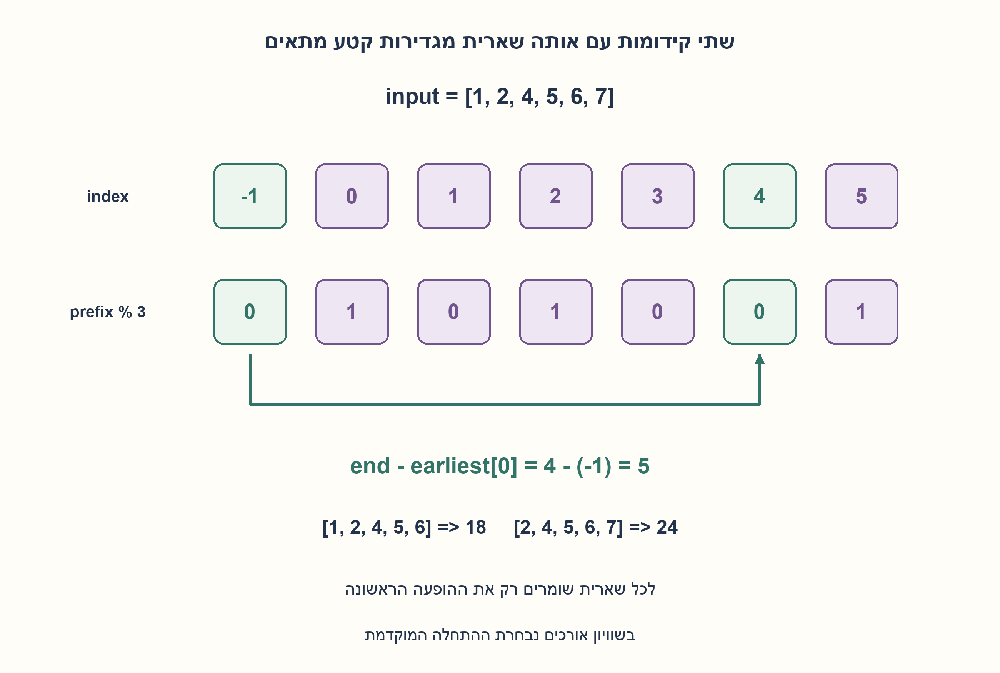
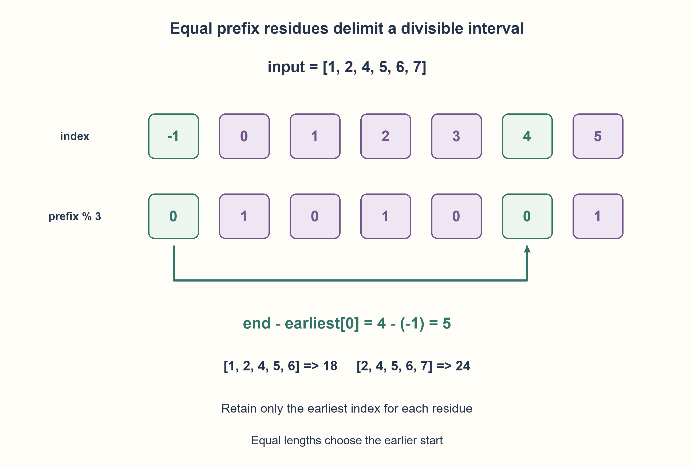

# PREP-163 — הקטע הרציף הארוך שסכומו מתחלק בשלוש

פתרון מוצע בסיוע AI; ביקורת מקצועית אנושית ממתינה.

## מקור פרטי / Private source

יש מערך של N מספרים שלמים וחיוביים, לאו דווקא שונים. מצא את הרצף הארוך ביותר של מספרים שסכומם מתחלק ב־3. לדוגמה 1,2,4,5,6,7: הסכום הוא מ־2 עד 7 או מ־1 עד 6.

[צילום מקור פרטי](../sources/2026-10-30-batch70-21.png)

## נוסח ערוך

נתון מערך שלN שלמים חיוביים, וייתכנו חזרות. מצאו קטע רציף באורך מרבי שסכומו מתחלק ב־ 3. בדוגמה [1,2,4,5,6,7] יש שני קטעים באורך 5: [1,2,4,5,6] ו־[2,4,5,6,7].

הבהרות: החזירו (length, start, end) עם גבולות מאפס, כולל שני הקצוות. בשוויון בוחרים התחלה מוקדמת ואז סוף מוקדם; אין קטע לא ריק מתאים או שקלט ריק מחזירים (0, None, None). אין שינוי בקלט. החוזה הראשי נשאר חיובי; שליליים ואפס מותרים רק בהרחבה המסומנת positive_only=False.

### שלושה רמזים

1. כתבו סכום קטע כהפרש בין שני סכומי קידומות.
2. איזה קשר בין שתי שאריות מודולו 3 מבטיח שההפרש מתחלק בשלוש?
3. שמרו לכל שארית רק את האינדקס הראשון שבו הופיעה. את שארית 0 אתחלו לאינדקס−1 של הקידומת הריקה; כל הופעה חוזרת מציעה קטע ארוך ככל האפשר שמסתיים כעת.

### הצעה לפתרון

### מהפרש סכומים לשוויון שאריות
אם P[j] הוא סכום הקידומת עדj, סכום הקטע i..j הוא P[j]−P[i−1]. הוא מתחלק בשלוש בדיוק כאשר שתי הקידומות באותה שארית. כדי שהקטע המסתיים ב־j יהיה ארוך ככל האפשר נבחר את הקידומת המוקדמת ביותר עם אותה שארית.

נשמור שלושה מיקומים first[0..2], כש־first[0]=−1 מייצג סכום ריק 0 ושתי האחרות לא ידועות. נסרוק משמאל לימין ונעדכן רק שארית מצטברת, בלי לשמור סכומי קידומת שלמים. בפעם הראשונה לשארית נזכור אינדקס; בהופעות הבאות נחשב אורך end−first[r] וגבולות first[r]+1..end. לא נדרוס את ההופעה הראשונה.

בדוגמה שאריות הקידומת הן 1,0,1,0,0,1. שארית 0 באינדקס 4 מול−1 נותנת אורך 5 וגבולות 0..4, שסכומם 18. שארית 1 באינדקס 5 מול 0 נותנת גם 5, סכום 24, אבל תחילתה מאוחרת ולכן אינה מחליפה את התוצאה. זהו אורך מרבי ולא סכום מרבי כמו ב־PREP-072.

אינווריאנט: first מכיל את המיקום הראשון של כל שארית שנראתה. עבור כל סוף, ההופעה הראשונה נותנת את המתחיל המוקדם ולכן את האורך הגדול ביותר; בחינת כל הסופים מוצאת את המקסימום הכולל. אפסים ושליליים עובדים באותה הוכחה אם מנרמלים שאריות לתחום 0..2; זו הרחבה נפרדת לחוזה החיובי.

Θ(N) פעולות במודל מילים ו־O(1) מילות עזר כי המחלק 3 קבוע. אינדקסים צריכים O(log N) ביטים, וערכי קלט גדולים מוסיפים עלות לחישוב שארית. החזרת גבולות נמנעת מהעתקת פרוסה; אם מחזירים גם את הקטע יש לחשב מקום וזמן פלט. נבדקו 21845 מערכים חיוביים ו־ 19531 מערכים בהרחבה החתומה מול סכימה עצמאית של כל הקטעים, כולל גבולות ושוויונות.

```python
"""Longest nonempty contiguous interval with sum divisible by three.

Return (length,start,end), inclusive zero-based bounds. No interval gives
(0,None,None). Equal lengths prefer earliest start, then earliest end.
Source contract is positive integers; an explicit optional extension accepts
all integers with positive_only=False. No full prefix sums are stored.
"""


def longest_mod_three(values, *, positive_only=True):
    earliest = [-1, None, None]
    residue = 0
    best = (0, None, None)
    for end, value in enumerate(values):
        if type(value) is not int or (positive_only and value <= 0):
            raise ValueError("source contract requires positive integers")
        residue = (residue + value) % 3
        if earliest[residue] is None:
            earliest[residue] = end
        else:
            start = earliest[residue] + 1
            length = end - earliest[residue]
            if length > best[0] or (length == best[0] and start < best[1]):
                best = length, start, end
    return best
```




### assumptions

[
  "חיוביים בחוזה המקור; הרחבה חתומה מפורשת.",
  "קטע רציף לא ריק, גבולות כוללניים ותשובת היעדר מוגדרת."
]

### optimality

Θ(N) פעולות מילה, שלושה אינדקסי שארית ו־O(1) מילות עזר; הפלט הוא גבולות.

### edge_cases

[
  "ריק, איבר יחיד, כל הסכום מתחלק 3, כמה קטעים מיטביים.",
  "ללא פתרון לא ריק; שאריות שליליות בהרחבה."
]

### common_mistakes

[
  "לדרוס מיקום מוקדם לשארית.",
  "לשכוח קידומת ריקה ולפספס קטע שמתחיל באפס.",
  "להחזיר תת־קבוצה לא רציפה או למקסם סכום במקום אורך."
]

### interview_answer

שתי קידומות באותה שארית מגדירות קטע שסכומו מתחלק 3. אשמור את המיקום הראשון לכל שארית ואחשב בכל סוף את המרחק אליו, עם שארית 0 באינדקס−1.

### source_ambiguities

רצף פורש כרציף, והפלט ושובר השוויון הוגדרו. לא אותה שאלה כמו מקסימום סכום PREP-072.

### verification

21845 חיוביים ו־ 19531 הרחבות חתומות מול כל קטע אפשרי; דוגמת המקור מחזירה(5,0,4).

### solution_extensions

[
  {
    "question": "ומה אם המחלק הואK כקלט?",
    "direction": "אותו רעיון עם מיקום ראשון לכל שארית, אבל המקום גדל עד O(K) או מספר השאריות שנראו.",
    "principle": "קבוע בשאלה המקורית אינו קבוע בהכללה."
  }
]

## Edited prompt

Given N positive integers, possibly repeated, find a longest contiguous interval whose sum is divisible by 3. For[1,2,4,5,6,7], both[1,2,4,5,6] and[2,4,5,6,7] have length 5.

Return(length, start, end) with zero-based inclusive bounds. Ties prefer earliest start, then end; empty input or no qualifying nonempty interval returns(0, None, None). Do not mutate input. Main contract remains positive; zero/negative values belong only to the explicitly labeled positive_only=False extension.

### Three hints

1. Express an interval sum as a difference of prefix sums.
2. Which relationship between two residues modulo 3 makes their difference divisible?
3. Retain the earliest prefix index per residue. Initialize residue 0 at−1 for the empty prefix; every repeated residue yields the longest interval ending here.

### Proposed solution

### Prefix differences become equal residues
Let P[j] be the prefix sum through j. Interval i..j sums to P[j]−P[i−1], divisible by 3 precisely when those prefixes have the same residue. To maximize length for a fixed end j choose the earliest prefix with that residue.

Keep three first indices, initializing first[0]=−1 for the empty prefix and the others unknown. Scan left-to-right, retaining only the current residue, not full prefix sums. First occurrences set an index; later ones propose length end−first[r] and bounds first[r]+1..end. Never overwrite the earliest occurrence.

Example residues are 1,0,1,0,0,1. Residue 0 at index 4 paired with−1 gives length 5, bounds 0..4, sum 18. Residue 1 at 5 paired with 0 also gives 5, sum 24, but starts later, losing the tie. This maximizes length under divisibility rather than sum as in PREP-072.

Invariant: first records the earliest occurrence of every seen residue. For each end that earliest prefix yields the longest eligible interval; checking all ends finds the global optimum. The proof also handles zero/negatives when residues are normalized to 0..2, a separate extension to the positive source contract.

Θ(N) word operations and O(1) auxiliary words because divisor 3 is fixed. Indices need O(log N) bits and large inputs add remainder-computation costs. Bounds avoid copying an output slice; returning the slice requires accounting for its output time/storage.21,845 positive arrays and 19,531 signed-extension arrays matched independent summation of every interval, including exact boundaries/ties.

```python
"""Longest nonempty contiguous interval with sum divisible by three.

Return (length,start,end), inclusive zero-based bounds. No interval gives
(0,None,None). Equal lengths prefer earliest start, then earliest end.
Source contract is positive integers; an explicit optional extension accepts
all integers with positive_only=False. No full prefix sums are stored.
"""


def longest_mod_three(values, *, positive_only=True):
    earliest = [-1, None, None]
    residue = 0
    best = (0, None, None)
    for end, value in enumerate(values):
        if type(value) is not int or (positive_only and value <= 0):
            raise ValueError("source contract requires positive integers")
        residue = (residue + value) % 3
        if earliest[residue] is None:
            earliest[residue] = end
        else:
            start = earliest[residue] + 1
            length = end - earliest[residue]
            if length > best[0] or (length == best[0] and start < best[1]):
                best = length, start, end
    return best
```




### assumptions

[
  "Positive source input; explicitly separate signed extension.",
  "Nonempty contiguous interval, inclusive bounds and defined absence result."
]

### optimality

Θ(N) word operations, three residue indices/O(1) words; output is bounds.

### edge_cases

[
  "Empty, singleton, divisible whole sum, tied longest intervals.",
  "No nonempty solution; normalized negative residues in the extension."
]

### common_mistakes

[
  "Overwriting earliest residue positions.",
  "Missing the empty prefix and intervals beginning at index 0.",
  "Returning a noncontiguous selection or maximizing sum instead of length."
]

### interview_answer

Equal prefix residues delimit a divisible interval. Save each residue's first index and maximize the distance at every end, with residue 0 initialized at−1.

### source_ambiguities

Sequence is interpreted as contiguous; output/ties are explicit. Different from maximum-sum PREP-072.

### verification

21845 positive and 19531 signed-extension arrays versus every interval; source example returns(5,0,4).

### solution_extensions

[
  {
    "question": "What if divisor K is supplied as input?",
    "direction": "Use earliest indices per residue; storage now grows up to O(K) or the number of residues encountered.",
    "principle": "A source constant is not constant in a generalization."
  }
]
