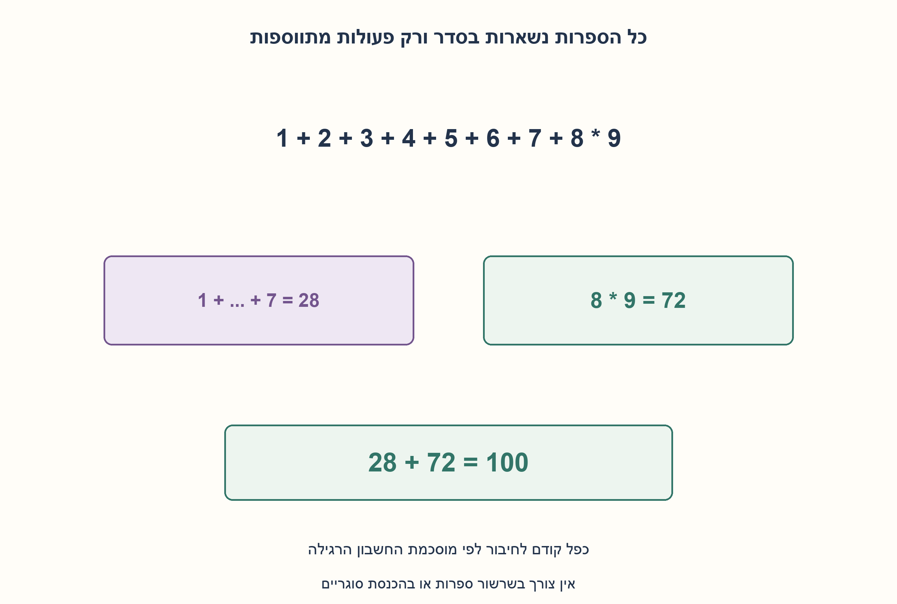
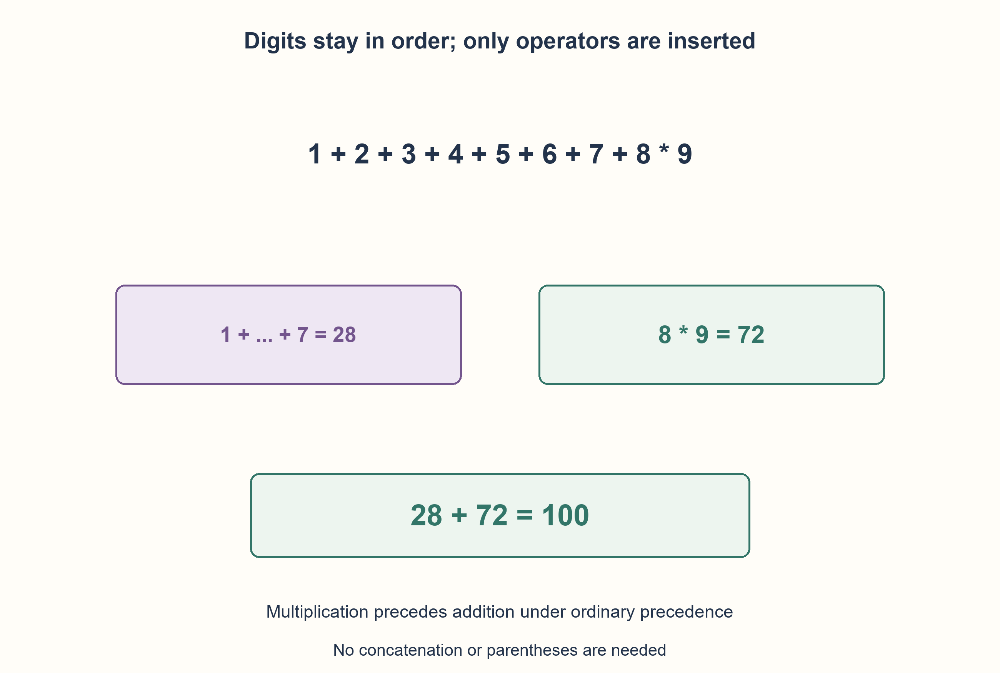

# PREP-164 — מוסיפים פעולות בין 1 עד 9 ומקבלים 100

פתרון מוצע בסיוע AI; ביקורת מקצועית אנושית ממתינה.

## מקור פרטי / Private source

1 2 3 4 5 6 7 8 9 = 100. צריך להוסיף פעולה חשבונית בין המספרים כדי לקבל את התוצאה הנכונה.

[צילום מקור פרטי](../sources/2026-10-30-batch70-23.png)

## נוסח ערוך

נתונות הספרות 1,2,3,4,5,6,7,8,9 בסדר הזה. הוסיפו פעולות חשבון כדי לקבל 100.

הבהרת מודל: מותרות +,−,×,÷ ופעולה אחת בדיוק בכל פער. שומרים על סדר הספרות ומשתמשים בכל אחת פעם אחת; אין צורך בשרשור, סוגריים או סימן חד־מקומי. משתמשים בקדימות חשבון רגילה ובאסוציאטיביות משמאל לפעולות באותה קדימות. מספיק למצוא דוגמה אחת ואין דרישת מינימום פעולות. המקור אינו מפרט את הספרייה, ולכן ההגדרות הן הבהרות ולא טענה שרק הן הותרו.

### שלושה רמזים

1. סכום 1 עד 9 הוא 45. איזו פעולה אחת יכולה להגדיל אותו בכמות מתאימה?
2. שמרו את 1 עד 7 בחיבור ובדקו את התוצאה של 8 כפול 9.
3. 1+...+7 נותן 28, ו־ 8×9 נותן 72. חברו את שני החלקים לפי קדימות הכפל.

### הצעה לפתרון

### דוגמה אחת אינה מחייבת חיפוש מסובך
נשאיר את שבע הספרות הראשונות בחיבור:1+2+3+4+5+6+7=28. במקום 8+9 נשתמש 8×9=72. לפי קדימות הכפל נקבל:

```text
1+2+3+4+5+6+7+8*9 = 28+72 = 100
```

כל ספרה מופיעה פעם אחת, בסדר המקורי, ובכל אחד משמונת הפערים יש פעולה. לא הכנסנו סוגריים או שרשרנו ספרות. זו דוגמה חוקית, לא הוכחת ייחוד או מינימום.

### חיפוש שניתן לבדוק
אפשר גם למנות 4^8=65536 השמות פעולות. המודל מחשב בכוונה ללא eval: הוא צובר מונחי כפל/חילוק לפני חיבור וחיסור. כל מנה היא Fraction מדויק, כך ששוויון ל־ 100 אינו תלוי בעיגול. המכנה בכל צעד חלוקה הוא ספרה 1..9 ולכן אינו אפס בחוזה הזה. תחביר אחר, כגון סוגריים, יחייב מפרש וכללי אפס אחרים.

כל אפשרות בדקדוק המוצהר מופיעה במנייה ולכן חיפוש מלא ימצא פתרון אם קיים; הפונקציה מחזירה את הראשון. במודל זה גודל הבעיה קבוע, אבל הכללה ל־n ספרות דורשת עד 4^(n−1) מועמדים ו־O(n) פעולות הערכה לכל מועמד, לפני עלויות מספרים רציונליים. אין להסיק שזה חיפוש מהיר לקלט לא חסום. נבדקו כל 65536 האפשרויות מול מפרש מחסניות עצמאי עם קדימות, ונמצאו 15 פתרונות בדקדוק המסוים. המספר 15 אינו טענה לכל ספריית פעולות אפשרית.

```python
"""Insert one of +,-,*,/ in each gap, ordinary precedence, exact fractions.

Digits stay in order; no concatenation, parentheses or unary signs needed.
The source does not specify an operator library; this is an explicit contract.
"""
from fractions import Fraction
from itertools import product

DIGITS = tuple(range(1, 10))
OPERATORS = ("+", "-", "*", "/")


def expression_value(operators, digits=DIGITS):
    if not digits or len(operators) != len(digits) - 1 or any(op not in OPERATORS for op in operators):
        raise ValueError("one allowed operator per gap is required")
    total, term, sign = Fraction(0), Fraction(digits[0]), 1
    for operator, value in zip(operators, digits[1:], strict=True):
        if operator in ("+", "-"):
            total += sign * term
            term, sign = Fraction(value), 1 if operator == "+" else -1
        elif operator == "*":
            term *= value
        else:
            term /= value
    return total + sign * term


def format_expression(operators):
    return "1" + "".join(operator + str(value) for operator, value in zip(operators, DIGITS[1:], strict=True))


def first_expression(target=100):
    for operators in product(OPERATORS, repeat=8):
        if expression_value(operators) == target:
            return format_expression(operators)
    return None
```




### assumptions

[
  "ספרות 1..9 בסדר, פעולה אחת מתוך ארבע בכל פער.",
  "קדימות רגילה וחשבונות רציונליים מדויקים; פתרון אחד מספיק."
]

### optimality

הדוגמה מאומתת ישירות; חיפוש כללי עד 4^(n−1) מועמדים עם O(n) פעולות הערכה. אין טענת אופטימליות.

### edge_cases

[
  "חלוקה וקידמות פעולות, כמה פתרונות אפשריים.",
  "שרשור וסוגריים שייכים לחוזה אחר."
]

### common_mistakes

[
  "לחשב משמאל לימין ולהתעלם מכפל קודם.",
  "לשנות סדר ספרות בלי רשות או להשתמש בעיגול לצורך שוויון.",
  "להציג פתרון אחד כיחיד בלי מנייה מתאימה."
]

### interview_answer

1 עד 7 בחיבור נותנים 28 ו־ 8 כפול 9 נותן 72. לכן הביטוי עם שבעה חיבורים וכפל בסוף שווה 100, בלי שינוי ספרות.

### source_ambiguities

ספריית הפעולות והתחביר לא פורטו; נבחר חוזה שבו הדוגמה תקפה בלי שרשור או סוגריים. אין כפילות במאגרים.

### verification

כל 65536 השמות הפעולות מול מפרש מחסניות בלתי תלוי;15 פגיעות תחת החוזה, ללא eval.

### solution_extensions

[
  {
    "question": "איך משתנה החיפוש אם מותר גם להשאיר פער בלי פעולה?",
    "direction": "צריך להגדיר שרשור ספרות ולבנות טוקנים מספריים לפני הערכת קדימות; זה מגדיל את מרחב התחביר.",
    "principle": "מנייה תלויה בדקדוק."
  }
]

## Edited prompt

Keep digits 1,2,3,4,5,6,7,8,9 in this order and insert arithmetic operators to obtain 100.

Explicit model: allow+,-,*,/ with exactly one operator per gap. Use each digit once in order; no concatenation, parentheses or unary signs are needed. Apply ordinary precedence and left associativity within equal precedence. One witness suffices; no minimum-operation requirement. The source omits a library, so these are stated clarifications rather than attributed restrictions.

### Three hints

1. The sum 1 through 9 is 45. Can changing one gap add the needed amount?
2. Keep 1 through 7 added and inspect 8 times 9.
3. 1+...+7 is 28 and 8*9 is 72. Combine them using multiplication precedence.

### Proposed solution

### One witness needs little search
Keep the first seven digits added:1+2+3+4+5+6+7=28. Replace 8+9 by 8*9=72. Ordinary multiplication precedence gives:

```text
1+2+3+4+5+6+7+8*9 = 28+72 = 100
```

Every digit occurs once in order and all eight gaps contain an operator. No parentheses or concatenation. This establishes one valid witness, not uniqueness or minimality.

### A checkable search
Enumerate 4^8=65536 operator assignments if desired. The model deliberately avoids eval, accumulating multiplication/division terms before addition/subtraction. Exact Fraction values make equality independent of floating rounding. Division operands are digits 1..9, never zero in this grammar. Other syntax, including parentheses, requires different parsing/zero rules.

Every assignment in the stated grammar appears, so exhaustive search finds a solution when one exists; the function returns the first. The source instance is fixed size, but n digits generalize to 4^(n−1) candidates and O(n) evaluation operations each, before rational bit costs. This does not imply efficient unbounded search. All 65,536 assignments matched an independent precedence-aware stack parser;15 satisfy the target in this grammar, not necessarily in every possible operator library.

```python
"""Insert one of +,-,*,/ in each gap, ordinary precedence, exact fractions.

Digits stay in order; no concatenation, parentheses or unary signs needed.
The source does not specify an operator library; this is an explicit contract.
"""
from fractions import Fraction
from itertools import product

DIGITS = tuple(range(1, 10))
OPERATORS = ("+", "-", "*", "/")


def expression_value(operators, digits=DIGITS):
    if not digits or len(operators) != len(digits) - 1 or any(op not in OPERATORS for op in operators):
        raise ValueError("one allowed operator per gap is required")
    total, term, sign = Fraction(0), Fraction(digits[0]), 1
    for operator, value in zip(operators, digits[1:], strict=True):
        if operator in ("+", "-"):
            total += sign * term
            term, sign = Fraction(value), 1 if operator == "+" else -1
        elif operator == "*":
            term *= value
        else:
            term /= value
    return total + sign * term


def format_expression(operators):
    return "1" + "".join(operator + str(value) for operator, value in zip(operators, DIGITS[1:], strict=True))


def first_expression(target=100):
    for operators in product(OPERATORS, repeat=8):
        if expression_value(operators) == target:
            return format_expression(operators)
    return None
```




### assumptions

[
  "Digits 1..9 in order, one of four operators per gap.",
  "Ordinary precedence/exact rational arithmetic; one witness suffices."
]

### optimality

Witness verified directly; generalized search has up to 4^(n−1) candidates/O(n) evaluation operations each. No optimality claim.

### edge_cases

[
  "Division/precedence and multiple solutions.",
  "Concatenation/parentheses belong to another contract."
]

### common_mistakes

[
  "Ignoring multiplication precedence.",
  "Reordering digits or using rounded equality.",
  "Claiming uniqueness from one witness."
]

### interview_answer

Add 1 through 7 for 28 and multiply 8 by 9 for 72. Their sum is 100 without changing the digits.

### source_ambiguities

Operators/syntax are unspecified; choose an explicit grammar validating a witness without concatenation/parentheses. No bank duplicate.

### verification

All 65536 assignments versus an independent stack parser;15 hits under the grammar, no eval.

### solution_extensions

[
  {
    "question": "What if a gap may contain no operator?",
    "direction": "Define digit concatenation and tokenize numbers before precedence evaluation, enlarging the grammar.",
    "principle": "Enumeration depends on syntax."
  }
]
