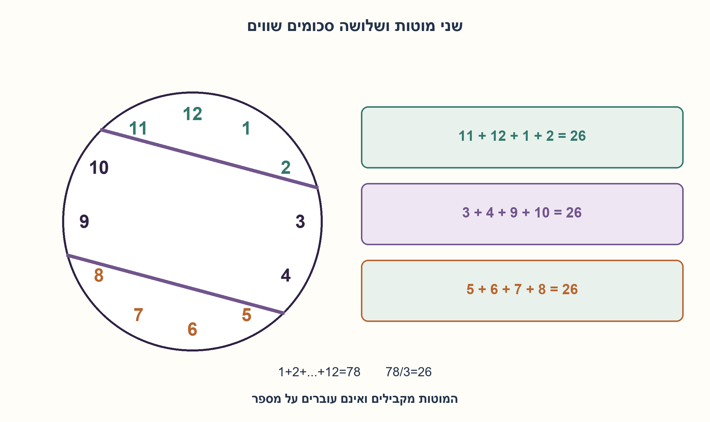
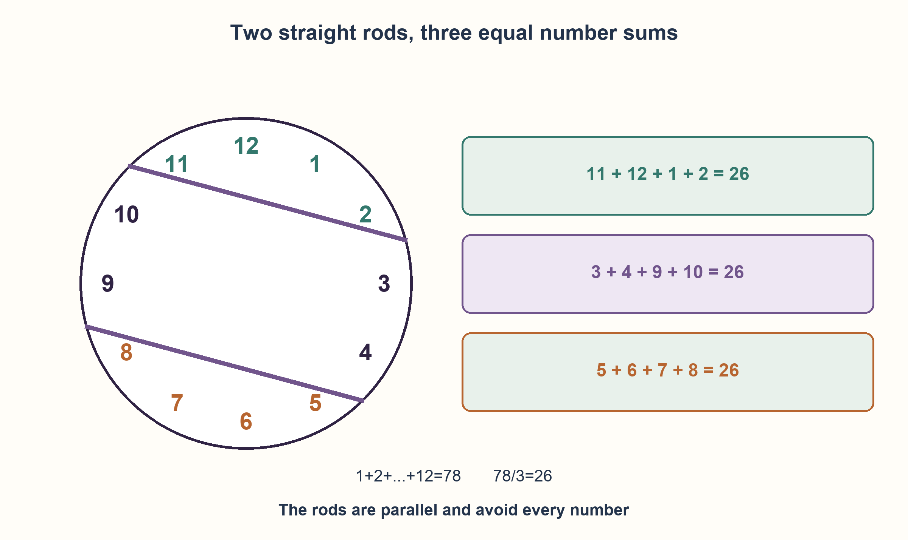

# PREP-165 — מחלקים שעון לשלושה סכומים שווים בשני מוטות

פתרון מוצע בסיוע AI; ביקורת אנושית ממתינה. הקושי לא כויל.

[צילום מקור פרטי](../sources/2026-10-30-batch70-08.png)

נתון לוח עגול של שעון עם המספרים 1 עד 12 וכן שני מוטות. יש להניח את 2 המוטות על לוח השעון כך שייווצרו 3 שטחים שסכום כל המספרים בכל אחד מהשטחים זהה.

## עברית

מחלקים שעון לשלושה סכומים שווים בשני מוטות

בלוח שעון עגול מופיעים המספרים 1 עד 12 במקומותיהם הרגילים. הניחו שני מוטות ישרים כך שיחלקו את הלוח לשלושה אזורים, ובכל אזור סכום המספרים יהיה זהה. תארו או שרטטו את המיקום והוכיחו שהוא עומד בדרישה.

הבהרות: המוטות מיוצגים כקווים ישרים דקים החוצים את הלוח ואינם עוברים על מספר. אזור מתייחס לאחד משלושת חלקי הלוח לאחר החיתוך. נדרש שוויון בסכומי המספרים, ואין דרישה לשוויון בשטח הגאומטרי.

1. מה סכום כל המספרים ומה חייב להיות הסכום בכל אזור?
2. שני קווים מקבילים יכולים ליצור שתי כיפות ורצועה באמצע. חפשו שתי קבוצות עוקבות סביב ההיקף עם סכום המטרה.
3. בודדו בקצה אחד את 11,12,1,2 ובקצה הנגדי את 5,6,7,8. בדקו אילו מספרים נשארים ברצועה שביניהם.

### סכום המטרה הוא 26
סכום 1 עד 12 הוא 78, ולכן כל אזור צריך להכיל סכום 26. נבודד כיפה שמכילה את 11,12,1,2: סכומם 26. בקצה הנגדי נבודד את 5,6,7,8, שגם סכומם 26. ברצועה האמצעית יישארו 3,4,9,10 וסכומם 26.

```text
cap A: 11+12+1+2 = 26
middle: 3+4+9+10 = 26
cap B: 5+6+7+8 = 26
```

### היכן המוטות עוברים?
המוט הראשון עובר בין 10 ל־11 בצד אחד ובין 2 ל־3 בצד השני. השני עובר בין 8 ל־9 ובין 4 ל־5. אפשר לבחור אותם מקבילים, כך שייווצרו בדיוק שלושה חלקים. שתי קבוצות הקצה הן רציפות סביב ההיקף;המספרים שבימין ובשמאל שייכים לאותה רצועה אמצעית מחוברת.

לבנייה מדויקת, ננרמל את רדיוס סימוני השעות לאחד. נבחר וקטור יחידה u שכיוונו 15 מעלות בכיוון השעון מהשעה 12, ונעביר קווים u·p=1/2 ו־u·p=−1/2. הם מקבילים ואינם נפגשים בתוך הלוח. התוויות נכנסות לקבוצות שפורטו ואף אחת אינה על קו. זהו הסבר גאומטרי לקיומם של המוטות, לא רק חלוקת המספרים לשלוש קבוצות שרירותיות.

הבדיקה מוודאת שכל 12 התוויות מופיעות בדיוק פעם אחת, כל סכום 26, וסיווג הנקודות נשמר ב־360 סיבובים משותפים של הלוח והקווים. הבדיקה הנומרית משלימה את הבנייה הזוויתית ואינה ניסוי פיזי במוטות.

```python
"""Two parallel ideal chords split ordinary clock marks into sums of26."""

from math import cos, pi


def partition_clock():
    groups = {"upper_cap": [], "middle": [], "lower_cap": []}
    # Normal direction is fifteen degrees clockwise from12. Chords are
    # u dot p=+1/2 and-1/2 on a unit disk, so they do not intersect inside.
    for label in range(1, 13):
        projection = cos(label * pi / 6 - pi / 12)
        region = (
            "upper_cap"
            if projection > 0.5
            else "lower_cap"
            if projection < -0.5
            else "middle"
        )
        groups[region].append(label)
    return {key: tuple(value) for key, value in groups.items()}
```




## English

Two rods divide a clock into three equal number sums

An ordinary circular clock has labels 1 through 12 in their standard positions. Place two straight rods so they divide the face into three regions with equal sums of labels. Describe or draw the placement and justify it.

Clarifications: rods are ideal thin straight cuts through the face, avoiding the labels. Regions are the three resulting pieces. Equal label sums are required; equal geometric areas are not specified.

1. What is the total of all labels, and therefore the required sum per region?
2. Parallel cuts form two caps and a middle strip. Find consecutive circular groups matching the target.
3. Separate 11,12,1,2 at one end and 5,6,7,8 at the opposite end. Check the middle labels.

### The target sum is 26
Labels 1 through 12 sum to 78, so every region needs 26. One cap contains 11,12,1,2, whose sum is 26. The opposite cap contains 5,6,7,8, also 26. The remaining middle strip contains 3,4,9,10, again 26.

```text
cap A: 11+12+1+2 = 26
middle: 3+4+9+10 = 26
cap B: 5+6+7+8 = 26
```

### Where do the rods cross the face?
The first passes between 10/11 on one side and 2/3 on the other. The second passes between 8/9 and 4/5. They can be parallel, giving exactly three pieces. Each cap contains a contiguous circular group;the labels at left and right belong to the same connected middle strip.

For an exact construction, normalize the hour-mark radius to one. Let unit normal u point 15 degrees clockwise from 12, and use lines u·p=1/2 and u·p=−1/2. They are parallel, do not meet inside the face, and put each label in the stated region without hitting a label. This proves geometric realizability rather than merely partitioning numbers into arbitrary sets.

Checks ensure all 12 labels occur exactly once, the three sums are 26, and classification survives 360 common rotations of points and cuts. Numerical rotation checks supplement the angular construction;they are not a physical rod experiment.

```python
"""Two parallel ideal chords split ordinary clock marks into sums of26."""

from math import cos, pi


def partition_clock():
    groups = {"upper_cap": [], "middle": [], "lower_cap": []}
    # Normal direction is fifteen degrees clockwise from12. Chords are
    # u dot p=+1/2 and-1/2 on a unit disk, so they do not intersect inside.
    for label in range(1, 13):
        projection = cos(label * pi / 6 - pi / 12)
        region = (
            "upper_cap"
            if projection > 0.5
            else "lower_cap"
            if projection < -0.5
            else "middle"
        )
        groups[region].append(label)
    return {key: tuple(value) for key, value in groups.items()}
```




## חומר משלים / Supporting material

```json
{
  "assumptions": {
    "he": [
      "שעות במיקומי שעון רגיל סביב מעגל; כל תווית נספרת פעם אחת.",
      "שני מוטות ישרים דקים, אפשר מקבילים, ללא כיסוי מספרים."
    ],
    "en": [
      "Standard equally spaced clock labels;each label counted once.",
      "Two thin straight rods may be parallel and avoid every label."
    ]
  },
  "optimality": {
    "he": "בנייה קבועה ללוח בן 12 מספרים. אין טענת יחידות של הפתרון או שוויון שטחי האזורים. שני חיתוכים מקבילים יוצרים שלושה חלקים.",
    "en": "A fixed construction for 12 labels. No uniqueness or equal-area claim. Two parallel cuts produce three pieces."
  },
  "verification": {
    "he": "נבדקו חלוקה של 12 תוויות, שלושה סכומי 26 ו־4,320 בדיקות מכפלה סקלרית ב־360 סיבובים. הבנייה הגאומטרית היא ההוכחה, והחישוב משתמש ב־floating point עם מרווח גדול מהגבולות.",
    "en": "Checked 12 partitioned labels, three sums of 26, and 4,320 dot products over 360 rotations. Geometry supplies the proof; floating-point checks have a substantial boundary gap."
  },
  "edge_cases": {
    "he": [
      "12 ו־1 סמוכים סביב ההיקף אף שסדרם המספרי נשבר.",
      "שני מוטות מצטלבים בתוך המעגל היו יוצרים בדרך כלל ארבעה אזורים.",
      "אין להניח שהרצועה מכילה רק מספרים רציפים בסדר הרגיל."
    ],
    "en": [
      "12 and 1 are circular neighbors despite numeric wraparound.",
      "Intersecting cuts inside the circle generally create four regions.",
      "The middle strip need not contain one numerically consecutive label interval."
    ]
  },
  "common_mistakes": {
    "he": [
      "לחלק לסכומים נכונים בלי להראות שקווים ישרים מייצרים את הקבוצות.",
      "לכפות שטחים גאומטריים שווים.",
      "להעביר מוט על מספר בלי להחליט לאיזה אזור הוא שייך."
    ],
    "en": [
      "Giving equal-sum sets without realizing them with straight cuts.",
      "Imposing equal geometric areas.",
      "Passing a cut through a label without defining ownership."
    ]
  },
  "interview_answer": {
    "he": "כל אזור צריך 26. אבודד 11,12,1,2 ובקצה הנגדי 5,6,7,8 באמצעות שני מוטות מקבילים. ברצועה נשארים 3,4,9,10. שלושת הסכומים 26 וכל מספר מופיע פעם אחת.",
    "en": "Each region needs 26. Parallel rods separate 11,12,1,2 and the opposite 5,6,7,8;the middle retains 3,4,9,10. All three sums are 26 and every label occurs once."
  },
  "source_ambiguities": {
    "he": [
      "רוחב המוטות ומיקום מדויק בתוך הרווחים לא נמסרו;נעשה שימוש בקווים אידאליים.",
      "שיוך Apple מדווח בצילום ולא אומת עצמאית."
    ],
    "en": [
      "Rod thickness and exact gap positions are unspecified;ideal lines are used.",
      "Apple attribution is source-reported, not independently verified."
    ]
  },
  "solution_extensions": {
    "he": [
      {
        "question": "למה שתי קבוצות הקצה חייבות להיות רציפות סביב המעגל?",
        "answer_direction": "קו ישר חותך מעגל בשתי נקודות ולכן כיפה אוספת קשת רציפה אחת. הרצועה בין שני קווים יכולה לאסוף שתי קשתות נפרדות.",
        "principle": "האילוץ הגאומטרי מצמצם את חלוקות המספרים האפשריות."
      }
    ],
    "en": [
      {
        "question": "Why are cap labels contiguous around the circle?",
        "answer_direction": "A straight cut meets a circle twice and bounds one contiguous arc;the middle strip may meet two separate arcs.",
        "principle": "Geometric realizability restricts numeric partitions."
      }
    ]
  }
}
```
