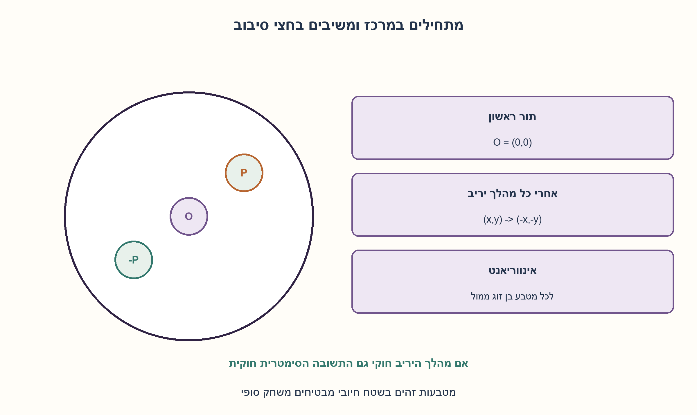
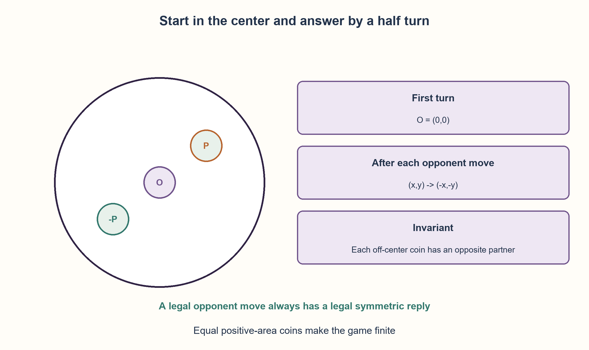

# PREP-166 — משחק מטבעות על שולחן עגול — סימטריה מנצחת

פתרון מוצע בסיוע AI; ביקורת אנושית ממתינה. הקושי לא כויל.

[צילום מקור פרטי](../sources/2026-10-30-batch70-10.png)

שני אנשים יושבים אחד מול השני כשבאמצע שולחן עגול. לכל אחד מספר בלתי מוגבל של מטבעות עגולים. כל אחד בתורו מניח מטבע על השולחן. מותר להניח איפה שרוצים, אבל לא על מטבעות אחרים שכבר נמצאים על השולחן. השחקן הראשון שלא יכול יותר לשים מטבעות מפסיד. תאר שיטה לניצחון בטוח.

## עברית

משחק מטבעות על שולחן עגול — סימטריה מנצחת

שני שחקנים מניחים בתורות מטבע עגול על שולחן עגול. אסור לחפוף למטבעות שכבר הונחו;השחקן הראשון שאין לו מהלך חוקי מפסיד. מצאו אסטרטגיה שמבטיחה ניצחון, וציינו למי היא זמינה.

הבהרות עריכה: לכל המטבעות אותו רדיוס חיובי, הם מונחים שטוח ובשלמותם על שולחן סופי, אין הזזה או ערימה, ולפחות מטבע אחד מתאים לשולחן. מגע משיק מותר אך חפיפת פנים אסורה. מניחים גאומטריה ומיקום אידאליים;אין הסתמכות על כישלון ידני של היריב. גדלים שווים אינם מפורשים בצילום ולכן זו הנחה מהותית.

1. לשולחן עגול יש סימטריה סביב המרכז. האם השחקן הראשון יכול ליצור מצב שנשמר אחרי זוג מהלכים?
2. נסו מטבע ראשון במרכז, ואז לכל מהלך יריב להגיב בנקודה שמולו ביחס למרכז.
3. הוכיחו שההעתק בחצי סיבוב גם נשאר על השולחן וגם אינו חופף למטבע ישן או למטבע היריב שזה עתה הונח. המטבע המרכזי חשוב דווקא לחלק האחרון.

### הראשון תופס את המרכז
הראשון מניח מטבע במרכז השולחן. אחר כך, אם היריב מניח מטבע שמרכזו p=(x, y), הראשון מניח מטבע שמרכזו −p=(−x,−y). הוא אינו מזיז את מטבע היריב;זו הנחה של מטבע חדש במקום הסימטרי.

אחרי כל תגובה, קבוצת המטבעות סימטרית תחת סיבוב 180 מעלות:המרכז נשאר במקומו וכל מטבע אחר מופיע עם בן זוג מולו. זהו האינווריאנט.

### למה התגובה תמיד חוקית?
השולחן העגול נשמר בסיבוב, לכן אם מטבע היריב כולו בפנים גם ההעתק שלו בפנים. לפני המהלך השולחן תפוס באופן סימטרי. אם מקום ההעתק היה חופף למטבע ישן, סיבוב אותו מטבע ישן היה מראה שגם מהלך היריב חופף למטבע ישן, בניגוד לחוקיותו.

נשאר לבדוק שההעתק אינו חופף למטבע היריב החדש עצמו. נסמן רדיוס מטבע ב־r. מטבע היריב אינו חופף למטבע המרכזי, לכן |p|≥2r. המרחק בין p לבין−p הוא 2|p|≥4r, יותר מהמרחק 2r הדרוש לאי־חפיפה. לכן התגובה חוקית גם מול המטבע החדש.

### מדוע זו הבטחת ניצחון ולא רק כלל נוח?
כל עוד השני מצליח להניח מטבע, לראשון קיימת תגובה. המשחק סופי:אם רדיוס השולחן R, מטבעות שאינם חופפים ותופסים שטח חיובי מקיימים K·πr²≤πR², ולכן מספרם חסום. מישהו חייב להיתקע, וזה אינו הראשון בתור תגובה. לכן השני הוא הראשון שלא יוכל לשחק.

האסטרטגיה אינה מבטיחה ניצחון לשחקן שנכפה עליו לשחק שני. היא גם אינה מוכיחה מספר מהלכים מזערי או אריזה מרבית של מטבעות. קוד הבדיקה משתמש ברשתות סופיות ובחשבון רציונלי כדי לבדוק חוקיות;סיום המהלכים ברשת אינו הוכחה שאין מהלך במישור הרציף. ההוכחה הרציפה היא הסימטריה וחסם השטח.

```python
"""Exact rational disk legality and a center/half-turn response strategy."""

from fractions import Fraction


def legal_center(point, placed, table_radius, coin_radius):
    x, y = map(Fraction, point)
    big, small = Fraction(table_radius), Fraction(coin_radius)
    if big <= 0 or small <= 0:
        raise ValueError("positive radii required")
    if small > big or x * x + y * y > (big - small) ** 2:
        return False
    return all((x - a) ** 2 + (y - b) ** 2 >= (2 * small) ** 2 for a, b in placed)


def reflected_response(point):
    return -point[0], -point[1]


def initial_move(table_radius, coin_radius):
    if not legal_center((0, 0), (), table_radius, coin_radius):
        raise ValueError("at least one coin must fit")
    return Fraction(0), Fraction(0)
```




## English

A winning symmetry strategy for circular-table coins

Players alternately place round coins on a circular table without overlapping coins already placed. The first unable to move loses. Give a guaranteed winning strategy and identify which player can use it.

Editorial assumptions: all coins have the same positive radius, lie flat and wholly on a finite table, and cannot be moved or stacked. At least one fits. Tangency is allowed but interior overlap is not. Placement is ideal;the strategy does not rely on opponent clumsiness. Equal size is not explicit in the screenshot and is an essential assumption.

1. Can the first player create a center symmetry restored after each pair of moves?
2. Try the first coin at the center, then reply to each opponent at the half-turn image of their position.
3. Show that the reflected coin stays on the table and avoids old coins and the newly placed opponent coin. The central coin matters for the last part.

### The first player claims the center
Place the first coin at the table center. Whenever the opponent places a coin centered at p=(x, y), reply with a new coin centered at−p=(−x,−y). The opponent coin is not moved.

After each reply the occupied set is invariant under a180-degree turn:the central coin stays fixed and every other coin has its opposite partner. This is the invariant.

### Why is the response always legal?
The circular table is preserved by the rotation, so the reflected coin remains wholly inside. Before the opponent move, the old occupied set is symmetric. If the reply overlapped an old coin, rotating that old coin would show that the opponent move also overlapped an old coin, contradicting legality.

The reply must also avoid the newly placed opponent coin. Let coin radius be r. The opponent avoided the central coin, so |p|≥2r. The centers p and−p are 2|p|≥4r apart, more than the 2r separation needed to avoid overlap. The response is therefore legal against the new coin too.

### Why does this guarantee a win?
Every legal second-player move has a legal first-player reply. The game is finite:for table radius R, nonoverlapping positive-area coins satisfy K·πr²≤πR², so the number of placed coins is bounded. Someone must run out of moves;it cannot be the first player while replying. Thus the second player is first unable to move.

This does not guarantee a win to someone forced to play second, nor minimize game length or solve maximum circle packing. Exact-rational test grids check legality;running out of grid points does not establish exhaustion of the continuous board. The continuous proof is symmetry plus the area bound.

```python
"""Exact rational disk legality and a center/half-turn response strategy."""

from fractions import Fraction


def legal_center(point, placed, table_radius, coin_radius):
    x, y = map(Fraction, point)
    big, small = Fraction(table_radius), Fraction(coin_radius)
    if big <= 0 or small <= 0:
        raise ValueError("positive radii required")
    if small > big or x * x + y * y > (big - small) ** 2:
        return False
    return all((x - a) ** 2 + (y - b) ** 2 >= (2 * small) ** 2 for a, b in placed)


def reflected_response(point):
    return -point[0], -point[1]


def initial_move(table_radius, coin_radius):
    if not legal_center((0, 0), (), table_radius, coin_radius):
        raise ValueError("at least one coin must fit")
    return Fraction(0), Fraction(0)
```




## חומר משלים / Supporting material

```json
{
  "assumptions": {
    "he": [
      "מטבעות זהים ברדיוס חיובי, שולחן עגול סופי ומטבע ראשון מתאים.",
      "אין חפיפה, ערימה, הזזה או הבלטה מעבר לשולחן;תורות ומיקומים אידאליים."
    ],
    "en": [
      "Identical positive-radius coins, a finite circular table, and a first coin fits.",
      "No overlap, stacking, moving or overhang;ideal alternating placement."
    ]
  },
  "optimality": {
    "he": "הבטחת ניצחון לראשון, לא מינימום מטבעות. חישוב נקודת התגובה הוא היפוך שני סימנים;בדיקת חוקיות מול K מטבעות בקוד עולה O(K). חסם השטח מוכיח סיום אך אינו חסם אריזה הדוק.",
    "en": "Winning guarantee for the first player, not a minimum coin count. Response coordinates require two sign changes;checking legality against K coins in code takes O(K). The area bound proves termination, not optimal packing."
  },
  "verification": {
    "he": "24 תגובות ראשונות ו־240 תגובות שניות על רשתות מדויקות, ועוד 100 משחקי רשת מדגמיים עם 262 זוגות תגובה חוקיים. לא נטען שנבדקו כל המיקומים הרציפים או סיום פיזי.",
    "en": "24 first replies and 240 second replies on exact grids, plus 100 seeded grid games with 262 legal response pairs. Neither all continuous placements nor a physical game was enumerated."
  },
  "edge_cases": {
    "he": [
      "אם אף מטבע אינו מתאים, הנחת הפתיחה אינה מתקיימת.",
      "אם רק מטבע אחד מתאים, הראשון מנצח מייד לאחר הנחתו.",
      "גדלי מטבעות שונים או שולחן שאינו סימטרי עשויים לשבור את ההעתק."
    ],
    "en": [
      "If no coin fits, the opening assumption fails.",
      "If only one fits, the center opening immediately wins.",
      "Different coin sizes or an asymmetric table may invalidate reflected replies."
    ]
  },
  "common_mistakes": {
    "he": [
      "להציע שיקוף בלי להציב מטבע מרכזי ובלי לבדוק חפיפה עם המהלך החדש.",
      "להסיק שהשני מנצח רק מפני שיש לו אפשרות לחקות.",
      "להתייחס לניסוי רשת כאילו כיסה כל נקודה במישור."
    ],
    "en": [
      "Proposing reflection without the central coin or checking the new opponent coin.",
      "Claiming the second player wins merely by copying.",
      "Treating finite-grid trials as coverage of every continuous position."
    ]
  },
  "interview_answer": {
    "he": "אבחר לשחק ראשון ואניח במרכז. לכל מטבע יריב אגיב בסיבוב 180 מעלות סביב המרכז. הסימטריה שומרת חוקיות מול הישנים, והמטבע המרכזי מונע חפיפה בין זוג המהלכים החדשים. המשחק סופי ולכן השני ייתקע ראשון.",
    "en": "Play first and place at center. Reply to every opponent coin by a180-degree turn. Symmetry avoids old coins, and the center coin keeps the new pair apart. The game is finite, so the second player runs out first."
  },
  "source_ambiguities": {
    "he": [
      "שוויון גדלים, הנחה מלאה על השולחן ותורות לא פורטו במלואם בצילום.",
      "המקור אינו מעניק ניצחון לשחקן השני;האסטרטגיה בוחרת ראשון.",
      "שיוכי Rafael/NVIDIA מדווחים בלבד."
    ],
    "en": [
      "Equal sizes, whole-table placement and exact turn rules are editorial clarifications.",
      "The winning strategy requires playing first, not a guaranteed second-player win.",
      "Rafael/NVIDIA attributions are source-reported only."
    ]
  },
  "solution_extensions": {
    "he": [
      {
        "question": "האם שולחן אליפטי משנה את הרעיון?",
        "answer_direction": "גם אליפסה נשמרת בחצי סיבוב. אם אותו מטבע מרכזי מתאים וכללי ההנחה זהים, הוכחת ההעתק ממשיכה;צורה ללא סימטריה מרכזית דורשת ניתוח אחר.",
        "principle": "מזהים איזו סימטריה, ולא איזה שם צורה, נחוצה להוכחה."
      }
    ],
    "en": [
      {
        "question": "Does an elliptical table change the idea?",
        "answer_direction": "An ellipse is also half-turn invariant. With a fitting central coin and the same rules, the proof continues;an asymmetric domain needs another analysis.",
        "principle": "Identify the required symmetry rather than relying on the shape name."
      }
    ]
  }
}
```


## מקור נוסף — 31.10.2026, מקבץ110

[צילום מקור פרטי 4](../sources/2026-10-31-batch21-04.png)

יש שולחן עגול. לכל שחקן יש אינסוף דסקיות. המטרה להניח דסקיות כך שלשחקן האחר אין אפשרות להניח דסקית. בכל תור שחקן מניח דסקית על השולחן. בחר אסטרטגיה שבה אתה בטוח מנצח.

שיוכי מקור מדווחים: NVIDIA.

מקור נוסף בלבד; הגרסה, הנוסח, הרמזים והפתרון נשמרו.
