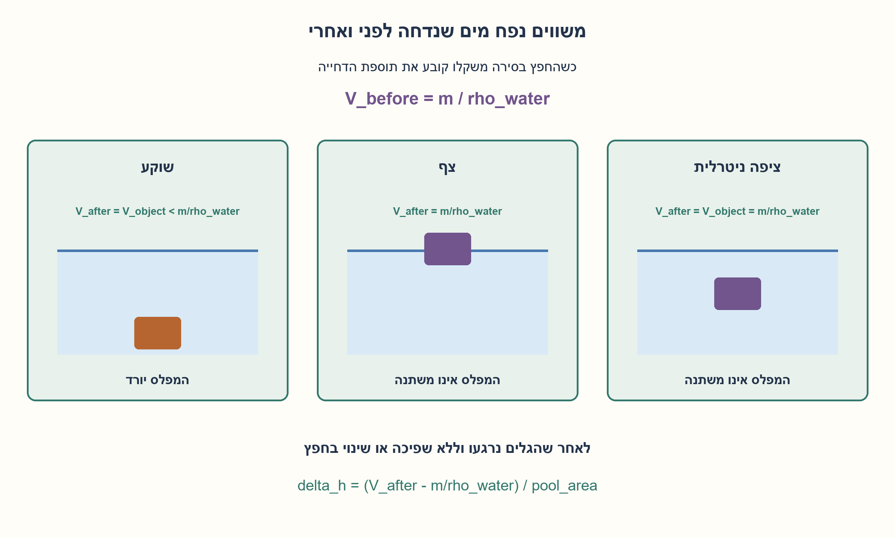
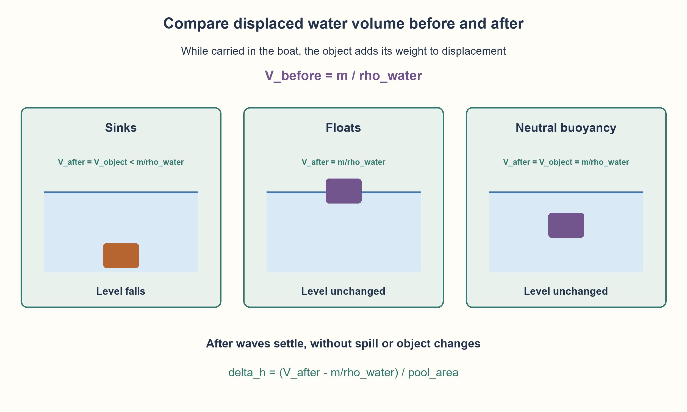

# PREP-167 — חפץ מהסירה למים — משקל, נפח וצפיפות

פתרון מוצע בסיוע AI; ביקורת אנושית ממתינה. הקושי לא כויל.

[צילום מקור פרטי](../sources/2026-10-30-batch70-16.png)

אדם נמצא בסירה בבריכה/ים וזורק חפץ כלשהו מהסירה למים. האם מפלס המים יעלה או ירד? הסבר.

## עברית

חפץ מהסירה למים — משקל, נפח וצפיפות

אדם בסירה זורק חפץ למים. האם מפלס המים עולה, יורד או נשאר? הסבירו אילו נתונים חסרים, והשוו חפץ שוקע, חפץ צף וחפץ שצפיפותו שווה לצפיפות המים.

לניתוח המוצע נבחר בריכה סגורה, סירה שצפה לפני ואחרי וחפץ מוצק שאינו מתמוסס, סופג או משנה נפח. אין שפיכה או תמיכה חיצונית, ומשווים מפלס לאחר רגיעת הגלים. המקור מזכיר גם ים;אין להסיק ממודל הבריכה שינוי מפלס גלובלי מדיד בים פתוח.

1. לפני הזריקה, מה קובע כמה מים הסירה דוחה בגלל החפץ?
2. אחרי הזריקה הסירה קלה יותר, אבל גם החפץ דוחה מים. צריך להשוות את שתי התרומות יחד.
3. כשהחפץ שוקע הדחייה שלו היא V;כשהוא צף הדחייה נקבעת מהשוויון בין משקלו למשקל המים שנדחו. השוו ל־m/ρמים שהיה קודם.

### לפני הזריקה החפץ כבר משפיע על המפלס
סירה צפה דוחה מים שמשקלם שווה למשקל הכולל שהיא נושאת. לכן חפץ שמסתו m גורם לתוספת נפח דחייה m/ρמים, בלי קשר לנפח החפץ כשהוא יבש בתוך הסירה. זה נובע מעקרון ארכימדס ומאזן כוחות לציפה;ראו [מקור OpenStax](https://openstax.org/books/university-physics-volume-1/pages/14-4-archimedes-principle-and-buoyancy).

אחרי הזריקה הסירה מאבדת את אותה תוספת דחייה. השאלה היא איזה נפח החפץ עצמו דוחה במקומה.

| החפץ | דחיית החפץ במים | שינוי מפלס במודל |
| --- | --- | --- |
| צפוף מהמים ושוקע | V=m/ρחפץ, קטן מ־m/ρמים | יורד |
| קל מהמים וצף חופשי | m/ρמים | ללא שינוי |
| צפיפות שווה למים | V=m/ρמים | ללא שינוי |

בחפץ שוקע, חלק ממשקלו נתמך בסופו של דבר בתחתית ולכן אינו דורש דחיית מים במשקל כל החפץ. בחפץ צף, המים עדיין נושאים את כל משקלו, במקום דרך הסירה. אין טעם לספור את נפח החפץ החדש בלי לזכור שהסירה התרוממה.

בבריכה בעלת חתך קבוע A:

```text
delta_h = (displacement_after - m/rho_water) / A
```

לדוגמה, מסה 2 ק״ג ונפח 0.001 מ״ק במים שצפיפותם 1000 ק״ג למ״ק:לפני הזריקה התוספת היא 0.002 מ״ק, אחריה 0.001 מ״ק. עבור A=1 מ״ר המפלס יורד 0.001 מטר, כלומר 1 מ״מ. אלה נתוני המחשה, לא נתוני הצילום.

הנוסח חפץ כלשהו אינו מספיק לתשובה גורפת. חפץ סופג, מתמוסס, נפתח או מוחזק בכוח יכול לשנות את המאזן. גם גלים בזמן הזריקה אינם המפלס הסטטי שניתחנו.

```python
"""Settled water-displacement balance for an inert unforced object."""

from fractions import Fraction


def displacement_change(mass, object_volume, water_density, pool_area=1):
    mass, volume, density, area = map(
        Fraction, (mass, object_volume, water_density, pool_area)
    )
    if min(mass, volume, density, area) <= 0:
        raise ValueError("positive mass, volume, water density and pool area required")
    before = mass / density  # Additional displacement while carried by the boat.
    object_density = mass / volume
    state = (
        "sinks"
        if object_density > density
        else "floats"
        if object_density < density
        else "neutral"
    )
    after = volume if state == "sinks" else mass / density
    return {
        "object_density": object_density,
        "state": state,
        "before": before,
        "after": after,
        "volume_change": after - before,
        "level_change": (after - before) / area,
    }
```




## English

From boat to water:weight, volume and density

A person in a boat throws an object into the water. Does water level rise, fall or stay? Identify missing information and compare sinking, floating and neutrally buoyant objects.

For the proposed analysis use a closed pool, a boat floating before/after, and a solid object that does not dissolve, absorb or change volume. No spill or external support;compare after waves settle. The source also mentions the sea;this basin model does not establish a measurable global open-ocean level change.

1. Before throwing, what determines the extra water displaced by the loaded boat?
2. Afterward the boat is lighter, but the object also displaces water. Account for both changes.
3. A sinking object displaces V;a floating object displaces water whose weight equals its own. Compare this with the earlier m/rho_water.

### The object already affects level before it is thrown
A floating boat displaces water whose weight balances its total carried weight. An object of mass m therefore adds displacement m/rho_water, regardless of its dry volume inside the boat. This follows from buoyancy and force balance;see [OpenStax](https://openstax.org/books/university-physics-volume-1/pages/14-4-archimedes-principle-and-buoyancy).

After throwing, the boat loses that displacement contribution. The question is what displacement the object itself replaces it with.

| Object | Object displacement in water | Settled level change |
| --- | --- | --- |
| Denser than water, sinks | V=m/rho_object, less than m/rho_water | Falls |
| Less dense, floats freely | m/rho_water | Unchanged |
| Equal density | V=m/rho_water | Unchanged |

A sinking object eventually has part of its weight supported by the bottom, so its weight need not all be supported by displaced water. A floating object still has all its weight supported by water, directly instead of through the boat. Counting new object volume without the boat rising omits half the balance.

For constant pool cross-section A:

```text
delta_h = (displacement_after - m/rho_water) / A
```

For example, a2 kg object of volume 0.001m³ in water of density 1000 kg/m³ contributes 0.002m³ before throwing and 0.001m³ afterward. At A=1m² the level drops 0.001m, or 1 mm. These illustrate the model;they were not source data.

An unspecified object does not justify one universal answer. Absorbing, dissolving, flooding or externally forced objects can change the balance. Splash waves are also different from the static level analyzed here.

```python
"""Settled water-displacement balance for an inert unforced object."""

from fractions import Fraction


def displacement_change(mass, object_volume, water_density, pool_area=1):
    mass, volume, density, area = map(
        Fraction, (mass, object_volume, water_density, pool_area)
    )
    if min(mass, volume, density, area) <= 0:
        raise ValueError("positive mass, volume, water density and pool area required")
    before = mass / density  # Additional displacement while carried by the boat.
    object_density = mass / volume
    state = (
        "sinks"
        if object_density > density
        else "floats"
        if object_density < density
        else "neutral"
    )
    after = volume if state == "sinks" else mass / density
    return {
        "object_density": object_density,
        "state": state,
        "before": before,
        "after": after,
        "volume_change": after - before,
        "level_change": (after - before) / area,
    }
```




## חומר משלים / Supporting material

```json
{
  "assumptions": {
    "he": [
      "סירה ואדם נשארים צפים לפני ואחרי;מסתם לא משתנה.",
      "חפץ מוצק אינרטי בעל מסה ונפח קבועים, ללא התמוססות, ספיגה או הצפה של חלל.",
      "בריכה סגורה ללא שפיכה, תמיכה חיצונית או שינוי כמות מים;משווים אחרי התייצבות.",
      "לנוסחת שינוי גובה נבחר שטח חתך קבוע A."
    ],
    "en": [
      "Boat/person remain floating with unchanged own mass.",
      "An inert solid object has fixed mass/volume and no dissolution, absorption or flooding.",
      "Closed pool, no spill, external support or water change;compare settled levels.",
      "A constant pool cross-section A is used for the level formula."
    ]
  },
  "optimality": {
    "he": "חישוב במספר קבוע של פעולות אריתמטיות. אין טענה למפלס ים מדיד, לתנועת גלים או למודל לכל חפץ אפשרי.",
    "en": "Constant-number arithmetic balance. No measurable open-ocean change, wave-motion or arbitrary-object model is claimed."
  },
  "verification": {
    "he": "180 מאזני מסה/נפח רציונליים של המערכת כולה, עם חפץ שוקע, צף וניטרלי. דוגמה צפופה נותנת ירידה של 1 מ״מ עבור שטח 1 מ״ר. לא נערך ניסוי מים או חפץ פיזי.",
    "en": "180 exact whole-system mass/displacement cases spanning sinking, floating and neutral objects. A dense example gives a1 mm drop for 1m² area. No physical water experiment."
  },
  "edge_cases": {
    "he": [
      "צפיפות שווה למים נותנת ללא שינוי, גם כשהחפץ שקוע כולו.",
      "שחרור גל זמני אינו מפלס שיווי המשקל.",
      "חפץ חלול שנפתח או סופג משנה את המודל.",
      "בבריכה שגולשת כמות המים אינה נשמרת לפי ההנחות."
    ],
    "en": [
      "Equal density leaves the level unchanged even when fully immersed.",
      "A transient splash is not the equilibrium level.",
      "A flooding hollow or absorbent object changes the model.",
      "An overflowing pool does not conserve water under these assumptions."
    ]
  },
  "common_mistakes": {
    "he": [
      "לומר שכל חפץ שנכנס למים מעלה את המפלס בלי להפחית את עומס הסירה.",
      "להשוות רק נפח חפץ במקום דחייה לפי משקלו כשהיה בסירה.",
      "להחיל תוצאת אבן שוקעת על חפץ שצף."
    ],
    "en": [
      "Counting only the newly immersed object and ignoring the unloaded boat.",
      "Using object volume rather than weight-based displacement while carried.",
      "Applying the sinking-stone result to a floating object."
    ]
  },
  "interview_answer": {
    "he": "בסירה החפץ גורם לדחיית m/ρמים. אם הוא שוקע, הוא דוחה במים רק את נפחו V, הקטן יותר, ולכן המפלס יורד. אם הוא צף או ניטרלי, הוא עדיין דוחה m/ρמים והמפלס נשאר. בלי נתוני החפץ אין תשובה יחידה של עולה או יורד.",
    "en": "While carried, the object adds m/rho_water displacement. A sinking object then displaces only its smaller volume V, so the level falls. A floating or neutral object still displaces m/rho_water, so it stays unchanged. Without object assumptions there is no single up/down answer."
  },
  "source_ambiguities": {
    "he": [
      "המקור אינו נותן צפיפות, סוג חפץ, בריכה סגורה או זמן התצפית.",
      "ים פתוח וחפץ שמשנה מסה/נפח דורשים מודל אחר;הפתרון מותנה במאזן בריכה מוגדר.",
      "שיוך Intel מדווח בלבד."
    ],
    "en": [
      "Density, object type, closed-basin conditions and observation time are absent.",
      "Open ocean or mass/volume-changing objects need another model;the result is conditional on a defined pool balance.",
      "Intel attribution is source-reported only."
    ]
  },
  "solution_extensions": {
    "he": [
      {
        "question": "מה אם חפץ קל מוחזק כולו מתחת למים באמצעות תמיכה מחוץ לסירה?",
        "answer_direction": "אז הוא דוחה V גדול מ־m/ρמים והמפלס יכול לעלות. יש להגדיר מי מספק כוח:אם התמיכה שייכת לסירה, יש לכלול את תגובת הכוח במאזן שלה.",
        "principle": "כוחות חיצוניים ושיוך המערכת משנים את מאזן הציפה."
      }
    ],
    "en": [
      {
        "question": "What if a light object is held fully underwater by support external to the boat?",
        "answer_direction": "Then it displaces V greater than m/rho_water and level can rise. Specify the force source;if it is attached to the boat, include the reaction force in that boat balance.",
        "principle": "External forces and system boundaries affect buoyancy accounting."
      }
    ]
  },
  "technical_references": {
    "he": [
      {
        "title": "OpenStax — עקרון ארכימדס וציפה",
        "url": "https://openstax.org/books/university-physics-volume-1/pages/14-4-archimedes-principle-and-buoyancy"
      }
    ],
    "en": [
      {
        "title": "OpenStax — Archimedes principle and buoyancy",
        "url": "https://openstax.org/books/university-physics-volume-1/pages/14-4-archimedes-principle-and-buoyancy"
      }
    ]
  }
}
```
