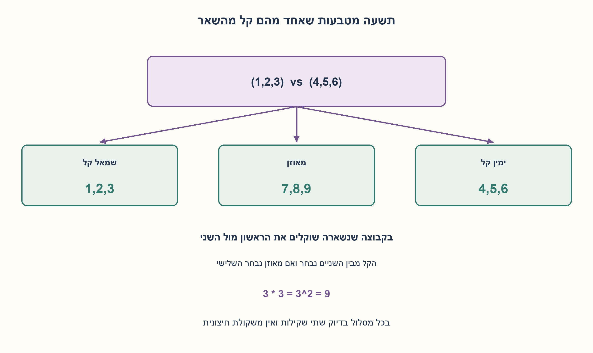
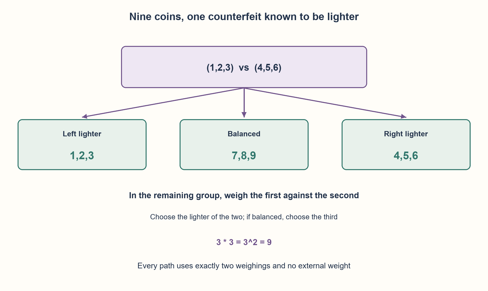

# PREP-168 — תשעה מטבעות ומטבע קל אחד — שתי שקילות

פתרון מוצע בסיוע AI; ביקורת אנושית ממתינה. הקושי לא כויל.

[צילום מקור פרטי](../sources/2026-10-30-batch70-17.png)

יש 9 מטבעות, אחת קלה יותר. מצא ב־2 שקילות במאזניים את המטבע הקלה.

## עברית

תשעה מטבעות ומטבע קל אחד — שתי שקילות

יש תשעה מטבעות שנראים זהים. בדיוק אחד קל יותר, ושמונת האחרים שווי משקל. מצאו את המטבע הקל בשתי שקילות במאזני שתי כפות. ציינו מה שוקלים בכל תוצאה ולמה שקילה אחת אינה מספיקה.

המאזניים מדויקים, המשקלים קבועים, אין משקולת חיצונית ידועה, ומותר לסמן מטבעות. ידוע מראש שהחריג קל ולא כבד;זה שונה מגרסת 12 המטבעות ב־PREP-049.

1. לכל שקילה שלוש תוצאות. האם אפשר לפצל את תשעת החשודים לשלוש קבוצות שוות?
2. שקלו שלושה מול שלושה. איזו קבוצה נשארת חשודה כשיש איזון, ואיזו כשהכפות שונות?
3. מתוך שלושת החשודים שנותרו שקלו אחד מול אחד. אם יש איזון, השלישי הוא הקל;אחרת בוחרים את הקל מבין הנשקלים.

### השקילה הראשונה מצמצמת מתשעה לשלושה
מסמנים 1..9 ושוקלים 1,2,3 מול 4,5,6.

| תוצאה | שלושת החשודים |
| --- | --- |
| הכף של 1,2,3 קלה יותר | 1,2,3 |
| הכף של 4,5,6 קלה יותר | 4,5,6 |
| איזון | 7,8,9 |

אם כף קלה יותר, החריג נמצא דווקא בה כי כל שאר המטבעות שווי משקל וידוע שהחריג קל. אם יש איזון, שש המטבעות הנשקלים תקינים ולכן החריג בשלישייה שלא נשקלה.

### השקילה השנייה בוחרת אחד מהשלושה
נסמן את שלושת החשודים a, b, c ושוקלים a מול b. אם a קל יותר זו התשובה;אם b קל יותר זו התשובה;ואם הם שווים, החריג c. בכל מסלול מבוצעות בדיוק שתי שקילות, ללא צורך במשקולת חיצונית.

### למה שתי שקילות הן מינימום?
יש תשעה מצבים אפשריים, לפי זהות המטבע הקל. שקילה אחת נותנת רק שלוש תוצאות, ולכן אינה יכולה להבחין בוודאות בין כל התשעה. שתי שקילות מאפשרות לכל היותר 3²=9 רצפי תוצאות, והבנייה נותנת בפועל תשעה רצפים שונים. כך מושג חסם המידע במודל המאזניים הזה.

הקוד מקבל פונקציית שקילה בלבד. הוא אינו מקבל את המשקלים או את מיקום המטבע החריג;הבודק לבדו יוצר אותם ומחזיר תוצאה. כל תשעת המיקומים נבדקו בתשעה משטרי משקל, עם בדיוק שתי קריאות בכל מקרה.

```python
"""Two adaptive balance queries; no weights or true counterfeit index given."""


def find_lighter(weigh):
    """weigh(left,right): -1 left lighter,0 equal,+1 right lighter."""
    first = weigh((0, 1, 2), (3, 4, 5))
    if type(first) is not int or first not in (-1, 0, 1):
        raise ValueError("invalid balance outcome")
    group = (0, 1, 2) if first == -1 else (3, 4, 5) if first == 1 else (6, 7, 8)
    second = weigh((group[0],), (group[1],))
    if type(second) is not int or second not in (-1, 0, 1):
        raise ValueError("invalid balance outcome")
    return group[0] if second == -1 else group[1] if second == 1 else group[2]
```




## English

Nine coins and one known-lighter counterfeit:two weighings

Nine coins look identical. Exactly one is lighter;the other eight have equal weight. Identify the lighter coin using two two-pan balance weighings. Give every outcome branch and explain why one weighing cannot suffice.

The balance is exact, weights are fixed, no external known weight is provided, and labels are allowed. Lighter is known in advance, unlike the heavier-or-lighter twelve-coin question PREP-049.

1. Each weighing has three outcomes. Split nine suspects into three equal groups.
2. Weigh three against three. Which group remains after balance, or after an unequal result?
3. From the three survivors, weigh one against one. Balance identifies the third;otherwise the lighter pan identifies the coin.

### The first weighing reduces nine suspects to three
Label coins 1..9 and weigh 1,2,3 against 4,5,6.

| Outcome | Remaining suspects |
| --- | --- |
| Pan 1,2,3 lighter | 1,2,3 |
| Pan 4,5,6 lighter | 4,5,6 |
| Balanced | 7,8,9 |

An unequal result puts the counterfeit on the lighter pan because all genuine coins weigh the same and the counterfeit is known lighter. Balance proves the six weighed coins genuine, leaving the unweighed group.

### The second weighing selects one of three
Call the survivors a, b, c and weigh a against b. If a is lighter, choose a;if b is lighter, choose b;if balanced, choose c. Every branch uses exactly two weighings without an external known weight.

### Why are two minimal?
There are nine possible identities. One weighing has only three outcomes and cannot distinguish all nine with certainty. Two weighings have at most 3²=9 outcome sequences, and the construction realizes nine distinct sequences. It reaches the information bound for this balance model.

The code receives only a weighing callback, not weights or the true counterfeit index. Only the verifier creates those hidden facts and supplies outcomes. All nine positions were checked under nine weight regimes, with exactly two calls in every case.

```python
"""Two adaptive balance queries; no weights or true counterfeit index given."""


def find_lighter(weigh):
    """weigh(left,right): -1 left lighter,0 equal,+1 right lighter."""
    first = weigh((0, 1, 2), (3, 4, 5))
    if type(first) is not int or first not in (-1, 0, 1):
        raise ValueError("invalid balance outcome")
    group = (0, 1, 2) if first == -1 else (3, 4, 5) if first == 1 else (6, 7, 8)
    second = weigh((group[0],), (group[1],))
    if type(second) is not int or second not in (-1, 0, 1):
        raise ValueError("invalid balance outcome")
    return group[0] if second == -1 else group[1] if second == 1 else group[2]
```




## חומר משלים / Supporting material

```json
{
  "assumptions": {
    "he": [
      "בדיוק מטבע אחד קל יותר, והגודל והצורה אינם מזהים אותו.",
      "שמונת התקינים שווי משקל, שלוש תוצאות שקילה מדויקות, ללא רעש.",
      "מותר לבחור שקילה שנייה לפי הראשונה."
    ],
    "en": [
      "Exactly one lighter coin with no visual identifying feature.",
      "Eight genuine coins have equal weight;three exact balance outcomes without noise.",
      "The second weighing may depend on the first."
    ]
  },
  "optimality": {
    "he": "שתי שקילות מספיקות ונחוצות:9 אפשרויות,3 תוצאות לשקילה. זהו מינימום שאילתות מאזניים, לא מינימום תנועות יד או זמן פיזי.",
    "en": "Two balance queries are sufficient and necessary:9 possibilities and 3 outcomes per query. This is a query minimum, not a minimum of handling actions or physical time."
  },
  "verification": {
    "he": "כל 9 המיקומים, בתשעה שילובי משקל ויחס בכל מיקום:81 מקרים. בכל אחד שתי שקילות בגודל 3 מול 3 ואז 1 מול 1;כל 9 מסלולי התוצאה שונים.",
    "en": "All 9 positions under 9 genuine/counterfeit weight combinations:81 cases. Each uses 3-versus 3 then 1-versus 1;all 9 outcome paths are distinct."
  },
  "edge_cases": {
    "he": [
      "איזון בשתי השקילות מזהה את המטבע השלישי בשלישייה 7,8,9.",
      "גם הפרש משקל קטן כרצוננו מתאים למאזניים האידאליים.",
      "אם לא ידוע כיוון הסטייה, תשעה מצבים הופכים ל־18 וההוכחה אינה חלה."
    ],
    "en": [
      "Two balanced outcomes identify the third member of 7,8,9.",
      "Arbitrarily small nonzero differences work only under the ideal exact balance.",
      "Unknown heavier/lighter direction creates 18 states and invalidates this two-query bound."
    ]
  },
  "common_mistakes": {
    "he": [
      "לבחור את הכף הכבדה למרות שידוע שהחריג קל.",
      "להתעלם מהשלישייה שלא נשקלה במקרה איזון.",
      "להשתמש במשקל אמיתי או בזהות החריג בתוך האלגוריתם."
    ],
    "en": [
      "Choosing the heavier pan despite known-lighter direction.",
      "Ignoring the unweighed group on balance.",
      "Giving the algorithm hidden weights or the counterfeit identity."
    ]
  },
  "interview_answer": {
    "he": "אשקול 3 מול 3. הכף הקלה היא קבוצת החשודים, ובאיזון אלו 3 האחרים. אחר כך 1 מול 1 מתוכם:הקל או השלישי באיזון.3² תוצאות מאפשרות 9 זהויות ושקילה אחת אינה מספיקה.",
    "en": "Weigh 3 against 3;the lighter pan remains, or the unweighed three if balanced. Then 1 against 1 identifies the lighter or the third on balance.3² paths distinguish 9 identities;one query cannot."
  },
  "source_ambiguities": {
    "he": [
      "המקור אינו מפרט דיוק מאזניים ומשקלים שווים לתקינים;אלה הנחות הכרחיות שהוצהרו.",
      "תגיות המקור המספריות אינן ייחוס חברה."
    ],
    "en": [
      "Exact outcomes and equal genuine weights are explicit necessary assumptions.",
      "Numeric source tags are not employer attributions."
    ]
  },
  "solution_extensions": {
    "he": [
      {
        "question": "מה משתנה אם המטבע עשוי להיות גם כבד?",
        "answer_direction": "צריך להבחין בין 18 מצבים. שתי שקילות מאפשרות לכל היותר 9 תוצאות משותפות, לכן אינן מספיקות.",
        "principle": "סופרים את מצב התקלה יחד עם זהות הרכיב."
      }
    ],
    "en": [
      {
        "question": "What if the counterfeit may also be heavier?",
        "answer_direction": "There are 18 identity/direction states but at most 9 two-query paths, so two cannot suffice.",
        "principle": "Count fault direction as well as identity."
      }
    ]
  }
}
```
