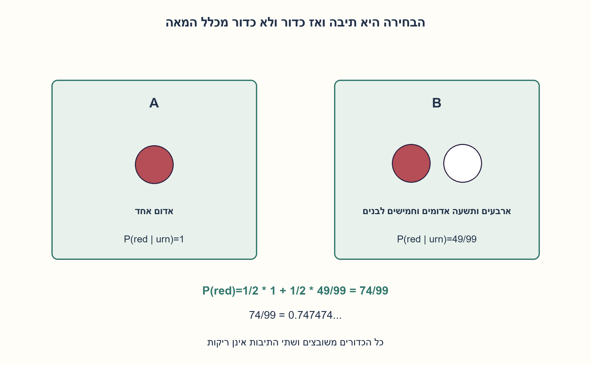
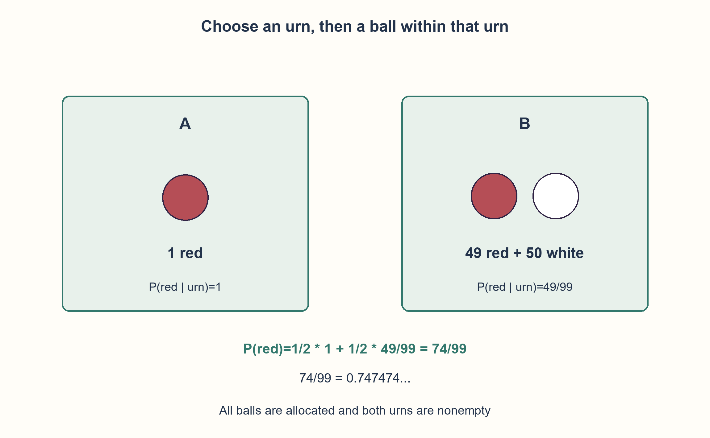

# PREP-169 — שתי תיבות, מאה כדורים ומקסימום סיכוי לאדום

פתרון מוצע בסיוע AI; ביקורת אנושית ממתינה. הקושי לא כויל.

[צילום מקור פרטי](../sources/2026-10-30-batch70-19.png)

יש לסדר 50 כדורים לבנים ו־50 כדורים אדומים בשתי תיבות כך שההסתברות לבחור כדור אדום תהיה מקסימלית, כאשר גם התיבה וגם הכדור נבחרים באקראי.

## עברית

שתי תיבות, מאה כדורים ומקסימום סיכוי לאדום

חלקו 50 כדורים אדומים ו־50 לבנים לשתי תיבות כדי למקסם את ההסתברות להוציא אדום. תחילה בוחרים תיבה באקראי ואז כדור מתוכה. הציגו חלוקה והוכיחו שאין טובה ממנה.

הבהרות: בוחרים כל תיבה בהסתברות 1/2, ואז כל כדור בתיבה שנבחרה בהסתברות שווה. כל 100 הכדורים משובצים, ושתי התיבות אינן ריקות. מותר למתכנן להבחין בצבעים בזמן החלוקה;אין סינון או החלפה אחרי הבחירה.

1. האם כל כדור מתוך המאה מקבל אותה הסתברות כשבוחרים קודם תיבה?
2. תיבה קטנה יכולה לקבל חצי מההסתברות הכוללת. מה קורה אם משאירים בה כדור אדום יחיד?
3. הניחו שהתיבה הקטנה מכילה m כדורים, כאשר m≤50. הראו שלכל m עדיף שכולם אדומים, ואז השוו בין ערכי m.

### החלוקה
בתיבה אחת שמים אדום אחד בלבד. בשנייה שמים 49 אדומים ו־50 לבנים. ההסתברות לאדום היא:

```text
P = (1/2)*1 + (1/2)*(49/99) = 74/99 ≈ 0.747474...
```

זה גדול מחצי מפני שהכדור היחיד בתיבה הראשונה מקבל הסתברות 1/2 לבדו. הבחירה הדו־שלבית אינה בחירה אחידה בין כל 100 הכדורים.

### הוכחת מקסימום לכל החלוקות
אפשר להחליף שמות תיבות, לכן נסמן את גודל הקטנה ב־m, בתחום 1..50. אם בה r אדומים, בשנייה 50−r אדומים ו־100−m כדורים. אז:

```text
P(m,r) = (1/2)*(r/m + (50-r)/(100-m))
```

המקדם של r הוא(1/2)(1/m−1/(100−m)), שאינו שלילי כש־m≤50. לכן עבור גודל קבוע עדיף לקחת את r הגדול האפשרי. אפשר למלא את כל m הכדורים באדום כי m≤50. אם m=50 המקדם אפס וכל חלוקה בגודל זה נותנת 1/2, שאינה המקסימום שנמצא.

לכן נשאר לבדוק:

```text
P(m) = (1/2)*(1 + (50-m)/(100-m))
P(m)-P(m+1) = 25/((100-m)*(99-m)) > 0
```

ל־1≤m<50 ההסתברות יורדת עם m. המקסימום הוא m=1, כלומר אדום יחיד בתיבה קטנה. החלפת שמות התיבות נותנת אותה אסטרטגיה. ההוכחה מכסה את כל החלוקות החוקיות;המנייה המלאה בקוד מאמתת בנוסף את כל 2,599 החלוקות ומוצאת בדיוק את שתי החלוקות הסימטריות האופטימליות.

```python
"""Uniform urn then uniform ball; all fifty red/fifty white balls allocated."""

from fractions import Fraction


def red_probability(red_first, white_first):
    if any(type(x) is not int or not 0 <= x <= 50 for x in (red_first, white_first)):
        raise ValueError("each allocation count must lie in0..50")
    first = red_first + white_first
    second = 100 - first
    if first == 0 or second == 0:
        raise ValueError("both urns must be nonempty")
    return (Fraction(red_first, first) + Fraction(50 - red_first, second)) / 2


def best_allocations():
    optimum, choices = Fraction(-1), []
    for red in range(51):
        for white in range(51):
            if red + white in (0, 100):
                continue
            value = red_probability(red, white)
            if value > optimum:
                optimum, choices = value, [(red, white)]
            elif value == optimum:
                choices.append((red, white))
    return optimum, tuple(choices)
```




## English

Two urns, one hundred balls and the best red probability

Distribute 50 red and 50 white balls between two urns to maximize the probability of drawing red. An urn is chosen first, then a ball within it. Give a distribution and prove optimality.

Clarifications: each nonempty urn is selected with probability 1/2, and balls within the selected urn are equiprobable. Allocate all 100 balls, keeping both urns nonempty. The allocator can see colors;no filtering or reassignment occurs after selection.

1. Are all 100 balls equally likely when the urn is selected first?
2. A small urn receives half the total probability. What happens if it contains a single red ball?
3. Let the smaller urn have m≤50 balls. For a fixed m, show it is best to make them all red, then compare different m.

### Distribution
Put one red ball alone in one urn. Put 49 red and 50 white in the other. Then:

```text
P = (1/2)*1 + (1/2)*(49/99) = 74/99 ≈ 0.747474...
```

The singleton red receives probability 1/2 by itself. Two-stage urn-first sampling is not uniform sampling among all 100 balls.

### Global optimality proof
Swap urn names if needed, so the smaller urn has m in 1..50 balls. If r of them are red, the other has 50−r red among 100−m balls:

```text
P(m,r) = (1/2)*(r/m + (50-r)/(100-m))
```

The coefficient of r is(1/2)(1/m−1/(100−m)), nonnegative for m≤50. For fixed m, maximize r;making all m balls red is feasible because m≤50. At m=50 the coefficient is zero and every such split gives 1/2, below our candidate optimum.

It remains to optimize:

```text
P(m) = (1/2)*(1 + (50-m)/(100-m))
P(m)-P(m+1) = 25/((100-m)*(99-m)) > 0
```

For 1≤m<50 the probability strictly decreases with m. The optimum is m=1, a single red ball in the smaller urn. Renaming urns gives the symmetric optimum. The argument covers every legal distribution;complete enumeration additionally checks all 2,599 allocations and finds exactly the two symmetric maximizers.

```python
"""Uniform urn then uniform ball; all fifty red/fifty white balls allocated."""

from fractions import Fraction


def red_probability(red_first, white_first):
    if any(type(x) is not int or not 0 <= x <= 50 for x in (red_first, white_first)):
        raise ValueError("each allocation count must lie in0..50")
    first = red_first + white_first
    second = 100 - first
    if first == 0 or second == 0:
        raise ValueError("both urns must be nonempty")
    return (Fraction(red_first, first) + Fraction(50 - red_first, second)) / 2


def best_allocations():
    optimum, choices = Fraction(-1), []
    for red in range(51):
        for white in range(51):
            if red + white in (0, 100):
                continue
            value = red_probability(red, white)
            if value > optimum:
                optimum, choices = value, [(red, white)]
            elif value == optimum:
                choices.append((red, white))
    return optimum, tuple(choices)
```




## חומר משלים / Supporting material

```json
{
  "assumptions": {
    "he": [
      "תיבה נבחרת אחיד ואז כדור אחיד מתוכה.",
      "כל 50 האדומים וכל 50 הלבנים משובצים;שתי התיבות לא ריקות.",
      "המתכנן רואה צבעים לפני החלוקה;הבחירה המאוחרת אקראית."
    ],
    "en": [
      "Uniform urn choice followed by uniform within-urn choice.",
      "All 50 red and 50 white balls allocated;both urns nonempty.",
      "Colors are visible to the allocator before the later random selection."
    ]
  },
  "optimality": {
    "he": "74/99 הוא מקסימום ההסתברות תחת מודל הדגימה המוצהר. המנייה בקוד סופית בת 2,599 חלוקות;הוכחת המקסימום נפרדת ואינה מסקנה ממדגם אקראי.",
    "en": "74/99 is globally maximal under the declared sampling model. Code enumerates 2599 finite allocations;the proof is separate from random experimentation."
  },
  "verification": {
    "he": "כל 2,599 החלוקות הלא־ריקות נבדקו מול סכימת הסתברויות של תוצאות כדור בודדות. אומתו מקסימום 74/99, סימטריה ושתי חלוקות אופטימליות בלבד.",
    "en": "All 2599 nonempty allocations were compared with an independent atomic-ball probability sum. Verified 74/99, symmetry, and exactly two optimal allocations."
  },
  "edge_cases": {
    "he": [
      "תיבה ריקה אינה תוצאה חוקית של המודל.",
      "שתי תיבות בגודל 50 נותנות סיכוי 1/2 בלי קשר לפיצול האדומים.",
      "בחירת כדור אחידה מכל 100 נותנת תמיד 1/2, אך זה ניסוי אחר."
    ],
    "en": [
      "An empty urn is outside the model.",
      "Two 50-ball urns give probability 1/2 regardless of red split.",
      "Uniform choice among all 100 gives 1/2, but is a different experiment."
    ]
  },
  "common_mistakes": {
    "he": [
      "למצע כמויות אדומים בלי לחלק בגודל כל תיבה.",
      "להניח שכל כדור מקבל הסתברות 1/100.",
      "להציג חלוקה טובה בלי להוכיח מקסימום."
    ],
    "en": [
      "Averaging red counts without urn-size denominators.",
      "Assigning probability 1/100 to every ball.",
      "Giving a good candidate without proving optimality."
    ]
  },
  "interview_answer": {
    "he": "אדום יחיד בתיבה אחת וכל 99 האחרים בשנייה נותנים 74/99. להוכחה, בתיבה הקטנה גודל m≤50 ולכל m עדיף למלא אותה באדומים. הביטוי שנותר יורד עם m ולכן m=1 אופטימלי.",
    "en": "One red alone and all other 99 balls together gives 74/99. For proof, the smaller urn has m≤50 and for fixed m should be all red. The resulting expression decreases with m, so m=1 is optimal."
  },
  "source_ambiguities": {
    "he": [
      "בחירה אקראית פורשה כאחידה בשני השלבים;בלי הסתברויות תיבה הבעיה חסרה.",
      "המקור אינו מציין כמות חובה בכל תיבה;הוגדרה אי־ריקנות בלבד.",
      "שיוך Applied Materials מדווח בלבד."
    ],
    "en": [
      "Random means uniform at both stages;unspecified urn probabilities otherwise leave a gap.",
      "No per-urn quota is supplied;only nonemptiness is imposed.",
      "Applied Materials attribution is source-reported only."
    ]
  },
  "solution_extensions": {
    "he": [
      {
        "question": "מה הסיכוי אם מחלקים 50 ו־50 בכל מקרה?",
        "answer_direction": "אם בכל תיבה 50 כדורים, כל כדור מקבל 1/2·1/50=1/100 ולכן הסיכוי לאדום 1/2 לכל חלוקה.",
        "principle": "סדר בחירה וגדלי הקבוצות קובעים את הסתברויות הפריטים."
      }
    ],
    "en": [
      {
        "question": "What if each urn must contain exactly 50 balls?",
        "answer_direction": "Every ball then gets 1/2·1/50=1/100, so total red probability is 1/2 for every split.",
        "principle": "Selection order and group sizes determine item probabilities."
      }
    ]
  }
}
```
