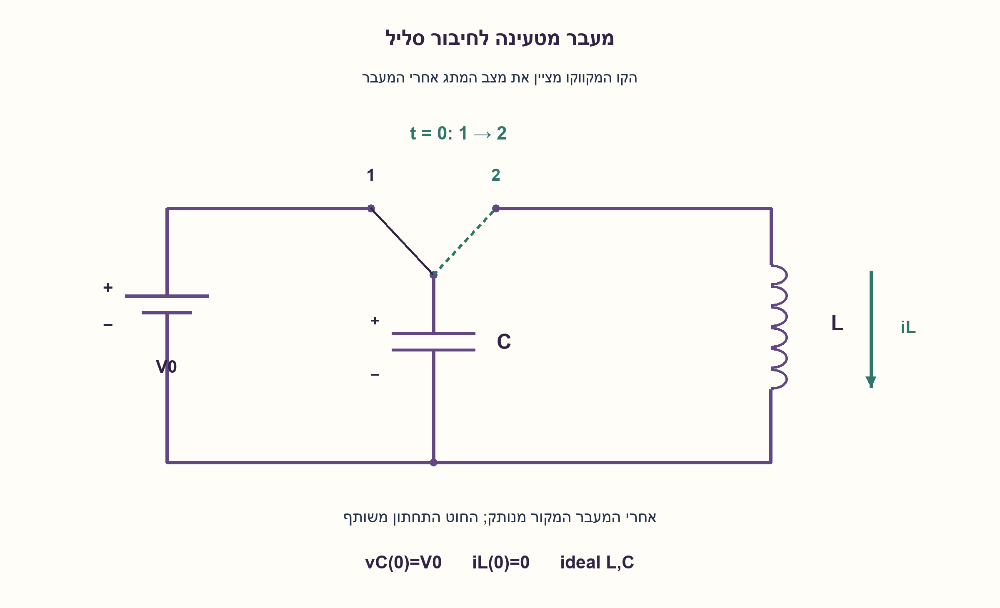
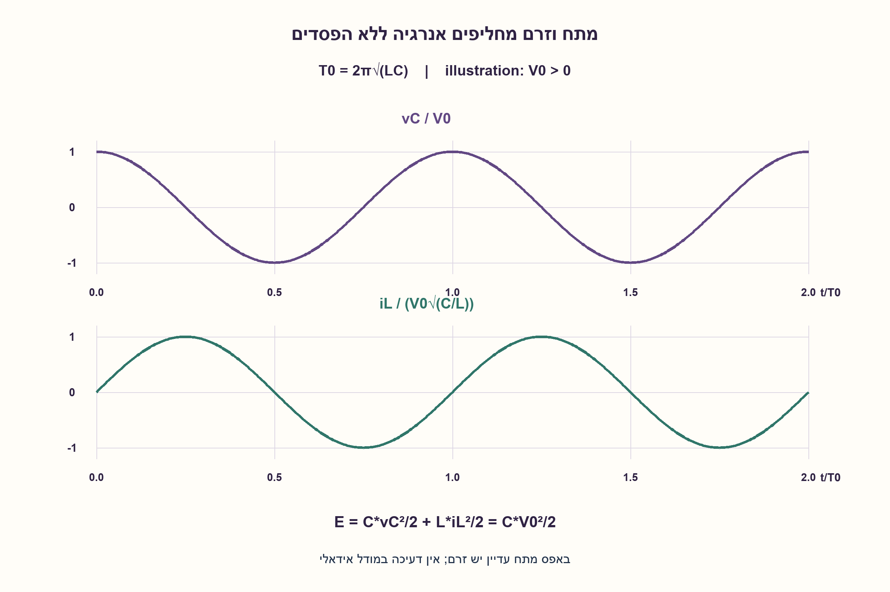
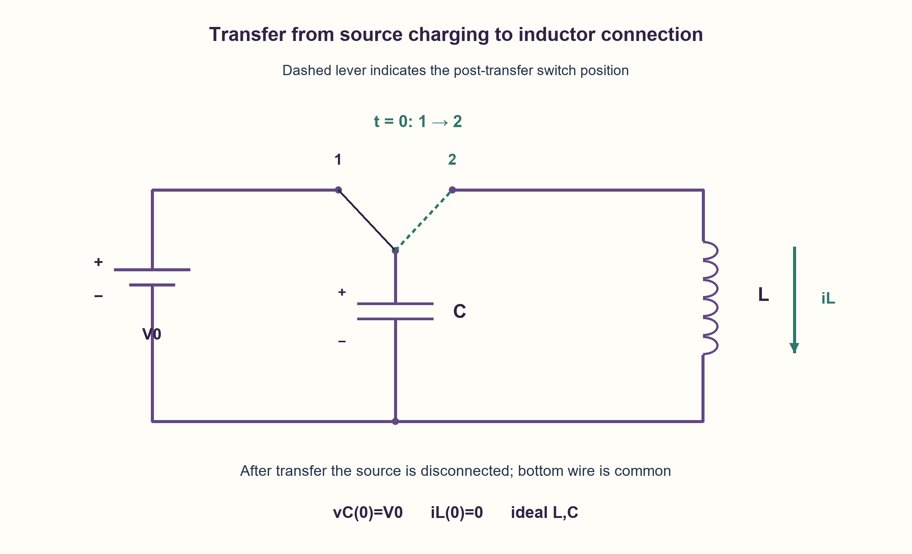
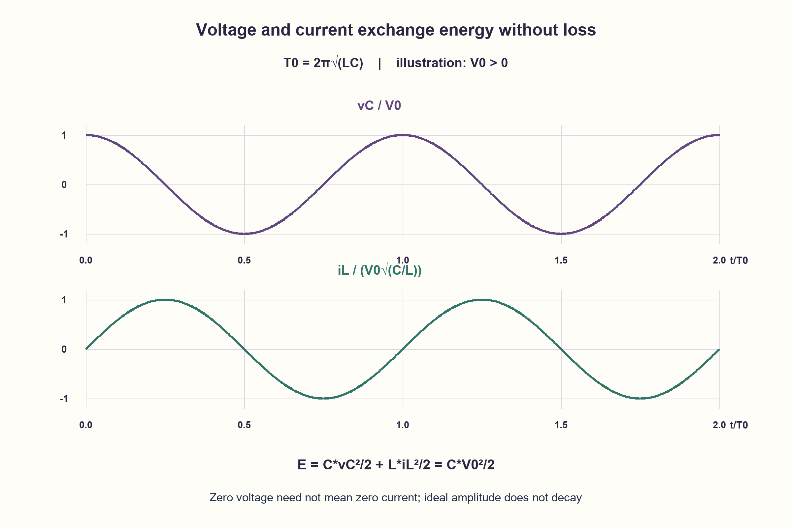

# PREP-170 — קבל טעון מחובר לסליל — המתח לאחר העברת המתג

פתרון מוצע בסיוע AI; ביקורת מקצועית אנושית ממתינה. הקושי אינו מכויל.

[צילום מקור פרטי](../sources/2026-10-30-batch70-01.png)

נתון מעגל CL כבתמונה, הקבל נטען וברגע שהוא טעון מזיזים את המתג למצב שני. צייר את המתח על הקבל לאחר סגירת המתג.

שיוכי חברות שדווחו בצילום ולא אומתו עצמאית: SolarEdge.

## עברית

במעגל שבשרטוט הקבל מחובר תחילה למקור מתח קבוע ונטען. ברגע t=0 מעבירים את המתג למצב השני: המקור מנותק, והקבל מחובר לסליל. שרטטו את מתח הקבל לאחר המעבר, והסבירו את תנאי ההתחלה ואת חילופי האנרגיה.

הבהרות: זהו המתג הדו־מצבי המצולם, לא סגירה המשאירה את המקור מחובר. נבחר קבל C וסליל L אידאליים וחיוביים, חוטים ומתג ללא התנגדות או הפסדים, העברה break-before-make ללא הזרקת אנרגיה, vC(0)=V0 ו־iL(0)=0. מודדים מתח מלוח הקבל העליון לתחתון; זרם הסליל החיובי כלפי מטה. המקור אינו נותן ערכי L, C, V0, ולכן נדרשת צורה פרמטרית. השוו בקצרה להשפעת הפסדים אמיתיים בלי להוסיף להם ערך שלא נמסר.

1. קבל טעון מחזיק אנרגיה חשמלית. האם הסליל מבזבז אותה כחום, או יכול לאגור אותה בצורה אחרת?
2. מתח הקבל וזרם הסליל רציפים. ברגע המעבר המתח הוא V0 והזרם אפס; כשזרם גדל מתח הקבל מתחיל לרדת.
3. כתבו C·dv/dt+iL=0 ו־L·diL/dt=v. מתקבלת משוואת תנודה עם תדר זוויתי 1/sqrt(LC), ונגזרת מתח התחלתית אפס.

### האנרגיה עוברת בין שני מאגרים
במצב הטעינה העליון של הקבל נמצא במתח המקור. לאחר ההעברה אין עוד מקור שמחזיק אותו שם. בתחילה הסליל אינו מעביר זרם, ולכן מתח הקבל אינו נופל בקפיצה. המתח V0 גורם לזרם הסליל להתחיל לגדול, והזרם פורק את הקבל בהדרגה.

```text
C dv/dt + iL = 0
L diL/dt = v
d²v/dt² + v/(LC) = 0
omega0 = 1/sqrt(LC)
vC(t) = V0*cos(omega0*t)
iL(t) = V0*sqrt(C/L)*sin(omega0*t)
T0 = 2*pi*sqrt(LC)
```

הסימנים נובעים מבחירת שני זרמי הענפים כלפי מטה; אין מקור אחרי ההעברה ולכן סכומם אפס. תנאי v(0)=V0 קובע את מקדם הקוסינוס, ו־iL(0)=0 נותן dv/dt(0)=0 ומבטל את איבר הסינוס במתח.

ברבע מחזור מתח הקבל אפס וזרם הסליל מרבי: האנרגיה כולה מגנטית. אבל הזרם אינו נעצר כשהמתח מגיע לאפס. הסליל ממשיך להזרים אותו וטוען את הקבל בקוטביות הפוכה; בחצי מחזור המתח −V0 והזרם שוב אפס. לאחר מחזור שלם חוזרים למצב ההתחלתי. לכן המתח הוא קוסינוס שאינו דועך, לא ירידה מעריכית רגילה של RC ולא ערך שנשאר באפס.

אנרגיית המערכת היא E=Cv²/2+Li²/2=CV0²/2 בכל זמן. זה מסביר הן את המשרעת והן את היעדר הדעיכה במודל האידאלי. במעגל אמיתי התנגדות הסליל, המתג והחוטים ופרמטרי הקבל גורמים להפסדים; תגובת RLC יכולה להיות תת־מרוסנת, קריטית או מרוסנת־יתר בהתאם לפרמטרים. ללא נתוני הפסד אין לנקוב בזמן דעיכה או להבטיח צורת מדידה פיזית. הקוד והשרטוטים מציגים במפורש LC אידאלי.

נבדקו ארבעה צירופי פרמטרים מול אינטגרציית RK4 בלתי תלויה לאורך ארבעה מחזורים בכל אחד:16,004 דגימות ובדיקות שימור אנרגיה. לא בוצע SPICE או ניסוי מתג וקבל אמיתי.

```python
"""Isolated ideal LC after disconnecting the charging source; passive iL downward."""

from math import cos, isfinite, sin, sqrt


def response(time, inductance, capacitance, initial_voltage):
    if not all(isfinite(v) for v in (time, inductance, capacitance, initial_voltage)):
        raise ValueError("finite parameters required")
    if time < 0 or inductance <= 0 or capacitance <= 0:
        raise ValueError("nonnegative time and positive L,C required")
    omega = 1 / sqrt(inductance * capacitance)
    voltage = initial_voltage * cos(omega * time)
    current_l = initial_voltage * sqrt(capacitance / inductance) * sin(omega * time)
    return voltage, current_l
```






## English

In the redrawn circuit a capacitor is initially connected to a DC source and charged. At t=0 the switch moves to its other position: the source disconnects and the capacitor connects to an inductor. Sketch the subsequent capacitor voltage and explain initial conditions and energy exchange.

Clarifications: this is the pictured two-position transfer, not a switch closure leaving the source attached. Choose positive ideal C, L, lossless wires/switch, break-before-make transfer without energy injection, vC(0)=V0 and iL(0)=0. Measure capacitor voltage from top plate to bottom; positive inductor current is downward. L, C, V0 values are absent, so provide a parametric waveform. Briefly distinguish real losses without inventing their values.

1. A charged capacitor stores electric energy. Does an ideal inductor dissipate it as heat, or store it in another form?
2. Capacitor voltage and inductor current are continuous. At transfer voltage isV0 and current is zero; current growth makes capacitor voltage fall.
3. Use C·dv/dt+iL=0 and L·diL/dt=v. This is an oscillator with angular frequency1/sqrt(LC) and initial voltage slope zero.

### Energy moves between two stores
During charging the upper capacitor plate is held at the source voltage. After transfer the source no longer holds it there. Initially the inductor current is zero, so the capacitor voltage does not jump. V0 starts increasing inductor current, and that current gradually discharges the capacitor.

```text
C dv/dt + iL = 0
L diL/dt = v
d²v/dt² + v/(LC) = 0
omega0 = 1/sqrt(LC)
vC(t) = V0*cos(omega0*t)
iL(t) = V0*sqrt(C/L)*sin(omega0*t)
T0 = 2*pi*sqrt(LC)
```

Both branch currents are defined downward. With no attached source their sum is zero. Initial v(0)=V0 sets the cosine coefficient; iL(0)=0 gives dv/dt(0)=0 and eliminates the voltage sine term.

At a quarter period the capacitor voltage is zero and inductor current is maximal: all energy is magnetic. The current does not stop when voltage reaches zero. It continues charging the capacitor with reversed polarity; at half a period voltage is−V0 and current is again zero. A full period restores the initial state. Thus voltage is an undamped cosine, not an RC exponential or a value stuck at zero.

Total energy is E=Cv²/2+Li²/2=CV0²/2 at all times, explaining constant amplitude. Real coil, switch and wire resistance and capacitor losses dissipate energy; an RLC response can be underdamped, critical or overdamped depending on parameters. Without loss data there is no numeric decay time or unique measured waveform. The code and diagrams explicitly show an ideal LC model.

Four parameter combinations were compared with independent RK4 integration over four periods each:16,004 samples and energy checks. No SPICE or physical switched-capacitor experiment was performed.

```python
"""Isolated ideal LC after disconnecting the charging source; passive iL downward."""

from math import cos, isfinite, sin, sqrt


def response(time, inductance, capacitance, initial_voltage):
    if not all(isfinite(v) for v in (time, inductance, capacitance, initial_voltage)):
        raise ValueError("finite parameters required")
    if time < 0 or inductance <= 0 or capacitance <= 0:
        raise ValueError("nonnegative time and positive L,C required")
    omega = 1 / sqrt(inductance * capacitance)
    voltage = initial_voltage * cos(omega * time)
    current_l = initial_voltage * sqrt(capacitance / inductance) * sin(omega * time)
    return voltage, current_l
```






## חומר משלים / Supporting material

```json
{
  "assumptions": {
    "he": [
      "מקור הטעינה מנותק לאחר המעבר; הסליל והקבל יוצרים לולאה מבודדת.",
      "מתח V0, זרם סליל התחלתי אפס, רכיבים אידאליים."
    ],
    "en": [
      "Charging source disconnects; capacitor and inductor form an isolated loop.",
      "InitialV0, zero inductor current, ideal positiveL, C."
    ]
  },
  "optimality": {
    "he": "פתרון פרמטרי של מערכת מסדר שני; אין טענת מינימום רכיבים או תכנון פיזי מיטבי.",
    "en": "Parametric second-order response; no component-count or physical-design optimum claimed."
  },
  "verification": {
    "he": "ארבע ריצות RK4 עצמאיות,16,004 דגימות ו־16,004 בדיקות אנרגיה מול הפתרון האנליטי. מודל אידאלי בלבד.",
    "en": "Four independent RK4 runs,16,004 samples and 16,004 energy checks against the analytic solution. Ideal model only."
  },
  "edge_cases": {
    "he": [
      "V0=0 משאיר אנרגיה ומתח אפס.",
      "t=0 מתח רציף וזרם אפס; ברבע מחזור המתח אפס אך הזרם לא.",
      "בלי ערכי L, C לא קיים ציר זמן מספרי יחיד."
    ],
    "en": [
      "V0=0 gives zero energy and response.",
      "At t=0 voltage is continuous; at quarter period voltage is zero but current is not.",
      "AbsentL, C, no unique numeric time axis exists."
    ]
  },
  "common_mistakes": {
    "he": [
      "ציור פריקת RC בלי נגד.",
      "השארת מקור המתח מחובר אחרי העברת המתג.",
      "עצירת הזרם כשהקבל מגיע לאפס.",
      "הנחת דעיכה בלי הפסדים."
    ],
    "en": [
      "Drawing anRC discharge without a resistor.",
      "Leaving the source connected after transfer.",
      "Stopping current at zero capacitor voltage.",
      "Adding decay without losses."
    ]
  },
  "interview_answer": {
    "he": "לאחר ניתוק המקור הקבל והסליל מחליפים אנרגיה. רציפות vC ו־iL נותנת vC=V0 cos(t/sqrtLC), עם קוסינוס לא דועך במודל האידאלי וזרם שמגיע לשיא ברבע מחזור.",
    "en": "After source disconnection, C andL exchange energy. Continuity gives vC=V0 cos(t/sqrtLC), an undamped ideal cosine with current maximal at a quarter period."
  },
  "source_ambiguities": {
    "he": [
      "המקור אינו נותן ערכי רכיבים, הפסדים או התנהגות מתג; ההנחות מוצגות בנפרד.",
      "SolarEdge מדווחת בצילום בלבד."
    ],
    "en": [
      "Values, losses and switch dynamics are absent; assumptions are explicit.",
      "SolarEdge attribution is source-reported only."
    ]
  },
  "solution_extensions": {
    "he": [
      {
        "question": "מה משתנה אם מוסיפים התנגדות טורית קטנה?",
        "answer_direction": "משוואת הלולאה כוללת איבר ריסון. בתחום תת־מרוסן המשרעת דועכת ותדר התנודה קטן מעט; יש לחשב לפי R, L, C ולא להוסיף דעיכה שרירותית.",
        "principle": "דעיכה נובעת מפיזור אנרגיה."
      }
    ],
    "en": [
      {
        "question": "What changes with a small series resistance?",
        "answer_direction": "The equation gains damping. An underdamped response decays with a shifted frequency determined byR, L, C, not an arbitrary envelope.",
        "principle": "Damping requires energy dissipation."
      }
    ]
  }
}
```
