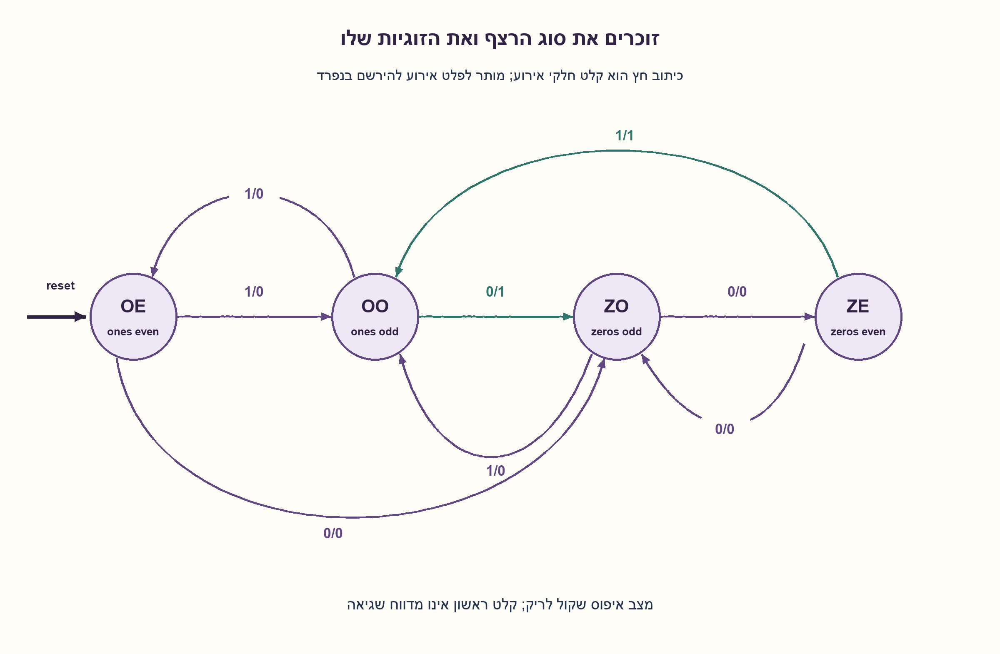
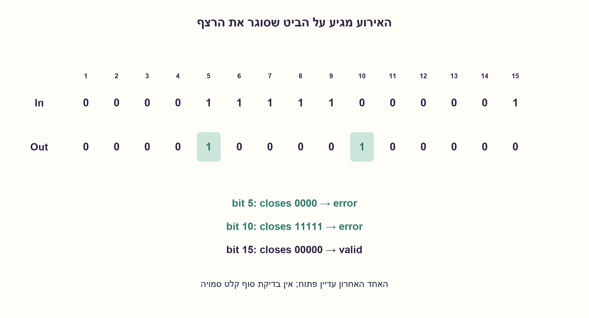
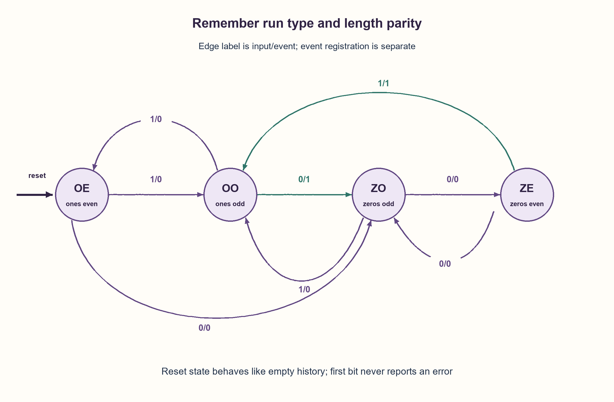
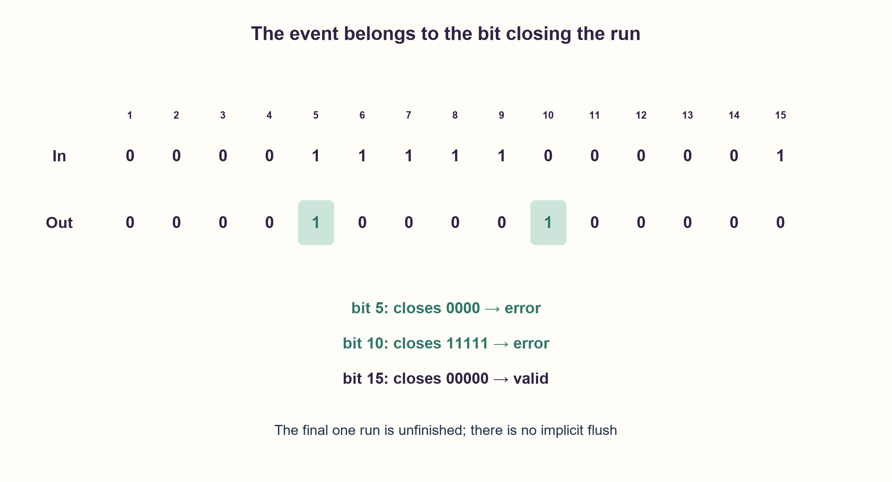

# PREP-171 — שגיאות בזוגיות רצפים — מחכים שהרצף יסתיים

פתרון מוצע בסיוע AI; ביקורת מקצועית אנושית ממתינה. הקושי אינו מכויל.

[צילום מקור פרטי](../sources/2026-10-30-batch70-18.png)

תכנן מערכת שמקבלת סדרת קלט של 0 ו־1 ומזהה שגיאות: רצף זוגי של 0, או רצף אי־זוגי של 1. בזיהוי שגיאה תוציא 1, בשאר המצבים 0. דוגמה: In=000011111000001; Out=000010000100000.

שיוכי חברות שדווחו בצילום ולא אומתו עצמאית: Zoran, SanDisk, CSR.

## עברית

תכננו מערכת המקבלת בכל מחזור סיבית 0 או 1. שגיאה היא רצף רציף זוגי של אפסים, או רצף רציף אי־זוגי של אחדים. בזיהוי שגיאה מוציאים 1 וביתר המחזורים 0. דוגמת המקור: In=000011111000001, Out=000010000100000.

הדוגמה מבהירה שהבדיקה היא של רצף שהסתיים: רק הסיבית ההפוכה שסוגרת אותו גורמת לפולס, ולא כל קידומת בעלת זוגיות שגויה. הרצף האחרון, כל עוד לא הגיע ההיפוך הבא, אינו נבדק; אין סימן סוף מילה. בחרו שעון משותף, סיבית יציבה לכל חזית ואיפוס שמוחק היסטוריה. הציגו מצבים, טבלת מעבר, פלט והסבר לאתחול. להדגמה יציבה אחרי חזית אפשר לרשום את אירוע ה־Mealy באוגר פלט; ציינו שהרישום מוסיף אחסון ולא מבטל דרישות תזמון.

1. מתי אפשר לדעת שאורך רצף סופי הוא זוגי או אי־זוגי? האם ייתכן שהסיבית הבאה עוד תמשיך אותו?
2. שמרו רק איזה ביט נמצא ברצף הנוכחי ואת זוגיות אורכו. בהמשך אותו ביט הופכים זוגיות; בהחלפת ביט בודקים את הרצף הישן.
3. מצבי ZO, ZE, OO, OE מתארים אפס/אחד ואי־זוגי/זוגי. שגיאה מתקבלת במעבר ZE עם 1 או OO עם 0. אפשר לאפס ל־OE: בשתי הסיביות הראשונות האפשריות הוא פועל כמו היסטוריה ריקה.

### השגיאה נקבעת בסגירת הרצף
ארבעה אפסים אינם שגיאה מדווחת מיד בביט הרביעי: ייתכן שיגיע עוד אפס ויהפוך את האורך לאי־זוגי. בדוגמה מגיע 1 בביט 5, סוגר ארבעה אפסים ומפיק את הפולס הראשון. אפס בביט 10 סוגר חמישה אחדים ומפיק את השני.1 בביט 15 סוגר חמישה אפסים, שאינם שגיאה; האחד הבודד החדש עדיין לא הסתיים.

אין צורך במונה אורך מלא. מספיקים ארבעה מצבי היסטוריה: ZO אפסים באורך אי־זוגי, ZE אפסים באורך זוגי, OO אחדים באורך אי־זוגי, OE אחדים באורך זוגי. בכל תא כתובים מצב הבא/אירוע.

| מצב | קלט 0 | קלט 1 |
| --- | --- | --- |
| ZO | ZE/0 | OO/0 |
| ZE | ZO/0 | OO/1 |
| OO | ZO/1 | OE/0 |
| OE | ZO/0 | OO/0 |

בעת המשך אותו ביט הופכים זוגיות ולא מפיקים שגיאה. בעת מעבר לביט השני בודקים את הזוגיות הישנה ומתחילים רצף חדש באורך 1. האינווריאנט הוא שהמצב מתאר את רצף הסיום של כל ההיסטוריה שנקלטה; הוא נשמר בכל אחד משני סוגי המעברים. לכן אירוע מופיע בדיוק על הסיבית הראשונה שאחרי רצף שגוי.

### למה לא צריך מצב התחלה חמישי?
מהיסטוריה ריקה קלט 0 צריך לעבור ל־ZO בלי שגיאה וקלט 1 ל־OO בלי שגיאה. אלה בדיוק מעברי OE. לכן איפוס ל־OE מדמה התחלה ריקה, ולא ממציא שגיאה על רצף אחדים זוגי מדומה. לאחר הסיבית הראשונה המצבים מתארים רצף ממשי. איפוס באמצע מוחק את ההיסטוריה ואינו סוגר את הרצף הישן.

אלה ארבעה מצבי Mealy של היסטוריית הרצף, שאפשר לקודד בשני ביטים; כל ששת זוגות המצבים הובחנו באמצעות המשכים בבדיקה. אם רוצים אירוע יציב לכל המחזור אחרי הדגימה, רושמים err<=event(state_old, input) לצד עדכון המצב. נוסף ביט פלט; אין לטעון ששני ביטי ההיסטוריה הם כל האחסון של מימוש מוצא רשום. מוצא Mealy צירופי ישיר דורש הבנת תזמון ואינו חסין גליצ׳ים מהטבלה בלבד.

נבדקו כל 8,191 המילים עד אורך 12 מול אורקל שסופר רצפים מן ההיסטוריה המלאה,90,114 סיביות,4,096 רצפי נתונים ואיפוס והדוגמה המקורית. לא הוסף flush סמוי בסוף קלט ולא בוצע HDL.

```python
"""Check only a run closed by the next opposite bit, never an unfinished suffix."""

TABLE = {
    "ZO": {0: ("ZE", 0), 1: ("OO", 0)},
    "ZE": {0: ("ZO", 0), 1: ("OO", 1)},
    "OO": {0: ("ZO", 1), 1: ("OE", 0)},
    "OE": {0: ("ZO", 0), 1: ("OO", 0)},
}
RESET_STATE = "OE"  # Equivalent to an empty history for all future inputs.


def step(state, bit, *, reset=False):
    if state not in TABLE or type(bit) is not int or bit not in (0, 1):
        raise ValueError("valid run state and one integer bit required")
    return (RESET_STATE, 0) if reset else TABLE[state][bit]


def detect(bits):
    state = RESET_STATE
    outputs = []
    for bit in bits:
        state, error = step(state, bit)
        outputs.append(error)
    return outputs
```






## English

Design a system accepting one0/1 bit each cycle. An error is an even-length contiguous zero run or an odd-length contiguous one run. Output one on error detection and zero otherwise. Source example:In=000011111000001, Out=000010000100000.

The example defines completed-run checking: only the opposite bit closing a run triggers its event, not every prefix with the wrong parity. An unfinished final run is not checked; there is no end-of-word marker. Use a common clock, one stable bit per edge and reset clearing history. Give states, transitions, output and initialization reasoning. To obtain a stable post-edge pulse, the Mealy event can be registered; acknowledge that storage and timing contract explicitly.

1. When can the final parity of a run be known? Could another identical bit still extend it?
2. Retain the current bit value and run-length parity. The same bit toggles parity; the opposite bit checks the old run.
3. UseZO, ZE, OO, OE for zero/one and odd/even. Emit onZE with 1 orOO with 0. ResetOE behaves like empty history for either possible first bit.

### A run is judged when it closes
Four zeros do not immediately trigger at bit 4: another zero could make their final length odd. In the example, one at bit 5 closes four zeros and produces the first pulse. Zero at bit 10 closes five ones and produces the second. One at bit 15 closes five zeros, which is valid; the newly started single one has not ended.

No full length counter is needed. Retain four history states:ZO for odd zeros, ZE for even zeros, OO for odd ones andOE for even ones. Each cell is next-state/event.

| State | Input 0 | Input 1 |
| --- | --- | --- |
| ZO | ZE/0 | OO/0 |
| ZE | ZO/0 | OO/1 |
| OO | ZO/1 | OE/0 |
| OE | ZO/0 | OO/0 |

The same bit toggles parity without an event. The opposite bit checks old parity and starts a new length-one run. The invariant is that state describes the suffix run of all accepted history; both transition types preserve it. Events therefore occur exactly on the first bit following an erroneous completed run.

### Initialization without a fifth state
Empty history should take zero toZO and one toOO, with no error. These are exactlyOE's transitions. Resetting toOE therefore simulates emptiness without reporting an error on a fictitious even one run. After the first bit, state describes a real run. Midstream reset discards history rather than closing it.

Four Mealy history states fit two bits; all six state pairs were distinguished by continuations in the checks. For a stable post-sampling cycle, register err<=event(old_state, input) alongside the state update. That adds a stored output bit: the two history bits are not the entire storage of a registered-output implementation. A direct combinational Mealy output needs a timing contract; the table alone does not prove glitch freedom.

All8,191 words through length 12 matched an independent full-history run-count oracle, covering90,114 bits,4,096 data/reset streams and the original example. No hidden end-of-input flush or HDL validation is claimed.

```python
"""Check only a run closed by the next opposite bit, never an unfinished suffix."""

TABLE = {
    "ZO": {0: ("ZE", 0), 1: ("OO", 0)},
    "ZE": {0: ("ZO", 0), 1: ("OO", 1)},
    "OO": {0: ("ZO", 1), 1: ("OE", 0)},
    "OE": {0: ("ZO", 0), 1: ("OO", 0)},
}
RESET_STATE = "OE"  # Equivalent to an empty history for all future inputs.


def step(state, bit, *, reset=False):
    if state not in TABLE or type(bit) is not int or bit not in (0, 1):
        raise ValueError("valid run state and one integer bit required")
    return (RESET_STATE, 0) if reset else TABLE[state][bit]


def detect(bits):
    state = RESET_STATE
    outputs = []
    for bit in bits:
        state, error = step(state, bit)
        outputs.append(error)
    return outputs
```






## חומר משלים / Supporting material

```json
{
  "assumptions": {
    "he": [
      "רצף נסגר רק בהופעת הביט ההפוך; אין סימן סוף.",
      "שגיאה: אפסים זוגיים או אחדים אי־זוגיים; איפוס מוחק ללא אירוע."
    ],
    "en": [
      "A run closes only on the opposite bit; no end marker.",
      "Error:even zeros or odd ones; reset discards history without an event."
    ]
  },
  "optimality": {
    "he": "ארבעה מצבי היסטוריה מובחנים דורשים שני ביטים במודל Mealy. מוצא רשום מוסיף ביט; אין מינימום שטח/תדר פיזי.",
    "en": "Four distinguishable history states need two Mealy state bits; registered output adds a bit. No physical-area or frequency minimum."
  },
  "verification": {
    "he": "8,191 מילים,90,114 ביטים,4,096 רצפי איפוס וכל ששת זוגות המצבים מול אורקל רצפים עצמאי.",
    "en": "8,191 words,90,114 bits,4,096 reset streams and all six state pairs versus an independent run oracle."
  },
  "edge_cases": {
    "he": [
      "קלט ריק, אפס יחיד ואחד יחיד לא סוגרים רצף.",
      "רצפים ארוכים אינם דורשים מונה הולך וגדל.",
      "איפוס באמצע אינו שגיאת רצף."
    ],
    "en": [
      "Empty input, a single zero or one closes no run.",
      "Arbitrarily long runs need no growing counter.",
      "Midstream reset is not a run error."
    ]
  },
  "common_mistakes": {
    "he": [
      "דיווח בכל פעם שהזוגיות זמנית שגויה.",
      "בדיקת הרצף החדש במקום הרצף שנסגר.",
      "הוספת שגיאה על האחד האחרון בדוגמה בלי סימן סוף."
    ],
    "en": [
      "Reporting every temporarily wrong parity.",
      "Checking the new run instead of the closed one.",
      "Flagging the final one without an end marker."
    ]
  },
  "interview_answer": {
    "he": "אשמור סוג ביט וזוגיות. בהמשך אותו ביט אהפוך זוגיות; בביט שונה אפיק שגיאה רק אם הישן היה אפסים זוגיים או אחדים אי־זוגיים, ואתחיל רצף באורך 1. OE שקול להתחלה ריקה.",
    "en": "Track bit type and parity. The same bit toggles parity; the opposite bit flags even zeros or odd ones in the old run and starts length 1. OE is equivalent to empty initialization."
  },
  "source_ambiguities": {
    "he": [
      "המקור אינו כותב ״הסתיים״ במפורש, אך הדוגמה קובעת שהפלט מופיע בגבול ולא בקידומות.",
      "זמן דגימה, איפוס ורישום מוצא הוגדרו בעריכה; חברות מדווחות בלבד."
    ],
    "en": [
      "The source does not explicitly say completed, but its example places events at boundaries rather than prefixes.",
      "Sampling, reset and output registration are editorial; companies are source-reported only."
    ]
  },
  "solution_extensions": {
    "he": [
      {
        "question": "כיצד בודקים גם את הרצף האחרון של הודעה סופית?",
        "answer_direction": "הוסיפו end או valid/end פרוטוקולי, והגדירו חזית דיווח נפרדת בלי להתחיל רצף נגדי מדומה.",
        "principle": "סיום מידע הוא חלק מהממשק."
      }
    ],
    "en": [
      {
        "question": "How can the last run of a finite message be checked?",
        "answer_direction": "Add an explicit end marker/protocol and define its reporting edge without inventing an opposite data bit.",
        "principle": "End-of-data is an interface event."
      }
    ]
  }
}
```
