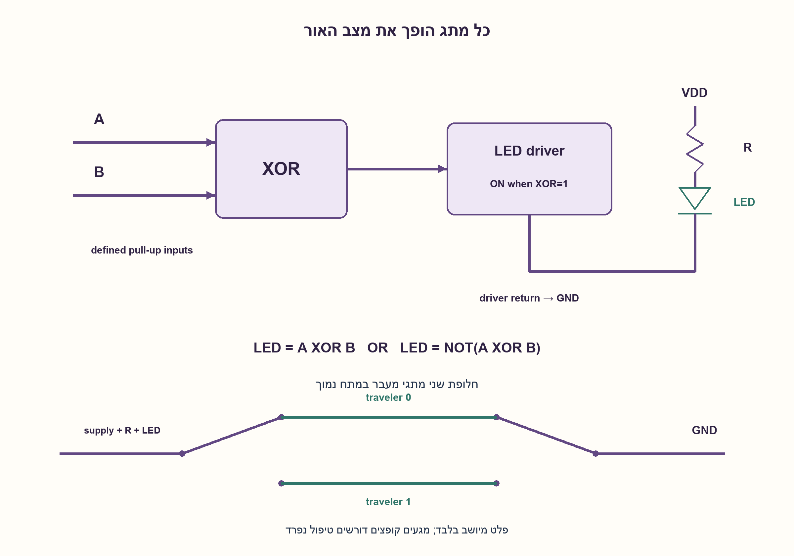
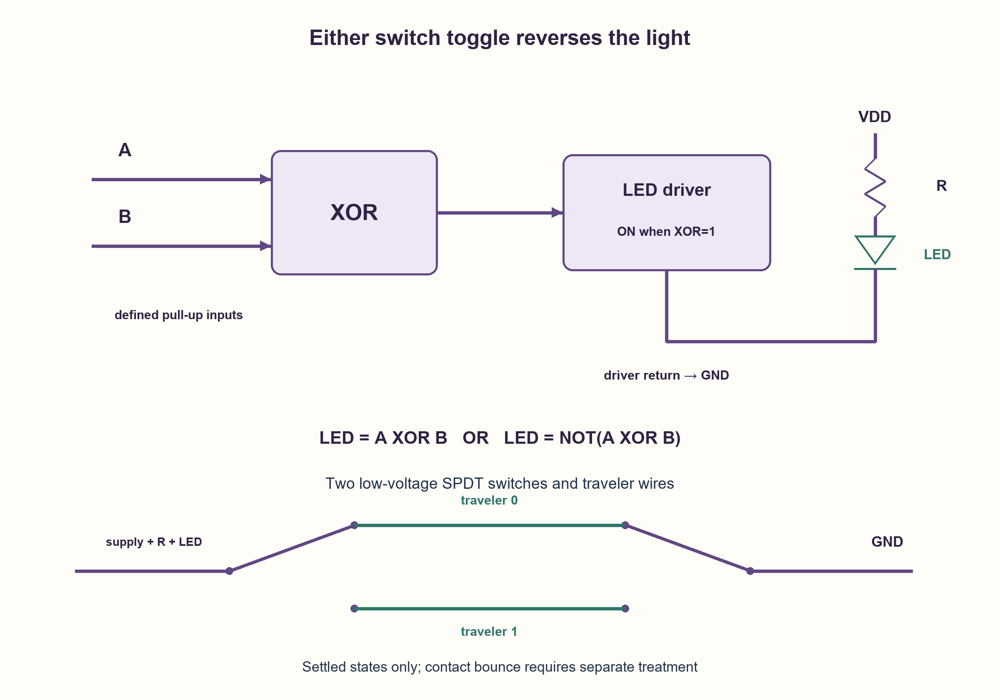

# PREP-172 — שני מתגים ולד אחד — כל החלפה משנה את האור

פתרון מוצע בסיוע AI; ביקורת מקצועית אנושית ממתינה. הקושי אינו מכויל.

[צילום מקור פרטי](../sources/2026-10-30-batch70-22.png)

בחדר יש שני מתגים ונורת לד אחת. צריך לממש מעגל כך שמתג אחד מדליק ומכבה את הנורה ומתג שני גם כן, כמו בבית. אפשר להשתמש בעוד רכיבים.

שיוכי חברות שדווחו בצילום ולא אומתו עצמאית: NVIDIA, Intel.

## עברית

בחדר יש שני מתגים ונורת LED אחת. תכננו מעגל כך שהחלפת מצבו של כל אחד מהמתגים, כשהשני נשאר במקומו, תהפוך את מצב הנורה: דולקת לכבויה ולהפך. מותר להוסיף רכיבים. הציגו טבלת אמת וחיבור מעשי עקרוני.

הבהרות: נדון במתח DC נמוך ובמצבים שהתייצבו. מייצגים את שני מצבי המתגים בסיביות A, B; אין דרישה שמצב ״למעלה״ של מתג מסוים יכפה תמיד הדלקה. בפתרון הלוגי אפשר לבחור XOR או XNOR לפי מצב ההתחלה. כל כניסת מתג מקבלת pull-up/pull-down מוגדר, ול־LED יש הגבלת זרם וממשק הנעה לפי דירוגי הרכיבים. הראו גם חלופת שני מתגי SPDT עם שני חוטי מעבר. נתחו קפיצות מגע ושינוי שני מתגים יחד; אין להבטיח היעדר הבהוב מתוך טבלת אמת בלבד.

1. השוו מצבי מתגים שנבדלים בסיבית אחת בלבד. מה חייב לקרות לפלט בכל קשת של הטבלה?
2. מתחילים למשל מ־00 כבוי. אז 01 ו־10 חייבים להיות דולקים. מה נדרש עבור 11?
3. הטבלה היא XOR או היפוכה. אפשר להזין XOR משתי כניסות מתג מוגדרות ולהפעיל דרייבר ללד; במימוש SPDT מחברים שני חוטי מעבר בין המתגים.

### הסיבית שמתחלפת היא הזוגיות
נבחר 00 כבוי. החלפת מתג אחד נותנת 01 או 10, ולכן שני המצבים דולקים. החלפה נוספת של המתג השני נותנת 11 וחייבת לכבות. זו בדיוק פונקציית XOR:

| A | B | LED=A XOR B |
| --- | --- | --- |
| 0 | 0 | 0 |
| 0 | 1 | 1 |
| 1 | 0 | 1 |
| 1 | 1 | 0 |

XOR מקיים (A XOR1) XOR B=NOT(A XOR B), ובאופן סימטרי למתג השני. אם רוצים להתחיל עם 00 דולק משתמשים ב־XNOR. למעשה הדרישה יחד עם בחירת הפלט ב־00 קובעת את כל ארבע השורות, ולכן אלו שתי האפשרויות הלוגיות היחידות.

### חיבור לוגי וחיבור מתגים
בגרסה הלוגית כל מתג SPST יכול לחבר כניסה לאדמה, כשנגד pull-up מושך אותה למתח הלוגי כשהמתג פתוח. לכן המצב החשמלי מוגדר תמיד; אסור להשאיר כניסה צפה. פלט XOR מפעיל דרייבר מתאים, למשל מתג טרנזיסטורי המפעיל LED ונגד טורי. הדרייבר והקוטביות נבחרים כך ש־1 פירושו זרם בלד. אין לחבר LED לעומס בלתי מוגבל או להניח שפלט לוגי מסוגל לספק כל זרם.

בחישוב אידאלי R=(Vsupply−Vf−Vdriver)/I. לדוגמה חישובית בלבד:3.3V, נפילת LED של 2V, דרייבר אידאלי ו־2 mA נותנים 650Ω. זה אינו בחירת רכיב בפועל: Vf, הזרם, הספק הנגד ויכולת הדרייבר נבדקים לפי נתוני המימוש. לא נבחר כאן דגם מסוים.

אפשר גם שני מתגי SPDT: המשותף של הראשון מתחבר למקור דרך ענף הגבלת הזרם והלד, שני חוטי מעבר מחברים פינים תואמים בין המתגים, והמשותף של השני סוגר לאדמה. המסלול סגור כשהשניים בוחרים את אותו חוט, כלומר XNOR לפי הסימון הזה. החלפת כל מתג שוברת או משלימה את אותו מסלול. זו אותה דרישה עם קוטביות התחלה אחרת.

קפיצות מגע עשויות ליצור כמה מעברים והבהוב; סינון/debounce או Schmitt input מתאימים לפי הדרישות. כששני המתגים מתחלפים יחד המצב הסופי אינו משתנה, אבל שינוי לא סימולטני בפועל יכול ליצור הבזק. ארבע שורות ושמונה החלפות יחידות נבדקו במודל מיושב בלבד; אין כאן בדיקת חומרה או הבטחת תזמון.

```python
"""Settled binary switch logic, not debounce, transient or device verification."""


def bit(value):
    if type(value) is not int or value not in (0, 1):
        raise ValueError("one integer bit required")
    return value


def xor_led(first, second):
    return bit(first) ^ bit(second)


def traveler_path(first, second):
    """Two SPDT switches select the same traveler => complete low-voltage path."""
    return int(bit(first) == bit(second))


def current_limit(supply, forward_drop, target_current, driver_drop=0.0):
    if target_current <= 0 or supply <= forward_drop + driver_drop:
        raise ValueError("positive headroom and current required")
    return (supply - forward_drop - driver_drop) / target_current
```




## English

A room has two switches and one LED. Design a circuit where toggling either switch while the other stays fixed reverses the light state. Extra components are allowed. Give a truth table and a conceptual practical connection.

Clarifications: low-voltage DC and settled switch states. Encode switch positions as bitsA, B; an individual “up” position need not force the light on regardless of the other switch. XOR or XNOR can set the initial polarity. Provide defined switch-input pull-ups/pull-downs, LED current limiting and a driver respecting device ratings. Also show two SPDT switches with two traveler wires. Discuss bounce and simultaneous changes; a truth table alone cannot guarantee flicker-free transitions.

1. Compare switch states differing in one bit. What must happen to output along every such edge?
2. If 00 is off,01 and 10 must be on. What does that force for 11?
3. The table is XOR or its complement. Drive it from two defined switch inputs and use an LED driver; an SPDT alternative uses two traveler wires between switches.

### The changing quantity is parity
Choose 00 off. Toggling one switch gives 01 or10, so both are on. Toggling the other gives 11 and must turn the light off. This is XOR:

| A | B | LED=A XOR B |
| --- | --- | --- |
| 0 | 0 | 0 |
| 0 | 1 | 1 |
| 1 | 0 | 1 |
| 1 | 1 | 0 |

XOR satisfies (A XOR1) XOR B=NOT(A XOR B), symmetrically forB. Use XNOR if 00 should start on. The requirement plus the 00 output determines every row, so these are the only two settled Boolean possibilities.

### Logic and switch implementations
Each SPST switch may ground an input with a pull-up to the logic rail while open. Inputs are therefore defined rather than floating. XOR drives a suitable output stage, such as a transistor switch feeding an LED and series resistor, with polarity chosen so logical one produces current. Do not assume unlimited output current or omit LED current limiting.

The ideal calculation is R=(Vsupply−Vf−Vdriver)/I. A numerical illustration only:3.3V supply,2V LED drop, ideal driver and 2 mA imply 650Ω. This is not an actual part selection; LED variation, current, resistor power and driver capability need the chosen implementation's specifications. No specific component is recommended.

Alternatively use two SPDT switches: connect the first common to the supply through the LED/current-limiting branch, tie matching traveler contacts between switches, and connect the second common to ground. The path closes when both choose the same traveler, an XNOR table under this labeling. Either toggle breaks or completes the path. It meets the same requirement with opposite initial polarity.

Contact bounce may cause repeated transitions and flicker; debounce or Schmitt inputs depend on requirements. Toggling both switches preserves the final state, but finite timing mismatch can create an intermediate flash. Four truth rows and eight single-switch toggles were checked only in a settled model, without hardware or transient guarantees.

```python
"""Settled binary switch logic, not debounce, transient or device verification."""


def bit(value):
    if type(value) is not int or value not in (0, 1):
        raise ValueError("one integer bit required")
    return value


def xor_led(first, second):
    return bit(first) ^ bit(second)


def traveler_path(first, second):
    """Two SPDT switches select the same traveler => complete low-voltage path."""
    return int(bit(first) == bit(second))


def current_limit(supply, forward_drop, target_current, driver_drop=0.0):
    if target_current <= 0 or supply <= forward_drop + driver_drop:
        raise ValueError("positive headroom and current required")
    return (supply - forward_drop - driver_drop) / target_current
```




## חומר משלים / Supporting material

```json
{
  "assumptions": {
    "he": [
      "כל פעם מחליפים מתג אחד כשהשני נשאר קבוע; מתייחסים למצב שהתייצב.",
      "מעגל DC במתח נמוך, הגבלת זרם וכניסות שאינן צפות."
    ],
    "en": [
      "Either individual switch changes while the other stays fixed; settled states.",
      "Low-voltageDC, current limiting and nonfloating inputs."
    ]
  },
  "optimality": {
    "he": "XOR או XNOR מממשים את הדרישה. אין טענת מינימום התקנים, נגד או שערים; הנעת LED היא חלק נפרד מהמימוש הלוגי.",
    "en": "XOR or XNOR meets the specification. No minimum device, resistor or gate claim; LED drive is separate from logical selection."
  },
  "verification": {
    "he": "ארבע שורות אמת, שמונה החלפות בודדות, ארבע החלפות כפולות וחישוב נגד לדוגמה. ללא בדיקת מגעים או LED ממשי.",
    "en": "Four truth rows, eight individual toggles, four double toggles and resistor arithmetic. No physical contacts or LED test."
  },
  "edge_cases": {
    "he": [
      "כל ארבעת מצבי המתגים; XOR לעומת XNOR.",
      "שני מתגים מתחלפים יחד: אותו מצב סופי, אפשרות למצב ביניים.",
      "מתג מכני קופץ; דרייבר עם נפילת מתח שאינה אפס."
    ],
    "en": [
      "All four states; XOR versus XNOR.",
      "Both switches change:same final state, possible intermediate transition.",
      "Contact bounce and nonzero driver drop."
    ]
  },
  "common_mistakes": {
    "he": [
      "חיבור שני SPST בטור נותן AND ולא החלפה מכל מצב.",
      "ניחוש שמתג אחד אחראי רק להדליק והשני רק לכבות.",
      "כניסה צפה או LED בלי הגבלת זרם."
    ],
    "en": [
      "Two series SPST switches implement AND, not the required toggle property.",
      "Assigning one switch only-on and the other only-off.",
      "Floating inputs or no LED current limiting."
    ]
  },
  "interview_answer": {
    "he": "החלפה של סיבית אחת חייבת להפוך פלט, ולכן זו XOR או XNOR. אפשר כניסות מתגים עם pull-up, שער XOR ודרייבר ללד עם נגד, או שני SPDT ושני חוטי מעבר. טבלת האמת מתארת מצב סופי ולא debounce.",
    "en": "Changing one bit must invert output, so use XOR/XNOR. Options are pulled switch inputs plus XOR and a current-limited LED driver, or two SPDT switches and travelers. The truth table covers final states, not debounce."
  },
  "source_ambiguities": {
    "he": [
      "המקור אינו קובע סוג מתגים, מתח, קוטביות התחלה או דירוג LED; ההנחות גלויות.",
      "NVIDIA ו־Intel מדווחות במקור בלבד."
    ],
    "en": [
      "Switch types, voltage, initial polarity and LED ratings are unspecified; assumptions are explicit.",
      "NVIDIA/Intel attribution is source-reported only."
    ]
  },
  "solution_extensions": {
    "he": [
      {
        "question": "מה משתנה בשלושה מתגים עצמאיים?",
        "answer_direction": "לוגית משתמשים בזוגיות של שלוש סיביות או היפוכה. חיבור מכני דורש טופולוגיית מתגים מתאימה ולא סתם SPST שלישי בטור.",
        "principle": "כל החלפת קלט משנה זוגיות."
      }
    ],
    "en": [
      {
        "question": "What changes with three independent switches?",
        "answer_direction": "Use three-bit parity or its complement logically; a mechanical circuit needs appropriate switching topology, not another series SPST.",
        "principle": "An individual input toggle changes parity."
      }
    ]
  }
}
```
