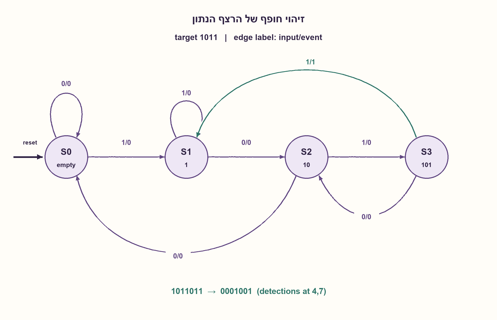
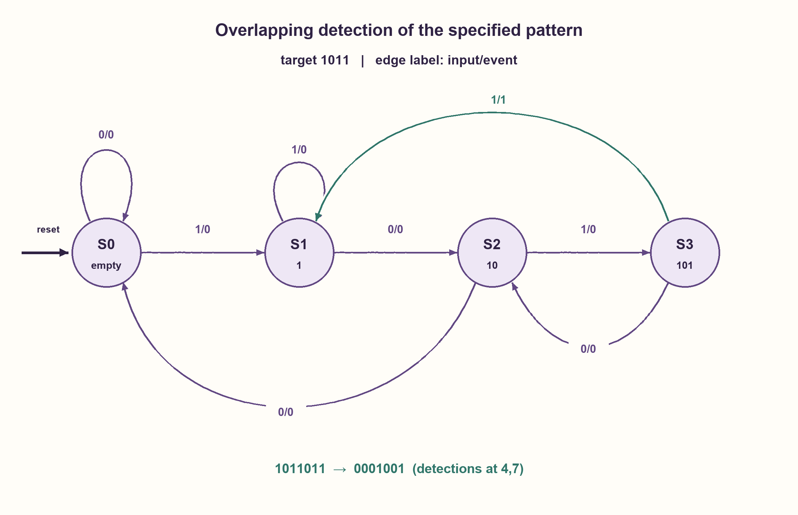

# PREP-173 — גלאי 1011 בזרם בלתי פוסק — שומרים גם חפיפה

פתרון מוצע בסיוע AI; ביקורת מקצועית אנושית ממתינה. הקושי אינו מכויל.

[צילום מקור פרטי](../sources/2026-10-30-batch70-24.png)

לבנות מכונת מצבים שמוציאה 1 רק כאשר מתקבל הרצף 1011. הרצף שנכנס למכונה אינסופי.

שיוכי חברות שדווחו בצילום ולא אומתו עצמאית: NVIDIA, Rafael.

## עברית

בנו מכונת מצבים המקבלת זרם ביטים אינסופי ומוציאה 1 רק בכל זיהוי של הרצף הרציף 1011. הציגו מצבים, טבלת מעבר ופלט, והסבירו איך חוזרים אחרי אי־התאמה או זיהוי.

המקור אינו מגדיר תזמון או חפיפה. בעריכה נבחר ביט אחד בכל מחזור, חפיפה מותרת ואיפוס שמחזיר להיסטוריה ריקה. הטבלה הראשית היא Mealy: האירוע נקבע מהמצב הנוכחי ומהביט הנוכחי לפני עדכון המצב, בדומה לשאלת הדוגמה המקושרת. בדקו 1011011, שבו יש זיהויים בעמדות 4 ו־7 לפי מספור מתחיל ב־1. אם נדרש פלט יציב אחרי חזית, אפשר לרשום את האירוע במפורש; אין לערבב את חוזה התזמון הזה עם פלט צירופי. זו הרשומה הידנית עם מקור הראיון, בלי למחוק את מזהה הדוגמה או היסטוריית תרגול.

1. איזה חלק מסוף הביטים שכבר הגיעו עדיין יכול להיות התחלה של 1011?
2. המצבים מייצגים קידומות ריקה,1,10,101. כישלון אינו בהכרח מחזיר להתחלה: למשל 1010 מסתיים ב־10.
3. ממצב 101 עם קלט 1 מזהים וחוזרים לקידומת 1, כי הביט האחרון יכול להתחיל התאמה חדשה. עם 0 חוזרים ל־10.

### ארבע דרגות של התקדמות
S0 פירושו שאין סיומת שימושית, S1 שההיסטוריה מסתיימת ב־1, S2 ב־10, S3 ב־101. נשמור תמיד את הקידומת הארוכה ביותר של 1011 שהיא גם סיומת של מה שנקלט.

| מצב | קלט 0: הבא/אירוע | קלט 1: הבא/אירוע |
| --- | --- | --- |
| S0 | S0/0 | S1/0 |
| S1 | S2/0 | S1/0 |
| S2 | S0/0 | S3/0 |
| S3 | S2/0 | S1/1 |

המקרה החשוב הוא S3. קלט 0 יוצר 1010, שמסתיים ב־10, ולכן חוזרים ל־S2. קלט 1 משלים 1011 ומוציא אירוע 1; הסיומת 1 היא כבר תחילת הופעה הבאה, ולכן עוברים ל־S1 ולא ל־S0. זו הדרך לשמור חפיפה.

ב־1011011 האירוע הראשון בביט 4. ה־1 הרביעי נשאר כקידומת; הביטים הבאים 0,1,1 משלימים את האירוע השני בביט 7. התוצאה היא 0001001. גם רצפים שאינם מכילים התאמה מלאה אינם גורמים לפלט 1.

### נכונות ותזמון
בכל מעבר מחפשים את הסיומת הארוכה ביותר שהיא קידומת יעד. הטבלה ממצה את שני הקלטים בכל מצב ושומרת את האינווריאנט. אירוע 1 נוצר רק כאשר ההיסטוריה הקודמת מסתיימת ב־101 והביט החדש 1; זה שקול לכך שארבעת הביטים האחרונים הם 1011. ארבעת מצבי ההיסטוריה מובחנים, ולכן שני ביטי מצב מספיקים ונחוצים למודל Mealy הזה. זה אינו חסם שטח פיזי או כלל למספר אוגרים עם פלט רשום.

פלט Mealy צירופי מחושב לפני עדכון המצב; הוא יכול להשתנות כשמשתנה הקלט. טבלת אמת אינה הבטחת היעדר גליצ׳ים. אפשר להוסיף אוגר אירוע ולעדכן אותו באותה חזית יחד עם המצב, כך שהפולס המתייחס לביט שנדגם מחזיק אחריה מחזור מלא. זה מוסיף ביט אחסון ומשנה את זמן התצפית, ללא שינוי עמדות הזיהוי הלוגיות. קלט אסינכרוני דורש ממשק ו־CDC נפרדים.

נבדקו 8,191 מילים עד אורך 12,90,114 סיביות,4,096 רצפי איפוס וששת זוגות המצבים מול אורקל סיומת של היסטוריה מלאה. הרשומה קשורה לדוגמת 1011 הקיימת כאותה משפחה, ולא לרצף 01011 של PREP-128.

```python
"""Mealy event from OLD prefix state and current accepted bit, before update."""

TABLE = {
    0: {0: (0, 0), 1: (1, 0)},
    1: {0: (2, 0), 1: (1, 0)},
    2: {0: (0, 0), 1: (3, 0)},
    3: {0: (2, 0), 1: (1, 1)},
}


def step(state, bit, *, reset=False):
    if type(state) is not int or state not in TABLE or type(bit) is not int or bit not in (0, 1):
        raise ValueError("valid prefix state and binary input required")
    return (0, 0) if reset else TABLE[state][bit]


def detections(bits):
    state = 0
    outputs = []
    for bit in bits:
        state, event = step(state, bit)
        outputs.append(event)
    return outputs
```




## English

Build an FSM for an infinite bit stream that outputs one on each occurrence of the contiguous pattern 1011. Give states, transitions and outputs, and explain mismatch and full-match fallback.

Clocking and overlap were not specified. Choose one bit each cycle, allow overlapping matches, and reset to empty history. The primary table is Mealy: determine the event from current state and current input before state update, matching the linked example contract. Test 1011011, with detections at one-based positions4 and 7. If a stable post-edge output is required, explicitly register the event; distinguish that timing from a direct combinational output. This manual source record does not delete the example identity or practice history.

1. Which suffix of received history can still begin 1011?
2. Use prefixes empty,1,10,101. Mismatch need not clear everything:1010 ends in10.
3. From 101, input 1 detects and falls back to prefix 1, the final bit of the match. Input 0 falls back to10.

### Four levels of progress
S0 means no useful suffix, S1 a suffix 1, S2 suffix 10 andS3 suffix 101. Retain the longest prefix of 1011 that is also a suffix of accepted history.

| State | Input 0:next/event | Input 1:next/event |
| --- | --- | --- |
| S0 | S0/0 | S1/0 |
| S1 | S2/0 | S1/0 |
| S2 | S0/0 | S3/0 |
| S3 | S2/0 | S1/1 |

S3 is the important case. Zero produces 1010, whose useful suffix is 10, so return to S2. One completes1011 and emits one; its final1 already starts a possible next match, so go to S1 rather than S0. This preserves overlap.

For 1011011, the first event is at bit 4. That final one remains as prefix 1; the next0,1,1 completes another event at bit 7. Output is 0001001. A history without a full match never emits one.

### Correctness and timing
Every transition retains the longest suffix that is a target prefix. The complete table preserves this invariant for either input. An event occurs exactly when old history ends in101 and current bit is one, equivalent to the last four bits being1011. Four history states are distinguishable, so two state bits are necessary and sufficient for this Mealy model. That is not a physical-area bound or a count including a stored output.

A direct Mealy output is evaluated before state update and may change when input changes. Its truth table is not a glitch-free guarantee. Adding an event register, updated at the same edge as state, gives a full post-edge cycle referring to the just-sampled bit. This adds a stored bit and changes observation time without changing logical detection positions. Asynchronous input needs a separate interface and CDC treatment.

Checks covered 8,191 words through length 12,90,114 bits,4,096 reset streams and six state pairs against a full-history suffix oracle. This is the same family as the existing 1011 example, not PREP-128's different01011 target.

```python
"""Mealy event from OLD prefix state and current accepted bit, before update."""

TABLE = {
    0: {0: (0, 0), 1: (1, 0)},
    1: {0: (2, 0), 1: (1, 0)},
    2: {0: (0, 0), 1: (3, 0)},
    3: {0: (2, 0), 1: (1, 1)},
}


def step(state, bit, *, reset=False):
    if type(state) is not int or state not in TABLE or type(bit) is not int or bit not in (0, 1):
        raise ValueError("valid prefix state and binary input required")
    return (0, 0) if reset else TABLE[state][bit]


def detections(bits):
    state = 0
    outputs = []
    for bit in bits:
        state, event = step(state, bit)
        outputs.append(event)
    return outputs
```




## חומר משלים / Supporting material

```json
{
  "assumptions": {
    "he": [
      "ביט סינכרוני אחד לכל צעד; חפיפה מותרת; יעד 1011 לפי סדר הגעה.",
      "אירוע Mealy מהמצב הישן והביט הנוכחי; רישום אירוע הוא חלופה מפורשת."
    ],
    "en": [
      "One synchronous bit per step; overlap allowed; target 1011 in arrival order.",
      "Mealy event uses old state/current input; registered event is an explicit alternative."
    ]
  },
  "optimality": {
    "he": "ארבעה מצבי קידומת מובחנים, שני ביטי מצב במודל Mealy. אוגר פלט, איפוס ותזמון פיזי נספרים בנפרד.",
    "en": "Four distinguishable prefix states, two Mealy state bits. Output storage, reset and physical timing are separate costs."
  },
  "verification": {
    "he": "8,191 מילים,90,114 ביטים,4,096 רצפי איפוס, שישה זוגות מצבים מובחנים ודוגמת חפיפה. מודל Python בלבד.",
    "en": "8,191 words,90,114 bits,4,096 reset streams, six distinguished state pairs and overlap example. Python model only."
  },
  "edge_cases": {
    "he": [
      "קלט ריק או פחות מארבעה ביטים.",
      "1011011 מזהה פעמיים;1010 שומר 10.",
      "111 אינו זיהוי; איפוס באמצע מוחק התקדמות."
    ],
    "en": [
      "Empty/fewer-than-four bits.",
      "1011011 detects twice;1010 preserves 10.",
      "111 is not a match; midstream reset clears progress."
    ]
  },
  "common_mistakes": {
    "he": [
      "איפוס ל־S0 אחרי זיהוי שמפסיד חפיפה.",
      "איפוס ל־S0 אחרי 1010 במקום שמירת 10.",
      "החלפת הסדר ל־1101 או בלבול עם 01011.",
      "ערבוב Mealy עם פלט אחרי חזית בלי אוגר."
    ],
    "en": [
      "Clearing to S0 after detection and losing overlap.",
      "Clearing after 1010 instead of retaining10.",
      "Reversing the target or confusing it with 01011.",
      "Describing a post-edge stored output without adding its register."
    ]
  },
  "interview_answer": {
    "he": "אשמור קידומות ריקה,1,10,101. במצב 101 וקלט 1 אוציא אירוע ואשמור 1; בקלט 0 אשמור 10. כך 1011011 מזהה בביטים 4,7. אבחין בין אירוע Mealy לפולס שנרשם אחרי חזית.",
    "en": "Track empty,1,10,101. From 101, one emits and keeps 1; zero keeps 10. Thus1011011 detects at 4,7. Distinguish the Mealy event from a registered post-edge pulse."
  },
  "source_ambiguities": {
    "he": [
      "זרם אינסופי אינו קובע חפיפה, איפוס או סוג מוצא; החוזה נוסף בגלוי.",
      "אותה בעיית דוגמה קיימת נשמרת עם מזהה והיסטוריה; הידנית היא רשומת המקור הראשית."
    ],
    "en": [
      "An infinite stream alone does not define overlap, reset or output timing; these are explicit choices.",
      "The existing example keeps its identity/history; the manual record is the sourced primary family member."
    ]
  },
  "solution_extensions": {
    "he": [
      {
        "question": "איך משתנה המימוש כשאסור לזהות חפיפה?",
        "answer_direction": "אחרי זיהוי מלא עוברים להתחלה במקום לשמור את ה־1 האחרון; יש להגדיר אם דילוג כזה מותר גם במקרה כישלון חלקי.",
        "principle": "מדיניות חפיפה היא דרישת ממשק ולא פרט קוסמטי."
      }
    ],
    "en": [
      {
        "question": "What changes if overlap is forbidden?",
        "answer_direction": "After a full match, reset progress rather than retaining the final1; specify whether partial mismatches retain prefixes.",
        "principle": "Overlap policy is a contract, not a cosmetic detail."
      }
    ]
  }
}
```
