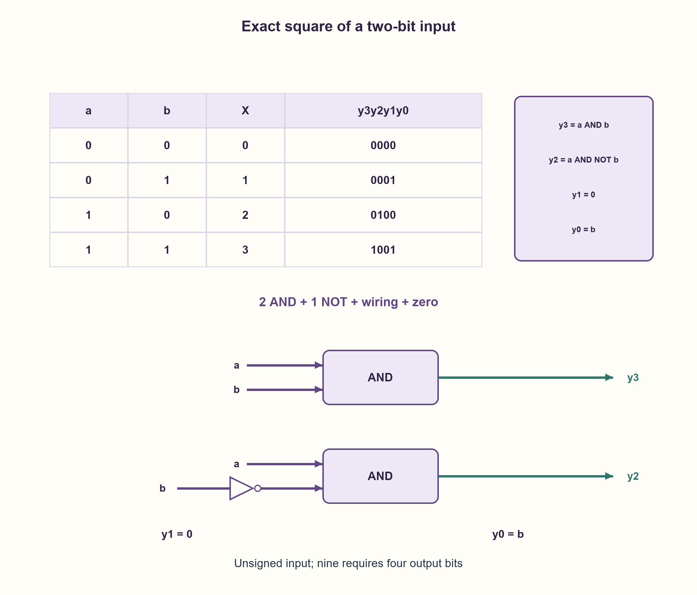

# PREP-174 — ריבוע של שתי סיביות — מפשטים מטבלת האמת

פתרון מוצע בסיוע AI; ביקורת מקצועית אנושית ממתינה. הקושי אינו מכויל.

[צילום מקור פרטי](../sources/2026-10-30-batch70-27.png)

צריך לממש רכיב שמבצע על ידי כניסת 2 סיביות את X בריבוע.

שיוכי חברות שדווחו בצילום ולא אומתו עצמאית: NVIDIA.

## עברית

ממשו רכיב צירופי שמקבל מספר X בן שתי סיביות ומוציא X². ציינו את רוחב המוצא, בנו טבלת אמת וממשו בשערים.

המקור אינו מגדיר סימן או גלישה. נבחר X ללא סימן בתחום 0..3 ותוצאה מדויקת בת ארבע סיביות, ללא שעון או זיכרון. מותרים AND, NOT, חוטים וקבוע 0; אין צורך במכפל כללי. אם הקלט חתום, הטבלה והפירוש משתנים ויש לנתח אותם בנפרד.

1. מהם ארבעת המספרים האפשריים ומהם ריבועיהם? כמה ביטים דורש הריבוע הגדול ביותר?
2. כתבו את הריבועים 0,1,4,9 בבינארי והשוו כל עמודת מוצא לכניסות.
3. אם X=(a, b), אז הביט הנמוך מועתק מ־b, הביט הבא תמיד 0, והביטים הגבוהים מופעלים במצבי 10 ו־11 בהתאמה.

### ארבע שורות מספיקות כדי לתכנן את כל המעגל
X=(a, b) הוא 2a+b. הקלטים האפשריים הם 0,1,2,3 והריבועים 0,1,4,9. המספר 9 דורש ארבע סיביות; אין לקצץ לשלוש.

| a | b | X | y3 y2 y1 y0 |
| --- | --- | --- | --- |
| 0 | 0 | 0 | 0000 |
| 0 | 1 | 1 | 0001 |
| 1 | 0 | 2 | 0100 |
| 1 | 1 | 3 | 1001 |

הביט y0 זהה ל־b ו־y1 תמיד אפס. y3 מופעל רק כאשר a=b=1, ולכן y3=a AND b. y2 מופעל רק ב־a=1, b=0, ולכן y2=a AND NOT b.

```text
y3 = a AND b
y2 = a AND NOT b
y1 = 0
y0 = b
```

נדרשים במימוש הפשוט שני AND, מהפך אחד, חיווט ואפס. הטבלה ממצה את כל הקלטים ולכן מוכיחה נכונות, לא רק מדגימה אותה. אין טענת מינימום שטח או השהיה בספריית תאים. משאבי המימוש קבועים כי רוחב הקלט קבוע.

זה אינו המונה של PREP-140 שמפיק n וריבועו לאורך זמן: כאן אין שעון, רק מיפוי מיידי לאחר השהיית השערים. אם מפרשים 10 כמספר החתום−2 ו־11 כ־−1, ריבוע 11 הוא 1 ולא 9; לכן חתימות אינן פרט שאפשר להשמיט. כל ארבע השורות וארבע דחיות קלט פגום נבדקו בפייתון מול כפל שלמים, ללא סינתזה או בדיקת רכיב.

```python
"""Gate equations for the exact square of an unsigned two-bit input."""


def square(value):
    if type(value) is not int or not 0 <= value < 4:
        raise ValueError("unsigned two-bit input required")
    a, b = (value >> 1) & 1, value & 1
    y3, y2, y1, y0 = a & b, a & (b ^ 1), 0, b
    return (y3 << 3) | (y2 << 2) | (y1 << 1) | y0
```


## English

Implement a combinational component receiving a two-bit number X and outputting X². State output width, give a truth table and implement gates.

The source omits signedness and overflow. Choose unsigned X in0..3 and an exact four-bit result, without clock or storage. AND, NOT, wires and constant zero are allowed; a general multiplier is unnecessary. Signed input has a different interpretation and table.

1. List the four possible inputs and their squares. How many bits does the largest result need?
2. Write 0,1,4,9 in binary and inspect each output column.
3. For X=(a, b), copy b to the low output bit, tie the next bit to zero, and identify the high bits for input 10 and 11.

### Four rows determine the complete circuit
X=(a, b) means 2a+b. Inputs0,1,2,3 have squares 0,1,4,9. Nine needs four output bits; truncating to three loses information.

| a | b | X | y3 y2 y1 y0 |
| --- | --- | --- | --- |
| 0 | 0 | 0 | 0000 |
| 0 | 1 | 1 | 0001 |
| 1 | 0 | 2 | 0100 |
| 1 | 1 | 3 | 1001 |

y0 equals b and y1 is always zero. y3 is high only for a=b=1, so y3=a AND b. y2 is high only for a=1, b=0, so y2=a AND NOT b.

```text
y3 = a AND b
y2 = a AND NOT b
y1 = 0
y0 = b
```

This straightforward construction uses two AND gates, one inverter, wires and zero. The truth table exhausts the domain and proves correctness rather than merely illustrating it. No minimum physical area or delay is claimed. Resource cost is constant for the fixed input width.

This differs from PREP-140's time-evolving counter and square: here no clock exists, only a combinational mapping after gate settling. Under signed interpretation10 means−2 and 11 means−1, whose square is 1 rather than9; signedness therefore matters. All four rows and four malformed-input rejections were executed against integer multiplication, without synthesis or device testing.

```python
"""Gate equations for the exact square of an unsigned two-bit input."""


def square(value):
    if type(value) is not int or not 0 <= value < 4:
        raise ValueError("unsigned two-bit input required")
    a, b = (value >> 1) & 1, value & 1
    y3, y2, y1, y0 = a & b, a & (b ^ 1), 0, b
    return (y3 << 3) | (y2 << 2) | (y1 << 1) | y0
```




## חומר משלים / Supporting material

```json
{
  "assumptions": {
    "he": [
      "X ללא סימן, בדיוק שתי סיביות; פלט מדויק ארבע סיביות.",
      "מעגל צירופי עם AND, NOT, אפס וחיווט."
    ],
    "en": [
      "Unsigned two-bit X; exact four-bit output.",
      "Combinational AND, NOT, zero and wiring."
    ]
  },
  "optimality": {
    "he": "שני AND ו־NOT אחד במימוש המוצע; אין טענת מינימום ספריית תאים.",
    "en": "TwoAND gates and one NOT in this construction; no minimum cell-library claim."
  },
  "verification": {
    "he": "כל ארבע השורות מול כפל שלמים וארבע דחיות קלט מחוץ לחוזה. Python בלבד.",
    "en": "All four rows against integer multiplication and four malformed inputs. Python only."
  },
  "edge_cases": {
    "he": [
      "0→0,1→1,2→4,3→9.",
      "שלוש סיביות מוצא אינן מספיקות.",
      "פירוש חתום משנה את שורת 11."
    ],
    "en": [
      "0→0,1→1,2→4,3→9.",
      "Three output bits are insufficient.",
      "Signed interpretation changes input 11."
    ]
  },
  "common_mistakes": {
    "he": [
      "מוצא בן שתי סיביות או השמטת הביט של 8.",
      "הנחה שיש צורך במכפל גדול.",
      "בלבול בין ריבוע למספר האחדות."
    ],
    "en": [
      "Using a two-bit output or dropping the eight-weight bit.",
      "Assuming a full multiplier is required.",
      "Confusing square with population count."
    ]
  },
  "interview_answer": {
    "he": "אכתוב את 0,1,4,9 בארבע סיביות. מתקבל y0=b, y1=0, y2=a AND NOT b, y3=a AND b. זה כל המעגל, בהנחה שהקלט ללא סימן.",
    "en": "Write 0,1,4,9 in four bits: y0=b, y1=0, y2=a AND NOT b, y3=a AND b. This completes the circuit for unsigned input."
  },
  "source_ambiguities": {
    "he": [
      "רוחב המוצא והסימן חסרים במקור ונוספו במפורש.",
      "NVIDIA מדווחת בלבד."
    ],
    "en": [
      "Output width and signedness were absent and are explicit additions.",
      "NVIDIA attribution is source-reported."
    ]
  },
  "solution_extensions": {
    "he": [
      {
        "question": "מהי הטבלה אם שתי סיביות הקלט חתומות במשלים לשתיים?",
        "answer_direction": "הערכים 0,1,−2,−1 נותנים 0,1,4,1. נדרשות שלוש סיביות; y2=a AND NOT b, y1=0, y0=b.",
        "principle": "אותו וקטור ביטים עשוי לייצג מספר אחר."
      }
    ],
    "en": [
      {
        "question": "What if input is signed two-bit two's complement?",
        "answer_direction": "Values 0,1,−2,−1 give0,1,4,1. Three bits suffice:y2=a AND NOT b, y1=0, y0=b.",
        "principle": "The same bit vector can denote a different number."
      }
    ]
  }
}
```
