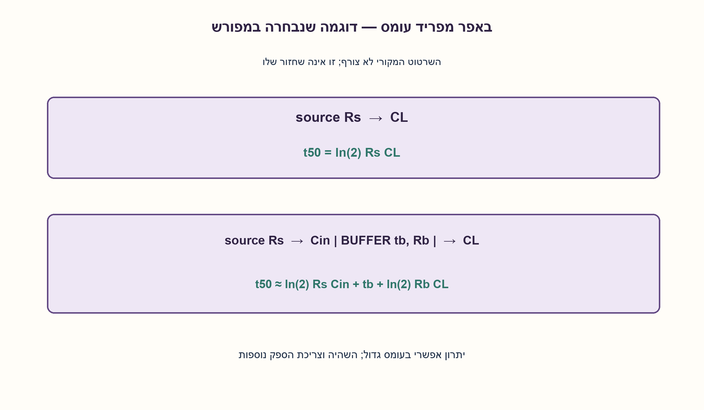
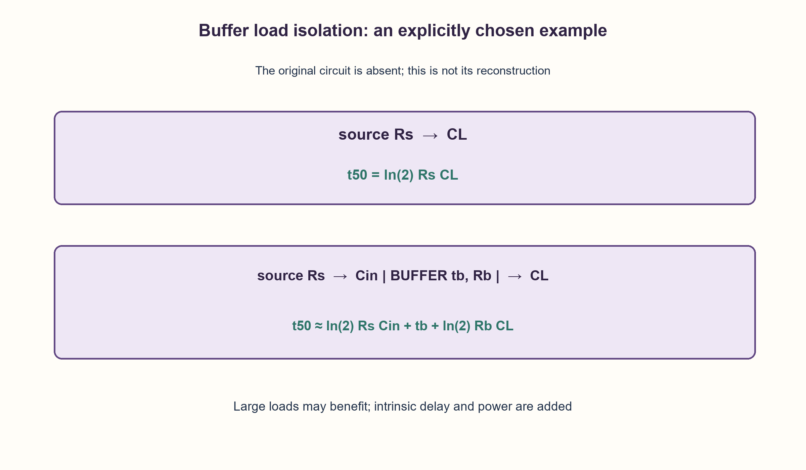

# PREP-175 — למה מוסיפים באפר? מפרידים פונקציה לוגית מיכולת הנעה

פתרון מוצע בסיוע AI; ביקורת מקצועית אנושית ממתינה. הקושי אינו מכויל.

[צילום מקור פרטי](../sources/2026-10-30-batch70-25.png)

נתנו לי שרטוט של מעגל לוגי ושאלו מה התפקיד של באפר, למה משתמשים בו?

שיוכי חברות שדווחו בצילום ולא אומתו עצמאית: NVIDIA.

## עברית

בראיון הוצג מעגל ונשאלה השאלה מה תפקיד הבאפר ולמה משתמשים בו. השרטוט אינו מופיע בצילום שנמסר, ולכן אי אפשר לקבוע מה תפקידו המסוים במעגל המקורי. הסבירו תפקידים אפשריים של באפר, והציגו דוגמה מפורשת של מקור חלש שמניע עומס קיבולי גדול. הסבירו מתי הבאפר עשוי לשפר השהיה ומתי הוא עלול להזיק.

הבהרות: נבחר באפר דיגיטלי לא מהפך, לא רכיב תלת־מצבי או ממיר רמות. בסכמת ההמחשה המקור מיוצג בנגד Rs, העומס ב־CL, וכניסת הבאפר ב־Cin. הבאפר מוסיף השהיה פנימית tb ומניע דרך Rb. זהו מודל RC ראשוני בלבד, לא שחזור של המעגל החסר או מודל טרנזיסטורי.

1. באפר יכול להוציא אותו ערך לוגי שקיבל ועדיין לעשות עבודה חשמלית חשובה. מה קורה למקור חלש כשמגדילים את העומס?
2. המקור יראה את קיבול כניסת הבאפר, והבאפר יטעין את העומס הגדול. השוו Rs·CL לסכום של שלוש עלויות.
3. בחציית חצי המתח המודל נותן ln(2)RC. עם באפר: ln(2)RsCin+tb+ln(2)RbCL. לא תמיד הסכום קטן יותר.

### אותו ביט, עומס אחר
באפר דיגיטלי לא מהפך שומר על פונקציית הזהות: Y=A לאחר זמן התפשטות. הוא אינו חוט אידאלי. כניסתו מעמיסה על המקור, אבל יציאתו יכולה להיות מתוכננת להניע יותר קיבול או יותר כניסות מאשר המקור החלש. כך מפרידים את השלב המחשב את הביט מהשלב המספק זרם לטעינה ולפריקה.

במודל מדרגת מתח דרך נגד, המתח עולה לפי v/VDD=1−exp(−t/RC). עבור סף של חצי מתח מתקבל t50=ln(2)RC. לכן:

```text
direct = ln(2) Rs CL
buffered = ln(2) Rs Cin + tb + ln(2) Rb CL
```

הבאפר כדאי במודל כאשר ההפרש חיובי: ln(2)[RsCL−RsCin−RbCL]>tb. לדוגמה Rs=1000Ω, CL=100 pF, Cin=2 pF, Rb=50Ω, tb=1 ns נותנים כ־69.31 ns בלי באפר וכ־5.85 ns איתו. אם CL קטן מאוד, השהיית הבאפר והכניסה הנוספת עלולות להגדיל את הסכום. זו בדיקת היגיון, לא תחזית מדויקת של ספריית תאים.

באפרים משמשים גם לפיצול fanout ולהנעת חוטים ארוכים; לעיתים שרשרת מדורגת טובה יותר משלב יחיד. באפר יכול לשחזר רמות תקינות כאשר הקלט עומד בדרישותיו, אבל אינו מתקן כל רעש, אינו מסנכרן CDC ואינו מבטיח היעדר גליצ׳ים. Schmitt trigger, ממיר רמות ובאפר תלת־מצבי הם יכולות נוספות שצריך לבחור במפורש. המונח isolation כאן הוא הקטנת העמסה, לא בידוד גלווני.

המחיר הוא שטח, הספק דינמי בקיבולים הנוספים, דליפה והשהיה פנימית. צריך לבדוק גם slew, עומס מותר, מתחים ותזמון מינימום: האצה עשויה להקשות על hold. עקרון ההעמסה נידון ב־[Toshiba, הערת יישום ללוגיקה](https://toshiba.semicon-storage.com/info/74 LCX08 FT_application_note_en_20210131_AKX00113.pdf?did=68970&prodName=74 LCX08 FT). הנוסחאות וההשוואה כאן נגזרו ממודל RC הנבחר.

27 חציות סף נבדקו מול חיפוש בינארי עצמאי בתגובה המעריכית, ועוד שני מקרים שבהם באפר עוזר או מזיק. אין כאן SPICE, סינתזה, מדידות או בחירת דגם רכיב.

```python
"""First-order illustrations only, not a transistor or transmission-line model."""

from math import isfinite, log


def rc_crossing(resistance, capacitance, fraction=0.5):
    if not all(isfinite(v) for v in (resistance, capacitance, fraction)):
        raise ValueError("finite parameters required")
    if resistance <= 0 or capacitance < 0 or not 0 < fraction < 1:
        raise ValueError("R>0, C>=0 and 0<fraction<1 required")
    return -resistance * capacitance * log(1 - fraction)


def compare_paths(source_r, load_c, buffer_input_c, buffer_r, intrinsic_delay):
    if not isfinite(intrinsic_delay) or intrinsic_delay < 0:
        raise ValueError("nonnegative finite intrinsic delay required")
    direct = rc_crossing(source_r, load_c)
    buffered = rc_crossing(source_r, buffer_input_c) + intrinsic_delay + rc_crossing(buffer_r, load_c)
    return direct, buffered
```




## English

The interviewer showed a circuit and asked what its buffer does. That circuit is absent from the supplied screenshot, so its particular purpose cannot be identified. Explain possible buffer roles and an explicit example of a weak source driving a large capacitive load. When might a buffer improve delay, and when might it hurt?

Clarifications: choose a noninverting digital buffer, not a tri-state device or level translator. Model the source by Rs, the load by CL, the buffer input by Cin, and its output by Rb plus intrinsic delay tb. This is a first-order RC illustration, not a reconstruction of the missing circuit or a transistor model.

1. A buffer can preserve the Boolean value while doing useful electrical work. What happens when a weak source sees a larger load?
2. The source drives the buffer input capacitance; the buffer drives the large load. Compare Rs·CL with the three resulting costs.
3. At half supply the model gives ln(2)RC. The buffered path is ln(2)RsCin+tb+ln(2)RbCL; it need not be smaller.

### The bit stays the same; the load changes
A noninverting digital buffer implements Y=A after propagation delay. It is not an ideal wire. Its input loads the source, but its output may be designed to drive more capacitance or fanout. This separates the logic-producing stage from the stage supplying charging/discharging current.

For a voltage step through resistance, the first-order response is v/VDD=1−exp(−t/RC). Half-supply crossing gives t50=ln(2)RC:

```text
direct = ln(2) Rs CL
buffered = ln(2) Rs Cin + tb + ln(2) Rb CL
```

The buffer helps in this model when ln(2)[RsCL−RsCin−RbCL]>tb. For Rs=1000Ω, CL=100 pF, Cin=2 pF, Rb=50Ω, tb=1 ns, the estimates are 69.31 ns direct and 5.85 ns buffered. With a tiny load, the added input and intrinsic delay may make it slower. This is a sanity model, not an accurate cell-library prediction.

Buffers also split fanout and help drive long interconnect; a staged chain can outperform one stage. A buffer may restore valid levels when its input specifications are met, but cannot repair arbitrary noise, synchronize CDC or guarantee glitch suppression. Schmitt inputs, level translation and tri-state control are separate capabilities. Load isolation does not mean galvanic isolation.

Costs include area, additional switching capacitance, leakage and intrinsic delay. Check slew, allowed load, voltage and minimum timing: acceleration can worsen hold. The loading principle is discussed in [Toshiba’s logic application note](https://toshiba.semicon-storage.com/info/74 LCX08 FT_application_note_en_20210131_AKX00113.pdf?did=68970&prodName=74 LCX08 FT); the equations and examples here follow the explicitly chosen RC model.

Checks independently bracketed27 exponential threshold crossings and tested two loads where buffering helps or hurts. No SPICE, synthesis, physical measurement or component selection is claimed.

```python
"""First-order illustrations only, not a transistor or transmission-line model."""

from math import isfinite, log


def rc_crossing(resistance, capacitance, fraction=0.5):
    if not all(isfinite(v) for v in (resistance, capacitance, fraction)):
        raise ValueError("finite parameters required")
    if resistance <= 0 or capacitance < 0 or not 0 < fraction < 1:
        raise ValueError("R>0, C>=0 and 0<fraction<1 required")
    return -resistance * capacitance * log(1 - fraction)


def compare_paths(source_r, load_c, buffer_input_c, buffer_r, intrinsic_delay):
    if not isfinite(intrinsic_delay) or intrinsic_delay < 0:
        raise ValueError("nonnegative finite intrinsic delay required")
    direct = rc_crossing(source_r, load_c)
    buffered = rc_crossing(source_r, buffer_input_c) + intrinsic_delay + rc_crossing(buffer_r, load_c)
    return direct, buffered
```




## חומר משלים / Supporting material

```json
{
  "assumptions": {
    "he": [
      "השרטוט המקורי חסר; ההמחשה נבחרה במפורש.",
      "באפר זהות דיגיטלי עם עומס קיבולי ומודל RC מאוחד."
    ],
    "en": [
      "Original circuit absent; the example is explicitly chosen.",
      "Noninverting digital buffer with a lumped capacitive RC model."
    ]
  },
  "optimality": {
    "he": "אין מספר באפרים אופטימלי ללא ספריית תאים, עומסים וחוטים; תוספת שלב עולה בשטח, הספק והשהיה.",
    "en": "No optimal buffer count follows without cells, loads and wiring; an added stage costs area, power and delay."
  },
  "verification": {
    "he": "29 בדיקות מתמטיות עצמאיות; ללא בדיקת שבב או סימולציית טרנזיסטורים.",
    "en": "29 independent mathematical cases; no chip or transistor simulation."
  },
  "edge_cases": {
    "he": [
      "עומס קטן: באפר עלול להאט.",
      "עומס גדול או fanout גבוה; שרשרת אפשרית.",
      "קלט רועש או מחוץ למסילות אינו מתוקן בהכרח."
    ],
    "en": [
      "Small load may become slower.",
      "Large load or fanout may benefit; staged drive is possible.",
      "No general repair of noisy or out-of-range input."
    ]
  },
  "common_mistakes": {
    "he": [
      "הטענה שבאפר הוא חוט ללא מחיר.",
      "קביעה מה עשה הבאפר בשרטוט שלא צורף.",
      "הנחה שבאפר רגיל הוא Schmitt או ממיר רמות."
    ],
    "en": [
      "Calling a buffer a free wire.",
      "Inventing the purpose in the missing diagram.",
      "Assuming an ordinary buffer is a Schmitt input or level shifter."
    ]
  },
  "interview_answer": {
    "he": "לוגית Y=A, חשמלית הבאפר מפריד מקור חלש מעומס גדול ומספק יכולת הנעה. אשווה את עלות העומס הישיר לכניסה, השהיה פנימית וטעינת העומס דרך הבאפר, ואציין את מחיר ההספק והשטח.",
    "en": "Logically Y=A; electrically the buffer separates a weak source from a large load. Compare direct loading with buffer input, intrinsic delay and output charging, then include power and area."
  },
  "source_ambiguities": {
    "he": [
      "אין שרטוט ולכן אין תשובה ייחודית על המעגל המצולם.",
      "NVIDIA מדווחת במקור בלבד."
    ],
    "en": [
      "No diagram means no unique explanation of the original circuit.",
      "NVIDIA is source-reported only."
    ]
  },
  "solution_extensions": {
    "he": [
      {
        "question": "האם הוספת באפר תמיד פותרת setup?",
        "answer_direction": "לא. יש לבדוק סכום השהיות מלא מול הקטנת העומס, ואז לבדוק hold והספק מחדש.",
        "principle": "אופטימיזציה נמדדת על נתיב שלם."
      }
    ],
    "en": [
      {
        "question": "Does a buffer always fix setup?",
        "answer_direction": "No; compare total added delay with reduced loading, and recheck hold and power.",
        "principle": "Optimize a whole path."
      }
    ]
  }
}
```
