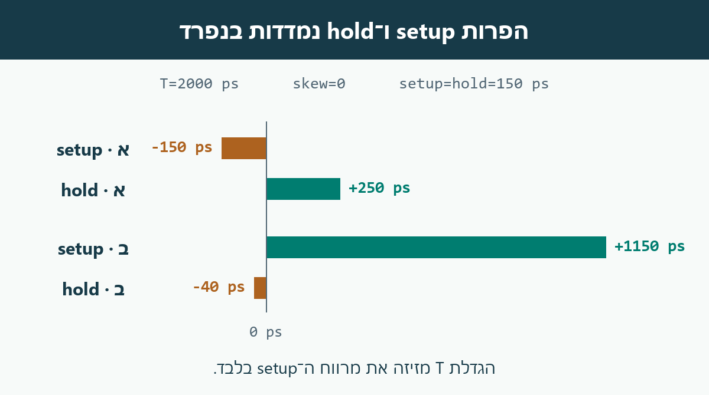
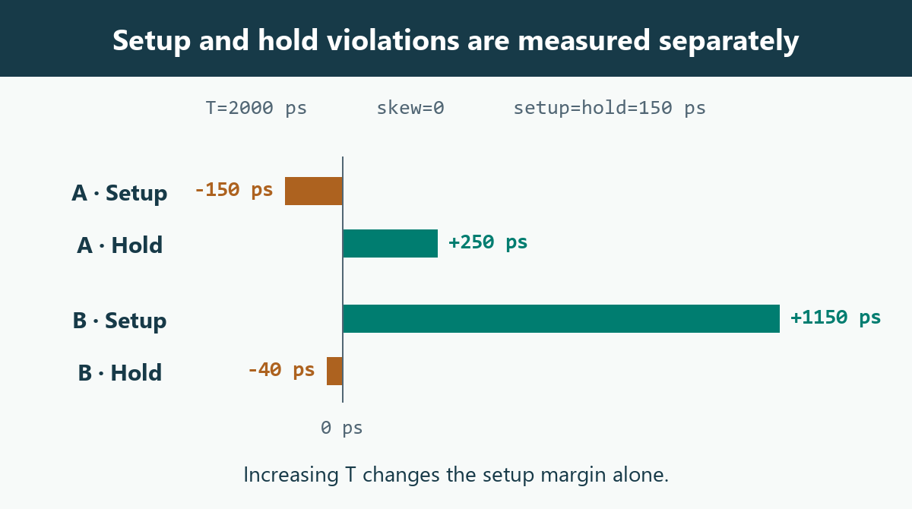

# PREP-176 — Setup ו־Hold — חלון יציבות ושני כיווני תקלה

הצעה לפתרון. ביקורת מקצועית אנושית ממתינה.

## עברית

### הרחבה: איזו הפרת תזמון קשה יותר
נמקו אם אפשר לקבוע מראש מה חמור יותר, הפרת `setup` או הפרת `hold`. עבור נתיב בין פליפ־פלופים באותו שעון, תנו דוגמה לכל סוג הפרה כאשר הבדיקה השנייה עוברת. הסבירו איזה שינוי במחזור עשוי לעזור, ואיזה שינוי בנתיב הנתונים מטפל בהגעה מוקדמת מדי.

1. נסחו אי־שוויון לכל חלון לפי חזית הלכידה המתאימה.
2. בדיקת setup משתמשת בהגעה המאוחרת ביותר ובדיקת hold בהגעה המוקדמת ביותר.
3. שנו את תקופת השעון בלבד במשוואות והבחינו בין ערך slack לבין אמצעי התיקון.

### מדרגים לפי slack ולפי אפשרות התיקון

#### כיווני חשיבה להרחבה
1. נסחו אי־שוויון לכל חלון לפי חזית הלכידה המתאימה.
2. בדיקת setup משתמשת בהגעה המאוחרת ביותר ובדיקת hold בהגעה המוקדמת ביותר.
3. שנו את תקופת השעון בלבד במשוואות והבחינו בין ערך slack לבין אמצעי התיקון.

שתיהן דרישות תפקודיות. הערכים של setup ו־hold בתא לבדם אינם מדרגים חומרה. בודקים את מרווח הזמן בכל תנאי עבודה ואת ההשפעה של תיקון על מפרט התדר והנתיבים האחרים. הפרה אחת יכולה להיות גדולה או קטנה מהשנייה בהתאם לנתיב.

קחו `T=2000 ps`, ארבעה ערכים משותפים `tCQ_min=100`, `tCQ_max=200`, `tsetup=150`, `thold=150`, ו־skew ואי־ודאות אפס. הכל ביחידות ps.

| נתיב | dmin | dmax | setup slack | hold slack |
| --- | --- | --- | --- | --- |
| א | 300 | 1800 | −150 | 250 |
| ב | 10 | 500 | 1150 | −40 |

החישוב הוא `Ssetup=T−tCQ_max−dmax−tsetup` ו־`Shold=tCQ_min+dmin−thold`. בנתיב א העלאת `T` ל־2150 מביאה את setup לאפס במודל. בנתיב ב היא משאירה hold על ‎−40, מפני שהגעת הנתון החדש נבדקת מול חזית הלכידה של אותו מחזור. הגדלת השהיית המינימום בנתיב ב ב־40 מספיקה במודל, אך יש לחשב מחדש גם את dmax ואת setup בכל פינה לאחר הוספת התא או שינוי הניתוב. שיפור setup עשוי לקצר גם את נתיב המינימום, ולכן בודקים את שתי הדרישות מחדש.

תשובה קצרה לראיון: לעיתים hold קשה יותר לסגירה כי הורדת תדר לא מגדילה את מרווח ה־hold. שני סוגי ההפרות נמדדים ב־slack לפי תנאי העבודה והחוזה, ושניהם עלולים לפגוע בדגימה. בדוגמה בטבלה הפרת setup גדולה יותר בזמן, אף שדרך התיקון הזמינה שונה.

## English

### Follow-up: Which timing violation is worse?
Explain whether a `setup` or a `hold` violation can be ranked as worse in general. Give an example of each violation on a same-clock flip-flop path while the other check passes. Explain which clock-period change can help and which data-path change addresses data arriving too early.

1. Write an inequality for each window using the relevant capture edge.
2. Setup uses the latest data arrival and hold uses the earliest.
3. Change only the clock period in the equations and distinguish slack from the available repair.

### Rank by slack and by the available repair

#### Hints for the follow-up
1. Write an inequality for each window using the relevant capture edge.
2. Setup uses the latest data arrival and hold uses the earliest.
3. Change only the clock period in the equations and distinguish slack from the available repair.

Both are functional constraints. The cell's individual setup and hold numbers cannot tell you which violation matters more. Evaluate margins at each operating condition and the impact of a repair on the required clock rate and other paths. Either violation can be larger on a given path.

Take `T=2000 ps`, common values `tCQ_min=100`, `tCQ_max=200`, `tsetup=150`, `thold=150`, and zero skew and uncertainty. All values are in ps.

| Path | dmin | dmax | Setup slack | Hold slack |
| --- | --- | --- | --- | --- |
| A | 300 | 1800 | −150 | 250 |
| B | 10 | 500 | 1150 | −40 |

Compute `Ssetup=T−tCQ_max−dmax−tsetup` and `Shold=tCQ_min+dmin−thold`. Raising `T` to 2150 restores zero setup slack for path A in this model. On path B it leaves hold at −40 because new data is checked against the capture edge of that same cycle. Adding 40 to path B's minimum data delay suffices in the model. Recompute maximum delay and setup at each corner after inserting a cell or changing routing. A setup optimization can also reduce the minimum path delay, so recheck both constraints.

Short interview answer: Hold may be harder to close because reducing the clock frequency leaves the hold margin unchanged. Both violations are quantified by slack under the declared conditions and both can compromise sampling. In the example the setup violation has the larger magnitude even though the repair options differ.

[צילום מקור פנימי 20](../sources/2026-11-18-batch31-20.png)
[תוצאות בדיקות](../checks/digital1118-verification.json)
