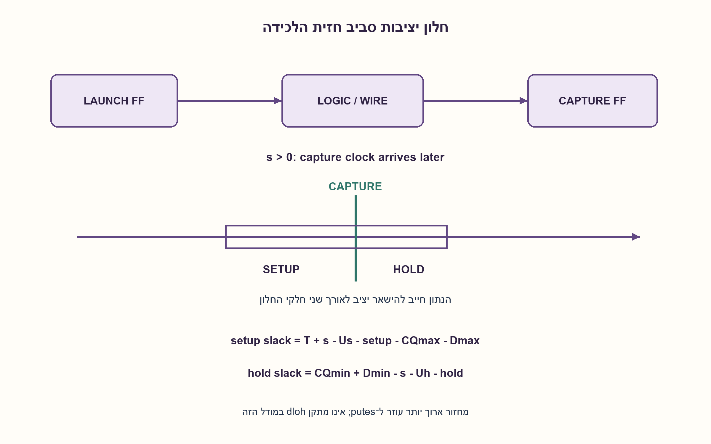
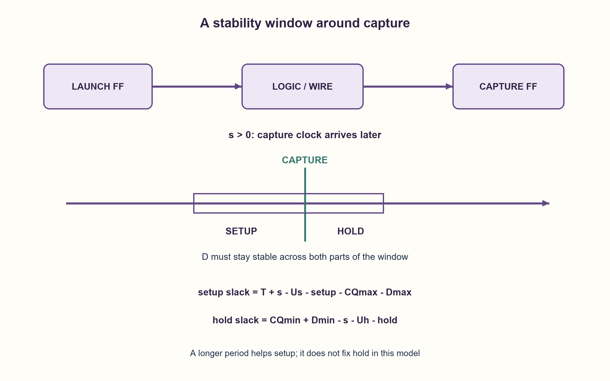

# PREP-176 — Setup ו־Hold — חלון יציבות ושני כיווני תקלה

פתרון מוצע בסיוע AI; ביקורת מקצועית אנושית ממתינה. הקושי אינו מכויל.

[צילום מקור פרטי](../sources/2026-10-30-batch70-26.png)

שאלות SETUP ו־HOLD. מה כל אחד אומר ואיך אפשר לפתור בעיית SETUP?

שיוכי חברות שדווחו בצילום ולא אומתו עצמאית: NVIDIA.

## עברית

הסבירו מה הם setup ו־hold של Flip-Flop, ומה עושים כדי לפתור הפרת setup. הציגו נתיב בין שני אוגרים, משוואות זמן וההשפעה של skew. הסבירו גם מה צריך לבדוק אחרי התיקון.

נבחר נתיב חד־מחזורי בין אוגרים באותו שעון ובאותה קוטביות חזית. T הוא המחזור; skew=s פירושו שחזית הלכידה מגיעה מאוחר יותר ב־s ביחס לחזית השיגור. זמני CQ ולוגיקה ניתנים במינימום ובמקסימום, ונפריד אי־ודאות setup ו־hold. אין כאן CDC, שעונים לא קשורים או הרשאה להכריז multicycle ללא שינוי חוזה פונקציונלי.

1. setup שואל אם הנתון הגיע מספיק מוקדם לפני חזית הלכידה; hold שואל אם נתון חדש מגיע מוקדם מדי אחריה.
2. ל־setup השתמשו ב־CQ ולוגיקה מקסימליים; ל־hold במינימליים. מה קורה כשהלכידה מאוחרת יותר?
3. הדרישות הן CQmax+Dmax+setup+Us ≤ T+s, ו־CQmin+Dmin ≥ hold+Uh+s. הגדלת T משפיעה רק על הראשונה.

### חלון שבו הכניסה צריכה להישאר יציבה
setup הוא משך הזמן הנדרש שבו D יציב לפני החזית הפעילה; hold הוא משך היציבות הנדרש אחריה. אלו מגבלות תא ותנאי עבודה, לא מספר קבוע לכל אוגר. הפרה עשויה ליצור דגימה שגויה או מטא־יציבות, אך התוצאה אינה חייבת להיכשל באותו אופן בכל הרצה.

נמקם חזית שיגור בזמן 0. הנתון המאוחר ביותר מגיע ב־CQmax+Dmax; חזית הלכידה הבאה היא T+s. לכן:

```text
setup_slack = T + s - Us - setup - CQmax - Dmax
hold_slack  = CQmin + Dmin - s - Uh - hold
```

slack שלילי הוא הפרה במודל. ל־hold מסתכלים על חזית הלכידה של אותו מחזור: הנתון החדש שנשלח ב־0 לא רשאי להגיע לפני s+hold+Uh. skew חיובי נותן יותר זמן לנתון המאוחר, אבל מאריך את החלון שבו הנתון הישן חייב להישמר. זו הסיבה שהוא עוזר ל־setup ומקשה על hold. סימן skew חייב להיות מוגדר לפני שימוש בנוסחה.

לדוגמה T=2 ns, CQmax=0.2 ns, Dmax=1.7 ns, setup=0.15 ns, Us=0.03 ns, s=0 נותנים setup slack=−0.08 ns. CQmin=0.08 ns, Dmin=0.05 ns, hold=0.1 ns, Uh=0.02 ns נותנים hold slack=0.01 ns. הגדלת המחזור ב־0.1 ns מתקנת את setup במודל ואינה משנה את hold.

### מתקנים את הסיבה, ואז בודקים את שני הקצוות
אפשר לקצר עומק לוגיקה, לפשט ביטויים, לבחור תאים מהירים יותר, להקטין fanout, לשנות placement/routing או לחזק נתיב כשהעומס הוא הגורם. כל בחירה עולה בשטח, הספק או חיווט. צינור נוסף מחלק נתיב אבל משנה latency ודורש התאמת מסלולים, בקרה ופרוטוקול. הורדת תדר עוזרת ל־setup אם מותר לשנות ביצועים. useful skew דורש תכנון שעון מבוקר ובדיקה בכל הפינות.

אין להוסיף השהיית data כדי לפתור setup; השהיית hold מכוונת לתקלה אחרת. אין לסמן false path או multicycle רק כדי להעלים דוח: החריגה צריכה לנבוע מהפונקציה ומהפרוטוקול. לאחר תיקון בודקים setup וגם hold, כל פינות PVT, אי־ודאות ושעונים, וכן פונקציונליות אם שונתה ארכיטקטורה. הגדלת T לבדה אינה פותרת הפרת hold של הנתיב הזה.

[AMD מתארת בדיקת timing slack כחלק מסגירת תזמון](https://docs.amd.com/r/en-US/ug1388-acap-system-integration-validation-methodology/Reviewing-Timing-Slack). משוואות החלון כאן נגזרו מחזיתות ההגדרה. 54 קומבינציות נבדקו מול זמני הגעה מוחלטים ומול שינוי תקופה; זה אינו STA signoff.

```python
"""Same-clock, same-edge, one-cycle path budgets in one consistent time unit."""

from math import isfinite


def timing_slacks(
    period, cq_min, cq_max, logic_min, logic_max, setup, hold, skew=0, setup_uncertainty=0, hold_uncertainty=0
):
    values = (
        period,
        cq_min,
        cq_max,
        logic_min,
        logic_max,
        setup,
        hold,
        skew,
        setup_uncertainty,
        hold_uncertainty,
    )
    if not all(isfinite(value) for value in values):
        raise ValueError("finite timing values required")
    if (
        period <= 0
        or min(cq_min, logic_min, setup, hold, setup_uncertainty, hold_uncertainty) < 0
        or cq_max < cq_min
        or logic_max < logic_min
    ):
        raise ValueError("invalid timing contract")
    # Positive skew means that the capture clock arrives LATER.
    setup_slack = period + skew - setup_uncertainty - setup - cq_max - logic_max
    hold_slack = cq_min + logic_min - skew - hold_uncertainty - hold
    return setup_slack, hold_slack
```




## English

Define flip-flop setup and hold and explain ways to fix a setup violation. Draw a register-to-register path, give timing equations and explain clock skew. What must be rechecked after a repair?

Choose a one-cycle path with the same clock and edge polarity. T is the period; positive skew s means capture arrives later than launch. CQ and logic delays have minimum/maximum bounds; setup and hold uncertainties are separate. CDC, unrelated clocks and unsupported multicycle exceptions are outside this contract.

1. Setup asks whether data arrives early enough before capture; hold asks whether new data arrives too soon afterward.
2. Use maximum CQ/logic for setup and minimum delays for hold. What does later capture do to each?
3. Require CQmax+Dmax+setup+Us ≤ T+s and CQmin+Dmin ≥ hold+Uh+s. Increasing T helps only the first.

### Data must be stable around the capture edge
Setup is the required stable-D interval before the active capture edge; hold is the stable interval afterward. Values depend on the cell and operating conditions. A violation can cause an incorrect sample or metastability; it does not imply one deterministic failure on every run.

Set launch time to zero. Latest arrival is CQmax+Dmax and next capture is T+s:

```text
setup_slack = T + s - Us - setup - CQmax - Dmax
hold_slack  = CQmin + Dmin - s - Uh - hold
```

Negative slack violates the model. Hold compares new data from the launch at zero with the same-cycle capture edge: arrival must be no earlier than s+hold+Uh. Positive skew allows more late-data time but extends how long old data must remain. It helps setup and hurts hold under this sign convention.

For T=2 ns, CQmax=0.2 ns, Dmax=1.7 ns, setup=0.15 ns, Us=0.03 ns, s=0, setup slack is−0.08 ns. With CQmin=0.08 ns, Dmin=0.05 ns, hold=0.1 ns, Uh=0.02 ns, hold slack is 0.01 ns. Increasing T by 0.1 ns fixes this setup budget without changing hold.

### Repair the cause, then recheck both ends
Reduce logic depth, simplify expressions, use faster cells, reduce fanout or improve placement/routing. Buffering may help a load-dominated path but adds its own delay. Choices trade area, power and wires. Pipelining divides a path but changes latency and requires aligned paths, control and protocol. Lowering frequency helps setup when the performance contract permits it. Useful skew requires controlled clock design and all-corner checking.

Adding data delay does not fix setup; hold-delay insertion addresses the other direction. False-path or multicycle exceptions require a functional/protocol basis, not merely an unpleasant report. Recheck setup and hold, operating corners, clock uncertainty and functional changes. Increasing period alone does not fix hold on this path.

[AMD discusses slack review in timing closure](https://docs.amd.com/r/en-US/ug1388-acap-system-integration-validation-methodology/Reviewing-Timing-Slack). The window equations above follow the defined edge times.54 parameter combinations were checked against absolute arrivals and period changes; this is not STA signoff.

```python
"""Same-clock, same-edge, one-cycle path budgets in one consistent time unit."""

from math import isfinite


def timing_slacks(
    period, cq_min, cq_max, logic_min, logic_max, setup, hold, skew=0, setup_uncertainty=0, hold_uncertainty=0
):
    values = (
        period,
        cq_min,
        cq_max,
        logic_min,
        logic_max,
        setup,
        hold,
        skew,
        setup_uncertainty,
        hold_uncertainty,
    )
    if not all(isfinite(value) for value in values):
        raise ValueError("finite timing values required")
    if (
        period <= 0
        or min(cq_min, logic_min, setup, hold, setup_uncertainty, hold_uncertainty) < 0
        or cq_max < cq_min
        or logic_max < logic_min
    ):
        raise ValueError("invalid timing contract")
    # Positive skew means that the capture clock arrives LATER.
    setup_slack = period + skew - setup_uncertainty - setup - cq_max - logic_max
    hold_slack = cq_min + logic_min - skew - hold_uncertainty - hold
    return setup_slack, hold_slack
```




## חומר משלים / Supporting material

```json
{
  "assumptions": {
    "he": [
      "אותו שעון וחזית, נתיב מחזור אחד; skew חיובי ללכידה מאוחרת.",
      "מודל זמן מאוחד, זמני מינימום/מקסימום ו־uncertainty נפרדים."
    ],
    "en": [
      "Same clock/edge, one-cycle path; positive skew means later capture.",
      "One time unit, explicit min/max delays and separate uncertainties."
    ]
  },
  "optimality": {
    "he": "אין תיקון יחיד אופטימלי ללא נתיב וספרייה; צינור משנה latency והאצה עשויה לפגוע ב־hold.",
    "en": "No unique best repair without the path/library; pipelining changes latency and acceleration may hurt hold."
  },
  "verification": {
    "he": "54 בדיקות מול לוח זמנים מוחלט; הגדלת מחזור עוזרת רק ל־setup במודל.",
    "en": "54 absolute-schedule checks; a longer period improves only setup in this model."
  },
  "edge_cases": {
    "he": [
      "skew שלילי או חיובי.",
      "נתיב קצר מאוד מפר hold.",
      "אפס slack הוא גבול המודל, לא מרווח הנדסי."
    ],
    "en": [
      "Negative/positive skew.",
      "A very short path can violate hold.",
      "Zero slack is a model boundary, not engineering margin."
    ]
  },
  "common_mistakes": {
    "he": [
      "שימוש ב־max גם ל־hold.",
      "בלבול בסימן skew.",
      "הנחה שהורדת תדר מתקנת hold.",
      "חריגת multicycle ללא בסיס פונקציונלי."
    ],
    "en": [
      "Using maximum delays for hold.",
      "Changing skew sign without definition.",
      "Claiming lower frequency fixes hold.",
      "Unsupported multicycle exceptions."
    ]
  },
  "interview_answer": {
    "he": "setup דורש הגעה לפני החזית ו־hold מונע הגעה מוקדמת של הנתון הבא. אבדוק max מול T+skew ל־setup, ו־min מול hold+skew ל־hold. אתקן עומק, עומס או ארכיטקטורה ואבדוק שוב את שניהם.",
    "en": "Setup limits late arrival; hold limits early new-data arrival. Compare maximum delays with T+skew, and minimum delays with hold+skew. Repair depth, load or architecture, then recheck both."
  },
  "source_ambiguities": {
    "he": [
      "המקור לא נותן נתיב או ערכים; הדוגמה והמודל נוספו במפורש."
    ],
    "en": [
      "No path or numeric values were supplied; the model/example are explicit additions."
    ]
  },
  "solution_extensions": {
    "he": [
      {
        "question": "מדוע הגדלת T לא מתקנת hold?",
        "answer_direction": "ההשוואה היא בין חזיתות של אותו מחזור לבין הנתון החדש, לכן T אינו מופיע באי־השוויון.",
        "principle": "לפני תיקון מזהים אילו חזיתות משתתפות בדרישה."
      }
    ],
    "en": [
      {
        "question": "Why does increasing T not fix hold?",
        "answer_direction": "It compares same-cycle edges with earliest new data, so T is absent from the inequality.",
        "principle": "Identify the edges participating in each constraint."
      }
    ]
  }
}
```
