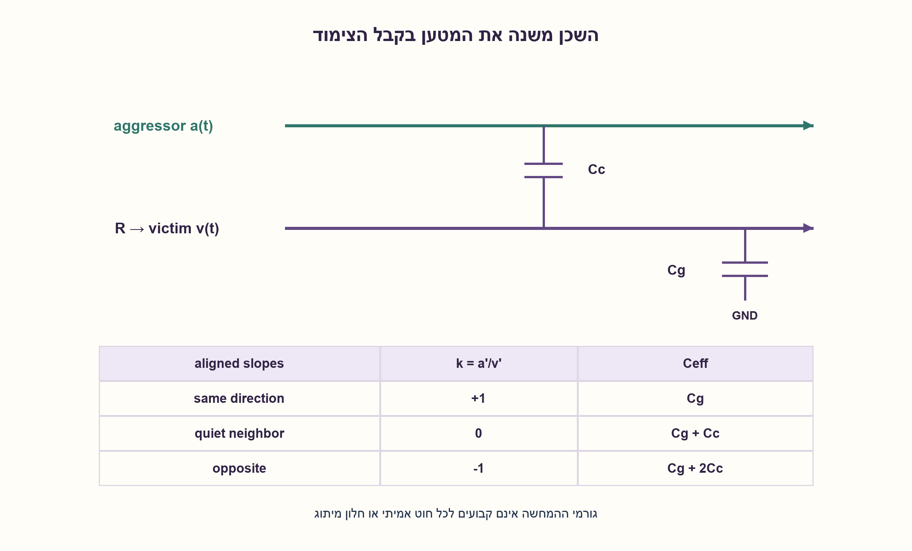
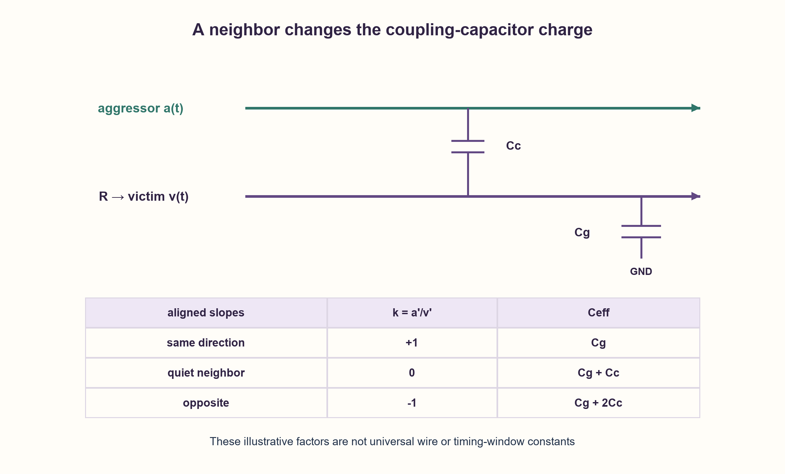

# PREP-177 — Crosstalk delay — השכן משנה את מטען החוט

פתרון מוצע בסיוע AI; ביקורת מקצועית אנושית ממתינה. הקושי אינו מכויל.

[צילום מקור פרטי](../sources/2026-10-30-batch70-28.png)

הסבר מה זה crosstalk delay והצע דרכים לטפל בבעיה.

שיוכי חברות שדווחו בצילום ולא אומתו עצמאית: NVIDIA.

## עברית

הסבירו מהו crosstalk delay והציעו דרכים לטפל בו. הפרידו בין שינוי השהיה בקו מיתוג לבין רעש בקו שאמור להישאר קבוע.

להמחשה בלבד נבחר חוט victim המונע דרך R, קיבול Cg לאדמה וקיבול צימוד Cc ל־aggressor. נניח מעברים מיושרים בעלי שיפועים שווים בגודל: באותו כיוון, שכן שקט, או בכיוונים מנוגדים. נגזור מטען אפקטיבי ולא נציג אותו כמודל מלא של חוט מפולג, צימוד השראתי או STA signoff. אין נתוני גאומטריה, תהליך או מספר השהיה במקור.

1. זרם בקבל צימוד תלוי בשינוי הפרש המתחים בין החוטים, לא רק במתח של חוט אחד.
2. כתבו i=Cg·dv/dt+Cc·d(v−a)/dt. מה קורה כשהשכן עולה יחד עם הקורבן או יורד נגדו?
3. אם k=(da/dt)/(dv/dt), אז Ceff=Cg+Cc(1−k). מתקבלים Cg, Cg+Cc, Cg+2 Cc עבור יחד, שקט ונגד בהתאמה.

### החוט אינו לבדו
שני חוטים קרובים מצומדים חשמלית. ה־aggressor יכול לשנות את המתח או את קצב המעבר של ה־victim דרך קיבולים ולעיתים גם צימוד השראתי. כשה־victim מחליף ערך, שינוי זמן חציית הסף הוא crosstalk delay. כשאמור להישאר קבוע, הצימוד עשוי ליצור פולס רעש בלי מעבר לוגי מתוכנן. אלו שני ניתוחים קשורים אך שונים.

בקירוב הקיבולי הנבחר, הזרם שהדרייבר מספק הוא:

```text
i = Cg dv/dt + Cc d(v-a)/dt
k = (da/dt)/(dv/dt)
Ceff = Cg + Cc (1-k)
```

כששני המתחים משתנים יחד באותו קצב, ההפרש על קבל הצימוד אינו משתנה ואין תוספת מטען דרכו: Ceff=Cg. שכן שקט נותן Cg+Cc. במעבר נגדי שווה, ההפרש משתנה פי שניים ולכן Ceff=Cg+2 Cc. אומדן RC לחציית חצי המתח הוא ln(2)R·Ceff. זו מסקנה של מודל שיפועים מיושרים שנכפה לצורך ההמחשה; דרייברים וחוטים אמיתיים קובעים יחד את הגלים, ולא תמיד אפשר להצמיד להם גורם 0/1/2 קבוע.

לכן מעבר נגדי יכול להאט לעומת שכן שקט ולהחמיר setup, ומעבר יחד יכול להאיץ ולהחמיר hold. אם זמני המעבר אינם חופפים, הכיוון, החלון ועוצמת ההשפעה משתנים. אין כלל שכל crosstalk רק מוסיף השהיה. בקורבן שקט צריך לבדוק גובה ורוחב פולס ורגישות המקלט, לא להציב dv/dt=0 בחלוקת השיפועים.

### מטפלים בצימוד ובתזמון
אפשר להגדיל מרווח בין חוטים, להקטין אורך מקביל, לשנות שכבות/ניתוב, להוסיף shielding עם חיבור ייחוס מתאים, או להשתמש בדרייבר/באפר מתאימים. אלו עולים בשטח, הספק, עומס או משאבי ניתוב; מגן מוסיף גם קיבול כלפי עצמו. הגבלת slew של aggressor יכולה להפחית רעש אבל להרע תזמון, וצריכה לעמוד במגבלות התא. שינוי חלונות מיתוג או מיקום עשוי לעזור כשמותר פונקציונלית.

[Toshiba מסבירה צימוד בין קווים מקבילים ואמצעי ניתוב לצמצומו](https://toshiba.semicon-storage.com/us/semiconductor/knowledge/e-learning/cmos-logic-usage-considerations/usage-9-3.html). משוואות המטען כאן הן נגזרת עצמאית של המודל המאוחד. בסגירה אמיתית משתמשים בפרזיטים מחולצים, חלונות פעילות, שיפועים, עומסים וכלי SI-aware STA, ובודקים גם מקסימום וגם מינימום.

27 תרחישי מטען חושבו בנפרד משינוי המתחים על שני הקבלים ועוד שישה סדרי השהיה. זה אינו field solver, SPICE או בדיקת רעש בתדר גבוה.

```python
"""Lumped capacitive illustration with prescribed aligned ramp slopes."""

from math import isfinite, log


def effective_capacitance(ground_c, coupling_c, aggressor_slope_ratio):
    values = (ground_c, coupling_c, aggressor_slope_ratio)
    if not all(isfinite(value) for value in values):
        raise ValueError("finite parameters required")
    if ground_c <= 0 or coupling_c < 0 or aggressor_slope_ratio not in (-1, 0, 1):
        raise ValueError("Cg>0, Cc>=0 and aligned ratio -1,0,1 required")
    return ground_c + coupling_c * (1 - aggressor_slope_ratio)


def illustrative_delay(resistance, ground_c, coupling_c, aggressor_slope_ratio):
    if not isfinite(resistance) or resistance <= 0:
        raise ValueError("positive finite resistance required")
    return log(2) * resistance * effective_capacitance(ground_c, coupling_c, aggressor_slope_ratio)
```




## English

Explain crosstalk delay and suggest remedies. Distinguish delay change on a switching victim from noise on a victim intended to stay quiet.

For illustration choose a victim driven through R, ground capacitance Cg, and coupling Cc to an aggressor. Assume aligned transitions with equal slope magnitudes:same direction, quiet neighbor, or opposite directions. Derive effective charge, without claiming a full distributed-wire, inductive-coupling or STA-signoff model. The source supplies no geometry, process or numeric delay.

1. Coupling-capacitor current depends on the changing voltage difference between wires.
2. Write i=Cg·dv/dt+Cc·d(v−a)/dt. What happens for equal-direction versus opposite ramps?
3. For k=(da/dt)/(dv/dt), Ceff=Cg+Cc(1−k):Cg, Cg+Cc, Cg+2 Cc for same, quiet and opposite motion.

### A wire is not alone
Nearby wires couple electrically. An aggressor can alter the victim voltage or transition through capacitance and sometimes inductive coupling. On a switching victim, the changed threshold-crossing time is crosstalk delay. On an intended quiet victim, coupling can create a noise pulse without a planned logical transition. These require related but different analyses.

In the chosen lumped capacitive model, the driver supplies:

```text
i = Cg dv/dt + Cc d(v-a)/dt
k = (da/dt)/(dv/dt)
Ceff = Cg + Cc (1-k)
```

Equal same-direction ramps keep the coupling voltage constant, giving Ceff=Cg. A quiet neighbor gives Cg+Cc. Equal opposite ramps change the difference twice as fast, giving Cg+2 Cc. An RC half-crossing estimate is ln(2)R·Ceff. These results assume prescribed aligned slopes; real drivers and distributed wires jointly determine waveforms, so a fixed0/1/2 factor is not universal.

Opposite switching can therefore slow the victim and worsen setup; same-direction switching can speed it and worsen hold, relative to a quiet neighbor. Different alignment changes the effect. Crosstalk does not always add delay. For a quiet victim, analyze pulse amplitude, width and receiver sensitivity rather than dividing by zero victim slope.

### Reduce coupling and inspect timing windows
Increase spacing, shorten parallel runs, reroute or change layers, add suitably referenced shielding, or choose appropriate drive/buffering. Costs include routing space, area, power and capacitance; shields themselves add load. Limiting aggressor slew can reduce noise while hurting timing and must respect cell specifications. Activity-window or placement changes may help when functionally permitted.

[Toshiba discusses coupling between parallel lines and routing remedies](https://toshiba.semicon-storage.com/us/semiconductor/knowledge/e-learning/cmos-logic-usage-considerations/usage-9-3.html). The charge equations here are independently derived from the chosen lumped model. Real closure uses extracted parasitics, activity windows, slopes, loads and SI-aware STA, checking both maximum and minimum timing.

Checks independently calculated27 charge scenarios from capacitor voltage changes plus six delay orderings. This is not a field solver, SPICE or high-frequency noise validation.

```python
"""Lumped capacitive illustration with prescribed aligned ramp slopes."""

from math import isfinite, log


def effective_capacitance(ground_c, coupling_c, aggressor_slope_ratio):
    values = (ground_c, coupling_c, aggressor_slope_ratio)
    if not all(isfinite(value) for value in values):
        raise ValueError("finite parameters required")
    if ground_c <= 0 or coupling_c < 0 or aggressor_slope_ratio not in (-1, 0, 1):
        raise ValueError("Cg>0, Cc>=0 and aligned ratio -1,0,1 required")
    return ground_c + coupling_c * (1 - aggressor_slope_ratio)


def illustrative_delay(resistance, ground_c, coupling_c, aggressor_slope_ratio):
    if not isfinite(resistance) or resistance <= 0:
        raise ValueError("positive finite resistance required")
    return log(2) * resistance * effective_capacitance(ground_c, coupling_c, aggressor_slope_ratio)
```




## חומר משלים / Supporting material

```json
{
  "assumptions": {
    "he": [
      "מודל קיבולי מאוחד ושיפועים מיושרים שנבחרו במפורש.",
      "R, Cg חיוביים; Cc לא שלילי; k הוא−1,0 או 1."
    ],
    "en": [
      "Explicit lumped capacitance and aligned prescribed slopes.",
      "Positive R, Cg; nonnegative Cc; k is−1,0 or1."
    ]
  },
  "optimality": {
    "he": "הקטנת צימוד מתחרה בשטח, עומס, הספק וניתוב; אין פתרון מיטבי ללא פרזיטים וחלונות פעילות.",
    "en": "Coupling reduction trades routing, area, power and load; no optimum without parasitics and switching windows."
  },
  "verification": {
    "he": "33 בדיקות מטען וסדרי השהיה במודל מאוחד; ללא field solver או STA.",
    "en": "33 charge/delay-order checks in a lumped model; no field solver or STA."
  },
  "edge_cases": {
    "he": [
      "Cc=0 מבטל תלות בשכן.",
      "אותו כיוון מול נגדי, וחוסר חפיפה.",
      "קורבן שקט דורש ניתוח פולס אחר."
    ],
    "en": [
      "Cc=0 removes neighbor dependence.",
      "Same/opposite transitions and nonoverlap.",
      "Quiet victim needs a different pulse analysis."
    ]
  },
  "common_mistakes": {
    "he": [
      "הטענה שצימוד רק מאט.",
      "שימוש אוטומטי ב־2 Cc לכל מעבר.",
      "התעלמות מ־hold או מחלונות פעילות."
    ],
    "en": [
      "Claiming coupling only slows signals.",
      "Assigning2 Cc to every event.",
      "Ignoring hold or activity windows."
    ]
  },
  "interview_answer": {
    "he": "זרם הצימוד תלוי בנגזרת הפרש המתחים. במודל שיפועים שווים, יחד נותן 0 Cc, שקט 1 Cc ונגד 2 Cc. אבדוק האטת setup וגם האצת hold, ואקטין צימוד או אשנה ניתוב והנעה תוך בדיקה מחודשת.",
    "en": "Coupling current follows the voltage-difference derivative. Equal ramps give0 Cc,1 Cc or2 Cc for same, quiet or opposite motion. Check setup slowdown and hold speedup, then tune routing, coupling or drive and recheck."
  },
  "source_ambiguities": {
    "he": [
      "אין במקור פרזיטים או צורות גל; כמות ההשהיה אינה ניתנת לחישוב יחיד."
    ],
    "en": [
      "No parasitics or waveforms were supplied; a unique numeric delay cannot be inferred."
    ]
  },
  "solution_extensions": {
    "he": [
      {
        "question": "למה מגן מוליך אינו פתרון חינם?",
        "answer_direction": "הוא צורך ניתוב ועלול להוסיף קיבול; נדרש חיבור ייחוס והערכה של העומס והתזמון.",
        "principle": "הקטנת הפרעה עשויה להגדיל עומס."
      }
    ],
    "en": [
      {
        "question": "Why is shielding not free?",
        "answer_direction": "It consumes routing and can add capacitance; provide a reference connection and re-evaluate load/timing.",
        "principle": "Reducing interference may increase load."
      }
    ]
  }
}
```
