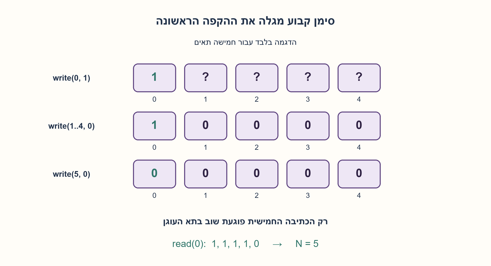
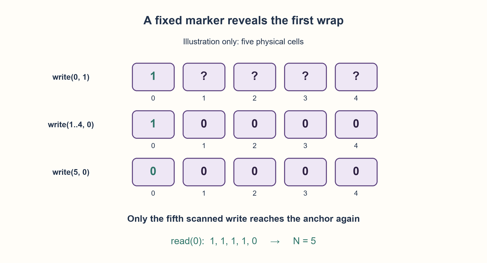

# PREP-178 — גילוי אורך זיכרון ביטים מעגלי בלי לדעת את תוכנו

פתרון מוצע בסיוע AI; ביקורת מקצועית אנושית ממתינה. הקושי אינו מכויל.

[צילום מקור פרטי](../sources/2026-10-30-batch90-01.png)

נתון מערך של ביטים בעל אורך N לא ידוע אשר מאותחל לערכים לא ידועים (0 או 1). נתונות הפונקציות void write(int addr, bit val); bit read(int addr); כאשר val הינו ערך בינארי לכתיבה למערך ו־addr הינו התא אליו ניגשים. הגישה לכתובת הינה ציקלית: אם ניגשים לכתובת מעל כמות האיברים חוזרים אל תחילת המערך. לדוגמה עבור מערך באורך 5: כתובת 3 ניגשת לתא 3, כתובת 5 לתא 0, כתובת 6 לתא 1 וכתובת 10 לתא 0. כתוב אלגוריתם שימצא את אורך המערך N.

## עברית

לרשותכם זיכרון ביטים באורך חיובי N שאינו ידוע. תוכן כל תא בתחילה יכול להיות 0 או 1. הממשק הוא:

```text
write(addr, val)
read(addr)
```

הכתובת addr היא מספר שלם לא שלילי, והגישה היא לתא addr mod N. למשל, כאשר N=5 הכתובות 0,5,10 פונות לאותו תא. מצאו אלגוריתם שתמיד מחזיר את N, והסבירו מדוע הוא עובד גם כשהתוכן ההתחלתי שרירותי.

הנחות העריכה: מותר לשנות ולהרוס את תוכן הזיכרון; אין דרישה לשחזרו. הקריאה והכתיבה אמינות, מיידיות ומתבצעות ללא כותב נוסף. N חיובי וסופי; אין גלישה במונה הכתובות ואין הודעת שגיאה שמגלה את האורך. השתמשו רק בממשק הנתון ולא בגישה למבנה פנימי.

1. בחרו תא עוגן וכתבו אליו ערך ידוע לפני שמתחילים. כך אינכם צריכים לנחש מה היה בו קודם.
2. אם כותבים ערך הפוך לכתובות 1,2,3,... ובודקים בכל פעם את העוגן, מתי ערכו יכול להשתנות לראשונה?
3. כתבו 1 לכתובת 0. לכל i חיובי כתבו 0 לכתובת i וקראו את כתובת 0. הכתובת החיובית הראשונה שאיפסה אותו היא N.

### הופכים חוסר מידע לסימן שאנחנו שולטים בו
הביטים ההתחלתיים אינם סימוני סוף שאפשר לסמוך עליהם. לכן יוצרים סימן: כותבים 1 בתא שאליו פונה כתובת 0. כעת סורקים כתובות חיוביות לפי הסדר, כותבים בכל אחת 0 ובודקים אם הסימן שלנו נמחק.

כל עוד 1≤i<N, הכתובת i אינה כתובת 0 מודולו N. הכתיבה אינה נוגעת בתא העוגן והוא נשאר 1. ב־i=N מגיעים לראשונה שוב לתא העוגן, כותבים בו 0, והקריאה מזהה זאת. לכן הכתובת שבה נעצרים היא בדיוק N, ולא כפולה מאוחרת שלו. עבור N=1 כבר הכתיבה בכתובת 1 חוזרת לעוגן.

לדוגמה N=5: אחרי כתיבת הסימן, הקריאות מן העוגן לאחר הכתיבות 1,2,3,4,5 הן 1,1,1,1,0. אין חשיבות לביטים שהיו בתאים האחרים. אין שימוש בהשוואת דפוסים מקריים, ולכן גם מערך שכולו אפסים או כולו אחדים מטופל.

מספר הפעולות המדויק הוא N קריאות ו־N+1 כתיבות: כתיבת עוגן אחת ועוד זוג פעולות בכל צעד. במודל של פעולה אחת לממשק זה O(N) זמן ו־O(1) מילות עזר. המונה עצמו צריך O(log N) ביטים; אין כאן טענה לזיכרון קבוע במספר ביטים לכל N או לאופטימליות מול כל מודל שאילתות אפשרי.

הבדיקה הרסנית. עם דרישה לשימור התוכן זו בעיה אחרת; אי אפשר להציג את האיפוס כפעולה חינמית שאינה משנה נתונים. קובץ המודל כולל זיכרון מעגלי לצורך הבדיקות בלבד; האלגוריתם שלהלן משתמש רק ב־read וב־write. נבדקו כל 8,190 מצבי התוכן עבור N=1..12 ועוד 15 מקרים גדולים. אלו בדיקות Python של החוזה, ללא בדיקת RAM פיזי.

```python
def discover_length(read, write):
    """Use only the supplied interface; write(i, v) accesses i modulo N."""
    write(0, 1)
    address = 1
    while True:
        write(address, 0)
        if read(0) == 0:
            return address
        address += 1
```




## English

You have a bit memory of unknown positive length N. Each initial cell may contain either 0 or 1. Its interface is:

```text
write(addr, val)
read(addr)
```

A nonnegative integer address accesses cell addr mod N. For example, at N=5, addresses 0,5,10 reach the same cell. Give an algorithm that always returns N and explain why arbitrary initial contents do not fool it.

Editorial assumptions: destructive writes are permitted; restoring old contents is not required. Reads/writes are reliable and immediately visible, with no concurrent writer. N is positive and finite; address arithmetic does not overflow and no bounds error reveals N. Use only the supplied interface, not the memory's internal representation.

1. Choose an anchor cell and establish its value before scanning, rather than guessing its initial contents.
2. Write the opposite value at addresses 1,2,3,... and reread the anchor after each write. When can it first change?
3. Write 1 at address 0. For each positive i, write 0 at i and read address 0. The first i that clears the anchor is N.

### Replace unknown contents with a controlled marker
Initial bits cannot serve as a trustworthy terminator. Establish a marker instead: write 1 into the cell reached by address 0. Scan positive addresses in order, writing 0 and checking whether the anchor was cleared.

For 1≤i<N, i is not 0 modulo N, so that write cannot touch the anchor; it remains 1. At i=N the scan first returns to the anchor, writes 0 there, and the read detects it. Thus the stopping address is exactly N, not a later multiple. At N=1, address 1 already wraps to the anchor.

For N=5 the anchor reads after writes at 1,2,3,4,5 are 1,1,1,1,0. Other initial cells do not matter. No accidental pattern match is used, so all-zero and all-one memories work too.

The exact cost is N reads and N+1 writes: one marker write plus one write/read pair per step. With constant-cost interface calls this is O(N) time and O(1) auxiliary words. The address counter itself requires O(log N) bits; this is not constant bits for every N, nor an optimality claim over all possible query models.

The procedure is destructive. Requiring original contents to survive defines a different problem. The downloadable model includes a circular memory specification for testing only; the algorithm below uses read/write alone. Checks enumerated all 8,190 initial states at N=1..12 and 15 larger cases. These are Python contract checks, not physical RAM tests.

```python
def discover_length(read, write):
    """Use only the supplied interface; write(i, v) accesses i modulo N."""
    write(0, 1)
    address = 1
    while True:
        write(address, 0)
        if read(0) == 0:
            return address
        address += 1
```




## חומר משלים / Supporting material

```json
{
  "assumptions": {
    "he": [
      "N חיובי וסופי; addr ממופה מודולו N והמונה אינו גולש.",
      "מותר להרוס את תוכן הזיכרון; קריאה וכתיבה אמינות ואין גישה מקבילית."
    ],
    "en": [
      "Positive finite N; addresses map modulo N without counter overflow.",
      "Destructive reliable read/write operations; no concurrent access."
    ]
  },
  "optimality": {
    "he": "האלגוריתם משתמש ב־2N+1 פעולות ממשק ובמספר קבוע של מילות עזר. אין טענת מינימום שאילתות ללא מודל חישוב וחסם תחתון מפורשים.",
    "en": "The algorithm uses 2N+1 interface calls and constant auxiliary words. No minimum-query claim is made without a stated computational model and lower bound."
  },
  "verification": {
    "he": "8,205 מקרים עברו: כל מצבי הביטים באורכים 1–12 ועוד 15 תרחישים באורכים 13,31,64,127,1000. נבדקו תוצאת N, עקבת העוגן ומספר הקריאות והכתיבות המדויק.",
    "en": "8,205 cases passed: all bit states at lengths 1–12 plus 15 cases at 13,31,64,127,1000. Checked N, anchor trace and exact read/write counts."
  },
  "edge_cases": {
    "he": [
      "N=1: הכתיבה החיובית הראשונה מוחקת את הסימן.",
      "כל הביטים שווים או מחזוריים: אין הסתמכות עליהם.",
      "N=0, גלישת כתובת או כותב נוסף נמצאים מחוץ לחוזה."
    ],
    "en": [
      "N=1: the first positive write clears the marker.",
      "Uniform or periodic contents do not affect the method.",
      "Zero length, address overflow or another writer violate the contract."
    ]
  },
  "common_mistakes": {
    "he": [
      "חיפוש דפוס שחוזר בלי ליצור סימן אמין.",
      "בדיקת כתובות בחזקות שתיים בלבד: באורך 3 הן לעולם אינן כפולות של 3.",
      "הבטחת שימור הנתונים למרות איפוסם."
    ],
    "en": [
      "Searching for a repeating pattern without establishing a marker.",
      "Probing only powers of two: at length 3 none is divisible by 3.",
      "Claiming old data survives the destructive writes."
    ]
  },
  "interview_answer": {
    "he": "אקבע סימן 1 בתא 0. אכתוב 0 לכתובות החיוביות לפי הסדר ואקרא כל פעם את 0. רק בכפולה חיובית של N הסימן יכול להימחק, והראשונה היא N. העלות 2N+1 פעולות והבדיקה הרסנית.",
    "en": "Set cell 0 to 1. Write 0 at successive positive addresses and reread 0 each time. Only a positive multiple of N can clear it; the first is N. Cost is 2N+1 calls and contents are destroyed."
  },
  "source_ambiguities": {
    "he": [
      "המקור אינו דורש שחזור מידע; האפשרות לשנותו נאמרת במפורש בנוסח הערוך.",
      "הגדרת כתובות בלתי חסומות ואמינות הממשק הן הנחות למודל, לא תכונות שנמדדו בחומרה."
    ],
    "en": [
      "The source does not require restoring contents; destructive permission is explicit in the edited version.",
      "Unbounded addresses and a reliable interface are model assumptions, not measured hardware properties."
    ]
  },
  "solution_extensions": {
    "he": [
      {
        "question": "מדוע קפיצה רק לכתובות 1,2,4,8,... אינה פתרון כללי?",
        "answer_direction": "עבור N=3 אף כתובת כזו אינה פוגעת בעוגן; הראו את השאריות 1,2 לסירוגין.",
        "principle": "סיום חייב להיות מובטח לכל גודל חוקי, לא רק לחזקות שתיים."
      }
    ],
    "en": [
      {
        "question": "Why not probe only 1,2,4,8,...?",
        "answer_direction": "At N=3 their residues alternate 1,2 and never reach the anchor.",
        "principle": "Termination must hold for every legal size, not just powers of two."
      }
    ]
  }
}
```
