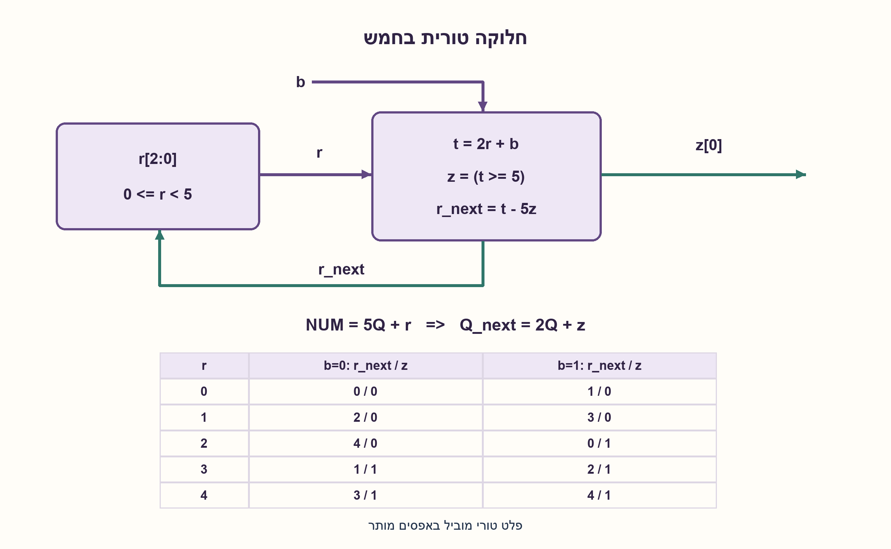
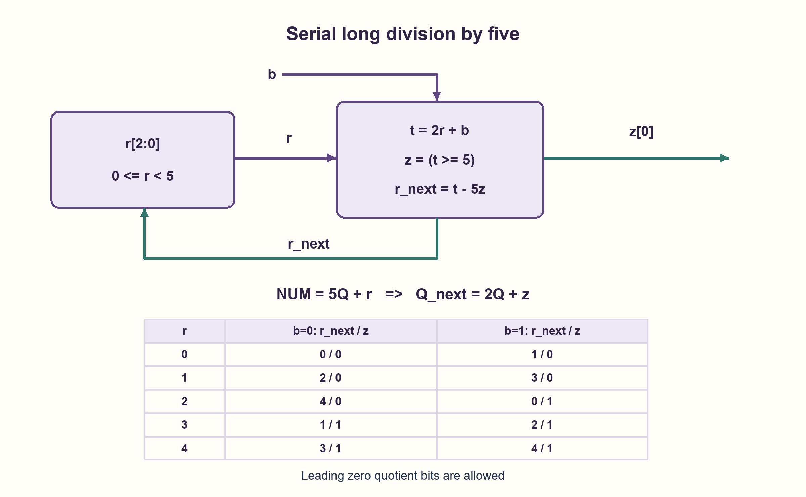

# PREP-179 — חלוקה בחמש תוך הגעת סיביות — מנה ושארית

פתרון מוצע בסיוע AI; ביקורת מקצועית אנושית ממתינה. הקושי אינו מכויל.

[צילום מקור פרטי](../sources/2026-10-30-batch90-02.png)

נתונה המערכת הבאה: כניסת המערכת הינה ביט 1 אז כל פעם מוסיפים אותו כ־LSB לזיכרון ברוחב אינסופי (נקרא למספר השמור NUM). מוצא המערכת הינו המספר השמור במערכת חלקי 5 מעוגל כלפי מטה (floor(num/5)). ממש את המערכת.

חברות לפי הדיווח בצילום בלבד: NVIDIA, Actelis Networks, Mellanox.

## עברית

מערכת מקבלת סיבית b בכל צעד, ומוסיפה אותה כסיבית ה־LSB של המספר שנצבר: NUM_next=2·NUM+b. תכננו מערכת שמוציאה floor(NUM/5) לאחר כל צעד. הציגו משוואות, מצבים ועלות אחסון.

הבהרות עריכה: נבחר b∈{0,1}, איפוס NUM=0, וקליטה בסדר MSB-first. הצילום אומר „ביט 1”; אם הכוונה לקבוע 1, זו תת־המשפחה של אותו מימוש. זיכרון אינסופי הוא הפשטה: מבחינים בין פלט מנה טורי לבין אוגר מנה מקביל בעל רוחב שגדל עם מספר הסיביות. אפשר לממש משפחת רכיבים עם גבול W מוגדר, אך אין רכיב סופי שמחזיק במקביל מנה מדויקת של זרם בלתי מוגבל.

1. במקום לשמור את המספר כולו בלוגיקת הבקרה, מה צריך לדעת על השארית בחלוקה בחמש?
2. כתבו NUM=5 Q+r. אחרי הגעת b הכפילו את שני האגפים בשתיים והוסיפו b.
3. t=2 r+b נמצא בין אפס לתשע. אם t≥5 מוסיפים סיבית מנה 1 ומחסרים חמש; אחרת סיבית המנה היא אפס.

### אותה פעולת חילוק ארוך בכל סיבית
המצב החשוב הוא r, השארית של הקידומת שכבר נקראה. תמיד 0≤r<5. מהאינווריאנט NUM=5 Q+r נקבל:

```text
2·NUM+b = 5·(2Q) + (2r+b)
t = 2r+b
z = 1 if t>=5 else 0
r_next = t-5z
Q_next = 2Q+z
```

מכיוון ש־t≤9, דרוש לכל היותר חיסור אחד. z היא סיבית המנה הבאה. המימוש הטורי הוא בקר בעל חמישה מצבי שארית, שלוש סיביות מצב, חיווט להזזה, השוואה לחמש וחיסור קבוע קטן. אין מחלק כללי גדול. טבלת המעברים בשרטוט מציינת `r_next/z` עבור כל r וכל b. בסיבית הראשונה עשויה לצאת אפס מוביל; אין למחוק אותה אם נדרש יישור סיביות.

לדוגמה 1101 הוא 13: רצף סיביות המנה הוא 0010, כלומר 2, והשארית הסופית 3. הנכונות באינדוקציה: האינווריאנט מתקיים באיפוס; נוסחאות העדכון שומרות אותו ואת טווח r. לכן אחרי כל קידומת Q הוא floor(NUM/5).

חמש השאריות ניתנות להגעה ומובחנות בהתנהגות העתידית: ההמשך 000 יפיק את הקודים הבינאריים של floor(8 r/5), חמישה ערכים שונים. לכן בקר המפיק את כל סיביות המנה דורש לפחות חמישה מצבים במודל זה. זו טענת מצבים, לא מינימום שערים או השהיה.

אם רוצים את כל Q במקביל אחרי כל צעד, מצרפים אוגר מנה עם Q_next=(Q<<1)|z. לאחר m קלטים הוא דורש O(m) ביטים. אפשר להגדיר W מרבי ואיתות overflow או backpressure; אסור לשמט זאת ולקרוא לאוגר קבוע „אינסופי”. אם b תמיד 1, המספר הוא 2^m−1 ואותן משוואות תקפות.

קוד ה־SV מפיק z תקף אחרי כל חזית עם valid=1 ושומר מצב בהפסקת valid. ה־Python שומר גם מנה לא חסומה לצורך בדיקה בלבד. נבדקו כל המילים עד אורך 12, כל עשר קשתות המעבר ומקרה של 256 אחדות. לא בוצעו הידור SV או סינתזה.

### מודל לוגי בפייתון שהורץ

```python
"""MSB-first long division; appending input b gives NUM' = 2*NUM+b.

The finite controller emits quotient bits. Python's unbounded quotient register
is an abstract observer, not a claim of physically infinite-width hardware.
"""


def step(remainder, bit):
    if type(remainder) is not int or not 0 <= remainder < 5:
        raise ValueError("remainder must be in 0..4")
    if type(bit) is not int or bit not in (0, 1):
        raise ValueError("one binary input required")
    trial = (remainder << 1) | bit
    quotient_bit = int(trial >= 5)
    return trial - 5 * quotient_bit, quotient_bit


def divide_stream(bits):
    remainder = quotient = 0
    trace = []
    for bit in bits:
        remainder, digit = step(remainder, bit)
        quotient = (quotient << 1) | digit
        trace.append((quotient, remainder, digit))
    return trace
```


### קוד SystemVerilog מוצע; לא הודר בבדיקה זו

```systemverilog
// Emits one MSB-first quotient bit for each accepted input bit.
// No finite-width register stores an infinitely growing quotient.
module serial_divide_five (
  input logic clk, rst, valid, bit_in,
  output logic quotient_bit, quotient_valid,
  output logic [2:0] remainder
);
  logic [3:0] trial;
  always_comb trial = {remainder, bit_in};
  always_ff @(posedge clk) begin
    if (rst) begin
      remainder <= 3'd0;
      quotient_bit <= 1'b0;
      quotient_valid <= 1'b0;
    end else begin
      quotient_valid <= valid;
      if (valid) begin
        quotient_bit <= trial >= 4'd5;
        remainder <= trial >= 4'd5 ? trial - 4'd5 : trial;
      end
    end
  end
endmodule
```




### assumptions

```json
[
  "בכל צעד נוספת סיבית בצד הפחות משמעותי; המספר ללא סימן. האיפוס לאפס.",
  "פלט טורי וחוזה רוחב מקביל מופרדים במפורש."
]
```

### optimality

בקר קבוע בעל חמישה מצבים; מנה טורית בעלות קבועה לסיבית. מנה מקבילית של m סיביות קלט דורשת O(m) אחסון.

### verification

8,191 מילים עד אורך 12; 90,114 תצפיות קידומת; עשרה מעברים ומקרה 256 אחדות מול divmod. קוד SV מוצע לא הודר.

### edge_cases

```json
[
  "קלט ריק ואפסים מובילים.",
  "המשך valid=0 שומר שארית; באיפוס גם המנה מתאפסת.",
  "רוחב מנה קבוע חייב מדיניות גלישה."
]
```

### common_mistakes

```json
[
  "לשמור רק שארית ואז לטעון שמתקבלת מנה מקבילית מלאה.",
  "להוסיף את הסיבית כ־MSB של המספר הקודם במקום כ־LSB.",
  "למחוק אפסים בתחילת הפלט ולפגוע ביישור."
]
```

### interview_answer

אשמור את r של הקידומת. מחשב t=2 r+b, פולט z לפי t≥5 ומחסיר 5 כשצריך. Q_next=2 Q+z. הבקרה סופית; פלט Q מקבילי לזרם בלתי מוגבל דורש אחסון גדל.

### source_ambiguities

```json
[
  "הביט „1” בצילום עשוי לתאר סיבית אחת או קבוע 1; שני המקרים נידונים.",
  "אין גבול אורך או דרישת תקפות פלט במקור; נוספו במפורש."
]
```

### solution_extensions

```json
[
  {
    "question": "האם שארית לבדה מספיקה להוציא מנה מקבילית?",
    "answer_direction": "לא. שתי קידומות שונות עשויות לחלוק שארית, אך המנות שלהן שונות; נדרש אחסון Q או פלט טורי שנאסף בחוץ.",
    "principle": "מצב בקרה אינו בהכרח כל מצב הנתונים."
  }
]
```

## English

The system receives one bit b per step and appends it as the new LSB: NUM_next=2·NUM+b. Design a system producing floor(NUM/5) after every step. Give equations, state and storage costs.

Editorial clarifications: choose b∈{0,1}, reset NUM=0 and MSB-first arrival. The source says “bit 1”; if it means the constant 1, that is the all-one subcase. Infinite-width memory is an abstraction: distinguish serial quotient bits from a parallel quotient register whose width grows with the input length. A family with a declared maximum W is implementable; a fixed finite circuit cannot store the exact parallel quotient of an unbounded stream.

1. What information about the remainder controls division, without retaining the whole number in the controller?
2. Write NUM=5 Q+r. Double both sides and append b.
3. t=2 r+b lies in 0..9. If t≥5 emit quotient bit 1 and subtract5; otherwise emit0.

### One long-division step per incoming bit
Retain remainder r of the prefix already read, with 0≤r<5. From NUM=5 Q+r:

```text
2·NUM+b = 5·(2Q) + (2r+b)
t = 2r+b
z = 1 if t>=5 else 0
r_next = t-5z
Q_next = 2Q+z
```

Since t≤9, at most one subtraction is needed. z is the next quotient bit. The serial controller has five remainder states, three state bits, shift wiring, a comparison against 5 and a small constant subtraction. It does not need a general wide divider. The diagram's transition table gives r_next/z for each r and b. Leading zero quotient bits are meaningful for bit alignment.

For input 1101, representing 13, quotient bits are 0010, representing 2, with final remainder 3. Correctness is inductive: reset satisfies the invariant; each update preserves it and the remainder range. Thus Q=floor(NUM/5) after every prefix.

All five remainders are reachable and behaviorally distinguishable: continuation 000 produces the binary encodings of floor(8 r/5), five different values. The quotient-bit controller therefore requires at least five states in this model. This is a state bound, not a minimum gate/delay claim.

A parallel Q output needs an additional register updated by Q_next=(Q<<1)|z. After m inputs it requires O(m) bits. Specify a maximum W and overflow/backpressure policy for real hardware; a fixed register is not infinite memory. Constant b=1 gives NUM=2^m−1 and uses the same recurrence.

The proposed SV emits z after every edge with valid=1 and preserves division state while valid=0. Python's unbounded Q is only a test observer. Checks cover all words through length 12, all ten transitions and 256 consecutive ones. No SV compilation or synthesis was performed.

### Executed Python logical model

```python
"""MSB-first long division; appending input b gives NUM' = 2*NUM+b.

The finite controller emits quotient bits. Python's unbounded quotient register
is an abstract observer, not a claim of physically infinite-width hardware.
"""


def step(remainder, bit):
    if type(remainder) is not int or not 0 <= remainder < 5:
        raise ValueError("remainder must be in 0..4")
    if type(bit) is not int or bit not in (0, 1):
        raise ValueError("one binary input required")
    trial = (remainder << 1) | bit
    quotient_bit = int(trial >= 5)
    return trial - 5 * quotient_bit, quotient_bit


def divide_stream(bits):
    remainder = quotient = 0
    trace = []
    for bit in bits:
        remainder, digit = step(remainder, bit)
        quotient = (quotient << 1) | digit
        trace.append((quotient, remainder, digit))
    return trace
```


### Proposed SystemVerilog; not compiled in this check

```systemverilog
// Emits one MSB-first quotient bit for each accepted input bit.
// No finite-width register stores an infinitely growing quotient.
module serial_divide_five (
  input logic clk, rst, valid, bit_in,
  output logic quotient_bit, quotient_valid,
  output logic [2:0] remainder
);
  logic [3:0] trial;
  always_comb trial = {remainder, bit_in};
  always_ff @(posedge clk) begin
    if (rst) begin
      remainder <= 3'd0;
      quotient_bit <= 1'b0;
      quotient_valid <= 1'b0;
    end else begin
      quotient_valid <= valid;
      if (valid) begin
        quotient_bit <= trial >= 4'd5;
        remainder <= trial >= 4'd5 ? trial - 4'd5 : trial;
      end
    end
  end
endmodule
```




### assumptions

```json
[
  "Unsigned MSB-first prefix accumulation; reset to zero.",
  "Serial output and a bounded parallel-register contract are separate."
]
```

### optimality

Five controller states and constant logical work per serial input. Parallel quotient storage grows as O(m).

### verification

8,191 words through length 12,90,114 prefix observations, ten transitions and a 256-one case against divmod. Proposed SV was not compiled.

### edge_cases

```json
[
  "Empty input and leading zeros.",
  "A valid=0 gap preserves remainder; reset starts a new quotient.",
  "A fixed quotient width needs an overflow policy."
]
```

### common_mistakes

```json
[
  "Keeping only r while claiming a complete parallel quotient.",
  "Prepending the input as MSB instead of appending as LSB.",
  "Discarding leading quotient zeros when alignment matters."
]
```

### interview_answer

Keep prefix remainder r. Compute t=2 r+b, emit z=(t≥5), subtract5 when needed and update Q_next=2 Q+z. The controller is finite; an unbounded parallel quotient needs growing storage.

### source_ambiguities

```json
[
  "“bit 1” may mean one bit or constant 1; both interpretations are covered.",
  "Source omits length and output-valid timing; these contracts are explicit additions."
]
```

### solution_extensions

```json
[
  {
    "question": "Does remainder alone determine a parallel quotient?",
    "answer_direction": "No. Different prefixes can share r but have different quotients; retain Q or accumulate serial output externally.",
    "principle": "Control state is not necessarily the whole datapath state."
  }
]
```
