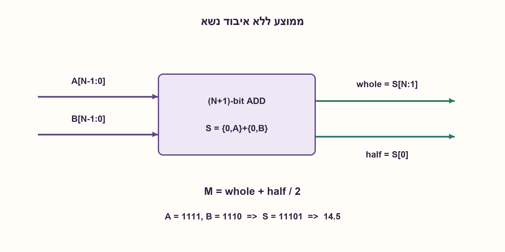
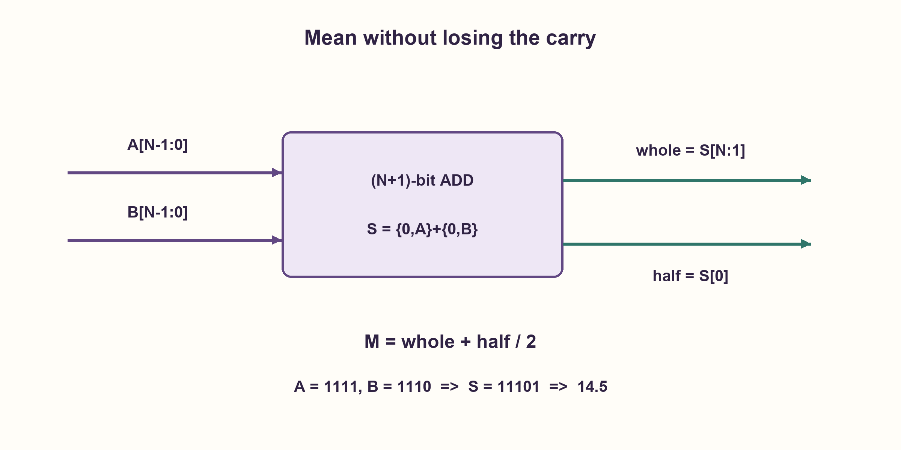

# PREP-180 — ממוצע של שני מספרים בני n ביטים — רוחב, שבר ועיגול

פתרון מוצע בסיוע AI; ביקורת מקצועית אנושית ממתינה. הקושי אינו מכויל.

[צילום מקור פרטי](../sources/2026-10-30-batch90-03.png)

ממש מערכת שמחשבת את הממוצע של 2 מספרים באורך n ביטים כל אחת.

חברות לפי הדיווח בצילום בלבד: Intel, Apple.

## עברית

ממשו מערכת המחשבת ממוצע של שני מספרים בני n ביטים כל אחד. הציגו את רוחב המחבר והפלט, טיפול בנשא ומדיניות עיגול.

המקור אינו מציין סימן או עיגול. בחוזה הראשי נבחר A, B ללא סימן בתחום 0..2^n−1, n≥1, ללא הבטחה על ההפרש ביניהם. החזירו גם ממוצע מדויק בצורת whole+half/2 וגם את הממוצע המעוגל כלפי מטה. התייחסו בנפרד למספרים מסומנים ולממוצע המעוגל לכיוון האפס. אין דרישת מינימום שערים או שימוש ברכיבים מסוימים.

1. מהו הערך המרבי של A+B? האם הוא תמיד נכנס ל־n ביטים?
2. מחשבים את הסכום ב־n+1 ביטים, ואז הזזה ימינה מחלקת בשתיים. מה מייצגת הסיבית שנושרת?
3. החלק השלם הוא S[n:1] וסיבית החצי היא S[0]. עבור פלט שלם בלבד צריך להצהיר שאפס הביט הנמוך פירושו עיגול מטה.

### קודם שומרים את הנשיאה, ואז מחלקים
הסכום המרבי הוא 2^(n+1)−2 ולכן n ביטים אינם מספיקים. מרחיבים את שתי הכניסות באפס אחד ומחברים ב־n+1 ביטים: S={0, A}+{0, B}. חיבור קצר מדי ואז הזזה אינו שקול לחישוב הממוצע.

החלוקה בשתיים היא חיווט בלבד: whole=S[n:1] ו־half=S[0]. החלק השלם נותר בן n ביטים; הסיבית half מציינת תוספת 0.5, ולכן מתקיים בדיוק 2·whole+half=A+B. אם רוצים פלט שלם מעוגל מטה, מחזירים whole. לדוגמה A=15, B=14 נותנים S=29, whole=14, half=1: הממוצע המדויק 14.5. A=B=15 נותן 15, לא 7 כפי שיקרה אם מאבדים את הנשיאה.

חלופה המונעת סכום רחב היא `(A AND B)+((A XOR B)>>1)` לחלק השלם, עם half=(A XOR B)[0]. ההצדקה היא A+B=2 (A AND B)+(A XOR B). השלם הסופי אינו גדול מהגדולה שבכניסות ולכן נכנס ל־n ביטים. זו חלופת מימוש, לא הוכחה שהיא מהירה או קטנה יותר בספריית תאים נתונה.

במספרים מסומנים בשיטת המשלים לשתיים מרחיבים סימן ל־n+1 לפני החיבור. הזזה אריתמטית מספקת floor גם לסכום שלילי; חיתוך לכיוון האפס שונה כשסכום שלילי ואי־זוגי. למשל (−2+−1)/2=−1.5: floor הוא−2 וחיתוך לאפס הוא−1. יש להגדיר זאת, לא להחליף בשקט בין הזזה לחלוקה בשפה מסוימת.

במחבר ripple העלות O(n) תאים והשהיית הנשיאה O(n); רשת prefix משנה השהיה ושטח. הזזת ביט אחד היא חיבורי חוטים, לא יחידת חילוק כללית. לא נטענת אופטימליות פיזית. הבדיקות מנו את כל זוגות הכניסות ברוחבים 1–7 ושני מקרי גבול ברוחב 8. ה־SV המוצע לא הודר.

### מודל לוגי בפייתון שהורץ

```python
"""Exact and floor arithmetic mean of two unsigned n-bit words."""


def mean_unsigned(a, b, width):
    if type(width) is not int or width < 1:
        raise ValueError("positive bit width required")
    if any(type(x) is not int or not 0 <= x < (1 << width) for x in (a, b)):
        raise ValueError("inputs must fit unsigned width")
    # Carry-out is retained: the addition conceptually has width+1 bits.
    total = a + b
    return total >> 1, total & 1  # integer part and a half-unit flag


def mean_without_wide_sum(a, b, width):
    mean_unsigned(a, b, width)  # validate the contract
    return (a & b) + ((a ^ b) >> 1), (a ^ b) & 1
```


### קוד SystemVerilog מוצע; לא הודר בבדיקה זו

```systemverilog
// Unsigned inputs; result = whole + half*0.5, with no addition overflow.
module binary_mean #(parameter int N = 8) (
  input logic [N-1:0] a, b,
  output logic [N-1:0] whole,
  output logic half
);
  logic [N:0] total;
  always_comb begin
    total = {1'b0, a} + {1'b0, b};
    whole = total[N:1];
    half = total[0];
  end
endmodule
```




### assumptions

```json
[
  "חוזה ראשי ללא סימן, n≥1, שתי כניסות עצמאיות.",
  "פלט מדויק כולל סיבית חצי; פלט שלם בלבד מעוגל מטה."
]
```

### optimality

מחבר בן n+1 ביטים וחיווט הזזה; תלות השטח וההשהיה בארכיטקטורת המחבר מתועדת.

### verification

21,844 זוגות ברוחבים 1–7 נבדקו מול שוויון 2·whole+half=A+B וחלופה בלתי תלויה; שני מקרי גבול של 8 ביט. ללא הידור HDL.

### edge_cases

```json
[
  "אפסים ושתי כניסות מרביות.",
  "סכום אי־זוגי דורש חצי או כלל עיגול.",
  "קלט מסומן מחייב הרחבת סימן ולא אפס."
]
```

### common_mistakes

```json
[
  "איבוד carry לפני ההזזה.",
  "הנחה שההפרש הוא שתיים כמו בשאלה הקשורה.",
  "הצגת הזזה אריתמטית כעיגול לאפס לכל סימן."
]
```

### interview_answer

ארחיב את הסכום ל־n+1 ביטים. הביטים העליונים לאחר הזזה הם הרצפה, והביט הנמוך מציין חצי. אסכם במפורש את מדיניות הסימן והעיגול.

### source_ambiguities

```json
[
  "הצילום אינו מגדיר סימן, שבר או עיגול.",
  "אין דרישה שהמספרים יבדלו בשתיים; זו אינה PREP-058."
]
```

### solution_extensions

```json
[
  {
    "question": "איך מעגלים תמיד כלפי מעלה?",
    "answer_direction": "מוסיפים ל־whole את half. במקסימום שתי הכניסות שוות וה־half אפס, לכן גם התוצאה המעוגלת נכנסת ל־n ביטים.",
    "principle": "ביט השארית קובע את תיקון העיגול."
  }
]
```

## English

Implement the arithmetic mean of two n-bit numbers. Specify adder/output widths, carry handling and rounding.

The source does not specify sign or rounding. The primary contract chooses unsigned A, B in 0..2^n−1, n≥1, with no promise on their difference. Return an exact result as whole+half/2 as well as the floor mean. Discuss signed numbers and rounding toward zero separately. No minimum-gate or restricted-component requirement is stated.

1. What is the largest A+B, and does it fit in n bits?
2. Use n+1 sum bits before shifting right. What information is carried by the discarded bit?
3. The whole part is S[n:1] and the half-unit bit is S[0]. An integer-only output must declare floor rounding.

### Retain the carry before dividing
The largest sum is 2^(n+1)−2, so n sum bits are insufficient. Zero-extend both inputs and add in n+1 bits: S={0, A}+{0, B}. Overflowing a narrow sum and then shifting is not a mean calculation.

Division by two is wiring: whole=S[n:1] and half=S[0]. whole has n bits; half denotes an additional 0.5. Thus 2·whole+half=A+B exactly. For an integer floor output return whole. For A=15, B=14, S=29 gives whole=14, half=1, or 14.5. A=B=15 must return 15, not 7 from a lost carry.

An alternative is `(A AND B)+((A XOR B)>>1)` for the whole part, with half=(A XOR B)[0]. It follows from A+B=2 (A AND B)+(A XOR B). The final whole value is no greater than the larger input, so it fits in n bits. This alternative is not automatically faster or smaller in a particular cell library.

For two's-complement signed inputs, sign-extend to n+1 before adding. An arithmetic shift implements floor even for negative sums; truncation toward zero differs for a negative odd sum. For example(−2+−1)/2=−1.5: floor is−2, truncation is−1. Specify the policy rather than silently exchanging shift and language division.

A ripple implementation uses O(n) cells with O(n) carry delay; prefix networks trade area and delay. A fixed one-bit shift is wiring, not a general divider. No physical optimum is claimed. Checks enumerate all input pairs at widths 1..7 and two eight-bit boundaries. The proposed SV was not compiled.

### Executed Python logical model

```python
"""Exact and floor arithmetic mean of two unsigned n-bit words."""


def mean_unsigned(a, b, width):
    if type(width) is not int or width < 1:
        raise ValueError("positive bit width required")
    if any(type(x) is not int or not 0 <= x < (1 << width) for x in (a, b)):
        raise ValueError("inputs must fit unsigned width")
    # Carry-out is retained: the addition conceptually has width+1 bits.
    total = a + b
    return total >> 1, total & 1  # integer part and a half-unit flag


def mean_without_wide_sum(a, b, width):
    mean_unsigned(a, b, width)  # validate the contract
    return (a & b) + ((a ^ b) >> 1), (a ^ b) & 1
```


### Proposed SystemVerilog; not compiled in this check

```systemverilog
// Unsigned inputs; result = whole + half*0.5, with no addition overflow.
module binary_mean #(parameter int N = 8) (
  input logic [N-1:0] a, b,
  output logic [N-1:0] whole,
  output logic half
);
  logic [N:0] total;
  always_comb begin
    total = {1'b0, a} + {1'b0, b};
    whole = total[N:1];
    half = total[0];
  end
endmodule
```




### assumptions

```json
[
  "Primary contract is unsigned, n≥1, independent inputs.",
  "Exact output has a half-unit flag; integer-only output is rounded down."
]
```

### optimality

An n+1-bit adder and shift wiring; area/delay depend on the adder architecture.

### verification

21,844 pairs at widths 1..7 checked against 2·whole+half=A+B and an independent bitwise identity; two eight-bit boundary cases. No HDL compilation.

### edge_cases

```json
[
  "Zeros and two maximal inputs.",
  "An odd sum needs a half bit or rounding rule.",
  "Signed inputs require sign extension, not zero extension."
]
```

### common_mistakes

```json
[
  "Discarding carry before shifting.",
  "Assuming a difference of two as in the related question.",
  "Calling arithmetic shift truncation toward zero for every sign."
]
```

### interview_answer

Form an n+1-bit sum; its upper n bits are the floor and its lowest bit denotes one half. State sign and rounding policy explicitly.

### source_ambiguities

```json
[
  "The source leaves sign, fractions and rounding unspecified.",
  "There is no difference-two promise; this is not PREP-058."
]
```

### solution_extensions

```json
[
  {
    "question": "How can the mean always be rounded up?",
    "answer_direction": "Add half to whole. At the maximum both inputs are equal and half=0, so the result still fits n bits.",
    "principle": "The remainder bit determines the rounding correction."
  }
]
```
