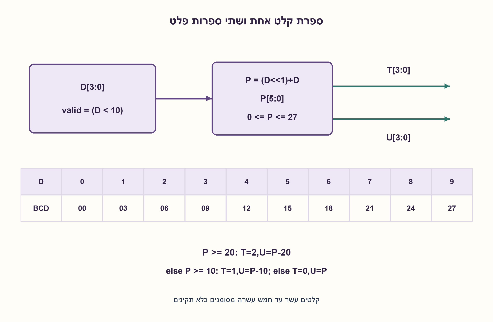
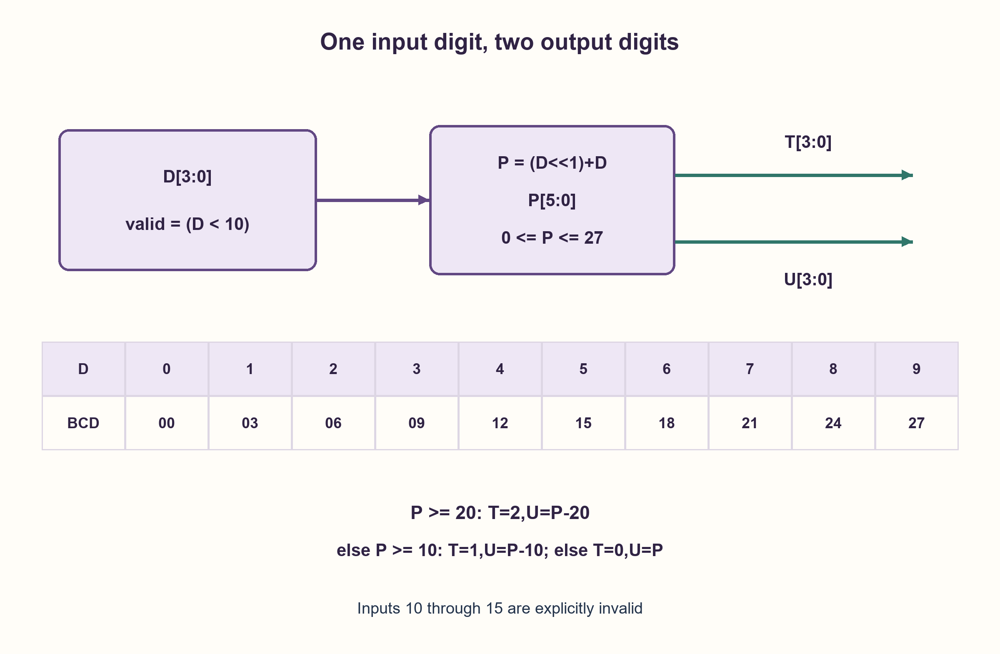

# PREP-181 — כפל ספרת BCD בשלוש והמרת התוצאה לשתי ספרות

פתרון מוצע בסיוע AI; ביקורת מקצועית אנושית ממתינה. הקושי אינו מכויל.

[צילום מקור פרטי](../sources/2026-10-30-batch90-07.png)

אתה מקבל מספר בתצוגה בינארית BCD (בין 0 ל־9). תכפיל אותו ב־3 ותציג BCD.

חברות לפי הדיווח בצילום בלבד: Apple.

## עברית

מגיעה ספרת BCD אחת, בקידוד בינארי בן ארבע סיביות לערכים 0–9. תכננו מערכת שמכפילה אותה בשלוש ומחזירה את התוצאה בתצוגת BCD. ציינו את מספר ספרות הפלט, טיפול בקלט לא תקין ומימוש אפשרי.

הבהרה: נבחר מעגל צירופי עם פלט שתי ספרות BCD — עשרות ואחדות, ארבע סיביות כל אחת — ואות valid. הקודים 1010–1111 אינם ספרות BCD: נבחר עבורם valid=0 ופלט 00, ולא תוצאת כפל רגילה. אין בחירה אוטומטית של don’t-care מחוץ לחוזה.

1. מה הטווח של פי שלושה מספרה בין אפס לתשע? האם ספרת BCD אחת מספיקה?
2. אפשר לחשב תחילה P=2 D+D בבינארי, ואז להפריד עשרות ואחדות.
3. הסכום לכל היותר 27. אם P≥20 העשרות 2; אחרת אם P≥10 העשרות 1; בשאר המקרים 0. את הבסיס העשרוני מפחיתים כדי לקבל אחדות.

### מספר אחד יכול להזדקק לשתי ספרות
התוצאה היא בין 0 ל־27. הפלט חייב להכיל שתי ספרות BCD: T[3:0] לעשרות ו־U[3:0] לאחדות. לדוגמה D=9 נותן T=0010, U=0111, כלומר 27. אין להחזיר 11011 ולקרוא לו BCD; זהו 27 בבינארי רגיל, לא שתי ספרות.

מימוש ישיר: מחשבים valid=(D<10). עבור קלט תקין יוצרים P=(D<<1)+D במחבר בינארי בן 6 ביטים. אחר כך משווים לקבועים 20 ו־10 ומחסרים:

```text
P>=20: T=2, U=P-20
else P>=10: T=1, U=P-10
else: T=0, U=P
```

בכל ענף U בין 0 ל־9, ו־10 T+U=P=3 D, ולכן שתי הספרות חוקיות ומייצגות את המכפלה. הטבלה בשרטוט מציגה את כל עשרת הקלטים. הגבולות בין הענפים הם D=4 (תוצאה 12) ו־D=7 (תוצאה 21); אין צורך בביצוע חילוק עשרוני כללי.

אפשר גם לגזור מטבלת 16 השורות רשת AND/OR/NOT או לממש ROM/LUT. הבחירה תלויה בספריית התאים ובמדדי שטח והשהיה. קלט לא תקין נשמר כ־valid=0 ופלט 00 בחוזה שלנו. אם המערכת מבטיחה קלט חוקי ורוצים להשתמש בשורות האחרות כ־don’t-care לצמצום, צריך לשנות ולהצהיר את החוזה לפני המינימיזציה.

הפלט הוא נתוני BCD ולא הנעת תצוגת שבעה מקטעים; המפענח לתצוגה, אם דרוש, הוא רכיב נוסף. כל 16 שורות הקלט נבדקו מול כפל שלם והפרדה עשרונית עצמאית. קוד SV מצורף כהצעה שלא הודרה; אין טענת מינימום שערים.

### מודל לוגי בפייתון שהורץ

```python
"""One valid BCD input digit, two BCD output digits; invalid input is flagged."""


def bcd_times_three(word):
    if type(word) is not int or not 0 <= word < 16:
        raise ValueError("four binary input bits required")
    valid = int(word < 10)
    if not valid:
        return 0, 0, 0
    product = (word << 1) + word  # six-bit binary product, at most 27
    if product >= 20:
        tens, ones = 2, product - 20
    elif product >= 10:
        tens, ones = 1, product - 10
    else:
        tens, ones = 0, product
    return valid, tens, ones
```


### קוד SystemVerilog מוצע; לא הודר בבדיקה זו

```systemverilog
// Valid BCD input0..9; two BCD output digits encode0..27.
module bcd_times_three (
  input logic [3:0] digit,
  output logic valid,
  output logic [3:0] tens, ones
);
  logic [5:0] product;
  always_comb begin
    valid = digit < 4'd10;
    product = {1'b0, digit, 1'b0} + {2'b0, digit};
    tens = 4'd0;
    ones = 4'd0;
    if (valid) begin
      if (product >= 6'd20) begin
        tens = 4'd2;
        ones = product - 6'd20;
      end else if (product >= 6'd10) begin
        tens = 4'd1;
        ones = product - 6'd10;
      end else ones = product;
    end
  end
endmodule
```




### assumptions

```json
[
  "כניסה בת ארבע סיביות; הקודים 0–9 תקינים בלבד.",
  "שתי ספרות BCD ואות valid; התנהגות שגיאה מפורשת."
]
```

### optimality

פונקציה צירופית קבועה. מחבר קטן, השוואות וחיסורי קבועים או LUT הם חלופות; לא הוכח מינימום שערים.

### verification

כל 16 קודי הקלט נבדקו, כולל שישה קודים לא תקינים. עבור התקינים אומתו חוקיות כל ספרה ושוויון 10 T+U=3 D. ללא הידור HDL.

### edge_cases

```json
[
  "D=0 נותן 00; D=9 נותן 27.",
  "D=3/4 ו־D=6/7 מסמנים מעברי עשרות.",
  "קלט 1010 אינו הספרה 10 ב־BCD חד־ספרתי."
]
```

### common_mistakes

```json
[
  "החזרת מכפלה בינארית רגילה במקום BCD.",
  "פלט ספרה אחת שמאבד את העשרות.",
  "שימוש ב־don’t-care אף שהקלט הלא תקין מוגדר."
]
```

### interview_answer

אחשב P=2 D+D, בתחום 0–27, ואז אבחר עשרות 0/1/2 ואחסיר את בסיס העשרות לקבלת האחדות. הפלט שתי ספרות BCD ו־valid לקלט 0–9.

### source_ambiguities

```json
[
  "המקור אינו נותן מספר ספרות פלט או התנהגות לקודים לא חוקיים; שניהם נוספו בגלוי.",
  "BCD אינו מפענח נורות שבעה מקטעים."
]
```

### solution_extensions

```json
[
  {
    "question": "האם אפשר לאפס את סיבית העשרות הגבוהה ביותר?",
    "answer_direction": "כן. העשרות בתחום 0–2 ולכן שתי הסיביות הגבוהות שלה תמיד 0; חיבורן לקבועים אינו משנה את רוחב ממשק BCD.",
    "principle": "טווח הערכים עשוי לכפות סיביות קבועות."
  }
]
```

## English

A single BCD digit arrives as four bits representing 0..9. Design a circuit multiplying it by three and returning BCD. Specify the number of output digits, invalid-input behavior and a possible implementation.

Clarifications: choose a combinational circuit with two four-bit BCD output digits, tens and units, plus valid. Codes 1010..1111 are not BCD digits; choose valid=0 and output 00, not ordinary multiplication. Invalid inputs are not silently treated as unspecified don’t-cares.

1. What is the range of three times a digit in 0..9? Can one BCD digit contain it?
2. Compute binary P=2 D+D, then separate tens and units.
3. P≤27. If P≥20 tens=2; otherwise if P≥10 tens=1; else tens=0. Subtract that decimal base for units.

### One input digit can need two output digits
The product ranges from 0 to 27. Provide BCD tens T[3:0] and units U[3:0]. For D=9, output T=0010, U=0111, representing 27. Returning 11011 and calling it BCD confuses ordinary binary with a pair of decimal digits.

A direct circuit computes valid=(D<10), then binary P=(D<<1)+D in a six-bit adder for valid input. Compare with constants 20 and 10 and subtract:

```text
P>=20: T=2, U=P-20
else P>=10: T=1, U=P-10
else: T=0, U=P
```

Each branch leaves 0≤U≤9 and satisfies 10 T+U=P=3 D, so both BCD digits are valid and correct. The diagram lists all ten valid inputs. Branch transitions occur at D=4 (product 12) and D=7 (product 21); no general decimal divider is required.

A 16-row truth table may instead be minimized into AND/OR/NOT logic or implemented by ROM/LUT. Which is smaller or faster depends on the library and metrics. This contract defines invalid input as valid=0 and output 00. A design using invalid codes as don’t-cares needs an explicit legal-input guarantee before minimization.

These outputs are BCD data, not seven-segment display drives. A display decoder is an additional stage if needed. All 16 input words were checked against independent integer multiplication and decimal splitting. Proposed SV is supplied but was not compiled; no gate minimum is claimed.

### Executed Python logical model

```python
"""One valid BCD input digit, two BCD output digits; invalid input is flagged."""


def bcd_times_three(word):
    if type(word) is not int or not 0 <= word < 16:
        raise ValueError("four binary input bits required")
    valid = int(word < 10)
    if not valid:
        return 0, 0, 0
    product = (word << 1) + word  # six-bit binary product, at most 27
    if product >= 20:
        tens, ones = 2, product - 20
    elif product >= 10:
        tens, ones = 1, product - 10
    else:
        tens, ones = 0, product
    return valid, tens, ones
```


### Proposed SystemVerilog; not compiled in this check

```systemverilog
// Valid BCD input0..9; two BCD output digits encode0..27.
module bcd_times_three (
  input logic [3:0] digit,
  output logic valid,
  output logic [3:0] tens, ones
);
  logic [5:0] product;
  always_comb begin
    valid = digit < 4'd10;
    product = {1'b0, digit, 1'b0} + {2'b0, digit};
    tens = 4'd0;
    ones = 4'd0;
    if (valid) begin
      if (product >= 6'd20) begin
        tens = 4'd2;
        ones = product - 6'd20;
      end else if (product >= 6'd10) begin
        tens = 4'd1;
        ones = product - 6'd10;
      end else ones = product;
    end
  end
endmodule
```




### assumptions

```json
[
  "Four input bits; only codes0..9 are valid digits.",
  "Two BCD output digits and a valid flag; invalid behavior is explicit."
]
```

### optimality

A fixed combinational function. Small arithmetic, constant comparisons/subtractions and LUTs are alternatives; no gate minimum is proved.

### verification

All 16 input words checked, including six invalid codes. Valid digits satisfy digit bounds and 10 T+U=3 D. No HDL compilation.

### edge_cases

```json
[
  "D=0 gives 00; D=9 gives 27.",
  "D=3/4 and D=6/7 straddle tens transitions.",
  "1010 is not a one-digit BCD encoding of 10."
]
```

### common_mistakes

```json
[
  "Returning ordinary binary rather than BCD.",
  "Using one output digit and losing the tens.",
  "Using don’t-cares despite defined invalid behavior."
]
```

### interview_answer

Compute P=2 D+D in 0..27; choose tens0/1/2 and subtract the tens base for units. Output two BCD digits and valid for inputs 0..9.

### source_ambiguities

```json
[
  "Source omits output digit count and invalid-code behavior; both are explicit additions.",
  "BCD is not a seven-segment drive pattern."
]
```

### solution_extensions

```json
[
  {
    "question": "Can the high tens bits be tied low?",
    "answer_direction": "Yes. Tens ranges over0..2, so its two most significant bits are always0; fixed wires retain the four-bit BCD interface.",
    "principle": "A value range can force constant bits."
  }
]
```
