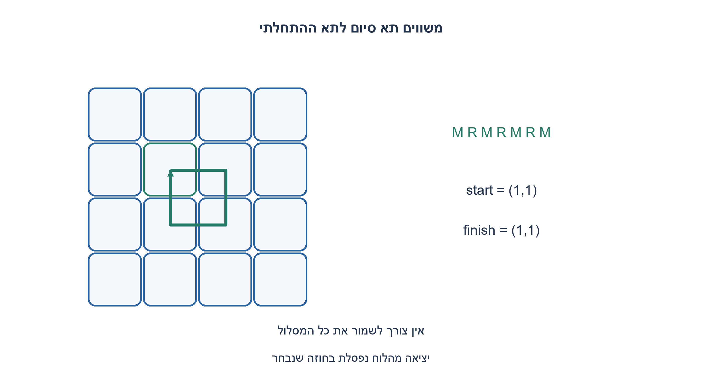
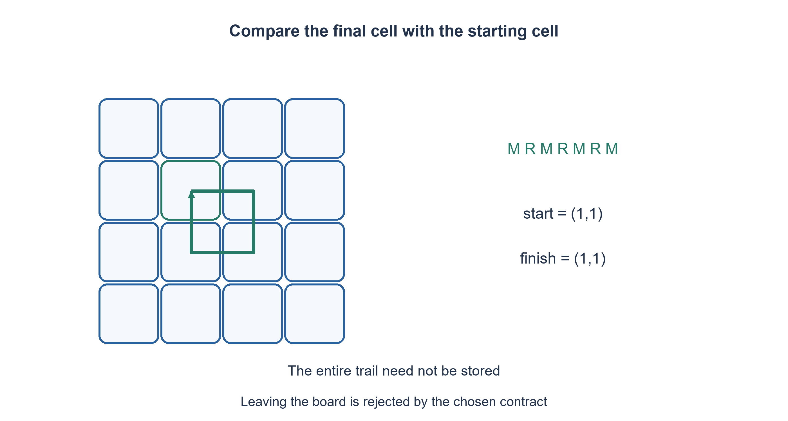

# PREP-182 — האם הצב חזר לנקודת ההתחלה?

פתרון מוצע בסיוע AI; ביקורת מקצועית אנושית ממתינה. הקושי אינו מכויל.

## עברית

### הרחבה: חץ בתא התחלתי בתוך מטריצה
ניתנת מטריצה מלבנית לא ריקה, מיקום התחלתי של חץ וכיוון אחת מארבע הרוחות, ומחרוזת R, L, M. R מסובבת 90° ימינה, L שמאלה, ו־ M מזיזה תא אחד בכיוון הנוכחי. החזירו True אם בסוף ביצוע חד־פעמי החץ באותו תא שבו התחיל; הכיוון הסופי לא חשוב.

המקור אינו מגדיר חריגה מהלוח. נבחר במפורש: תנועה החוצה או פקודה לא מוכרת גורמות ValueError; אין גלישה מעגלית או מכשולים. תאי המטריצה משמשים לתחום בלבד ואינם משתנים.

1. האם צריך לזכור את כל המסלול כדי להשוות נקודת סיום להתחלה?
2. שמרו שורה, עמודה וכיוון, וגם את התא ההתחלתי.
3. ייצגו E, S, W, N כ־ 0,1,2,3. סיבוב משנה כיוון מודולו 4; תנועה מוסיפה וקטור. אחרי כל תנועה בדקו גבולות ובסוף השוו רק תא.

### משנים נקודת ייחוס, לא את הרעיון
הפתרון במישור נשמר. בגרסת הלוח שומרים start_row, start_column ואת המיקום הנוכחי. כיוון 0 הוא מזרח, 1 דרום, 2 מערב ו־ 3 צפון; השורות גדלות מטה. R מוסיפה אחד מודולו 4 ו־ L מחסירה אחד. M מוסיפה את אחד הווקטורים (0,1), (1,0), (0, −1), (−1,0), ובודקת שהמיקום עדיין בטווח.

אחרי כל קידומת המיקום והכיוון השמורים שווים למצב החץ האמיתי: זו טענת האינווריאנט שמוכחת לפי סוג הפקודה. לכן בסוף מספיק להשוות את התא לתא ההתחלתי. אין צורך לסמן ביקורים, לזהות חציית מסלול או לחזור לאותו כיוון. מחרוזת ריקה או סיבובים בלבד מחזירות אמת; M בודדת מחזירה שקר אם היא חוקית, וחריגה מהלוח היא שגיאה ולא False רגיל.

ל־ k פקודות החלק התנועתי לוקח O(k) זמן ומספר קבוע של מילים, בנוסף ל־ O(rows) בדיקת מלבניות. אין סריקה של כל ערכי המטריצה. הקואורדינטות דורשות ביטים לפי הממדים; אין טענת מקום קבוע בביטים ללוחות בלתי חסומים. אם המראיין בוחר wrap, חסימה בקיר או עצירה בגבול, יש לשנות את מעבר M במפורש: אלו חוזים שונים, ולא מידע שניתן להסיק מהצילום.

```python
"""Finite rectangular board; reject an out-of-bounds M, no implicit wrapping."""
VECTORS = ((0, 1), (1, 0), (0, -1), (-1, 0))  # E,S,W,N


def returns_to_cell(matrix, row, column, heading, commands):
    if not matrix or not matrix[0] or any(len(r) != len(matrix[0]) for r in matrix):
        raise ValueError("nonempty rectangular matrix required")
    rows, columns = len(matrix), len(matrix[0])
    if (type(row) is not int or type(column) is not int or type(heading) is not int
            or not 0 <= row < rows or not 0 <= column < columns
            or not 0 <= heading < 4):
        raise ValueError("start cell or heading outside allowed domain")
    start_row, start_column = row, column
    for command in commands:
        if command == "R":
            heading = (heading + 1) % 4
        elif command == "L":
            heading = (heading - 1) % 4
        elif command == "M":
            dr, dc = VECTORS[heading]
            row, column = row + dr, column + dc
            if not 0 <= row < rows or not 0 <= column < columns:
                raise ValueError("movement leaves the finite board")
        else:
            raise ValueError("only R,L,M are allowed")
    return (row, column) == (start_row, start_column)
```




## English

### Extension: an arrow starting inside a matrix
Given a nonempty rectangular matrix, initial cell and one of four headings, execute one R, L, M string. R turns clockwise by ninety degrees, L counterclockwise, and M moves one cell forward. Return True exactly when the final cell equals the initial cell; final heading is irrelevant.

The source omits boundary behavior. Explicitly choose ValueError for leaving the board or an unknown command; no toroidal wrap or obstacles. Matrix contents define dimensions only and are not modified.

1. Must the entire path be remembered to compare its endpoint to its start?
2. Keep row, column and heading, plus the starting cell.
3. Encode E, S, W, N as 0,1,2,3. Turns update modulo four; movement adds a vector. Check bounds after moves and compare only the final cell.

### Change the origin, not the principle
Preserve the plane solution and add start_row/start_column to current position. Encode east, south, west, north as zero, one, two, three with rows increasing downward. R adds one modulo four; L subtracts one. M adds the selected vector (0,1), (1,0), (0, -1), (-1,0), then checks that the cell remains inside the board.

After every command prefix the stored position/heading equals the actual arrow state, by induction on command type. At the end compare only the final and initial cell. No visited matrix, self-intersection detector or final-heading equality is needed. Empty commands or turns alone return true; one legal M returns false. Leaving the board is an error rather than an ordinary false result.

For k commands, movement costs O(k) time and a constant number of words, plus O(rows) for rectangular-shape validation. Matrix cell values are not scanned. Coordinates require dimension-dependent bits, so there is no fixed-bit-space claim for unbounded boards. If the interviewer instead chooses wrapping, blocked movement or stopping at walls, change the M transition explicitly; none of these alternatives follows from the screenshot.

```python
"""Finite rectangular board; reject an out-of-bounds M, no implicit wrapping."""
VECTORS = ((0, 1), (1, 0), (0, -1), (-1, 0))  # E,S,W,N


def returns_to_cell(matrix, row, column, heading, commands):
    if not matrix or not matrix[0] or any(len(r) != len(matrix[0]) for r in matrix):
        raise ValueError("nonempty rectangular matrix required")
    rows, columns = len(matrix), len(matrix[0])
    if (type(row) is not int or type(column) is not int or type(heading) is not int
            or not 0 <= row < rows or not 0 <= column < columns
            or not 0 <= heading < 4):
        raise ValueError("start cell or heading outside allowed domain")
    start_row, start_column = row, column
    for command in commands:
        if command == "R":
            heading = (heading + 1) % 4
        elif command == "L":
            heading = (heading - 1) % 4
        elif command == "M":
            dr, dc = VECTORS[heading]
            row, column = row + dr, column + dc
            if not 0 <= row < rows or not 0 <= column < columns:
                raise ValueError("movement leaves the finite board")
        else:
            raise ValueError("only R,L,M are allowed")
    return (row, column) == (start_row, start_column)
```




## חומר משלים / Supporting material

```json
{
  "assumptions": {
    "he": "מלבן לא ריק, כיוון 0..3, אין מכשולים; יציאה גורמת חריגה.",
    "en": "Nonempty rectangle, heading 0..3, no obstacles; leaving it raises an error."
  },
  "optimality": {
    "he": "O(k+rows) זמן כולל בדיקת צורה; O(1) מילים.",
    "en": "O(k+rows) including shape validation; O(1) words."
  },
  "verification": {
    "he": "כל ארבעת הכיוונים ורצפי RLM באורכים 0..7 בלוח 5×5 מול תנועה במספרים מרוכבים.",
    "en": "All four headings and RLM strings of lengths 0..7 on a 5x5 board versus independent complex motion."
  },
  "edge_cases": {
    "he": "ריק; סיבובים; גבול; מטריצה לא מלבנית; כיוון לא חוקי.",
    "en": "Empty commands; turns; edge; ragged matrix; invalid heading."
  },
  "common_mistakes": {
    "he": "להוסיף wrap בשקט; לדרוש כיוון סיום זהה; לסרוק או לשנות את המטריצה שלא לצורך.",
    "en": "Silently adding wrap; requiring the original heading; unnecessarily scanning/mutating matrix contents."
  },
  "interview_answer": {
    "he": "אעקוב אחרי תא וכיוון ואשווה לתא ההתחלתי, עם כלל גבול מפורש.",
    "en": "Track cell and heading, compare with the initial cell, and state boundary behavior."
  },
  "source_ambiguities": {
    "he": "כלל הגבול אינו במקור; נבחרה דחיית יציאה, ולא גלישה.",
    "en": "Boundary behavior is absent; rejection, not wrapping, was chosen."
  },
  "solution_extensions": {
    "he": [
      {
        "question": "ומה אם הלוח הוא טורוס?",
        "answer_direction": "עדכון שורה ועמודה נעשה מודולו הממדים; זו גרסה נפרדת.",
        "principle": "תנאי גבול הם חלק מחוזה המעברים."
      }
    ],
    "en": [
      {
        "question": "What if the board is a torus?",
        "answer_direction": "Update row/column modulo dimensions as a separate variant.",
        "principle": "Boundary conditions belong to the transition contract."
      }
    ]
  }
}
```
