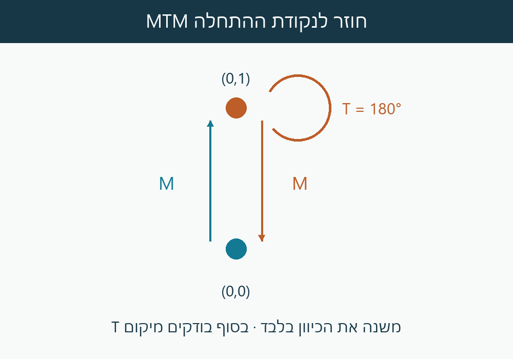
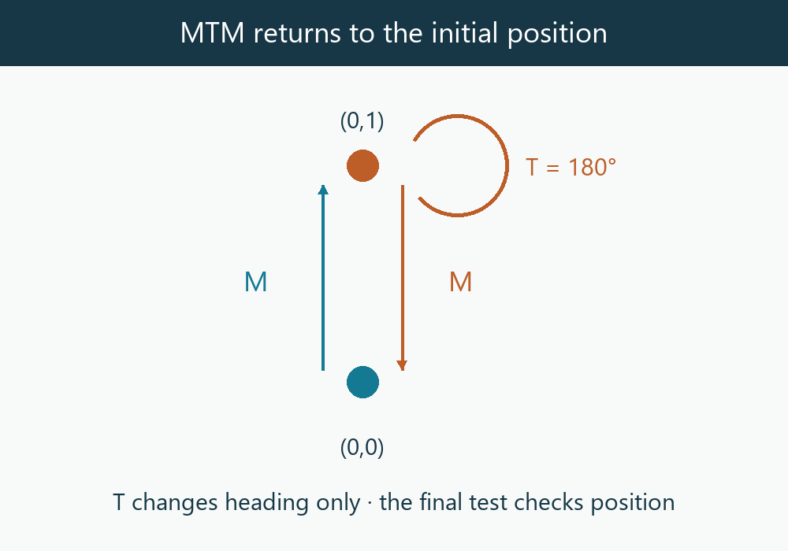

# PREP-182 — הרחבה לתו T

[צילום מקור](../sources/2026-11-15-batch20b-10.png)

## האם הצב חזר לנקודת ההתחלה?

נתון רצף סופי של פקודות לצב במישור. M מזיזה אותו יחידה אחת קדימה; R מסובבת אותו ימינה ב־90 מעלות; L מסובבת שמאלה ב־90 מעלות. כתבו פונקציה שקובעת אם לאחר ביצוע הרצף פעם אחת הצב נמצא במיקומו ההתחלתי. הכיוון הסופי אינו חייב להיות הכיוון ההתחלתי.

לצורך המימוש נבחר ראשית צירים וכיוון התחלתי מזרחה; הבחירה אינה משנה אם חוזרים למיקום. הרצף הריק מותר. פקודות חוקיות הן התווים הגדולים R,L,M בלבד. זו אינה השאלה האם חזרה אינסופית על הרצף נשארת בתחום חסום.

### הרחבה: חץ בתא התחלתי בתוך מטריצה
ניתנת מטריצה מלבנית לא ריקה, מיקום התחלתי של חץ וכיוון אחת מארבע הרוחות, ומחרוזת R, L, M. R מסובבת 90° ימינה, L שמאלה, ו־ M מזיזה תא אחד בכיוון הנוכחי. החזירו True אם בסוף ביצוע חד־פעמי החץ באותו תא שבו התחיל; הכיוון הסופי לא חשוב.

המקור אינו מגדיר חריגה מהלוח. נבחר במפורש: תנועה החוצה או פקודה לא מוכרת גורמות ValueError; אין גלישה מעגלית או מכשולים. תאי המטריצה משמשים לתחום בלבד ואינם משתנים.

### הרחבה — פניית פרסה
הוסיפו את התו T שפונה 180 מעלות ללא תזוזה. הלוח בהרחבה זו אינסופי. בדקו חזרה לנקודת ההתחלה לאחר רצף יחיד, בלי לדרוש חזרה לכיוון ההתחלתי. רצף ריק תקין.

### פתרון מוצע

### לא צריך לצייר את כל המסלול
מצב מספיק הוא `(x,y,d)`: שני רכיבי המיקום וכיוון d מתוך מזרח, דרום, מערב וצפון. מתחילים ב־`(0,0,0)`. פנייה ימינה מוסיפה אחד ל־d מודולו 4; פנייה שמאלה מחסירה אחד. ב־M מוסיפים את וקטור הכיוון: `(1,0)`, `(0,-1)`, `(-1,0)` או `(0,1)`.

האינווריאנט הוא שאחרי כל קידומת המצב השמור הוא בדיוק מצב הצב האמיתי: הוא נכון בתחילה, וכל אחת משלוש הפקודות מבצעת בדיוק את עדכון ההגדרה. לכן בסוף חזרה למיקום שקולה ל־`x==0 and y==0`.

למשל `MRMRMRM` עובר ארבע צלעות של ריבוע וחוזר לראשית, אף שכיוונו הסופי צפונה ולא מזרחה. גם רצף של פניות בלבד חוזר למיקום, כי לא זזים. לעומת זאת `M` אינו חוזר. אין צורך לשמור את הנקודות שבדרך או לבדוק אם המסלול נוגע בעצמו.

עבור n פקודות, הזמן הוא O(n) ויש מספר קבוע של משתנים. כל קואורדינטה חסומה בערך מוחלט ב־n, ולכן נדרשים O(log(n+1)) ביטים ולא מספר קבוע של ביטים בלתי תלוי בקלט. במודל מילים שיכולות לייצג את אורך הקלט זהו O(1) זיכרון נוסף במילים. כל אלגוריתם מדויק חייב במקרה הגרוע לבחון את הקלט: פקודת הסיום יכולה לשנות את התשובה.

נבדקו כל 29,524 הרצפים עד אורך 9 מול מודל עצמאי של מספרים מרוכבים, כולל 250,959 צעדי פקודה. הבדיקה הסופית נובעת מהאינווריאנט, לא מהניסוי הסופי לבדו.

```python
"""Single-pass turtle position; final orientation is intentionally ignored."""

VECTORS = ((1, 0), (0, -1), (-1, 0), (0, 1))


def turtle_state(commands):
    x = y = heading = 0
    for command in commands:
        if command == "R":
            heading = (heading + 1) % 4
        elif command == "L":
            heading = (heading - 1) % 4
        elif command == "M":
            dx, dy = VECTORS[heading]
            x, y = x + dx, y + dy
        else:
            raise ValueError("Only uppercase R, L and M are permitted")
    return x, y, heading


def returns_to_start(commands):
    x, y, _ = turtle_state(commands)
    return x == 0 and y == 0
```


### משנים נקודת ייחוס, לא את הרעיון
הפתרון במישור נשמר. בגרסת הלוח שומרים start_row, start_column ואת המיקום הנוכחי. כיוון 0 הוא מזרח, 1 דרום, 2 מערב ו־ 3 צפון; השורות גדלות מטה. R מוסיפה אחד מודולו 4 ו־ L מחסירה אחד. M מוסיפה את אחד הווקטורים (0,1), (1,0), (0, −1), (−1,0), ובודקת שהמיקום עדיין בטווח.

אחרי כל קידומת המיקום והכיוון השמורים שווים למצב החץ האמיתי: זו טענת האינווריאנט שמוכחת לפי סוג הפקודה. לכן בסוף מספיק להשוות את התא לתא ההתחלתי. אין צורך לסמן ביקורים, לזהות חציית מסלול או לחזור לאותו כיוון. מחרוזת ריקה או סיבובים בלבד מחזירות אמת; M בודדת מחזירה שקר אם היא חוקית, וחריגה מהלוח היא שגיאה ולא False רגיל.

ל־ k פקודות החלק התנועתי לוקח O(k) זמן ומספר קבוע של מילים, בנוסף ל־ O(rows) בדיקת מלבניות. אין סריקה של כל ערכי המטריצה. הקואורדינטות דורשות ביטים לפי הממדים; אין טענת מקום קבוע בביטים ללוחות בלתי חסומים. אם המראיין בוחר wrap, חסימה בקיר או עצירה בגבול, יש לשנות את מעבר M במפורש: אלו חוזים שונים, ולא מידע שניתן להסיק מהצילום.

```python
"""Finite rectangular board; reject an out-of-bounds M, no implicit wrapping."""
VECTORS = ((0, 1), (1, 0), (0, -1), (-1, 0))  # E,S,W,N


def returns_to_cell(matrix, row, column, heading, commands):
    if not matrix or not matrix[0] or any(len(r) != len(matrix[0]) for r in matrix):
        raise ValueError("nonempty rectangular matrix required")
    rows, columns = len(matrix), len(matrix[0])
    if (type(row) is not int or type(column) is not int or type(heading) is not int
            or not 0 <= row < rows or not 0 <= column < columns
            or not 0 <= heading < 4):
        raise ValueError("start cell or heading outside allowed domain")
    start_row, start_column = row, column
    for command in commands:
        if command == "R":
            heading = (heading + 1) % 4
        elif command == "L":
            heading = (heading - 1) % 4
        elif command == "M":
            dr, dc = VECTORS[heading]
            row, column = row + dr, column + dc
            if not 0 <= row < rows or not 0 <= column < columns:
                raise ValueError("movement leaves the finite board")
        else:
            raise ValueError("only R,L,M are allowed")
    return (row, column) == (start_row, start_column)
```


### תמיכה ב־T
שומרים את אותם שני קואורדינטות ואינדקס כיוון. עבור T מעדכנים d=(d+2)%4 ואינם משנים את המיקום. לכן MTM חוזר להתחלה, ו־T לבדו חוזר אף שהכיוון הפוך. MMTM אינו חוזר. ההוכחה באינדוקציה על קידומות והעלות O(n) זמן ו־O(1) מילות עבודה נשמרות. אפשר גם לתרגם כל T לשני תווי R, אך אין צורך לבנות מחרוזת עזר.

```python
"""One finite command string. Final heading is intentionally irrelevant."""
VECTORS = ((0, 1), (1, 0), (0, -1), (-1, 0))


def returns_to_start_with_turnback(commands):
    if not isinstance(commands, str):
        raise ValueError("a command string is required")
    x = y = heading = 0
    for command in commands:
        if command == "R":
            heading = (heading + 1) % 4
        elif command == "L":
            heading = (heading - 1) % 4
        elif command == "T":
            heading = (heading + 2) % 4
        elif command == "M":
            dx, dy = VECTORS[heading]
            x, y = x + dx, y + dy
        else:
            raise ValueError("only uppercase M,R,L,T are allowed")
    return x == 0 and y == 0
```



## Did the turtle return to its starting position?

A turtle executes a finite sequence in the plane. M moves one unit forward; R turns clockwise by 90 degrees; L turns counterclockwise by 90 degrees. Write a function deciding whether executing the sequence once returns it to its initial position. Its final heading need not equal its initial heading.

Choose the origin and an initially eastward heading for implementation; return-to-position is invariant under that choice. The empty sequence is allowed. Only uppercase R,L,M are legal. This is not the different question of boundedness when the sequence is repeated forever.

### Extension: an arrow starting inside a matrix
Given a nonempty rectangular matrix, initial cell and one of four headings, execute one R, L, M string. R turns clockwise by ninety degrees, L counterclockwise, and M moves one cell forward. Return True exactly when the final cell equals the initial cell; final heading is irrelevant.

The source omits boundary behavior. Explicitly choose ValueError for leaving the board or an unknown command; no toroidal wrap or obstacles. Matrix contents define dimensions only and are not modified.

### Extension — a half turn
Add command T, a 180-degree turn without movement. This extension uses an infinite grid. Test return to the starting position after one sequence, regardless of final heading. The empty string is valid.

### Proposed solution

### The entire trail need not be stored
Keep `(x,y,d)`: two position coordinates and one of east, south, west and north. Start at `(0,0,0)`. R increments d modulo 4; L decrements it. M adds the current direction vector:`(1,0)`, `(0,-1)`, `(-1,0)` or `(0,1)`.

The invariant is that after every prefix the stored state equals the turtle's actual state. It holds initially and each command applies precisely its defining update. Consequently return-to-position is equivalent to `x==0 and y==0` at the end.

For example, `MRMRMRM` traces four sides of a square and returns to the origin while ending northward rather than eastward. A sequence of turns alone also returns because it never moves. The sequence `M` does not. Neither storing visited points nor detecting self-intersections is necessary.

For n commands the algorithm takes O(n) time and a constant number of variables. Each coordinate has absolute value at most n, requiring O(log(n+1)) bits, not a fixed number of bits independent of input length. This is O(1) extra machine words when a word can hold the input length. Reading the input is necessary in the worst case: a final command can change the answer.

All 29,524 sequences through length 9 were compared with independent complex-number motion, covering 250,959 command steps. General correctness comes from the invariant, rather than finite testing alone.

```python
"""Single-pass turtle position; final orientation is intentionally ignored."""

VECTORS = ((1, 0), (0, -1), (-1, 0), (0, 1))


def turtle_state(commands):
    x = y = heading = 0
    for command in commands:
        if command == "R":
            heading = (heading + 1) % 4
        elif command == "L":
            heading = (heading - 1) % 4
        elif command == "M":
            dx, dy = VECTORS[heading]
            x, y = x + dx, y + dy
        else:
            raise ValueError("Only uppercase R, L and M are permitted")
    return x, y, heading


def returns_to_start(commands):
    x, y, _ = turtle_state(commands)
    return x == 0 and y == 0
```


### Change the origin, not the principle
Preserve the plane solution and add start_row/start_column to current position. Encode east, south, west, north as zero, one, two, three with rows increasing downward. R adds one modulo four; L subtracts one. M adds the selected vector (0,1), (1,0), (0, -1), (-1,0), then checks that the cell remains inside the board.

After every command prefix the stored position/heading equals the actual arrow state, by induction on command type. At the end compare only the final and initial cell. No visited matrix, self-intersection detector or final-heading equality is needed. Empty commands or turns alone return true; one legal M returns false. Leaving the board is an error rather than an ordinary false result.

For k commands, movement costs O(k) time and a constant number of words, plus O(rows) for rectangular-shape validation. Matrix cell values are not scanned. Coordinates require dimension-dependent bits, so there is no fixed-bit-space claim for unbounded boards. If the interviewer instead chooses wrapping, blocked movement or stopping at walls, change the M transition explicitly; none of these alternatives follows from the screenshot.

```python
"""Finite rectangular board; reject an out-of-bounds M, no implicit wrapping."""
VECTORS = ((0, 1), (1, 0), (0, -1), (-1, 0))  # E,S,W,N


def returns_to_cell(matrix, row, column, heading, commands):
    if not matrix or not matrix[0] or any(len(r) != len(matrix[0]) for r in matrix):
        raise ValueError("nonempty rectangular matrix required")
    rows, columns = len(matrix), len(matrix[0])
    if (type(row) is not int or type(column) is not int or type(heading) is not int
            or not 0 <= row < rows or not 0 <= column < columns
            or not 0 <= heading < 4):
        raise ValueError("start cell or heading outside allowed domain")
    start_row, start_column = row, column
    for command in commands:
        if command == "R":
            heading = (heading + 1) % 4
        elif command == "L":
            heading = (heading - 1) % 4
        elif command == "M":
            dr, dc = VECTORS[heading]
            row, column = row + dr, column + dc
            if not 0 <= row < rows or not 0 <= column < columns:
                raise ValueError("movement leaves the finite board")
        else:
            raise ValueError("only R,L,M are allowed")
    return (row, column) == (start_row, start_column)
```


### Supporting T
Keep the same two coordinates and direction index. T performs d=(d+2)%4 without moving. Thus MTM returns, and T alone returns with reversed heading. MMTM does not return. The prefix invariant and O(n) time/O(1) working-word bounds remain valid. Expanding T to RR is another valid approach, but an auxiliary string is unnecessary.

```python
"""One finite command string. Final heading is intentionally irrelevant."""
VECTORS = ((0, 1), (1, 0), (0, -1), (-1, 0))


def returns_to_start_with_turnback(commands):
    if not isinstance(commands, str):
        raise ValueError("a command string is required")
    x = y = heading = 0
    for command in commands:
        if command == "R":
            heading = (heading + 1) % 4
        elif command == "L":
            heading = (heading - 1) % 4
        elif command == "T":
            heading = (heading + 2) % 4
        elif command == "M":
            dx, dy = VECTORS[heading]
            x, y = x + dx, y + dy
        else:
            raise ValueError("only uppercase M,R,L,T are allowed")
    return x == 0 and y == 0
```


