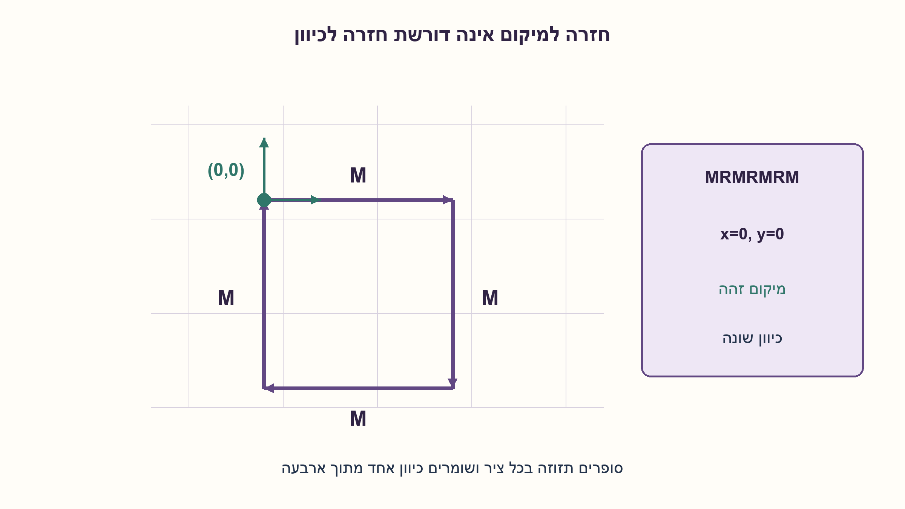
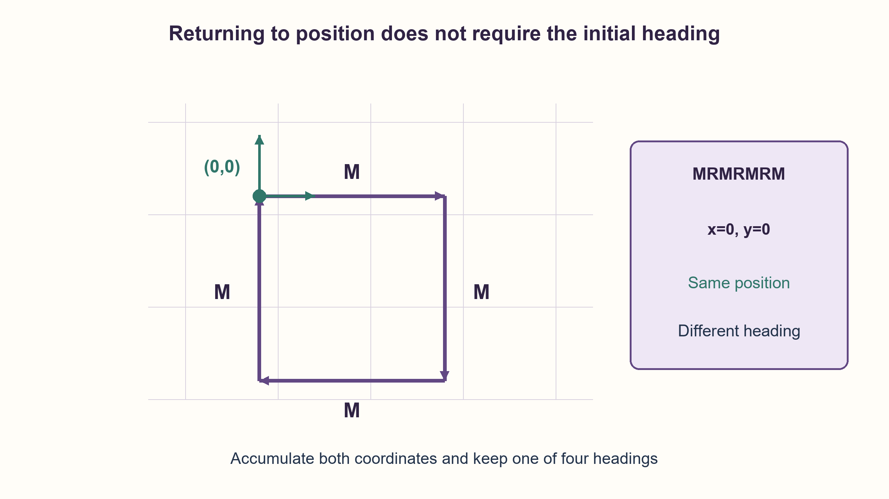

# PREP-182 — האם הצב חזר לנקודת ההתחלה?

פתרון מוצע בסיוע AI; ביקורת מקצועית אנושית ממתינה. הקושי אינו מכויל.

[צילום מקור פרטי](../sources/2026-10-30-batch90-08.png)

נתון חץ במרחב דו־ממדי, בסגנון וקטור, שנראה כמו מכונת מצבים ויכול לקבל שלוש אופציות של קוד R, M, L. M היא פקודת move המקדמת במשבצת לכיוון שאליו מצביע החץ. R פונה ימינה ב־90 מעלות, L פונה שמאלה ב־90 מעלות. צריך לכתוב פקודה, לא משנה באיזו שפה, שבודקת בהינתן רצף פקודות האם הוא מבצע סיבוב (חוזר למקום ההתחלתי) או לא.

שיוכי חברות שדווחו בצילום ולא אומתו עצמאית: NVIDIA.

## עברית

נתון רצף סופי של פקודות לצב במישור. M מזיזה אותו יחידה אחת קדימה; R מסובבת אותו ימינה ב־90 מעלות; L מסובבת שמאלה ב־90 מעלות. כתבו פונקציה שקובעת אם לאחר ביצוע הרצף פעם אחת הצב נמצא במיקומו ההתחלתי. הכיוון הסופי אינו חייב להיות הכיוון ההתחלתי.

לצורך המימוש נבחר ראשית צירים וכיוון התחלתי מזרחה; הבחירה אינה משנה אם חוזרים למיקום. הרצף הריק מותר. פקודות חוקיות הן התווים הגדולים R,L,M בלבד. זו אינה השאלה האם חזרה אינסופית על הרצף נשארת בתחום חסום.

1. המיקום משתנה רק בפקודת M, אבל הכיוון קובע איזה ציר משתנה ובאיזה סימן.
2. שמרו שני סכומי תזוזה וכיוון מתוך ארבעה. פנייה משנה רק את הכיוון.
3. התחילו ב־(0,0). אחרי הסריקה בודקים x=0 וגם y=0, בלי לדרוש שהכיוון חזר.

### לא צריך לצייר את כל המסלול
מצב מספיק הוא `(x,y,d)`: שני רכיבי המיקום וכיוון d מתוך מזרח, דרום, מערב וצפון. מתחילים ב־`(0,0,0)`. פנייה ימינה מוסיפה אחד ל־d מודולו 4; פנייה שמאלה מחסירה אחד. ב־M מוסיפים את וקטור הכיוון: `(1,0)`, `(0,-1)`, `(-1,0)` או `(0,1)`.

האינווריאנט הוא שאחרי כל קידומת המצב השמור הוא בדיוק מצב הצב האמיתי: הוא נכון בתחילה, וכל אחת משלוש הפקודות מבצעת בדיוק את עדכון ההגדרה. לכן בסוף חזרה למיקום שקולה ל־`x==0 and y==0`.

למשל `MRMRMRM` עובר ארבע צלעות של ריבוע וחוזר לראשית, אף שכיוונו הסופי צפונה ולא מזרחה. גם רצף של פניות בלבד חוזר למיקום, כי לא זזים. לעומת זאת `M` אינו חוזר. אין צורך לשמור את הנקודות שבדרך או לבדוק אם המסלול נוגע בעצמו.

עבור n פקודות, הזמן הוא O(n) ויש מספר קבוע של משתנים. כל קואורדינטה חסומה בערך מוחלט ב־n, ולכן נדרשים O(log(n+1)) ביטים ולא מספר קבוע של ביטים בלתי תלוי בקלט. במודל מילים שיכולות לייצג את אורך הקלט זהו O(1) זיכרון נוסף במילים. כל אלגוריתם מדויק חייב במקרה הגרוע לבחון את הקלט: פקודת הסיום יכולה לשנות את התשובה.

נבדקו כל 29,524 הרצפים עד אורך 9 מול מודל עצמאי של מספרים מרוכבים, כולל 250,959 צעדי פקודה. הבדיקה הסופית נובעת מהאינווריאנט, לא מהניסוי הסופי לבדו.

```python
"""Single-pass turtle position; final orientation is intentionally ignored."""

VECTORS = ((1, 0), (0, -1), (-1, 0), (0, 1))


def turtle_state(commands):
    x = y = heading = 0
    for command in commands:
        if command == "R":
            heading = (heading + 1) % 4
        elif command == "L":
            heading = (heading - 1) % 4
        elif command == "M":
            dx, dy = VECTORS[heading]
            x, y = x + dx, y + dy
        else:
            raise ValueError("Only uppercase R, L and M are permitted")
    return x, y, heading


def returns_to_start(commands):
    x, y, _ = turtle_state(commands)
    return x == 0 and y == 0
```




## English

A turtle executes a finite sequence in the plane. M moves one unit forward; R turns clockwise by 90 degrees; L turns counterclockwise by 90 degrees. Write a function deciding whether executing the sequence once returns it to its initial position. Its final heading need not equal its initial heading.

Choose the origin and an initially eastward heading for implementation; return-to-position is invariant under that choice. The empty sequence is allowed. Only uppercase R,L,M are legal. This is not the different question of boundedness when the sequence is repeated forever.

1. Only M changes position, but the heading determines the axis and sign.
2. Keep two displacement totals and one of four headings. A turn changes heading only.
3. Start at (0,0). After scanning, check x=0 and y=0 without requiring the initial heading.

### The entire trail need not be stored
Keep `(x,y,d)`: two position coordinates and one of east, south, west and north. Start at `(0,0,0)`. R increments d modulo 4; L decrements it. M adds the current direction vector:`(1,0)`, `(0,-1)`, `(-1,0)` or `(0,1)`.

The invariant is that after every prefix the stored state equals the turtle's actual state. It holds initially and each command applies precisely its defining update. Consequently return-to-position is equivalent to `x==0 and y==0` at the end.

For example, `MRMRMRM` traces four sides of a square and returns to the origin while ending northward rather than eastward. A sequence of turns alone also returns because it never moves. The sequence `M` does not. Neither storing visited points nor detecting self-intersections is necessary.

For n commands the algorithm takes O(n) time and a constant number of variables. Each coordinate has absolute value at most n, requiring O(log(n+1)) bits, not a fixed number of bits independent of input length. This is O(1) extra machine words when a word can hold the input length. Reading the input is necessary in the worst case: a final command can change the answer.

All 29,524 sequences through length 9 were compared with independent complex-number motion, covering 250,959 command steps. General correctness comes from the invariant, rather than finite testing alone.

```python
"""Single-pass turtle position; final orientation is intentionally ignored."""

VECTORS = ((1, 0), (0, -1), (-1, 0), (0, 1))


def turtle_state(commands):
    x = y = heading = 0
    for command in commands:
        if command == "R":
            heading = (heading + 1) % 4
        elif command == "L":
            heading = (heading - 1) % 4
        elif command == "M":
            dx, dy = VECTORS[heading]
            x, y = x + dx, y + dy
        else:
            raise ValueError("Only uppercase R, L and M are permitted")
    return x, y, heading


def returns_to_start(commands):
    x, y, _ = turtle_state(commands)
    return x == 0 and y == 0
```




## חומר משלים / Supporting material

```json
{
  "assumptions": {
    "he": [
      "כל M היא צעד באותו אורך; פניות מדויקות של 90 מעלות.",
      "ביצוע יחיד; שוויון מיקום בלבד, ללא דרישה לכיוון סופי."
    ],
    "en": [
      "Every M has the same unit length; turns are exact right angles.",
      "One execution; equality of position only, not final heading."
    ]
  },
  "optimality": {
    "he": "O(n) זמן, O(1) מילים נוספות או O(log(n+1)) ביטים לקואורדינטות; אין שמירת מסלול.",
    "en": "O(n) time, O(1) extra words or O(log(n+1)) coordinate bits; no trail storage."
  },
  "verification": {
    "he": "כל 29,524 הרצפים עד אורך 9 ו־250,959 צעדים נבדקו מול מודל מרוכב נפרד; שלושה קלטים פגומים נדחו.",
    "en": "All 29,524 sequences through length 9 and 250,959 steps matched an independent complex model; three invalid inputs were rejected."
  },
  "edge_cases": {
    "he": [
      "רצף ריק או פניות בלבד: חוזר.",
      "חזרה למיקום עם כיוון אחר נחשבת הצלחה.",
      "M יחיד אינו חוזר; אות קטנה אינה פקודה חוקית בחוזה שנבחר."
    ],
    "en": [
      "Empty sequence or turns only return.",
      "Returning with another heading is success.",
      "One M does not return; lowercase is invalid under the chosen contract."
    ]
  },
  "common_mistakes": {
    "he": [
      "לדרוש גם כיוון סופי זהה.",
      "לבלבל חזרה בביצוע יחיד עם חסימות במספר אינסופי של חזרות.",
      "לשמור כל נקודה במקום לצבור תזוזה."
    ],
    "en": [
      "Also requiring equal final headings.",
      "Confusing one-run return with bounded repeated motion.",
      "Storing every point instead of accumulating displacement."
    ]
  },
  "interview_answer": {
    "he": "אשמור x,y וכיוון מתוך ארבעה. R ו־L יעדכנו כיוון, M יעדכן מיקום. אחזיר אמת רק אם שתי הקואורדינטות אפס, בלי לבדוק כיוון סופי.",
    "en": "Keep x,y and one of four headings. R/L change heading; M changes position. Return true exactly when both coordinates are zero, regardless of final heading."
  },
  "source_ambiguities": {
    "he": [
      "המילה סיבוב במקור הובהרה כחזרה למיקום אחרי הרצף פעם אחת; זהו התנאי שבסוגריים בצילום.",
      "הכיוון והראשית נבחרו לצורכי ייצוג בלבד."
    ],
    "en": [
      "The source's parenthetical return-to-initial-position defines the one-run contract.",
      "Initial axes and heading are representation choices only."
    ]
  },
  "solution_extensions": {
    "he": [
      {
        "question": "מה משתנה אם גם הכיוון הסופי חייב להיות זהה?",
        "answer_direction": "מוסיפים לתנאי הסיום d=0; שאר העדכונים נשארים.",
        "principle": "מפרידים בין דרישת מיקום לדרישת מצב מלא."
      }
    ],
    "en": [
      {
        "question": "What if final heading must also match?",
        "answer_direction": "Add d=0 to the final condition; retain all updates.",
        "principle": "Distinguish position from full state."
      }
    ]
  }
}
```
