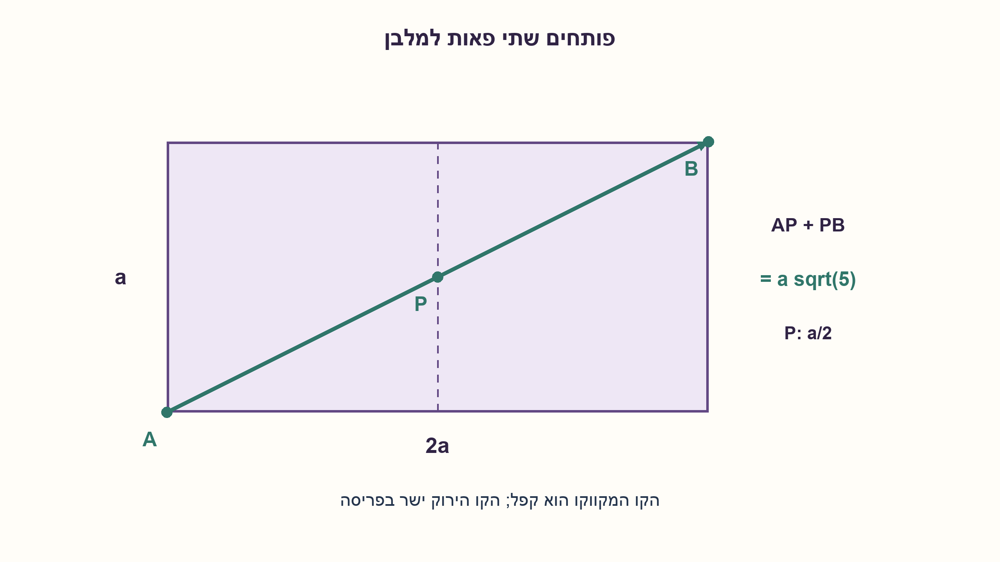
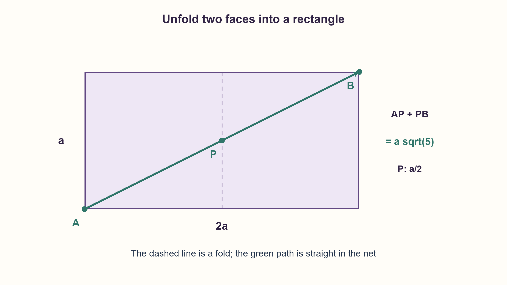

# PREP-183 — הדרך הקצרה על פני קובייה

פתרון מוצע בסיוע AI; ביקורת מקצועית אנושית ממתינה. הקושי אינו מכויל.

[צילום מקור פרטי](../sources/2026-10-30-batch90-09.png)

חשב את הדרך הקצרה מקצה אחד של קובייה לקצה השני כאשר הדופן באורך a.

שיוכי חברות שדווחו בצילום ולא אומתו עצמאית: NVIDIA.

## עברית

לקובייה אורך צלע a>0. מצאו את הדרך הקצרה ביותר מקודקוד אחד לקודקוד הנגדי על פני הקובייה, ואת אורכה, והסבירו מדוע היא מינימלית.

הצילום אומר מקצה אחד לקצה השני בלי להגדיר את הנקודות או את מרחב התנועה. הניתוח כאן בוחר במפורש קודקודים נגדיים ומסלול על פני השטח. אם מותר לעבור דרך הגוף, או מוגבלים רק למקצועות, התשובה משתנה; פרטו גם אותן.

1. האלכסון המרחבי עובר בתוך הקובייה, ולכן אינו מסלול חוקי על פניה.
2. פתחו שתי פאות סמוכות למלבן שאורכו 2a ורוחבו a. איזה קו מחבר את נקודות הקצה?
3. האלכסון בפריסה עובר באמצע המקצוע המשותף. לחסם תחתון, כל מסלול חייב לעבור בין שלוש הפאות ליד ההתחלה לשלוש הפאות ליד הסיום.

### פותחים את הפאות במקום לנחש מסלול שבור
שתי פאות סמוכות נפתחות למלבן שמידותיו `2a × a`, והקודקודים הנגדיים המבוקשים נמצאים בפינות מנוגדות שלו. הקו הישר ביניהם נשאר בתוך שתי הפאות. בקיפול חזרה הוא עובר באמצע המקצוע המשותף, ואורכו:

```text
L = sqrt((2a)^2+a^2) = a*sqrt(5)
```

### למה מסלול דרך פאות אחרות אינו קצר יותר?
נמקם את A ב־`(0,0,0)` ואת B ב־`(a,a,a)`. שלוש פאות ההתחלה הן x=0,y=0,z=0, ושלוש פאות הסיום הן x=a,y=a,z=a. כל מסלול רציף על הקובייה חייב לעבור בין שתי הקבוצות. נקודת מעבר P נמצאת במקצוע שמחבר פאה מכל קבוצה; עד כדי החלפת שמות הצירים אפשר לכתוב `P=(a,t,0)`, כאשר `0≤t≤a`.

אורך המסלול עד P אינו קטן מהמרחק המרחבי הישר מ־A ל־P; אותו דבר מהנקודה P ל־B. לכן כל מסלול חסום מלמטה ב־`sqrt(a²+t²)+sqrt(a²+(a−t)²)`. לפי אי־שוויון המשולש במישור, זהו לפחות אורך סכום הווקטורים `(a,t)+(a,a−t)=(2a,a)`, כלומר `a√5`. כאשר t=a/2 שתי הקשתות הישרות על שתי הפאות משיגות שוויון. כך יש גם מסלול חוקי וגם חסם תחתון שווה, ולא רק ניסוי של פריסה אחת.

אם מותר לעבור דרך הגוף, האלכסון המרחבי נותן `a√3`. אם מותר לנוע רק לאורך המקצועות, חייבים לצבור a בכל אחד משלושת הצירים ולכן האורך הוא `3a`. מעבר על אלכסון פאה ואז על מקצוע נותן `(√2+1)a`, והוא ארוך ממסלול הפאות הרציף.

נבדקו 909 נקודות חצייה בתשעה גדלים מול סכומי מרחקים תלת־ממדיים עצמאיים. המינימליות לכל t נובעת מההוכחה לעיל. לרקע על ניתוח באמצעות פריסות במקרים כלליים יותר: [Shortest Paths on Cubes](https://arxiv.org/abs/2003.06096).

```python
"""Opposite-vertex paths on a cube surface; a is a positive finite side."""

from math import hypot, isfinite, sqrt


def shortest_surface_length(side):
    if not isfinite(side) or side <= 0:
        raise ValueError("The cube side must be positive and finite")
    return side * sqrt(5)


def path_via_shared_edge(side, edge_offset):
    if not isfinite(side) or side <= 0 or not isfinite(edge_offset):
        raise ValueError("Finite side and edge offset required")
    if not 0 <= edge_offset <= side:
        raise ValueError("Crossing point must lie on the common edge")
    return hypot(side, edge_offset) + hypot(side, side - edge_offset)


def unfolded_path(side):
    shortest_surface_length(side)
    return ((0, 0), (side, side / 2), (2 * side, side))
```




## English

A cube has side length a>0. Find the shortest path from one vertex to the opposite vertex constrained to the surface, give its length, and justify minimality.

The screenshot says from one end to the other without defining endpoints or the motion domain. This analysis explicitly chooses opposite vertices and surface travel. Allowing travel through the solid or restricting travel to edges changes the answer; state those alternatives too.

1. The space diagonal passes through the solid and is not a legal surface path.
2. Unfold two adjacent faces into a 2a by a rectangle. Which line joins the endpoints?
3. The net's diagonal crosses the shared edge at its midpoint. For a lower bound, every path must pass from the three start faces to the three end faces.

### Flatten the faces rather than guessing a broken path
Two adjacent faces unfold into a `2a × a` rectangle with the required vertices at opposite corners. Its straight diagonal stays within the two faces. Refolding gives a path crossing their shared edge at its midpoint, of length:

```text
L = sqrt((2a)^2+a^2) = a*sqrt(5)
```

### Why can another set of faces not do better?
Place A at `(0,0,0)` and B at `(a,a,a)`. The three start faces have x=0,y=0,z=0; the three end faces have x=a,y=a,z=a. Every continuous surface path must cross between these groups. Such a crossing P lies on an edge shared by one face of each group. Up to coordinate permutation, `P=(a,t,0)` with `0≤t≤a`.

The path prefix to P is at least the straight 3D distance AP; likewise the suffix is at least PB. Thus its total length is at least `sqrt(a²+t²)+sqrt(a²+(a−t)²)`. By the planar triangle inequality, this is at least the norm of `(a,t)+(a,a−t)=(2a,a)`, namely `a√5`. At t=a/2 the two straight face segments achieve equality. A legal construction and an equal lower bound establish global minimality, rather than checking just one net experimentally.

If travel through the solid is allowed, the space diagonal has length `a√3`. If travel is restricted to edges, one must accumulate a along each axis, giving `3a`. A face diagonal followed by an edge has length `(√2+1)a`, exceeding the continuous surface optimum.

Checks sampled909 crossing points over nine sizes against independent 3D segment sums. The proof above covers every t. For background on unfolding analysis in more general cases, see[Shortest Paths on Cubes](https://arxiv.org/abs/2003.06096).

```python
"""Opposite-vertex paths on a cube surface; a is a positive finite side."""

from math import hypot, isfinite, sqrt


def shortest_surface_length(side):
    if not isfinite(side) or side <= 0:
        raise ValueError("The cube side must be positive and finite")
    return side * sqrt(5)


def path_via_shared_edge(side, edge_offset):
    if not isfinite(side) or side <= 0 or not isfinite(edge_offset):
        raise ValueError("Finite side and edge offset required")
    if not 0 <= edge_offset <= side:
        raise ValueError("Crossing point must lie on the common edge")
    return hypot(side, edge_offset) + hypot(side, side - edge_offset)


def unfolded_path(side):
    shortest_surface_length(side)
    return ((0, 0), (side, side / 2), (2 * side, side))
```




## חומר משלים / Supporting material

```json
{
  "assumptions": {
    "he": [
      "a חיובי; שני הקודקודים נגדיים במרחב.",
      "מסלול רציף על הפאות, ללא חדירה לגוף וללא הגבלה למקצועות בלבד."
    ],
    "en": [
      "Positive side a; diametrically opposite vertices.",
      "Continuous face travel, without interior shortcuts or an edges-only restriction."
    ]
  },
  "optimality": {
    "he": "אורך מינימלי a√5 לפי בנייה וחסם תחתון תואם; חישוב האורך O(1).",
    "en": "Minimum length a√5 by construction and matching lower bound; O(1) length calculation."
  },
  "verification": {
    "he": "909 דגימות חצייה ותשעה גדלים מול מרחקי 3D; ארבעה אורכים פגומים נדחו. הוכחת המינימליות רציפה ונפרדת מהדגימה.",
    "en": "909 crossing samples over nine sizes versus 3D distances; four invalid sides rejected. Continuous minimality is proved separately from sampling."
  },
  "edge_cases": {
    "he": [
      "a=0 או a שלילי אינם קובייה בחוזה.",
      "מעבר דרך הגוף נותן a√3; מקצועות בלבד נותנים 3a.",
      "מספר מסלולים סימטריים משיגים אותו מינימום."
    ],
    "en": [
      "Zero or negative a is outside the cube contract.",
      "Interior travel gives a√3; edges only give3a.",
      "Symmetric paths attain the same minimum."
    ]
  },
  "common_mistakes": {
    "he": [
      "לתת את אלכסון הגוף כשנדרש מסלול על הפאות.",
      "להניח שאלכסון פאה ועוד מקצוע הוא מיטבי.",
      "להציג פריסה חוקית בלי לשלול מסלול קצר יותר."
    ],
    "en": [
      "Giving the space diagonal for surface travel.",
      "Assuming a face diagonal plus one edge is optimal.",
      "Presenting a legal unfolding without a lower bound."
    ]
  },
  "interview_answer": {
    "he": "בפני השטח פותחים שתי פאות למלבן 2a על a. האלכסון הוא a√5 וחוצה את המקצוע באמצעו. החסם דרך נקודת מעבר בין קבוצות הפאות מוכיח שאין דרך קצרה יותר.",
    "en": "Unfold two faces into a 2a by a rectangle. Its diagonal is a√5 and crosses the shared edge midway. A near/far-face crossing lower bound rules out shorter alternatives."
  },
  "source_ambiguities": {
    "he": [
      "סוג הקצוות והיתר התנועה חסרים בצילום; הבחירה בקודקודים נגדיים על הפאות היא הנחת עריכה גלויה."
    ],
    "en": [
      "Endpoints and permitted motion are underspecified in the screenshot; opposite vertices with surface travel are an explicit editorial choice."
    ]
  },
  "solution_extensions": {
    "he": [
      {
        "question": "מה יקרה בתיבה בעלת שלוש צלעות שונות?",
        "answer_direction": "למסלול בין קודקודים נגדיים משווים פריסות במידות (a+b)×c, (a+c)×b ו־(b+c)×a.",
        "principle": "מגדירים את מרחב התנועה ומשווים מבנים סימטריים שהפכו לשונים."
      }
    ],
    "en": [
      {
        "question": "What changes for a rectangular box with unequal dimensions?",
        "answer_direction": "For opposite vertices compare the(a+b)×c, (a+c)×b and(b+c)×a unfoldings.",
        "principle": "Specify the motion domain and compare formerly symmetric constructions."
      }
    ]
  }
}
```
