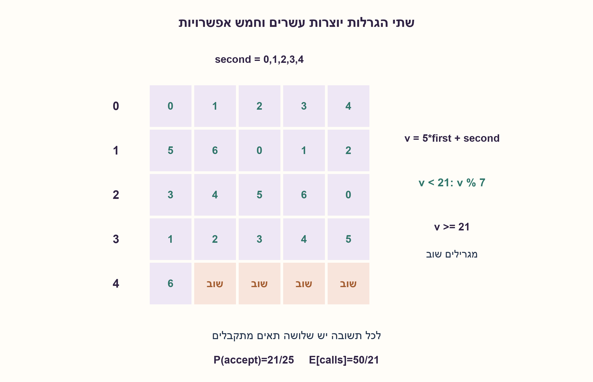
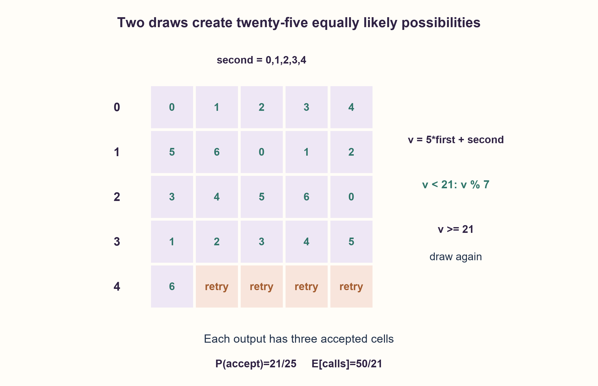

# PREP-184 — מ־Random5 ל־Random7 בלי הטיה

פתרון מוצע בסיוע AI; ביקורת מקצועית אנושית ממתינה. הקושי אינו מכויל.

[צילום מקור פרטי](../sources/2026-10-30-batch90-11.png)

קיימת פונקציה Random5 שמוציאה באופן רנדומלי כפלט אחד מהמספרים 0,1,2,3,4. עליך לייצר מפונקציה זו את הפונקציה Random7 שמוציאה כפלט באופן רנדומלי 0,1,2,3,4,5,6.

שיוכי חברות שדווחו בצילום ולא אומתו עצמאית: Apple.

## עברית

נתונה פונקציה Random5 שמחזירה אחד מהמספרים 0,1,2,3,4. ממשו בעזרתה Random7 שמחזירה אחד מהמספרים 0,1,2,3,4,5,6 בהסתברות שווה.

נניח במפורש שכל קריאות Random5 בלתי תלויות ואחידות; בלי הבטחה זו אי אפשר להסיק שהפתרון אחיד. מותר לקרוא לפונקציה מספר משתנה של פעמים. הסבירו את אחידות הפלט, מספר הקריאות הצפוי ומה מובטח לגבי עצירה.

1. אי אפשר לחלק חמש תוצאות אחידות לשבע קבוצות שוות. נסו לבנות מרחב גדול יותר.
2. שתי קריאות נותנות 25 זוגות שווי הסתברות. איזה חלק מתוכם מתחלק בדיוק לשבע?
3. צרו v=5a+b. קבלו רק v<21 והחזירו v mod 7; בארבעת המקרים האחרים מגרילים מחדש.

### לא דוחסים חמש תוצאות לשבע
לוקחים שתי קריאות בלתי תלויות a,b ומגדירים `v=5a+b`. כל אחד מ־25 הערכים 0–24 מתקבל מזוג יחיד, ולכן בהסתברות 1/25. הערכים 0–20 מתחלקים לשבע קבוצות שוות בגודל שלוש לפי השארית מודולו 7. מקבלים רק אותם; עבור 21–24 זורקים את הזוג ומתחילים ניסיון חדש.

הדחייה אינה הטיה: בכל ניסיון לכל תשובה j יש שלושה זוגות מתקבלים. עבור k−1 דחיות ואחריהן קבלה, ההסתברות לתשובה j באותו ניסיון היא `(4/25)^(k−1)·3/25`. סכימה על k≥1 נותנת `1/7` לכל j.

הסתברות הקבלה היא 21/25. מספר הניסיונות הוא גאומטרי ותוחלתו 25/21; בכל ניסיון יש שתי קריאות, ולכן תוחלת מספר הקריאות ל־Random5 היא `50/21`, כ־2.381. זהו ניתוח של השיטה הזו, לא טענה שהיא מיטבית בין כל השיטות שממחזרות מידע אקראי.

עוצרים בהסתברות 1: ההסתברות ליותר מ־k ניסיונות היא `(4/25)^k`, והיא שואפת לאפס. עם זאת אין חסם דטרמיניסטי סופי למספר הניסיונות, ויש רצפים אינסופיים של דחיות. אם דורשים מספר קריאות חסום מראש ב־K, כל עלה ניתן להרחבה לעומק K ותוצאתו היא כפולה של `1/5^K`; אי אפשר לקבל בדיוק 1/7 כי 7 אינו מחלק שום חזקה של 5. זו מגבלה של הפקה מדויקת מקריאות אחידות, לא הוכחה שלעולם לא נסיים.

נבדקו כל 25 הזוגות וכל 1,785 ההיסטוריות שמסתיימות בקבלה עד הניסיון הרביעי. לכל אחת משבע התשובות נמצא אותו מספר היסטוריות בכל עומק. זוהי בדיקת המיפוי; איכות המקור האקראי עצמו היא הנחת החוזה.

```python
"""Exact rejection sampling, assuming independent uniform random5 calls."""


def random7(random5):
    while True:
        first, second = random5(), random5()
        if type(first) is not int or type(second) is not int:
            raise ValueError("random5 must return integers")
        if not (0 <= first <= 4 and 0 <= second <= 4):
            raise ValueError("random5 must return values in 0..4")
        candidate = 5 * first + second
        if candidate < 21:
            return candidate % 7
```




## English

Random5 returns one of 0,1,2,3,4. Use it to implement Random7 with uniform output over 0,1,2,3,4,5,6.

Explicitly assume independent uniform Random5 calls; without that promise output uniformity cannot be concluded. A variable number of calls is allowed. Explain the output distribution, expected call count and termination guarantee.

1. Five equally likely outcomes cannot be partitioned evenly into seven groups. Build a larger sample space.
2. Two calls give25 equally likely pairs. How much of that space divides evenly into seven?
3. Form v=5a+b. Accept only v<21 and return v mod7; otherwise draw again.

### Do not squeeze five outcomes directly into seven
Take independent draws a,b and form `v=5a+b`. Each of the25 integers 0..24 corresponds to exactly one pair, hence has probability 1/25. Values0..20 partition into seven equal groups of three by remainder modulo 7. Accept these values; for 21..24 discard the pair and start another attempt.

Rejection introduces no bias. In every attempt, each output j has three accepted pairs. The probability of k−1 rejections followed by output j is `(4/25)^(k−1)·3/25`. Summing over k≥1 gives `1/7` for every j.

Acceptance probability is 21/25. The geometric number of attempts has expectation 25/21. Two calls per attempt therefore yield expected Random5 calls `50/21`, approximately 2.381. This analyzes this method; it does not claim optimality among algorithms recycling random information.

Termination occurs with probability 1: the probability of exceeding k attempts is `(4/25)^k`, tending to zero. There is no finite deterministic worst-case bound, and infinite rejection sequences exist. If calls were bounded by a fixed K, all leaves could be extended to depth K and every output probability would be a multiple of `1/5^K`. Exact 1/7 is impossible because7 divides no power of 5. This is a limit on exact bounded-call generation, not a claim that the algorithm normally fails to finish.

Checks enumerated all 25 pairs and all 1,785 first-accept histories through attempt 4. Each of the seven outputs had equal history counts at every depth. This verifies the mapping; the random source's quality remains a contract assumption.

```python
"""Exact rejection sampling, assuming independent uniform random5 calls."""


def random7(random5):
    while True:
        first, second = random5(), random5()
        if type(first) is not int or type(second) is not int:
            raise ValueError("random5 must return integers")
        if not (0 <= first <= 4 and 0 <= second <= 4):
            raise ValueError("random5 must return values in 0..4")
        candidate = 5 * first + second
        if candidate < 21:
            return candidate % 7
```




## חומר משלים / Supporting material

```json
{
  "assumptions": {
    "he": [
      "כל קריאה מחזירה מספר שלם אחיד בתחום 0–4.",
      "הקריאות בלתי תלויות; מותר מספר קריאות משתנה."
    ],
    "en": [
      "Each call returns a uniform integer in 0..4.",
      "Calls are independent; variable call count is allowed."
    ]
  },
  "optimality": {
    "he": "תוחלת 50/21 קריאות מקור ו־O(1) מקום; אין חסם זמן סופי למקרה הגרוע. לא נטענת אופטימליות גלובלית.",
    "en": "Expected 50/21 source calls and O(1) space; no finite worst-case time bound. Global optimality is not claimed."
  },
  "verification": {
    "he": "25 זוגות, 1,785 היסטוריות קבלה עד ארבעה ניסיונות וחישוב רציונלי של התוחלת; אין בדיקת איכות למחולל חיצוני.",
    "en": "25 pairs,1,785 first-accept histories through four attempts and rational expectation; no external RNG-quality certification."
  },
  "edge_cases": {
    "he": [
      "v=20 מתקבל ונותן 6; v=21 נדחה.",
      "רצף של דחיות יכול להיות ארוך כרצוננו.",
      "מקור לא אחיד או מתואם אינו מכוסה בהוכחה."
    ],
    "en": [
      "v=20 is accepted as 6; v=21 is rejected.",
      "A rejection run may be arbitrarily long.",
      "Biased or correlated sources are outside the proof."
    ]
  },
  "common_mistakes": {
    "he": [
      "להחזיר v mod 7 לכל 25 הערכים: ארבע תשובות יקבלו הופעה נוספת.",
      "לקרוא לעצירה בהסתברות 1 חסם זמן מובטח.",
      "להניח שהמילה רנדומלי לבדה מבטיחה אי־תלות ואחידות."
    ],
    "en": [
      "Applying v mod7 to all 25 values gives four answers extra mass.",
      "Calling almost-sure termination a deterministic runtime bound.",
      "Assuming the word random alone guarantees independence and uniformity."
    ]
  },
  "interview_answer": {
    "he": "אייצר 25 זוגות אחידים משתי קריאות, אדחה את 21–24 ואחזיר שארית מודולו 7 עבור השאר. לכל תשובה שלושה זוגות; התוחלת 50/21 קריאות, עם עצירה בהסתברות 1 בלבד.",
    "en": "Generate25 equiprobable pairs, reject 21..24 and return modulo 7 for the rest. Each answer has three pairs; expect 50/21 calls, with almost-sure rather than bounded termination."
  },
  "source_ambiguities": {
    "he": [
      "המקור לא מציין אי־תלות ואחידות; הן הוצהרו כהנחות הנחוצות להבטחת פלט אחיד."
    ],
    "en": [
      "Independence and uniformity are necessary assumptions, explicitly added because the screenshot does not state them."
    ]
  },
  "solution_extensions": {
    "he": [
      {
        "question": "מה ההכללה ל־RandomM שממנו רוצים RandomN?",
        "answer_direction": "בונים k ספרות בבסיס M עד שיש לפחות N מצבים, מקבלים כפולה של N מצבים ומחלקים לפי שארית; מחשבים הסתברות קבלה.",
        "principle": "דחייה משמרת קבוצות שוות הסתברות."
      }
    ],
    "en": [
      {
        "question": "How does this generalize from RandomM to RandomN?",
        "answer_direction": "Build k base-M digits until there are at least N states; accept a multiple of N states and use the remainder, then compute acceptance probability.",
        "principle": "Rejection preserves equal probability groups."
      }
    ]
  }
}
```
