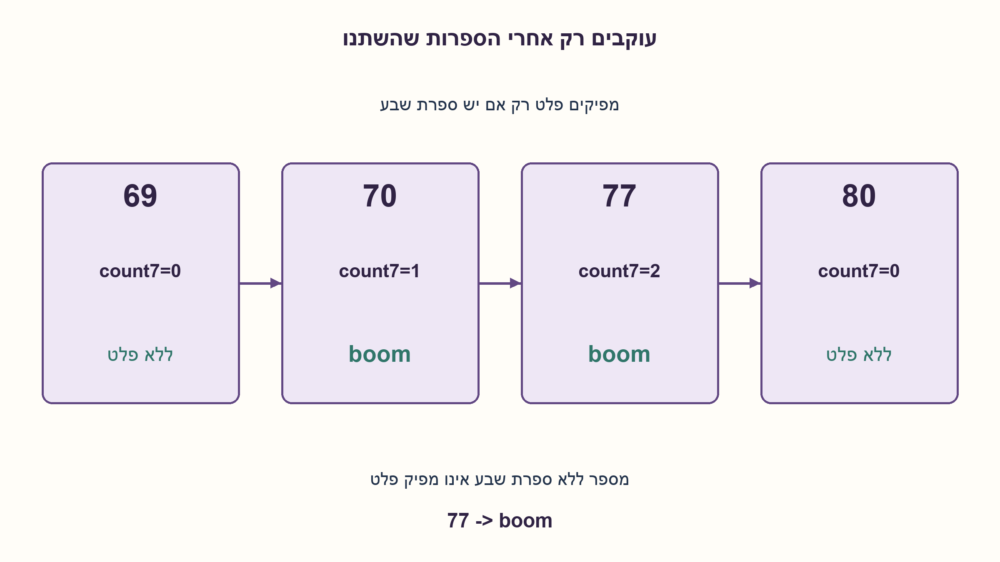
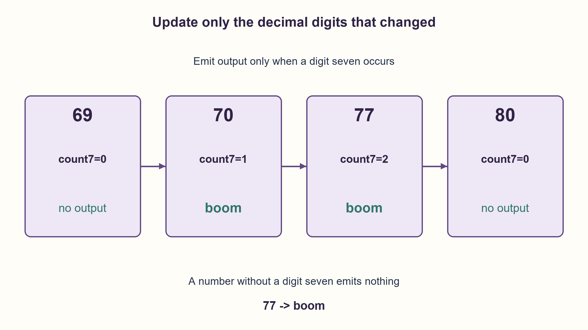

# PREP-185 — שבע בום — פלט רק כאשר הספרה מופיעה

פתרון מוצע בסיוע AI; ביקורת מקצועית אנושית ממתינה. הקושי אינו מכויל.

[צילום מקור פרטי](../sources/2026-10-30-batch90-14.png)

ישנו משחק הנקרא 7 בום. בכל פעם שמופיע המספר 7 צריך להדפיס boom, אחרת לא קורה כלום. כתוב קוד המתאר את המשחק עד המספר 100. כתוב קוד המתאר את המשחק עד המספר 1000000. הסבר את דרך המחשבה.

שיוכי חברות שדווחו בצילום ולא אומתו עצמאית: Apple, Cisco.

## עברית

כתבו קוד שעובר על המספרים 1 עד 100, כולל הקצוות. עבור מספר שהכתיב העשרוני שלו מכיל את הספרה 7 מדפיסים boom; אחרת לא מדפיסים דבר, כפי שנדרש בצילום. לאחר מכן הרחיבו עד 1,000,000 והסבירו את שיקולי היעילות.

נבחר פלט boom אחד לכל מספר מתאים: גם 77 מפיק boom פעם אחת. הצילום דורש הופעת הספרה 7; הוא אינו מוסיף את הכלל המוכר של כפולות 7. אין אפסים מובילים. דונו בשיטה פשוטה ובאפשרות לשמור מצב בין מספרים עוקבים.

1. בכל מספר אפשר לבדוק את הכתיב העשרוני, או להוציא ספרות בעזרת שארית וחילוק ב־10.
2. כשהמספר גדל באחד, בדרך כלל משתנה רק הספרה האחרונה; נשא משנה כמה ספרות נוספות.
3. שמרו מערך ספרות ומספר הופעות של 7. כשספרה משתנה, גרעו אם הייתה 7 והוסיפו אם נעשתה 7; boom נדרש אם המונה חיובי.

### קודם מממשים בדיוק את הכלל
הדרך הישירה היא לעבור על i מ־1 עד N ולבדוק אם הספרה 7 מופיעה בו. אפשר להשתמש ב־`'7' in str(i)`, או לבדוק `i%10` ולהקטין את העותק ב־`i//=10`. עבור 14 אין פלט; עבור 17 או 77 מדפיסים boom אחד. אין להדפיס את שאר המספרים: המקור אומר שבמקרים האלה לא קורה דבר. עד מיליון יש לכל היותר שבע ספרות, ולכן גם הדרך הפשוטה מעשית.

אם רוצים להימנע מסריקה חוזרת של כל הספרות לצורך ההחלטה, שומרים אותן כמו מונה עשרוני יחד עם `count7`. בהוספת אחד מאפסים רצף ספרות 9, ואז מגדילים את הספרה הבאה. תשע שהופכת לאפס אינה 7 לפני השינוי או אחריו; בספרה שמוגדלת מעדכנים את count 7 לפי הערך הישן והחדש. כך נשמר האינווריאנט שהוא מספר הספרות השוות ל־7 בכתיב המספר הנוכחי.

לאורך N הגדלות, ספרת האחדות משתנה N פעמים, העשרות בערך N/10 וכן הלאה. מספר עדכוני הספרות הכולל חסום בסכום גאומטרי: `N+N/10+N/100+...=O(N)`. לכן תחזוקת החלטת ה־boom עולה O(N) פעולות בסך הכול במודל פעולות ספרה, עם O(log(N+1)) ספרות מקום. המימוש המקושר יוצר פלט בהדרגה ולא שומר את כל השורות.

בכל התאמה מפיקים רק את המילה הקבועה boom. אם יש B התאמות, גודל הפלט הוא Θ(B), ולכן יש גם Ω(B) עבודת כתיבה; אין צורך להמיר את המספרים הלא־מתאימים לטקסט. הבדיקה הישירה עולה O(N log N) פעולות ספרה כחסם כללי, ואילו תחזוקת המונה חוסכת את סריקת הספרות החוזרת. הטענה על O(N) נוגעת לעדכוני ספרות במודל המוצהר, ולא למדידת מהירות מסוף או לעלות בלתי מוגבלת של מספרים שלמים במחשב.

נבדקו כל מיליון המספרים בשתי השיטות מול בדיקת מחרוזת עצמאית. עד 100 יש 19 פלטי boom. עד מיליון יש 468,559: בין 0 ל־999999 יש `9^6` מחרוזות שש ספרות ללא 7, גם כשמרפדים באפסים; לכן ההפרש הוא `10^6−9^6`. אפס והמיליון עצמם אינם מכילים 7. זו בדיקת נכונות של הכלל, לא מדידת מהירות מסוף.

```python
"""A boom once per positive integer containing decimal digit 7."""


def contains_seven(number):
    if type(number) is not int or number < 0:
        raise ValueError("A nonnegative integer is required")
    while number:
        if number % 10 == 7:
            return True
        number //= 10
    return False


def seven_flags(limit):
    """Increment decimal digits; membership work is amortized O(1) per number."""
    if type(limit) is not int or limit < 0:
        raise ValueError("A nonnegative integer limit is required")
    digits = [0]  # Least-significant decimal digit first.
    sevens = 0
    for number in range(1, limit + 1):
        place = 0
        while place < len(digits) and digits[place] == 9:
            digits[place] = 0
            place += 1
        if place == len(digits):
            digits.append(1)
        else:
            sevens -= digits[place] == 7
            digits[place] += 1
            sevens += digits[place] == 7
        yield number, sevens > 0


def seven_boom(limit):
    """Emit boom only for matching integers; nonmatching integers emit nothing."""
    for _, boom in seven_flags(limit):
        if boom:
            yield "boom"
```




## English

Process integers 1 through 100 inclusive. Print boom when the usual decimal representation contains digit7; otherwise emit nothing, as required by the screenshot. Extend through 1,000,000 and explain efficiency considerations.

Emit one boom per matching integer:77 produces boom once. The screenshot requires the occurrence of digit7; it does not also request the familiar multiples-of 7 rule. There are no leading zeroes. Discuss both a simple method and maintained state between consecutive numbers.

1. Inspect the decimal string or extract digits using remainder and division by 10.
2. Incrementing an integer usually changes only its final digit; a carry changes more.
3. Maintain decimal digits and their count of sevens. Decrement the count when a changed digit was7 and increment when it becomes7; boom means a positive count.

### Implement the exact rule first
The direct method loops from 1 to N and checks for digit7. Use `'7' in str(i)`, or inspect `i%10` while dividing a copy by 10. Emit nothing for 14 and one boom for 17 or77. Do not print nonmatching numbers: the source explicitly says nothing happens otherwise. Through one million there are at most seven digits, so the simple method is practical too.

To avoid rescanning all digits for the decision, maintain a decimal counter and `count7`. Incrementing resets a suffix of nines and increments the next digit. A nine becoming zero contributes no seven before or after; for the incremented digit adjust count 7 according to its old and new values. The invariant is that count 7 equals the number of current decimal digits equal to7.

Over N increments, the units digit changes N times, the tens about N/10 times, and so on. Total digit updates are bounded by the geometric sum `N+N/10+N/100+...=O(N)`. Maintaining membership therefore takes O(N) digit operations in total and O(log(N+1)) stored decimal digits. The implementation yields outputs rather than retaining every line.

Every match emits only the fixed word boom. With B matches the output has Θ(B) characters, requiring Ω(B) writing work; nonmatching integers need no text conversion. Direct membership has an O(N log N) digit-operation bound, whereas the maintained counter avoids repeated digit scans. The O(N) claim concerns digit-state updates in the stated model, not terminal throughput or unbounded-integer machine costs.

Both methods were checked for every integer through one million against independent string membership. There are19 booms through 100 and 468,559 through one million. Among0..999999, exactly `9^6` padded six-digit strings contain no7, giving `10^6−9^6`. Zero and one million themselves contain no7. This verifies the rule; terminal throughput was not benchmarked.

```python
"""A boom once per positive integer containing decimal digit 7."""


def contains_seven(number):
    if type(number) is not int or number < 0:
        raise ValueError("A nonnegative integer is required")
    while number:
        if number % 10 == 7:
            return True
        number //= 10
    return False


def seven_flags(limit):
    """Increment decimal digits; membership work is amortized O(1) per number."""
    if type(limit) is not int or limit < 0:
        raise ValueError("A nonnegative integer limit is required")
    digits = [0]  # Least-significant decimal digit first.
    sevens = 0
    for number in range(1, limit + 1):
        place = 0
        while place < len(digits) and digits[place] == 9:
            digits[place] = 0
            place += 1
        if place == len(digits):
            digits.append(1)
        else:
            sevens -= digits[place] == 7
            digits[place] += 1
            sevens += digits[place] == 7
        yield number, sevens > 0


def seven_boom(limit):
    """Emit boom only for matching integers; nonmatching integers emit nothing."""
    for _, boom in seven_flags(limit):
        if boom:
            yield "boom"
```




## חומר משלים / Supporting material

```json
{
  "assumptions": {
    "he": [
      "טווח חיובי כולל הקצה; ייצוג עשרוני ללא אפסים מובילים.",
      "פלט אחד לכל מספר שמכיל 7; אין כלל נוסף של התחלקות ב־7."
    ],
    "en": [
      "Positive inclusive interval; usual decimal representation without leading zeroes.",
      "One output per number containing 7; no additional divisibility rule."
    ]
  },
  "optimality": {
    "he": "בדיקה ישירה O(N log N) פעולות ספרה; תחזוקת count 7 היא O(N) עדכוני ספרה מצטברים. B התאמות מפיקות B מילים קבועות ו־Θ(B) תווי פלט; אין פלט עבור שאר המספרים.",
    "en": "Direct membership uses O(N log N) digit operations; count 7 maintenance uses O(N) amortized digit updates. B matches emit B fixed words and Θ(B) characters; nonmatches emit nothing."
  },
  "verification": {
    "he": "כל 1,000,000 המספרים נבדקו מול כתיב עשרוני עצמאי; נמצאו 19 פלטי boom עד 100 ו־468,559 עד מיליון.",
    "en": "All 1,000,000 integers matched independent decimal-string membership;19 booms through 100 and 468,559 through one million."
  },
  "edge_cases": {
    "he": [
      "77 מפיק boom אחד ולא שניים.",
      "14 אינו מפיק פלט על פי הכלל המצולם.",
      "ב־69→70 נכנס 7; ב־79→80 הוא נעלם; N=0 מפיק רצף ריק בהכללת ה־API."
    ],
    "en": [
      "77 yields one boom, not two.",
      "14 emits no output under the supplied rule.",
      "69→70 introduces7;79→80 removes it; generalized API N=0 yields no lines."
    ]
  },
  "common_mistakes": {
    "he": [
      "להוסיף כפולות של 7 בלי שהמקור ביקש זאת.",
      "להדפיס את המספר הרגיל כשאין בו 7, בניגוד למקור.",
      "לא לעדכן ספרות שנמחקו או השתנו בנשא."
    ],
    "en": [
      "Adding multiples of 7 without a source requirement.",
      "Printing a nonmatching number despite the source's no-action rule.",
      "Failing to update digit state across carries."
    ]
  },
  "interview_answer": {
    "he": "אבדוק הופעת הספרה 7 ואפיק boom אחד רק בהתאמה; אחרת לא יהיה פלט. מיליון קטן מספיק גם לסריקה פשוטה. לשיפור החלטת הזיהוי אשמור ספרות ומונה שביעיות ואעדכן רק את הנשא; אספור גם את מחיר הפלט.",
    "en": "Test for digit7 and emit one boom only on a match; otherwise emit nothing. A simple scan handles one million. To optimize membership keep decimal digits and a seven-count, update carried digits and include output cost."
  },
  "source_ambiguities": {
    "he": [
      "המקור דורש boom בהופעת 7 ואחרת שום פעולה; אין הדפסת המספרים הלא־מתאימים.",
      "שם המשחק המקובל עשוי לכלול כפולות 7, אך הנוסח בצילום מציין רק הופעת הספרה.",
      "פלט יחיד למספר מתאים נבחר בגלוי כשיש יותר מהופעה אחת."
    ],
    "en": [
      "The source requires boom on a 7 occurrence and otherwise no action; nonmatching numbers are not printed.",
      "The familiar game's name may include multiples of 7, but the screenshot specifies only digit occurrence.",
      "One output per matching integer is explicitly chosen when the digit occurs repeatedly."
    ]
  },
  "solution_extensions": {
    "he": [
      {
        "question": "אם צריך רק לספור כמה מספרים עד N מכילים 7, בלי להדפיסם?",
        "answer_direction": "אפשר להשתמש ב־digit DP או לספור את המשלימים ללא 7; אז אין הכרח לעבור על כל N המספרים.",
        "principle": "גודל הפלט משנה את החסם התחתון."
      }
    ],
    "en": [
      {
        "question": "What if only the count through N is needed, without printing each value?",
        "answer_direction": "Use digit DP or count the complement without7; then visiting every integer is unnecessary.",
        "principle": "Output requirements determine lower bounds."
      }
    ]
  }
}
```
