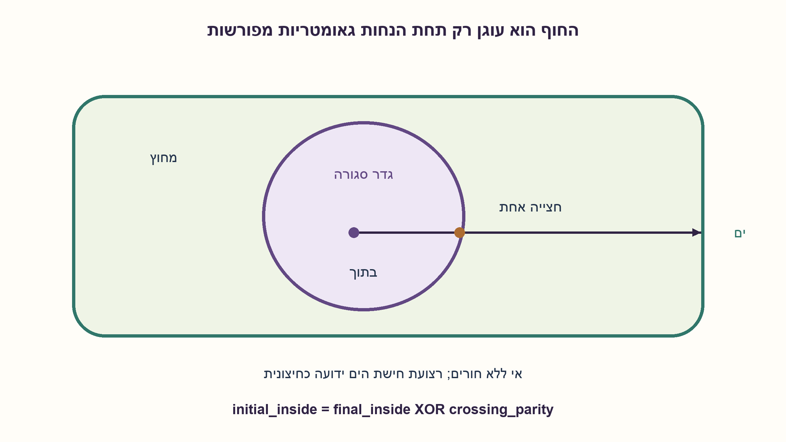
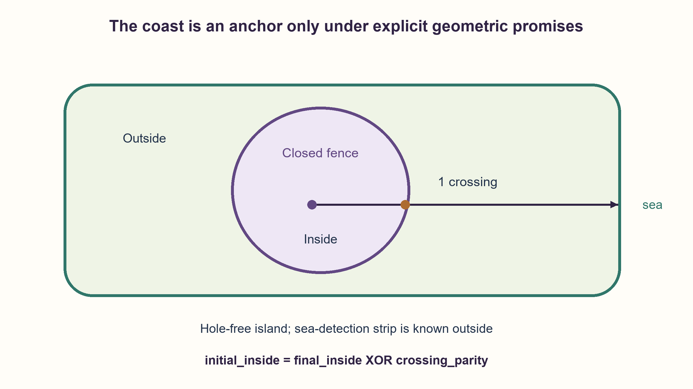

# PREP-186 — באיזה צד של הגדר התחלת? החוף כעוגן

פתרון מוצע בסיוע AI; ביקורת מקצועית אנושית ממתינה. הקושי אינו מכויל.

[צילום מקור פרטי](../sources/2026-10-30-batch90-18.png)

שמים אדם מסוים על אי שחלקו מוקף בגדר. האדם יכול לדעת בכל רגע נתון האם הוא חצה גדר והאם הוא סמוך לים. יש לתאר אלגוריתם שידע היכן הניחו את האדם בהתחלה: האם בחלק של האי שאינו מוקף גדר או בחלק של האי המוקף גדר.

שיוכי חברות שדווחו בצילום ולא אומתו עצמאית: Apple.

## עברית

אדם הונח בנקודה לא ידועה באי שחלק ממנו מוקף בגדר. הוא יכול לדעת מתי חצה גדר והאם הוא סמוך לים. תארו כיצד להסיק אם נקודת ההתחלה הייתה בתוך האזור המגודר או מחוצה לו.

ראשית הסבירו איזה מידע גאומטרי ויכולת תנועה חסרים בנוסח. לאחר מכן פתרו תחת החוזה המוצהר הבא: אי יבשתי חסום ופשוט־קשר, עם חוף חיצוני סגור פשוט יחיד וללא חורים או אגמים פנימיים; גדר סגורה פשוטה ופוליגונלית, שנמצאת כולה בפנים האי ואינה נוגעת בחוף. חיישן הסמיכות לים מופעל רק ברצועת חוף הידועה כולה מחוץ לאזור המגודר; לא די בסמיכות בלתי מכוילת. אפשר לחצות את הגדר ולנוע במסלול המגיע לרצועה זו לאחר מספר סופי של חציות אמיתיות. נקודת ההתחלה אינה על הגדר. חיישן החצייה מדווח על מעבר בין הצדדים, לא על נגיעה בלבד.

1. כל חצייה אמיתית מחליפה בין פנים לחוץ, אבל חציות לבדן אינן אומרות מה היה הצד הראשון.
2. אם כל הגדר נמצאת בפנים האי, באיזה צד שלה נמצא חוף הים?
3. שמרו ביט זוגיות והפכו אותו בכל חצייה. בהגעה לחוף ידוע שאתם בחוץ; מספר אי־זוגי של חציות אומר שהתחלתם בפנים.

### צריך נקודה שהצד שלה ידוע
החיישן לגדר נותן שינוי מצב, לא מצב מוחלט. אם רק יודעים שהתרחשו חציות, אפשר להתחיל בפנים או בחוץ ולהחליף את שמות שני המצבים; אותה סדרת אירועים מתאימה לשניהם. גם חיישן סמיכות לים אינו בהכרח עוגן: אם הגדר מגיעה אל החוף ומפרידה שני חלקים שלכל אחד חוף משלו, אפשר להגיע לים בלי חצייה משני הצדדים. לגונה פנימית יכולה להיות בתוך הגדר, ורצועת חישה רחבה מדי יכולה להגיע לתוך האזור המגודר גם כשהגדר אינה נוגעת בחוף. הנוסח המקורי אינו מגדיר את צורת האי, טווח החישה או מסלול שמגיע לעוגן. לכן אין תשובה בלתי מותנית לכל גאומטריה שהמילים מאפשרות.

בחוזה שהוספנו בגלוי, לאי חוף חיצוני יחיד ללא חורים, והגדר היא עקום סגור פשוט שנמצא כולו בפנים האי. נוסף לכך רצועת החישה ליד החוף ידועה כולה מחוץ לאזור הפנימי של הגדר. דווקא הבטחת הרצועה הזו הופכת חיווי סמיכות לים לעוגן מוחלט; היא אינה נובעת מהמילה סמוך לבדה. הולכים במסלול שמובטח להגיע לרצועה, למשל בקו ישר במודל קרקע חסומה ללא מכשולי תנועה, תוך הימנעות ממסלול שמתלכד עם גדר. שומרים ביט p שמתחיל באפס והופכים אותו בכל חצייה אמיתית. אין צורך לספור עד מספר גדול.

האינווריאנט הוא `current_inside = initial_inside XOR p`. כל חצייה הופכת את שני אגפי היחס, ולכן הוא נשמר. כשמתקבל חיווי שהגענו לרצועת החוף החיצונית המובטחת, `current_inside=0`, ומתקבל `initial_inside=p`. מספר אי־זוגי של חציות אומר התחלה בפנים; מספר זוגי, כולל אפס, אומר התחלה בחוץ. אין הכרח להגיע לקו המים המדויק אם כל רצועת החישה היא עוגן חיצוני תקף.

נגיעה בגדר וחזרה לאותו צד אינה חצייה. אם מתחילים על הגבול, המושג בפנים דורש כלל נוסף. אם אי אפשר לחצות גדר, אין מסלול מובטח לרצועה, יש חוף פנימי או שרצועת החישה חודרת לגדר, אי אפשר להשתמש בעוגן הזה בלי חוזה אחר. הקוד מסרב לתת תשובה אם לא הוזן עוגן סופי ידוע.

ל־k אירועי חיישן זמן העיבוד O(k), והזיכרון הוא ביט זוגיות אחד. אין כאן חסם אורך הליכה מתוך נתוני המקור; הוא תלוי בגאומטריה ובמסלול. נבדקו 32,766 היסטוריות לשני מצבי התחלה וכן 289 מסלולי המחשה גאומטריים, ולא ניווט פיזי באי.

```python
"""Conditional inference: a known final side anchors crossing parity."""


def infer_initial_inside(crossing_events, *, final_inside=None):
    if type(final_inside) is not bool:
        raise ValueError("A known final inside/outside anchor is required")
    parity = False
    for crossed in crossing_events:
        if type(crossed) is not bool:
            raise ValueError("Each event must report a genuine crossing as a bool")
        parity ^= crossed
    return final_inside ^ parity


def from_outside_coast(crossing_events):
    """Valid only if the reached coast is known outside the closed fence."""
    return infer_initial_inside(crossing_events, final_inside=False)
```




## English

A person is placed at an unknown point on an island, part of which is fenced. They can detect crossing a fence and being near the sea. How can they infer whether the initial point was inside the fenced region?

First identify missing geometry and movement guarantees. Then solve under this explicit contract: bounded simply connected land with one simple closed outer shoreline and no holes or inland lakes; one simple closed polygonal fence wholly inland, never touching the shore. The sea-proximity sensor activates only in a coastal strip known to lie wholly outside the fenced interior; uncalibrated proximity is insufficient. Movement may cross the fence and is guaranteed to reach this strip after finitely many genuine crossings. The start is not on the fence. The crossing sensor reports a change of side, not a mere touch.

1. Each true crossing flips inside/outside, but crossings alone do not identify the first side.
2. If the entire fence is inland, which side contains the coastline?
3. Toggle one parity bit per crossing. At the coast you are known outside; odd crossing parity means the start was inside.

### A known-side point is necessary
The fence sensor reports a state change, not an absolute state. Crossing events alone are consistent with either initial side after swapping the labels. Even the sea sensor need not anchor a side: a fence reaching the coast can divide two coastal regions, either of which can reach water without crossing. An inner lagoon may lie within the fence, and an overly wide proximity zone may extend inside even when the fence never touches the shore. The source specifies neither island topology, sensor range nor a route to an anchor. Thus the unrestricted wording has no universal answer.

Under the explicitly added contract, the island has one outer shore with no holes and the simple closed fence is wholly inland. In addition, the sea-detection strip is known entirely outside the fence. This strip promise is what makes proximity an absolute-side anchor; it does not follow merely from the word near. Follow a route guaranteed to reach that strip, for example a straight walk on bounded unobstructed land while avoiding overlap with fence segments. Keep a parity bit p initialized to zero and toggle it on every genuine crossing. A large crossing counter is unnecessary.

The invariant is `current_inside = initial_inside XOR p`. Each crossing flips both relevant sides of the relation. When the guaranteed outside coastal strip is detected,`current_inside=0`, so `initial_inside=p`. Odd crossing parity means the start was inside; even parity, including zero, means it was outside. Exact waterline contact is unnecessary when the entire detection strip is a valid outside anchor.

Touching the fence and returning to the same side is not a crossing. Starting on its boundary needs another membership convention. An uncrossable fence, no guaranteed route to the strip, an inner shore or a sensing zone extending inside requires a different anchor contract. The code refuses to infer a side without a known final anchor.

For k sensor events, processing takes O(k) time and one parity bit. No walking-distance bound follows from the original data; it depends on geometry and route. Checks covered 32,766 anchored histories for both initial states and 289 illustrative geometric rays, not physical island navigation.

```python
"""Conditional inference: a known final side anchors crossing parity."""


def infer_initial_inside(crossing_events, *, final_inside=None):
    if type(final_inside) is not bool:
        raise ValueError("A known final inside/outside anchor is required")
    parity = False
    for crossed in crossing_events:
        if type(crossed) is not bool:
            raise ValueError("Each event must report a genuine crossing as a bool")
        parity ^= crossed
    return final_inside ^ parity


def from_outside_coast(crossing_events):
    """Valid only if the reached coast is known outside the closed fence."""
    return infer_initial_inside(crossing_events, final_inside=False)
```




## חומר משלים / Supporting material

```json
{
  "assumptions": {
    "he": [
      "אי חסום ופשוט־קשר בעל חוף חיצוני סגור פשוט יחיד, ללא חורים או אגמים; גדר סגורה פשוטה אחת, פוליגונלית ופנימית לחוף; נקודת ההתחלה אינה על הגדר.",
      "אפשר לנוע ולחצות; מובטחת הגעה לרצועת חישה חופית הידועה כולה מחוץ לגדר אחרי מספר סופי של חציות אמיתיות.",
      "חיישני חצייה וסמיכות לים שניהם קיימים; חיווי סמיכות נחשב עוגן רק תחת הבטחת הרצועה החיצונית."
    ],
    "en": [
      "Bounded simply connected island with one simple closed outer shore, no holes or inland lakes; one simple closed polygonal fence wholly inland; start off its boundary.",
      "Crossable terrain and a route guaranteed to reach a sensing strip known entirely outside the fence after finitely many genuine crossings.",
      "Both crossing and sea-proximity sensors exist; proximity is an anchor only under the outside-strip promise."
    ]
  },
  "optimality": {
    "he": "O(k) עיבוד ל־k אירועים וביט אחד; אורך וזמן ההליכה אינם חסומים על סמך המקור בלבד.",
    "en": "O(k) processing for k events and one parity bit; original data alone give no walking-distance or travel-time bound."
  },
  "verification": {
    "he": "32,766 היסטוריות עם עוגן ידוע, 289 קרניים באי מלבני סינתטי ודחיית עוגן לא ידוע; אין ניווט בשטח או הוכחת גאומטריה באמצעות מדגם בלבד.",
    "en": "32,766 anchored histories,289 rays in synthetic rectangular geometry and unknown-anchor rejection; no field navigation or geometric proof based solely on samples."
  },
  "edge_cases": {
    "he": [
      "אפס חציות והגעה לרצועת החישה החיצונית: ההתחלה בחוץ.",
      "נגיעה אינה חצייה; התחלה על גבול חסרה בחוזה המקורי.",
      "לגונה פנימית או טווח סמיכות רחב מדי עלולים לבטל את עוגן החוף."
    ],
    "en": [
      "Zero crossings ending in the outside sensing strip means an outside start.",
      "A contact is not a crossing; a boundary start is unspecified originally.",
      "An inland lagoon or overly wide proximity zone can invalidate the coastal anchor."
    ]
  },
  "common_mistakes": {
    "he": [
      "להפוך זוגיות ליד נגיעה בלי מעבר צד.",
      "להניח שכל חיווי סמיכות לים הוא מחוץ לגדר בלי לכייל את הרצועה או לשלול חוף פנימי.",
      "להבטיח עצירה בלי לתת יכולת להגיע לעוגן."
    ],
    "en": [
      "Toggling on a touch without changing sides.",
      "Treating every sea-proximity indication as outside without a strip guarantee or excluding inner shores.",
      "Promising termination without an anchor-reaching motion guarantee."
    ]
  },
  "interview_answer": {
    "he": "חציות נותנות רק זוגיות, ולכן דרוש עוגן. בהבטחה שרצועת החישה החופית כולה בחוץ ונגישה, אגיע אליה ואשמור זוגיות חציות. בסיום אני בחוץ; זוגיות אי־זוגית פירושה שהתחלתי בפנים. בלי ההבטחות אין הכרעה כללית.",
    "en": "Crossings provide parity, so an anchor is needed. Given a reachable sea-sensing strip known wholly outside, walk there while toggling a bit. The final side is outside; odd parity means an inside start. Without those promises no universal decision follows."
  },
  "source_ambiguities": {
    "he": [
      "המקור מציין גם ים וגם חציות, אך אינו מגדיר טופולוגיית אי, חוף פנימי, טווח סמיכות, צורת גדר, יכולת תנועה או התחלה בגבול.",
      "אי ללא חורים ורצועת חישה ידועה כחיצונית הן הנחות עריכה מפורשות. הפתרון המותנה אינו מחליף את המקור."
    ],
    "en": [
      "The source supplies sea and crossing observations but no island topology, inner-shore, proximity-range, fence, motion or boundary-start contract.",
      "A hole-free island and a sensing strip known outside are explicit editorial assumptions; the conditional solution does not replace the source."
    ]
  },
  "solution_extensions": {
    "he": [
      {
        "question": "מה עושים אם החיישן מחמיץ חצייה אחת?",
        "answer_direction": "כל ביט הזוגיות עלול להתהפך; ללא יתירות או תצפית מצב נוספת אין הבטחת נכונות.",
        "principle": "אינווריאנט דורש התאמה בין אירוע פיזי לתצפית."
      }
    ],
    "en": [
      {
        "question": "What if the sensor misses one crossing?",
        "answer_direction": "Parity may be inverted; correctness needs redundancy or another absolute-side observation.",
        "principle": "An invariant relies on observations matching physical events."
      }
    ]
  }
}
```
