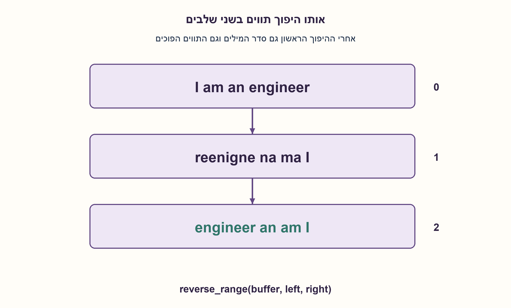
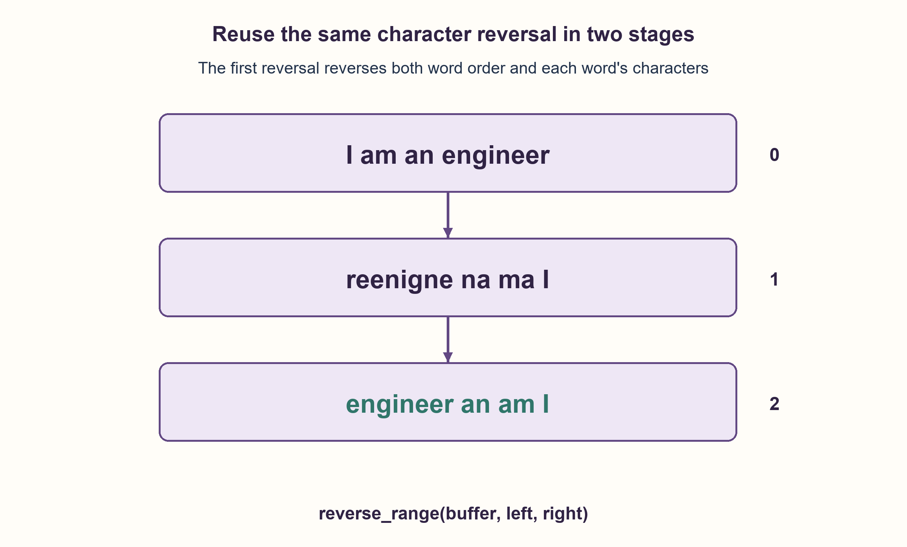

# PREP-187 — היפוך סדר מילים באמצעות היפוך תווים

פתרון מוצע בסיוע AI; ביקורת מקצועית אנושית ממתינה. הקושי אינו מכויל.

[צילום מקור פרטי](../sources/2026-10-30-batch90-19.png)

א. רשום פונקציה המקבלת מחרוזת והופכת אותה, לדוגמה abc >>> cba. ב. בעזרת הפונקציה מסעיף א בנה פונקציה שהופכת את סדר המילים במחרוזת, לדוגמה I am an engineer >>> engineer an am I. חייב להשתמש בפונקציה שבנית בא.

שיוכי חברות שדווחו בצילום ולא אומתו עצמאית: SanDisk, Apple.

## עברית

א. כתבו פונקציה שהופכת סדר תווים, למשל abc→cba. ב. השתמשו בפונקציה מסעיף א כדי להפוך את סדר המילים במחרוזת, בלי להפוך את התווים בתוך כל מילה. למשל I am an engineer→engineer an am I. חובה לקרוא לפונקציה מסעיף א.

בחוזה המימוש מילה היא רצף שאינו רווח ASCII רגיל. כל התווים נשמרים; בהרחבה לרווחים מרובים גם סדר קבוצות הרווחים מתהפך, כולל רווחים בקצוות. אין נרמול רווחים. פונקציית א מקבלת מקטע כולל במאגר תווים ניתן לשינוי; מעטפת Python שמחזירה מחרוזת חדשה משתמשת בעותק.

1. היפוך כל המחרוזת הופך גם את סדר המילים וגם את התווים בכל מילה.
2. אם לאחר ההיפוך המלא הופכים כל מילה בנפרד, איזה משני השינויים מתבטל?
3. ממשו reverse_range פעם אחת. קראו לו על כל המחרוזת, ואז על כל מקטע שאינו רווח; קבלו גם מקטע ריק.

### הופכים את הסדר ואז מתקנים את התווים
פונקציית א מחזיקה שני אינדקסים בקצות מקטע, מחליפה את התווים, ומקדמת את האינדקסים זה לקראת זה עד שנפגשים. היא יודעת להפוך גם את כל המאגר וגם מילה אחת, ולכן אין צורך לממש לוגיקת החלפה פעם נוספת בסעיף ב.

תחילה הופכים את כל המחרוזת. הדוגמה הופכת מ־`I am an engineer` ל־`reenigne na ma I`. סדר המילים כבר נכון, אבל כל מילה הפוכה. כעת סורקים את המאגר ומפעילים בדיוק את פונקציית א על כל מקטע שאינו רווח. התוצאה היא `engineer an am I`.

לנכונות, נכתוב את הקלט כרצף מילים ומקטעי הפרדה. היפוך מלא הופך את סדר כל המקטעים ואת תווי כל מקטע. היפוך נוסף של כל מילה מחזיר את תוויה לסדרם המקורי, בלי להזיז אותה ממיקומה החדש. מקטע שמכיל רק רווחים זהה להיפוכו; לכן נשמר מספר כל תו, וסדר קבוצות הרווחים מתהפך יחד עם המקטעים. לדוגמה שני רווחים ואז `ab c` ואז רווח אחד ייתנו רווח אחד ואז `c ab` ואז שני רווחים.

כל תו משתתף לכל היותר בהיפוך המלא, בסריקה ובהיפוך מקטע אחד: O(n) זמן. במאגר תווים ניתן לשינוי יש O(1) מילים נוספות. מחרוזות Python אינן ניתנות לשינוי, ולכן מעטפת המחרוזת יוצרת רשימה ומחרוזת תוצאה, ומשתמשת ב־O(n) זיכרון נוסף. אין לייחס למעטפת את עלות המקום של הפעולה בתוך מאגר קיים.

מילה כאן אינה הגדרה לשונית: טאב ופיסוק נשארים חלק מהמילה. דוגמאות המקור באותיות רגילות; הקוד עובד על תווי Python, לא על אשכולות תצוגה מורכבים כגון אות עם סימן ניקוד נפרד. חוזה של Unicode grapheme clusters ידרוש חלוקה מתאימה לפני ההיפוך.

נבדקו כל 9,841 המחרוזות מעל a,b ורווח עד אורך 8 מול אורקל טוקנים נפרד, וכן 1,549 היפוכי מקטעים. נבדקו גם שימור תווים, הפעלה כפולה ודוגמת המקור.

```python
"""Reverse words by reusing exactly the character-range reversal operation."""


def reverse_range(chars, left, right):
    """In-place inclusive interval; the empty interval right=left-1 is valid."""
    if not (0 <= left <= len(chars) and left - 1 <= right < len(chars)):
        raise ValueError("Invalid inclusive interval")
    while left < right:
        chars[left], chars[right] = chars[right], chars[left]
        left, right = left + 1, right - 1


def reverse_words_inplace(chars):
    """Words are non-space runs; every ASCII space character is retained."""
    reverse_range(chars, 0, len(chars) - 1)
    start = 0
    for end in range(len(chars) + 1):
        if end == len(chars) or chars[end] == " ":
            reverse_range(chars, start, end - 1)
            start = end + 1


def reverse_words(text):
    chars = list(text)
    reverse_words_inplace(chars)
    return "".join(chars)
```




## English

A. Reverse a sequence of characters, for example abc→cba. B. Reuse the function from A to reverse the order of words without reversing characters within each word. For example I am an engineer→engineer an am I. Calling function A is mandatory.

In this implementation a word is a non-ASCII-space run. Every character is retained; with multiple spaces the order of space runs is also reversed, including leading/trailing runs. Spaces are not normalized. Function A reverses an inclusive interval in a mutable character buffer; the Python string-returning wrapper makes a copy.

1. Reversing the whole string reverses both word order and each word's characters.
2. If each word is then reversed separately, which of those changes is undone?
3. Implement reverse_range once. Call it on the entire buffer and then on each non-space run; handle empty intervals.

### Reverse order, then repair the characters
Function A keeps indices at the interval ends, swaps those characters and moves inward until they meet. The same operation reverses a whole buffer or one word, so B need not duplicate swapping logic.

First reverse the entire string. The example changes from `I am an engineer` to `reenigne na ma I`. Word order is already correct, but each word is backward. Scan the buffer and call precisely function A on every non-space run, obtaining `engineer an am I`.

For correctness, view the input as word and separator blocks. Whole-buffer reversal reverses block order and characters within each block. Reversing each word again restores its character order without moving it from its new location. An all-space block is identical to its own reversal. Thus every character is retained while the order of space runs is reversed too. For example, two leading spaces followed by `ab c` and one trailing space become one leading space followed by `c ab` and two trailing spaces.

Each character participates in at most the whole reversal, the scan and one word reversal: O(n) time. A mutable character buffer uses O(1) extra words. Python strings are immutable, so the string wrapper creates a list and a result string, requiring O(n) extra space. Do not attribute the in-place core's space bound to the copying wrapper.

A word here is not a linguistic unit: tabs and punctuation remain word content. Source examples use ordinary letters; the code operates on Python characters, not extended grapheme clusters such as a letter plus a separate combining mark. A grapheme-cluster contract needs appropriate segmentation before reversal.

Checks covered all 9,841 strings over a,b,space through length 8 against an independent token oracle and 1,549 inclusive-range reversals. Character preservation, involution and the source example were also checked.

```python
"""Reverse words by reusing exactly the character-range reversal operation."""


def reverse_range(chars, left, right):
    """In-place inclusive interval; the empty interval right=left-1 is valid."""
    if not (0 <= left <= len(chars) and left - 1 <= right < len(chars)):
        raise ValueError("Invalid inclusive interval")
    while left < right:
        chars[left], chars[right] = chars[right], chars[left]
        left, right = left + 1, right - 1


def reverse_words_inplace(chars):
    """Words are non-space runs; every ASCII space character is retained."""
    reverse_range(chars, 0, len(chars) - 1)
    start = 0
    for end in range(len(chars) + 1):
        if end == len(chars) or chars[end] == " ":
            reverse_range(chars, start, end - 1)
            start = end + 1


def reverse_words(text):
    chars = list(text)
    reverse_words_inplace(chars)
    return "".join(chars)
```




## חומר משלים / Supporting material

```json
{
  "assumptions": {
    "he": [
      "מילה היא מקטע מרבי שאינו רווח ASCII; כל הרווחים נשמרים.",
      "א פועלת על מקטע כולל במאגר ניתן לשינוי; ב חייבת לקרוא לה.",
      "המעטפת מקבלת מחרוזת ומעתיקה; הפעולה בתוך מאגר קיים אינה מעתיקה אותו."
    ],
    "en": [
      "Words are maximal non-ASCII-space runs; all spaces are retained.",
      "A reverses an inclusive interval in a mutable buffer; B must call it.",
      "The string wrapper copies; the core operates in an existing buffer."
    ]
  },
  "optimality": {
    "he": "O(n) זמן. ליבה בתוך מאגר קיים: O(1) מילים נוספות; מעטפת מחרוזת Python: O(n) מקום.",
    "en": "O(n) time. Core in an existing buffer: O(1) extra words; Python string wrapper: O(n) space."
  },
  "verification": {
    "he": "9,841 מחרוזות, 1,549 מקטעים, אורקל טוקנים נפרד, הפעלה כפולה ושימור שכיחויות תווים; דוגמת המקור נבדקה בפועל.",
    "en": "9,841 strings,1,549 intervals, independent token oracle, involution and character frequencies; the source example was executed."
  },
  "edge_cases": {
    "he": [
      "מחרוזת ריקה ומקטע ריק חוקיים.",
      "רווחים בקצוות עוברים לקצה ההפוך; אין מחיקת רווחים.",
      "טאב אינו מפריד בחוזה הזה; אשכולות Unicode אינם מפורקים לשונית."
    ],
    "en": [
      "Empty strings and empty intervals are valid.",
      "Edge spaces move to the opposite edge; no spaces are dropped.",
      "A tab is not a delimiter here; Unicode grapheme segmentation is not performed."
    ]
  },
  "common_mistakes": {
    "he": [
      "להחזיר רק היפוך כל התווים.",
      "לפתור באמצעות split/join בלי לקרוא לפונקציית א.",
      "לקרוא למימוש עם העתקה in-place או למחוק רווחים בלי להגדיר זאת."
    ],
    "en": [
      "Returning only the full character reversal.",
      "Using split/join without calling A.",
      "Calling a copying wrapper in-place or silently dropping spaces."
    ]
  },
  "interview_answer": {
    "he": "אממש היפוך מקטע עם שני מצביעים. אפעיל אותו על כל המאגר, ואחר כך על כל מילה. היפוך ראשון משנה את סדר המילים; השני מתקן את התווים בתוכן. הזמן לינארי, והמקום תלוי אם יש מאגר ניתן לשינוי או עותק.",
    "en": "Implement a two-pointer interval reversal. Apply it to the whole buffer, then to every word. The first changes word order; the second repairs each word. Time is linear; space depends on whether a mutable buffer is supplied or copied."
  },
  "source_ambiguities": {
    "he": [
      "המקור אינו מגדיר רווחים מרובים, פיסוק או קידוד. חוזה המקטעים וההעתקה הוצהר בגלוי בלי לשנות את הדוגמה."
    ],
    "en": [
      "Multiple spaces, punctuation and encoding are unspecified originally. Block and copying contracts are explicit and preserve the supplied example."
    ]
  },
  "solution_extensions": {
    "he": [
      {
        "question": "איך שומרים את מספר הרווחים המקורי בכל מיקום תוך היפוך המילים בלבד?",
        "answer_direction": "זהו חוזה אחר: צריך לאסוף או לזהות מקטעי מילים ולהעתיקם אל שלד ההפרדות המקורי; הניתוח והזיכרון משתנים.",
        "principle": "קובעים איזה מבנה נחשב נתון לפני שבוחרים אלגוריתם."
      }
    ],
    "en": [
      {
        "question": "How would you preserve each original separator position while reversing only words?",
        "answer_direction": "That is another contract: identify word blocks and place them into the original separator skeleton, with a corresponding space analysis.",
        "principle": "Define which structure is preserved before selecting an algorithm."
      }
    ]
  }
}
```
