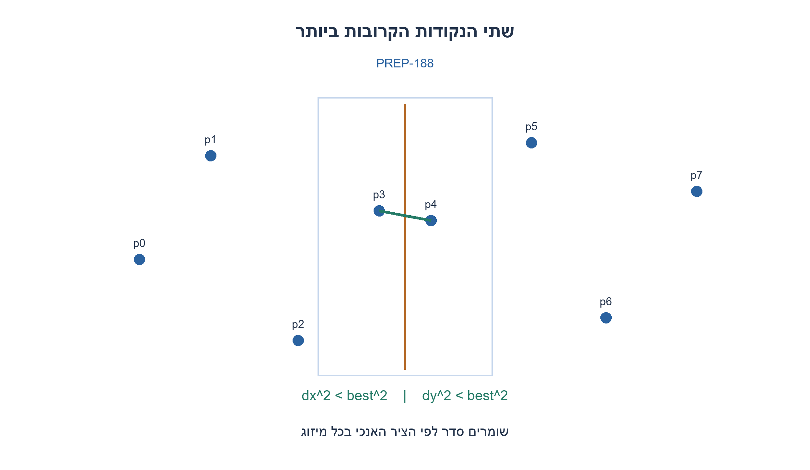
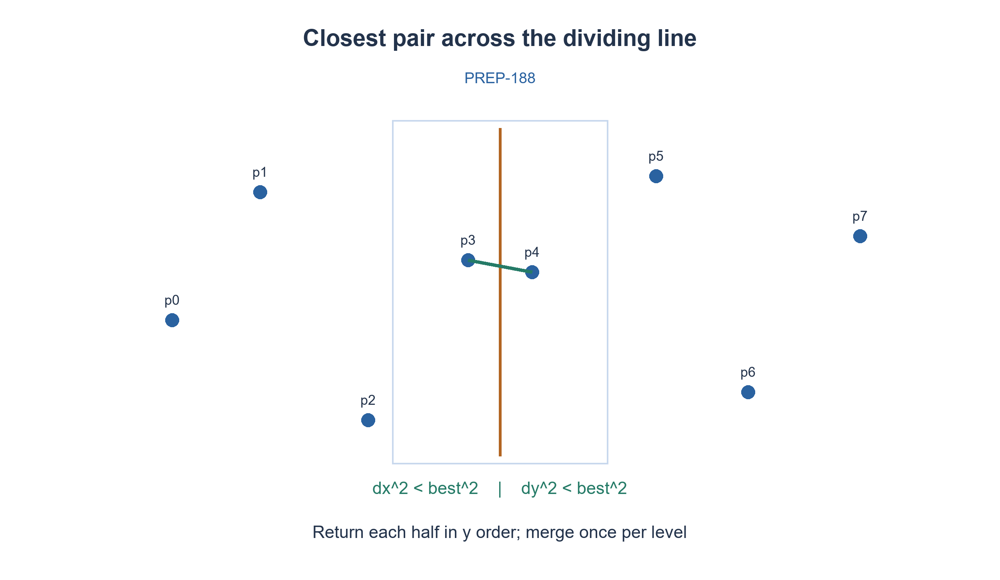

# PREP-188 — שתי הנקודות הקרובות ביותר במישור

פתרון מוצע בסיוע AI; ביקורת מקצועית אנושית ממתינה. הקושי אינו מכויל.

[צילום מקור פרטי](../sources/2026-10-30-batch110-01.png)

בהינתן N נקודות במישור יש לממש קוד C שבודק איזה שתי נקודות הן הקרובות אחת לשנייה.

## עברית

נתונות N נקודות במישור. כתבו פונקציה בשפת C שמחזירה אינדקסים של שתי נקודות שונות שמרחקן האוקלידי הוא הקטן ביותר. נקודות שונות במערך יכולות להיות בעלות אותן קואורדינטות. בשוויון מותר להחזיר כל זוג קרוב ביותר. הסבירו נכונות, זמן וזיכרון.

חוזה המימוש שנבחר: N≥2; הקואורדינטות הן מספרים שלמים בטווח ‎−10⁹..10⁹. הפונקציה אינה משנה את הקלט ומחזירה גם מרחק בריבוע מדויק ב־uint64_t. קלט לא תקין או כישלון הקצאה מדווחים בכישלון. המקור אינו מגביל את הקואורדינטות: הגבול הוא הבהרה של מימוש C מדויק, ולא נתון שנראה בצילום. לחלופה עם מספרים ממשיים נדרש חוזה נפרד לדיוק ולערכים לא סופיים.

1. השוו תחילה את הפתרון הבסיסי שבודק כל זוג. האם אפשר לחלק את הנקודות לשני חצאים?
2. זוג שמשפר את שתי התשובות מהחצאים חייב לחצות את קו החלוקה ולהימצא קרוב אליו.
3. שמרו סדר לפי y בעת החזרה מהרקורסיה. בתוך הרצועה בדקו רק שכנים שהפרש ה־y שלהם קטן מהמרחק הטוב ביותר.

### מחפשים בתוך כל חצי, ואז רק ליד הגבול
בדיקת כל N(N−1)/2 הזוגות היא חלופה תקפה בזמן Θ(N²) ובמקום קבוע מעבר לפלט. כדי לשפר, ממיינים פעם אחת לפי x ומחלקים באמצע. שומרים את ערך x של קו החלוקה לפני שהקריאות הרקורסיביות משנות את הסדר. כל קריאה מחזירה את הקטע שלה ממוין לפי y; ממזגים שני קטעים בזמן ליניארי.

אם δ הוא המרחק הטוב שכבר נמצא, זוג משופר שחוצה את החלוקה חייב להיות ברצועה שהמרחק האופקי שלה מהקו קטן מ־δ. אחרת הפרש ה־x לבדו גדול מדי. סורקים את הרצועה בסדר y, ועוצרים השוואות כאשר הפרש ה־y מגיע ל־δ. בתוך כל חצי אין שתי נקודות שמרחקן קטן מהחסם הנוכחי; טיעון אריזה בריבועי צד δ/2 מגביל למספר קבוע את השכנים שעשויים לשפר. לכן המיזוג והבדיקה עולים O(N) לכל רמה, ולא נבדקים מחדש כל הזוגות ברצועה.

באינדוקציה, זוג מנצח נמצא כולו באחד החצאים או חוצה ביניהם. הקריאות מכסות את האפשרות הראשונה והרצועה את השנייה. הקוד משתמש בחסם גלובלי שעשוי להיות קטן עוד יותר מהתשובות המקומיות; הדבר רק מסנן זוגות שלא יכולים לשפר את התשובה. בחסם אפס אי אפשר להשתפר, אך עדיין ממזגים לסדר y לפני החזרה.

למשל (0,0),(4,0),(4,1) נותנים מרחק בריבוע 1. כפילויות בקואורדינטות נותנות 0 עם שני אינדקסים שונים. אין צורך בשורש כדי להשוות מרחקים. בהגבלת הקואורדינטות שבחוזה, כל ריבוע הפרש הוא לכל היותר 4·10¹⁸ והסכום לכל היותר 8·10¹⁸, ולכן החישוב המדויק אינו גולש. המרה ל־int64_t נעשית לפני החיסור. ההקצאה נבדקת גם מול גלישת size_t.

המיון הראשוני הוא merge sort עם חסם גרוע־ביותר O(N log N), ואחריו T(N)=2T(N/2)+O(N). זמן כולל O(N log N), שני מערכי עזר O(N) ומחסנית O(log N). אין טענה למינימום קבועי זמן. נבדק מודל Python מקביל מול מנייה עצמאית של כל הזוגות ב־2,193 קלטים, כולל כפילויות וגבולות מספריים. קוד C להלן עבר סקירה, אך לא קומפל בסביבה זו; אין להציג את בדיקת המודל כהוכחת קימפול.

```c
/* Exact squared Euclidean distance for |x|,|y| <= 1,000,000,000.
 * C11; independently authored. Returns any closest pair of distinct indices.
 * The input is not modified. Return 1 on success; 0 on invalid input/allocation.
 */
#include <stdint.h>
#include <stddef.h>
#include <stdlib.h>
#include <string.h>

typedef struct { int32_t x, y; } Point;
typedef struct { Point p; size_t id; } Item;
typedef struct { size_t first, second; uint64_t distance2; } Closest;

static int less(Item a, Item b, int by_y) {
    int32_t u = by_y ? a.p.y : a.p.x, v = by_y ? b.p.y : b.p.x;
    if (u != v) return u < v;
    u = by_y ? a.p.x : a.p.y; v = by_y ? b.p.x : b.p.y;
    return u != v ? u < v : a.id < b.id;
}
static uint64_t square(int64_t value) { return (uint64_t)(value * value); }
static void consider(Item a, Item b, Closest *best) {
    uint64_t d = square((int64_t)a.p.x-b.p.x) + square((int64_t)a.p.y-b.p.y);
    if (d < best->distance2) {
        best->first = a.id; best->second = b.id; best->distance2 = d;
    }
}
static void merge(Item *a, Item *tmp, size_t lo, size_t mid, size_t hi, int by_y) {
    size_t i=lo, j=mid, k=lo;
    while (i<mid && j<hi) tmp[k++] = less(a[j],a[i],by_y) ? a[j++] : a[i++];
    while (i<mid) tmp[k++]=a[i++];
    while (j<hi) tmp[k++]=a[j++];
    memcpy(a+lo,tmp+lo,(hi-lo)*sizeof(*a));
}
static void sort_x(Item *a, Item *tmp, size_t lo, size_t hi) {
    if (hi-lo<2) return;
    size_t mid=lo+(hi-lo)/2;
    sort_x(a,tmp,lo,mid); sort_x(a,tmp,mid,hi); merge(a,tmp,lo,mid,hi,0);
}
/* Entry: x order; exit: y order. All pair candidates improve a global bound. */
static void solve(Item *a, Item *tmp, size_t lo, size_t hi, Closest *best) {
    if (hi-lo<=3) {
        for (size_t i=lo;i<hi;i++) for (size_t j=i+1;j<hi;j++) consider(a[i],a[j],best);
        for (size_t i=lo+1;i<hi;i++) {
            Item v=a[i]; size_t j=i;
            while (j>lo && less(v,a[j-1],1)) { a[j]=a[j-1]; --j; }
            a[j]=v;
        }
        return;
    }
    size_t mid=lo+(hi-lo)/2; int32_t split=a[mid].p.x;
    solve(a,tmp,lo,mid,best); solve(a,tmp,mid,hi,best);
    merge(a,tmp,lo,mid,hi,1);
    if (best->distance2==0) return;
    size_t count=0;
    for (size_t i=lo;i<hi;i++)
        if (square((int64_t)a[i].p.x-split)<best->distance2) tmp[lo+count++]=a[i];
    for (size_t i=0;i<count;i++) for (size_t j=i+1;j<count;j++) {
        if (square((int64_t)tmp[lo+j].p.y-tmp[lo+i].p.y)>=best->distance2) break;
        consider(tmp[lo+i],tmp[lo+j],best);
    }
}
int closest_pair(const Point *points, size_t n, Closest *out) {
    if (!points || !out || n<2 || n>SIZE_MAX/sizeof(Item)) return 0;
    for (size_t i=0;i<n;i++)
        if (points[i].x < -1000000000 || points[i].x > 1000000000 ||
            points[i].y < -1000000000 || points[i].y > 1000000000) return 0;
    Item *a=malloc(n*sizeof(*a)), *tmp=malloc(n*sizeof(*tmp));
    if (!a || !tmp) { free(a); free(tmp); return 0; }
    for (size_t i=0;i<n;i++) { a[i].p=points[i]; a[i].id=i; }
    Closest best={0,1,UINT64_MAX};
    sort_x(a,tmp,0,n); solve(a,tmp,0,n,&best);
    *out=best; free(tmp); free(a); return 1;
}
```




## English

Given N planar points, write a C function returning original indices of two distinct entries with minimum Euclidean distance. Distinct entries may have identical coordinates; any minimizing pair is acceptable. Explain correctness, time and storage.

Chosen implementation contract: N≥2; integer coordinates lie in −10^9..10^9. Input remains unchanged; return an exact uint64_t squared distance. Report invalid input or allocation failure. The source gives no coordinate bounds: these bounds explicitly complete the exact C implementation contract, rather than being attributed to the screenshot. Real-valued coordinates need a separate precision/nonfinite-value contract.

1. Start with the baseline that checks every pair. Can the points be split into two halves?
2. An improving cross-half pair must lie near the dividing line.
3. Return each recursive segment in y order. In the strip, inspect only neighbors whose y separation is below the current distance bound.

### Search both halves, then only near their boundary
Checking all N(N−1)/2 pairs is a valid Θ(N²)-time alternative using constant auxiliary storage. To improve it, sort once by x and split in the middle. Save the split x coordinate before recursive calls change the order. Each call returns its segment in y order; merge two sorted segments in linear time.

If δ is the best distance already found, an improving cross-half pair must lie within horizontal distance δ of the dividing line. Otherwise its x difference alone is too large. Scan the strip in y order and stop comparing when y separation reaches δ. No two points within either half are closer than the current bound; packing into squares of side δ/2 bounds the number of relevant neighbors by a constant. Thus each merge/strip scan is O(N), rather than examining every pair in the strip.

Inductively a winning pair lies in one half or crosses the split. The recursive calls cover the first case and the strip covers the second. This implementation uses a global bound that can be even smaller than local half answers; it only discards pairs that cannot improve the result. A zero bound cannot improve, but merging into y order still happens before return.

For (0,0),(4,0),(4,1), the squared distance is 1. Duplicate coordinates yield zero with distinct original indices. Squared distances avoid square roots. Under the declared coordinate bound, each squared difference is at most 4·10^18 and their sum at most 8·10^18, so exact arithmetic fits. Cast before subtraction. Allocation checks also prevent a size_t multiplication overflow.

Initial merge sort guarantees worst-case O(N log N); recursion satisfies T(N)=2T(N/2)+O(N). Total time is O(N log N), with two O(N) arrays and O(log N) stack frames. No minimum constant-factor claim is made. A corresponding Python model passed 2,193 comparisons with independent exhaustive pair enumeration, including duplicates and numerical limits. The C source below was reviewed but not compiled in this environment; model execution is not a C compilation claim.

```c
/* Exact squared Euclidean distance for |x|,|y| <= 1,000,000,000.
 * C11; independently authored. Returns any closest pair of distinct indices.
 * The input is not modified. Return 1 on success; 0 on invalid input/allocation.
 */
#include <stdint.h>
#include <stddef.h>
#include <stdlib.h>
#include <string.h>

typedef struct { int32_t x, y; } Point;
typedef struct { Point p; size_t id; } Item;
typedef struct { size_t first, second; uint64_t distance2; } Closest;

static int less(Item a, Item b, int by_y) {
    int32_t u = by_y ? a.p.y : a.p.x, v = by_y ? b.p.y : b.p.x;
    if (u != v) return u < v;
    u = by_y ? a.p.x : a.p.y; v = by_y ? b.p.x : b.p.y;
    return u != v ? u < v : a.id < b.id;
}
static uint64_t square(int64_t value) { return (uint64_t)(value * value); }
static void consider(Item a, Item b, Closest *best) {
    uint64_t d = square((int64_t)a.p.x-b.p.x) + square((int64_t)a.p.y-b.p.y);
    if (d < best->distance2) {
        best->first = a.id; best->second = b.id; best->distance2 = d;
    }
}
static void merge(Item *a, Item *tmp, size_t lo, size_t mid, size_t hi, int by_y) {
    size_t i=lo, j=mid, k=lo;
    while (i<mid && j<hi) tmp[k++] = less(a[j],a[i],by_y) ? a[j++] : a[i++];
    while (i<mid) tmp[k++]=a[i++];
    while (j<hi) tmp[k++]=a[j++];
    memcpy(a+lo,tmp+lo,(hi-lo)*sizeof(*a));
}
static void sort_x(Item *a, Item *tmp, size_t lo, size_t hi) {
    if (hi-lo<2) return;
    size_t mid=lo+(hi-lo)/2;
    sort_x(a,tmp,lo,mid); sort_x(a,tmp,mid,hi); merge(a,tmp,lo,mid,hi,0);
}
/* Entry: x order; exit: y order. All pair candidates improve a global bound. */
static void solve(Item *a, Item *tmp, size_t lo, size_t hi, Closest *best) {
    if (hi-lo<=3) {
        for (size_t i=lo;i<hi;i++) for (size_t j=i+1;j<hi;j++) consider(a[i],a[j],best);
        for (size_t i=lo+1;i<hi;i++) {
            Item v=a[i]; size_t j=i;
            while (j>lo && less(v,a[j-1],1)) { a[j]=a[j-1]; --j; }
            a[j]=v;
        }
        return;
    }
    size_t mid=lo+(hi-lo)/2; int32_t split=a[mid].p.x;
    solve(a,tmp,lo,mid,best); solve(a,tmp,mid,hi,best);
    merge(a,tmp,lo,mid,hi,1);
    if (best->distance2==0) return;
    size_t count=0;
    for (size_t i=lo;i<hi;i++)
        if (square((int64_t)a[i].p.x-split)<best->distance2) tmp[lo+count++]=a[i];
    for (size_t i=0;i<count;i++) for (size_t j=i+1;j<count;j++) {
        if (square((int64_t)tmp[lo+j].p.y-tmp[lo+i].p.y)>=best->distance2) break;
        consider(tmp[lo+i],tmp[lo+j],best);
    }
}
int closest_pair(const Point *points, size_t n, Closest *out) {
    if (!points || !out || n<2 || n>SIZE_MAX/sizeof(Item)) return 0;
    for (size_t i=0;i<n;i++)
        if (points[i].x < -1000000000 || points[i].x > 1000000000 ||
            points[i].y < -1000000000 || points[i].y > 1000000000) return 0;
    Item *a=malloc(n*sizeof(*a)), *tmp=malloc(n*sizeof(*tmp));
    if (!a || !tmp) { free(a); free(tmp); return 0; }
    for (size_t i=0;i<n;i++) { a[i].p=points[i]; a[i].id=i; }
    Closest best={0,1,UINT64_MAX};
    sort_x(a,tmp,0,n); solve(a,tmp,0,n,&best);
    *out=best; free(tmp); free(a); return 1;
}
```




## חומר משלים / Supporting material

```json
{
  "assumptions": {
    "he": [
      "מרחק אוקלידי; אינדקסים שונים; קואורדינטות שלמות חסומות כפי שמוגדר בנוסח; מותר כל זוג בשוויון."
    ],
    "en": [
      "Euclidean distance; distinct indices; bounded integer coordinates as declared; any minimizing tie is acceptable."
    ]
  },
  "optimality": {
    "he": "O(N log N) זמן גרוע־ביותר, O(N) מקום; פתרון כל־הזוגות O(N²) תקף אך איטי יותר.",
    "en": "Worst-case O(N log N) time and O(N) storage; exhaustive O(N²) pairs are a valid slower alternative."
  },
  "verification": {
    "he": "2,193 קלטים במודל Python מול אורקל כל־הזוגות. קוד C לא קומפל; נדרשת הרצת קומפיילר נפרדת לפני שימוש מעשי.",
    "en": "2,193 Python-model inputs versus brute-force oracle. C was not compiled; a separate compiler run is required before practical use."
  },
  "edge_cases": {
    "he": [
      "פחות משתי נקודות; נקודות זהות; אותו x; שוויונות; גבולות ±10⁹; כישלון הקצאה."
    ],
    "en": [
      "Fewer than two points; duplicate points; equal x; ties; ±10^9 boundaries; allocation failure."
    ]
  },
  "common_mistakes": {
    "he": [
      "מיון הרצועה מחדש בכל רמה מעלה את הזמן ל־O(N log² N).",
      "שמירת midpoint מתוך מערך שכבר מוין לפי y, או חיסור int32 לפני ההרחבה, עלולים לשבש את התוצאה."
    ],
    "en": [
      "Sorting the strip afresh at every level yields O(N log² N).",
      "Reading the split after y sorting, or subtracting int32 before widening, can invalidate the result."
    ]
  },
  "interview_answer": {
    "he": "מחלקים לפי x, פותרים בכל חצי וממזגים לפי y. רק רצועה צרה ושכנים קרובים יכולים לשפר, ולכן O(N log N).",
    "en": "Split by x, solve each half and merge by y. Only a narrow strip and nearby neighbors can improve the bound, giving O(N log N)."
  },
  "source_ambiguities": {
    "he": [
      "המקור אינו קובע סוג קואורדינטות, שוויונות או דרישת סיבוכיות; המימוש מצהיר על בחירותיו."
    ],
    "en": [
      "The source leaves coordinate type, tie rules and complexity unspecified; implementation choices are explicit."
    ]
  },
  "solution_extensions": {
    "he": {
      "question": "איך תטפלו בנתונים ממשיים או בנקודות שמגיעות בזרם?",
      "direction": "ממשיים מחייבים חוזה דיוק; זרם דורש מבנה דינמי אחר ואינו אותו אלגוריתם offline.",
      "integration": "מוכן בתוכן; לא מחובר לתור אינטראקטיבי."
    },
    "en": {
      "question": "What changes for real coordinates or streaming insertions?",
      "direction": "Reals need a precision contract; a dynamic stream requires another data structure rather than silently reusing the offline bound.",
      "integration": "Prepared in content; not connected to an interactive queue."
    }
  },
  "technical_references": {
    "he": [
      {
        "title": "מקור אקדמי לעקרון החלוקה והרצועה",
        "url": "https://algs4.cs.princeton.edu/code/javadoc/edu/princeton/cs/algs4/ClosestPair.html"
      }
    ],
    "en": [
      {
        "title": "Academic reference for divide-and-conquer closest pair",
        "url": "https://algs4.cs.princeton.edu/code/javadoc/edu/princeton/cs/algs4/ClosestPair.html"
      }
    ]
  }
}
```
