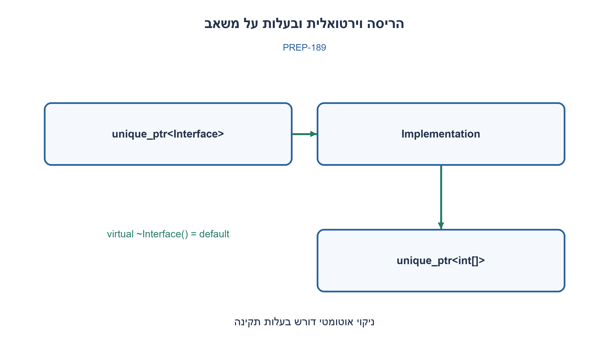
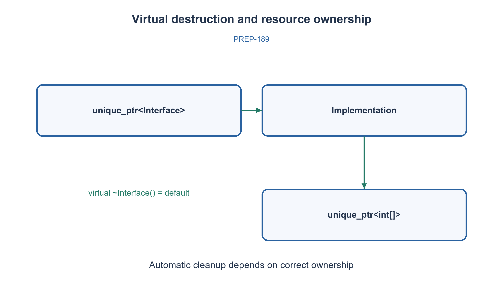

# PREP-189 — Destructor, ניהול משאבים והריסה וירטואלית ב־C++

פתרון מוצע בסיוע AI; ביקורת מקצועית אנושית ממתינה. הקושי אינו מכויל.

[צילום מקור פרטי](../sources/2026-10-30-batch110-06.png)

מה זה DESTRUCTOR? מתי לא כדאי להסתמך על הדיפולטיבי? למה צריך ש־DESTRUCTOR יהיה וירטואלי?

## עברית

מהו destructor ב־C++ ומתי הוא נקרא? מתי destructor שהקומפיילר מייצר מספיק, ומתי נדרשת פעולת ניקוי מפורשת? הסבירו מדוע מחלקת בסיס עשויה להזדקק ל־destructor וירטואלי. תנו דוגמה לניהול משאבים והבחינו בין בעלות על משאב לבין מצביע שרק משקיף עליו.

הבהרה: מדובר ב־C++17 ובמחיקה רגילה באמצעות delete או unique_ptr עם deleter ברירת מחדל. אין להסיק שכל destructor בכל שפה עובד כך או שכל מחלקה צריכה פונקציה וירטואלית.

1. חשבו מה צריך לקרות כשהאובייקט מסיים את חייו — לא רק לזיכרון, אלא גם למשאבים שהוא מחזיק.
2. האיברים של המחלקה נהרסים בעצמם. מה ההבדל בין vector לבין כתובת גולמית של זיכרון שהמחלקה הקצתה?
3. במחיקה דרך Base* צריך להגיע גם לחלק Derived. שיקלו RAII ו־virtual ~Base() = default כשמחיקה פולימורפית מותרת.

### ה־destructor מסיים בעלות, לא רק “מוחק משתנים”
destructor הוא פונקציית חבר מיוחדת בשם ‎~ClassName() שמופעלת בסיום חיי אובייקט: למשל ביציאה מטווח של משתנה אוטומטי, ב־delete מתאים או בשחרור בעלות של אובייקט RAII. היא אינה נקראת בכל תוכנית שמסתיימת באופן חריג, ואינה איסוף אשפה שמחפש את כל ההקצאות.

destructor שנוצר אוטומטית מפעיל את ה־destructors של האיברים והבסיסים; הוא אינו מבצע delete על אובייקט שאליו מצביע מצביע גולמי. לכן string, vector ו־unique_ptr כחברים לרוב מאפשרים Rule of Zero: המחלקה אינה כותבת פונקציות ניהול מיוחדות כלל. לעומת זאת בעלות ישירה על handle חיצוני עשויה לדרוש RAII מתאים שמסיים אותה. לא משחררים מצביע שאינו בבעלותנו, ולא כותבים ניקוי כפול למשאב שכבר מנוהל ב־unique_ptr. כשמגדירים ניהול בעלות ידני צריך לבחון גם copy/move כדי שלא ייווצרו שתי בעלויות ושחרור כפול.

### למה virtual בבסיס?
כאשר מוחקים אובייקט Derived דרך מצביע Base* באמצעות delete רגיל, destructor של Base חייב להיות וירטואלי כדי שההריסה הדינמית תתחיל ב־Derived. אחרת זו התנהגות לא מוגדרת — אין להסתפק בטענה “רק ייתכן דלף”. מסיימים את גוף ה־destructor של Derived, הורסים את חבריו בסדר הפוך להכרזתם, ואז את הבסיסים לפי סדר ההריסה. סדר זה נמשך לכל מחלקה בשרשרת.

אם המחיקה הפולימורפית היא חלק מהממשק, מקובל destructor ציבורי וירטואלי, גם ‎virtual ~Base() = default. אם היא אסורה, בסיס יכול לבחור destructor מוגן ולא וירטואלי וכך לחסום delete דרך מצביע בסיס אצל הלקוח. מחלקת ערך רגילה ללא מחיקה פולימורפית אינה זקוקה לווירטואליות רק מפני שיש לה destructor.

בדוגמה, unique_ptr<Interface> מחזיק בפועל Implementation. כשבעל המצביע יוצא מטווח, destructor וירטואלי מבטיח הריסת Implementation; חבר ה־unique_ptr של המערך משחרר אותו אוטומטית. אין לולאת delete ידנית. גם “ברירת מחדל” יכולה להיות וירטואלית; אלה אינם מושגים סותרים. רצוי שניקוי לא יזרוק חריגה: חריגה נוספת בזמן unwinding עלולה לגרום ל־terminate. קוד C++ להלן הוא דוגמה שנסקרה מול הנחיות C++ Core Guidelines, אך לא קומפל בסביבה זו.

```cpp
// C++17 illustrative code; see verification for the uncompiled-code limitation.
#include <memory>
#include <string>
#include <vector>

struct ValueRecord {
    std::string label;
    std::vector<int> samples;
    // Implicit destructor destroys both members: no manual delete is needed.
};
struct Interface {
    virtual ~Interface() = default; // Supports destruction through Interface*.
    virtual void run() = 0;
};
struct Implementation final : Interface {
    std::unique_ptr<int[]> buffer = std::make_unique<int[]>(16);
    void run() override { buffer[0] = 42; }
    // Implicit derived destructor releases buffer before the base destructor.
};
int main() {
    std::unique_ptr<Interface> object = std::make_unique<Implementation>();
    object->run();
} // Implementation, buffer, then Interface destruction through a virtual base.
```




## English

What is a C++ destructor, and when does it run? When is a compiler-generated destructor sufficient, and when is explicit cleanup needed? Explain why a base class may need a virtual destructor. Give a resource-management example and distinguish ownership from a non-owning pointer.

Clarification: use C++17 with ordinary delete or unique_ptr using its default deleter. Do not generalize to every language or assume every class requires virtual functions.

1. Consider what must happen when an object ends its lifetime, including resources beyond memory.
2. Members are themselves destroyed. How does vector differ from a raw address to storage owned by the class?
3. Deleting through Base* must destroy the Derived part too. Consider RAII and virtual ~Base() = default when polymorphic deletion is supported.

### Destruction ends ownership, not merely “deletes variables”
A destructor is the special member named ~ClassName() invoked when an object ends its lifetime: for example, leaving an automatic variable's scope, matching delete, or release by an RAII owner. It is not guaranteed on every abnormal program termination and is not garbage collection that finds all allocations.

An implicit destructor invokes member and base destructors; it does not delete a pointee merely because a raw pointer member stores its address. Members such as string, vector and unique_ptr often permit the Rule of Zero: no custom ownership-management operations in the containing class. Direct ownership of an external handle may instead require an appropriate RAII wrapper with explicit release. Do not free non-owned pointers or duplicate cleanup already performed by unique_ptr. Manual ownership also requires considering copy/move operations to avoid two owners and double release.

### Why virtual in a base?
Deleting a Derived object through Base* using ordinary delete requires a virtual base destructor so dynamic destruction starts at Derived. Otherwise behavior is undefined, not merely a possible leak. After the Derived destructor body, its members are destroyed in reverse declaration order, followed by its base subobjects in their destruction order. The process continues through the hierarchy.

If polymorphic deletion belongs to the interface, use a public virtual destructor, including virtual ~Base() = default. If deletion through a base is forbidden, a protected non-virtual destructor can prevent client-side delete through Base*. An ordinary value class does not need virtual dispatch just because it has a destructor.

In the example, unique_ptr<Interface> actually owns an Implementation. Scope exit dispatches through the virtual destructor, and its array-owning unique_ptr member releases storage automatically. No manual delete loop is needed. A defaulted destructor can also be virtual; these are independent properties. Cleanup should not throw: a second exception during stack unwinding can call terminate. The C++ illustration below was reviewed against the C++ Core Guidelines but not compiled in this environment.

```cpp
// C++17 illustrative code; see verification for the uncompiled-code limitation.
#include <memory>
#include <string>
#include <vector>

struct ValueRecord {
    std::string label;
    std::vector<int> samples;
    // Implicit destructor destroys both members: no manual delete is needed.
};
struct Interface {
    virtual ~Interface() = default; // Supports destruction through Interface*.
    virtual void run() = 0;
};
struct Implementation final : Interface {
    std::unique_ptr<int[]> buffer = std::make_unique<int[]>(16);
    void run() override { buffer[0] = 42; }
    // Implicit derived destructor releases buffer before the base destructor.
};
int main() {
    std::unique_ptr<Interface> object = std::make_unique<Implementation>();
    object->run();
} // Implementation, buffer, then Interface destruction through a virtual base.
```




## חומר משלים / Supporting material

```json
{
  "assumptions": {
    "he": [
      "C++17; delete רגיל; בעלות מוגדרת; אין העברת הכלל לשפות בעלות finalizer."
    ],
    "en": [
      "C++17, ordinary delete and explicit ownership; do not transfer these rules to finalizers in other languages."
    ]
  },
  "optimality": {
    "he": "אין סיבוכיות קבועה לכל destructor: העלות תלויה בניקוי החברים והמשאבים. בדוגמה מספר האובייקטים קבוע.",
    "en": "There is no universal constant destructor cost; member/resource cleanup determines it. The illustration has a fixed number of objects."
  },
  "verification": {
    "he": "סקירת הכללים והדוגמה מול הנחיות C++ רשמיות. לא בוצע קימפול C++ או ניסוי שמריץ התנהגות לא מוגדרת.",
    "en": "Rules and illustration reviewed against the C++ Core Guidelines. No C++ compilation or experiment executing undefined behavior was performed."
  },
  "edge_cases": {
    "he": [
      "מצביע משקיף; בעלות ייחודית; מחיקה פולימורפית; מחלקה בסיסית שמונעת מחיקה; כישלון בנאי וחריגות ניקוי."
    ],
    "en": [
      "Non-owning pointer; unique ownership; polymorphic deletion; base forbidding client deletion; failed construction and cleanup exceptions."
    ]
  },
  "common_mistakes": {
    "he": [
      "ה־destructor האוטומטי אינו משחרר כל הקצאה שמצביע גולמי מפנה אליה.",
      "delete דרך בסיס לא וירטואלי אינו ניסוי תקין להוכחת סדר הריסה.",
      "אין לכתוב destructor ידני לכל מחלקה."
    ],
    "en": [
      "An implicit destructor does not free every allocation referenced by a raw pointer.",
      "Deleting through a non-virtual base is not a valid experiment for discovering a destruction order.",
      "Do not manually define a destructor for every class."
    ]
  },
  "interview_answer": {
    "he": "RAII קושר משאב לחיי אובייקט. חברים מנהלי משאב מאפשרים ניקוי אוטומטי; delete פולימורפי דורש destructor בסיס וירטואלי.",
    "en": "RAII ties a resource to object lifetime. Resource-owning members enable automatic cleanup; polymorphic delete requires a virtual base destructor."
  },
  "source_ambiguities": {
    "he": [
      "המקור אינו מציין שפה; המונחים ברירת מחדל ווירטואלי מפורשים כאן בהקשר C++."
    ],
    "en": [
      "The source does not name a language; default and virtual destruction are interpreted explicitly in C++."
    ]
  },
  "solution_extensions": {
    "he": {
      "question": "מה משתבש אם מעתיקים מחלקה שמחזיקה raw owning pointer?",
      "direction": "העתקה רדודה עלולה ליצור שחרור כפול. העדיפו RAII ו־Rule of Zero או הגדירו חוזה copy/move תקין.",
      "integration": "מוכן בתוכן; לא מחובר לתור."
    },
    "en": {
      "question": "What breaks when copying a class with a raw owning pointer?",
      "direction": "Shallow copy can cause double release. Prefer RAII and Rule of Zero or define a correct copy/move contract.",
      "integration": "Prepared in content; not connected to the queue."
    }
  },
  "technical_references": {
    "he": [
      {
        "title": "הנחיות C++ — C.20, C.30–C.37",
        "url": "https://isocpp.github.io/CppCoreGuidelines/CppCoreGuidelines#c35-a-base-class-destructor-should-be-either-public-and-virtual-or-protected-and-non-virtual"
      },
      {
        "title": "טיוטת תקן C++ — הריסת איברים ובסיסים",
        "url": "https://eel.is/c++draft/class.dtor"
      },
      {
        "title": "טיוטת תקן C++ — כללי delete",
        "url": "https://eel.is/c++draft/expr.delete"
      },
      {
        "title": "טיוטת תקן C++ — default_delete",
        "url": "https://eel.is/c++draft/unique.ptr.dltr.dflt"
      }
    ],
    "en": [
      {
        "title": "C++ Core Guidelines — C.20 and C.30–C.37",
        "url": "https://isocpp.github.io/CppCoreGuidelines/CppCoreGuidelines#c35-a-base-class-destructor-should-be-either-public-and-virtual-or-protected-and-non-virtual"
      },
      {
        "title": "C++ draft — member and base destruction",
        "url": "https://eel.is/c++draft/class.dtor"
      },
      {
        "title": "C++ draft — delete semantics",
        "url": "https://eel.is/c++draft/expr.delete"
      },
      {
        "title": "C++ draft — default_delete",
        "url": "https://eel.is/c++draft/unique.ptr.dltr.dflt"
      }
    ]
  }
}
```
