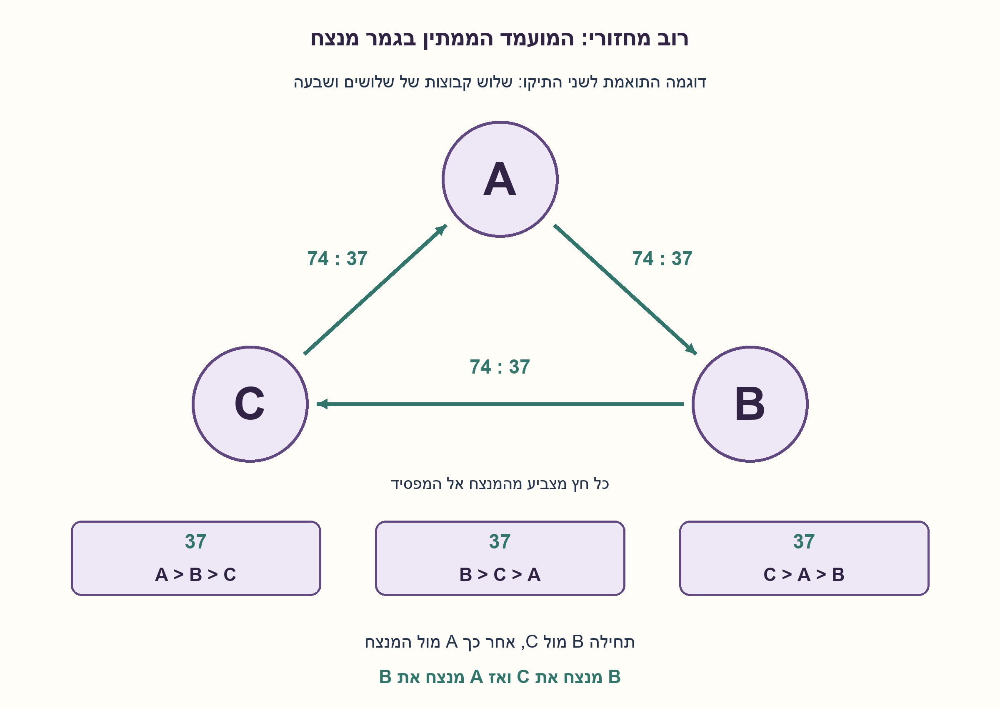
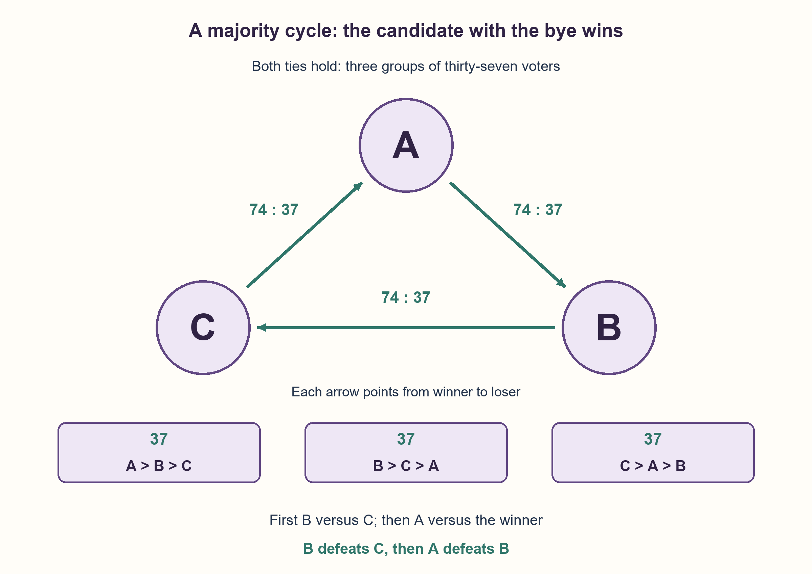

# PREP-190 — שתי הצבעות בתיקו: מי מרוויח מסדר העימותים?

פתרון מוצע בסיוע AI; ביקורת מקצועית אנושית ממתינה. הקושי אינו מכויל.

[צילום מקור פרטי](../sources/2026-10-30-batch110-07.png)

ישנם 111 עובדים שצריכים להצביע ליושב ראש מתוך שלושה מתמודדים שאינם מתוך 111 האנשים. כל אחד שם פתק עם המועמד המועדף עליו. בוצעה הצבעה ראשונה ויצא תיקו. הוחלט לבצע עוד הצבעה: כל אדם שם שני פתקים, עדיפות ראשונה ועדיפות שנייה. אחרי ההצבעה השנייה שוב יצא תיקו. מתמודד אחד הציע לשניים האחרים: אתם תתמודדו ביניכם, המנצח יתמודד מולי וכך ייבחר יושב ראש. נתח את ההצעה: האם היא הוגנת? כלפי מי? הסבר מדוע ההצעה אינה הוגנת.

שיוכי חברות שדווחו בצילום ולא אומתו עצמאית: Marvell.

## עברית

111 עובדים בוחרים בין שלושה מועמדים A,B,C שאינם מצביעים בעצמם. בהצבעה על המועמד המועדף מתקבל תיקו משולש. בסיבוב נוסף כל עובד מסמן את העדיפות הראשונה ואת השנייה, ושוב מתקבל תיקו משולש. A מציע שתחילה B ו־C יתמודדו, והמנצח יתמודד מולו.

נתחו את ההצעה, הציגו דוגמת העדפות שמתאימה לשני התיקו, והסבירו מה ניתן להסיק גם בלי לדעת את כל הדירוגים.

לצורך הניתוח מגדירים במפורש: לכל עובד דירוג קבוע וחד־משמעי של שלושת המועמדים; שני הסימונים בסיבוב השני מקנים קול אחד כל אחד, ללא משקל שונה; בכל עימות זוגי מצביעים בכנות לפי אותו דירוג והמנצח נקבע ברוב רגיל. הוגנות כאן מתייחסת ליחס שווה למועמדים וליכולת לשלוט בתוצאה באמצעות סדר העימותים. המקור אינו מגדיר משקלי דירוג או כלל הוגנות אוניברסלי.

1. תיקו בהעדפות ראשונות אינו אומר שבכל עימות זוגי יתקבל תיקו. כמה קולות מקבל כל מועמד בכל אחד משני הסיבובים?
2. נסו שלוש קבוצות של 37 עובדים, עם הדירוגים A>B>C, B>C>A, C>A>B. בדקו כל זוג מועמדים בנפרד.
3. בדוגמה נוצר מעגל רוב. מי שמדלג על העימות הראשון פוגש בדיוק את המועמד שהוא מנצח. אפשר גם לתאר את כל ששת הדירוגים בעזרת משתנה אחד.

### סדר העימותים יכול לבחור את המנצח
נחלק את העובדים לשלוש קבוצות של 37:

| מספר עובדים | דירוג מהעדיף לפחות עדיף |
|---|---|
| 37 | A > B > C |
| 37 | B > C > A |
| 37 | C > A > B |

כל מועמד מקבל 37 העדפות ראשונות ו־74 סימונים בשתי העדיפויות יחד. שני התיקו מתקיימים. אבל בעימותים הזוגיים A מנצח את B ברוב 74–37, B מנצח את C ברוב 74–37, ו־C מנצח את A ברוב 74–37.

אם B ו־C מתמודדים תחילה, B מנצח. לאחר מכן A מנצח את B, ולכן A נבחר. אילו B היה ממתין לגמר, C היה מנצח תחילה את A, ואז B היה מנצח את C. אותו מנגנון יכול לבחור כל אחד משלושת המועמדים: מי שקיבל את הדילוג על הסיבוב הראשון זוכה.

### האם זו רק דוגמה מיוחדת?
לא, תחת ההנחות המפורשות. מאחר שיש 111 מצביעים, התיקו הראשון נותן 37 לכל מועמד. בסיבוב השני יש 222 סימונים, כלומר 74 לכל מועמד; לכן כל מועמד מופיע גם במקום האחרון בדיוק 37 פעמים. נסמן את מספר בעלי הדירוג A>B>C ב־x. אילוצי המקומות הראשונים והאחרונים מחייבים:

| דירוג | מספר עובדים |
|---|---|
| A>B>C | x |
| A>C>B | 37−x |
| B>A>C | 37−x |
| B>C>A | x |
| C>A>B | x |
| C>B>A | 37−x |

כאשר x שלם בין 0 ל־37. בכל אחת מההשוואות A מול B, B מול C, C מול A, הצד הראשון מקבל 37+x קולות והצד השני 74−x. אם x≥19 מתקבל המעגל שתואר; אם x≤18 מתקבל המעגל ההפוך. שוויון זוגי אינו אפשרי כי מספר המצביעים אי־זוגי. בשני כיווני המעגל, המועמד הממתין בגמר מנצח את זוכה העימות הראשון.

לכן ההצעה מיטיבה עם A ופוגעת ביחס השווה ל־B ול־C: A מעניק לעצמו תפקיד שמבטיח לו ניצחון במודל הזה. אין כאן טענה שכל שיטת נוקאאוט פסולה בכל מצב או שכל הגדרה של הוגנות חייבת להסכים. הבעיה היא שהמועמד קובע לעצמו את סדר העימותים אחרי התיקו. הגרלה סימטרית של המועמד הממתין הייתה נותנת לכל מועמד סיכוי 1/3 בתנאים האלה.

הבדיקה מנתה את כל 54,872 הפרופילים שמקיימים את התיקו הראשון. 38 מהם מקיימים גם את השני; בכל 114 סדרי העימותים שלהם ניצח המועמד הממתין. ההוכחה האלגברית מכסה את אותה משפחה במלואה. עבור שלושה מועמדים ו־111 עובדים זהו חישוב בגודל קבוע; עם פרופיל של m מצביעים, ספירת ההשוואות נעשית בזמן O(m).

```python
"""Sincere pairwise voting after tied first-choice and approval totals.

Profiles map strict rankings, e.g. ('A','B','C'), to nonnegative counts.
The source's second ballot is explicitly modelled as two equal approvals.
"""

from collections import Counter
from itertools import permutations

CANDIDATES = ("A", "B", "C")


def tied_profile(x, first_choice_count=37):
    """All profiles with equal first and last counts, parameterized by x."""
    if not isinstance(x, int) or not 0 <= x <= first_choice_count:
        raise ValueError("x must be between zero and the per-candidate total")
    m = first_choice_count
    return dict(zip(permutations(CANDIDATES), (x, m - x, m - x, x, x, m - x)))


def ballot_totals(profile):
    first, approval = Counter(), Counter()
    valid = set(permutations(CANDIDATES))
    for ranking, count in profile.items():
        if ranking not in valid or not isinstance(count, int) or count < 0:
            raise ValueError("Each ballot is a strict ranking with a nonnegative count")
        first[ranking[0]] += count
        for candidate in ranking[:2]:
            approval[candidate] += count
    return dict(first), dict(approval)


def pairwise_votes(profile, first, second):
    if first == second or first not in CANDIDATES or second not in CANDIDATES:
        raise ValueError("Choose two different candidates")
    ballot_totals(profile)
    votes = sum(count for ranking, count in profile.items()
                if ranking.index(first) < ranking.index(second))
    return votes, sum(profile.values()) - votes


def agenda_winner(profile, bye):
    """The other two compete, then their winner competes against bye."""
    if bye not in CANDIDATES:
        raise ValueError("Unknown bye candidate")

    def winner(first, second):
        left, right = pairwise_votes(profile, first, second)
        if left == right:
            raise ValueError("The pairwise tie policy is unspecified")
        return first if left > right else second

    others = [candidate for candidate in CANDIDATES if candidate != bye]
    return winner(bye, winner(*others))
```




## English

111 employees choose among three nonvoting candidates A,B,C. The first-choice ballot ends in a three-way tie. In a second ballot each employee marks their first and second choices, again producing a three-way tie. A proposes that B and C compete first, with the winner then facing A.

Analyze the proposal, construct rankings consistent with both ties, and explain what follows even without knowing every ranking.

Explicit model: each voter has one fixed strict ranking; each of the two marks in the second ballot contributes one equally weighted approval; every head-to-head contest uses sincere votes from the same rankings and ordinary majority. Fairness here means treating candidates symmetrically and avoiding unilateral control of the outcome through the agenda. The screenshot specifies neither ranking weights nor a universal fairness rule.

1. A first-choice tie does not imply a head-to-head tie. How many votes must each candidate receive in each ballot?
2. Try three groups of 37 ranked A>B>C, B>C>A and C>A>B. Count each head-to-head contest separately.
3. The example produces a majority cycle. The candidate with the bye faces exactly the candidate they defeat. The six ranking counts can also be parameterized by one variable.

### The agenda can select the winner
Split the employees into three groups of 37:

| Voters | Strict ranking, best first |
|---|---|
| 37 | A > B > C |
| 37 | B > C > A |
| 37 | C > A > B |

Each candidate receives 37 first choices and 74 combined first/second approvals, so both ties hold. Yet A beats B by 74–37, B beats C by 74–37, and C beats A by 74–37.

Under A's proposal, B first defeats C; A then defeats B and wins. If B had the bye instead, C would first defeat A and B would defeat C. The same mechanism can elect any candidate: the candidate who skips the first contest wins.

### Is this only one specially chosen example?
No, under the explicit assumptions. The first tie assigns 37 first choices to each candidate. The second ballot has 222 marks, assigning 74 approvals to each; hence each candidate also appears last exactly 37 times. Let x be the count of A>B>C rankings. Equal first and last totals force:

| Ranking | Voters |
|---|---|
| A>B>C | x |
| A>C>B | 37−x |
| B>A>C | 37−x |
| B>C>A | x |
| C>A>B | x |
| C>B>A | 37−x |

Here x is an integer from 0 through 37. In each of A versus B, B versus C and C versus A, the first candidate receives 37+x votes and the second receives 74−x. At x≥19 the cycle has the displayed direction; at x≤18 it reverses. Odd voter count rules out a head-to-head tie. In either cycle direction, the candidate with the bye defeats the first contest's winner.

Thus the proposal favors A and treats B and C asymmetrically: A awards himself a role that guarantees victory in this model. This is not a claim that every knockout election is always unfair under every possible fairness definition. The objection is unilateral assignment of the agenda after the tied ballots. Randomly and symmetrically drawing the bye would instead give every candidate probability 1/3 here.

The checker independently enumerated all 54,872 profiles with tied first choices. Exactly 38 also tie in approvals; across all their 114 bye agendas, the bye candidate wins. The algebraic argument covers the complete family. For the fixed three-candidate, 111-voter instance the calculation is constant size; counting comparisons from m individual rankings takes O(m) time.

```python
"""Sincere pairwise voting after tied first-choice and approval totals.

Profiles map strict rankings, e.g. ('A','B','C'), to nonnegative counts.
The source's second ballot is explicitly modelled as two equal approvals.
"""

from collections import Counter
from itertools import permutations

CANDIDATES = ("A", "B", "C")


def tied_profile(x, first_choice_count=37):
    """All profiles with equal first and last counts, parameterized by x."""
    if not isinstance(x, int) or not 0 <= x <= first_choice_count:
        raise ValueError("x must be between zero and the per-candidate total")
    m = first_choice_count
    return dict(zip(permutations(CANDIDATES), (x, m - x, m - x, x, x, m - x)))


def ballot_totals(profile):
    first, approval = Counter(), Counter()
    valid = set(permutations(CANDIDATES))
    for ranking, count in profile.items():
        if ranking not in valid or not isinstance(count, int) or count < 0:
            raise ValueError("Each ballot is a strict ranking with a nonnegative count")
        first[ranking[0]] += count
        for candidate in ranking[:2]:
            approval[candidate] += count
    return dict(first), dict(approval)


def pairwise_votes(profile, first, second):
    if first == second or first not in CANDIDATES or second not in CANDIDATES:
        raise ValueError("Choose two different candidates")
    ballot_totals(profile)
    votes = sum(count for ranking, count in profile.items()
                if ranking.index(first) < ranking.index(second))
    return votes, sum(profile.values()) - votes


def agenda_winner(profile, bye):
    """The other two compete, then their winner competes against bye."""
    if bye not in CANDIDATES:
        raise ValueError("Unknown bye candidate")

    def winner(first, second):
        left, right = pairwise_votes(profile, first, second)
        if left == right:
            raise ValueError("The pairwise tie policy is unspecified")
        return first if left > right else second

    others = [candidate for candidate in CANDIDATES if candidate != bye]
    return winner(bye, winner(*others))
```




## חומר משלים / Supporting material

```json
{
  "assumptions": {
    "he": [
      "דירוגים קבועים וחד־משמעיים; הצבעה זוגית כנה ברוב רגיל.",
      "כל סימון של עדיפות ראשונה או שנייה שווה קול אחד; אין שיטה משוקללת אחרת."
    ],
    "en": [
      "Fixed strict rankings; sincere ordinary-majority head-to-head votes.",
      "First/second marks are equally weighted approvals, not an unspecified weighted scoring system."
    ]
  },
  "optimality": {
    "he": "תפקיד הממתין בגמר מנצח בכל 38 הפרופילים האפשריים במודל. זו הוכחה לתלות בסדר העימותים, לא משפט הוגנות לכל שיטת בחירות.",
    "en": "The bye wins in all 38 feasible profiles under this model. This proves agenda dependence, not a universal fairness theorem."
  },
  "verification": {
    "he": "54,872 פרופילים בעלי תיקו ראשון נמנו עצמאית; 38 מקיימים גם תיקו שני. הורחבו לקולות אישיים, וכל זוג וכל 114 סדרי העימותים נבדקו.",
    "en": "Independently enumerated 54,872 first-tied profiles; 38 also satisfy the second tie. Individual ballots, all pairwise contests and all 114 bye agendas were checked."
  },
  "edge_cases": {
    "he": [
      "x=0 ו־x=37 יוצרים מחזורי רוב הפוכים באותה עוצמה.",
      "אין תיקו זוגי ב־111 קולות; בשינוי למספר מצביעים זוגי צריך כלל שובר שוויון.",
      "שינוי העדפות או משקלי ההצבעה השנייה מבטל את ההסקה מהתיקו."
    ],
    "en": [
      "x=0 and x=37 give equally strong reversed cycles.",
      "111 votes cannot tie pairwise; an even electorate needs a tie policy.",
      "Changed rankings or different second-ballot weights invalidate the inference from the two ties."
    ]
  },
  "common_mistakes": {
    "he": [
      "להסיק מתיקו בהעדפות הראשונות שכל זוג יתאזן.",
      "להכריז ש־A זוכה בלי לציין הצבעה זוגית כנה ודירוגים קבועים.",
      "לומר שכל שיטת עימותים אינה הוגנת במקום להסביר מי שולט בסדר."
    ],
    "en": [
      "Inferring pairwise ties from tied first choices.",
      "Guaranteeing A wins without fixed rankings and sincere pairwise voting.",
      "Calling every runoff unfair rather than identifying unilateral agenda control."
    ]
  },
  "interview_answer": {
    "he": "אציג שלוש קבוצות של 37 עם העדפות מחזוריות. כל מועמד מקבל 37 ראשונים ו־74 סימונים, אבל הרוב הזוגי מסתובב במעגל. A ממתין למנצח שהוא עצמו מנצח, ולכן מקבל יתרון מכריע. תחת ההנחות אפשר להוכיח שזה קורה בכל פרופיל שמתאים לשני התיקו.",
    "en": "Use three cyclic groups of 37: first totals are 37 and approval totals 74, but pairwise majorities cycle. A waits for the opponent he defeats, securing the outcome. Under the assumptions this holds for every profile consistent with both ties."
  },
  "source_ambiguities": {
    "he": [
      "המקור אינו מגדיר ניקוד לעדיפות השנייה, הצבעה אסטרטגית או מושג הוגנות. המודל והיקף המסקנה מוגדרים בגלוי."
    ],
    "en": [
      "The source leaves second-choice scoring, strategic behavior and fairness undefined. The model and the scope of its conclusion are explicit."
    ]
  },
  "solution_extensions": {
    "he": [
      {
        "question": "מה תעשה הגרלה הוגנת של המועמד שמדלג על העימות הראשון?",
        "answer_direction": "כל מועמד יקבל דילוג בסיכוי 1/3 ולכן גם ניצחון בסיכוי 1/3 במודל המחזורי.",
        "principle": "מפרידים בין כלל הצבעה לבין בחירת סדר מוטה."
      }
    ],
    "en": [
      {
        "question": "What if the bye is assigned by a fair lottery?",
        "answer_direction": "Each candidate receives the bye, and hence victory in this cyclic model, with probability 1/3.",
        "principle": "Distinguish the voting rule from biased agenda assignment."
      }
    ]
  }
}
```
