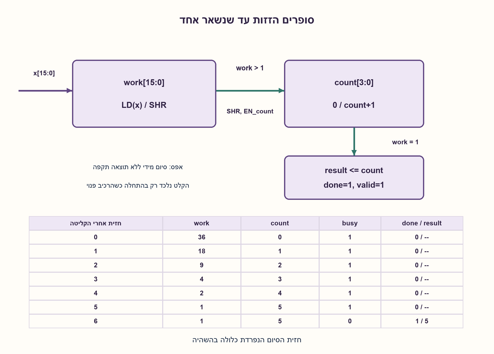
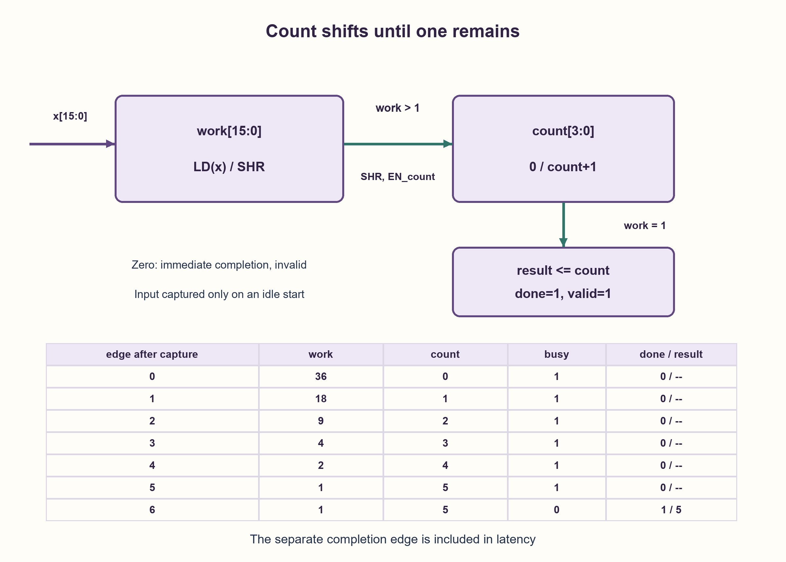

# PREP-191 — לוג בסיס שתיים בעזרת מונה ואוגר הזזה

פתרון מוצע בסיוע AI; ביקורת מקצועית אנושית ממתינה. הקושי אינו מכויל.

[צילום מקור פרטי](../sources/2026-10-30-batch110-08.png)

כניסת הרכיב היא מספר בעל 16 סיביות. בעזרת מונה, רכיבי זיכרון FF ושערים לוגיים הוצא את לוג בסיס 2 מעוגל כלפי מטה של המספר בכניסה. למשל עבור המספר 100100 התשובה היא 5.

חברות לפי הדיווח בצילום בלבד: Apple.

## עברית

תכננו רכיב המקבל מספר לא מסומן x בעל 16 סיביות ומחזיר floor(log2 (x)), באמצעות מונה, FF ושערים לוגיים. לדוגמה, עבור 100100 בבינארי התוצאה היא 5. הסבירו את רצף העבודה, רוחב הפלט, תנאי העצירה והטיפול באפס.

הבהרת עריכה: נבחר מימוש סינכרוני רב־מחזורי. חזית שעון שבה start=1 והרכיב פנוי לוכדת תמונת קלט; שינויים בקלט וב־start בזמן busy אינם מתקבלים. reset סינכרוני קודם לכל פעולה. עבור x>0, done הוא פולס של מחזור אחד בסיום ו־valid מציין תוצאה מוגדרת; עבור x=0 מסיימים כבר בחזית הקליטה עם valid=0 ותוצאת מציין־מקום 0. אין הגדרה מתמטית ל־log2(0).

1. היכן נמצאת הסיבית המשמעותית ביותר שערכה אחד, ומה הקשר שלה ללוג המבוקש?
2. כל הזזה ימינה באחד מחלקת את המספר בשתיים עם עיגול כלפי מטה. ספרו כמה הזזות נדרשות כדי להגיע לאחד.
3. לכדו את הקלט באוגר, אפסו מונה, וכל עוד האוגר גדול מאחד הזיזו אותו ימינה והגדילו מונה. אחרי ההגעה לאחד פרסמו את המונה; אפס דורש מסלול נפרד.

### סופרים הזזות, בלי לחשב לוגריתם ממשי
למספר חיובי שהסיבית הגבוהה שלו נמצאת במיקום k, כשסופרים מ־0, מתקיים 2^k≤x<2^(k+1). לכן התשובה היא k, בטווח 0..15, ודי בארבע סיביות פלט.

בחזית הקליטה שומרים work=x ו־count=0. אם x אינו אפס, מציבים busy=1. בכל חזית עבודה: אם work>1, מבצעים work_next=work>>1 ו־count_next=count+1. אחרת מעתיקים את count אל result, מורידים busy ומפיקים done=1, valid=1. במימוש זה יש חזית סיום נפרדת; היא חלק מחוזה ההשהיה. התנאי work>1 שקול ל־OR של work[15:1], ולכן אינו דורש משווה כללי.

דוגמה: work מתקדם 36→18→9→4→2→1, והמונה 0→1→2→3→4→5. בחזית העבודה השישית מפרסמים result=5. שינוי x באמצע אינו משנה את החישוב שנלכד.

הוכחת נכונות: אחרי c הזזות נשמר work=floor(x/2^c). כאשר k=floor(log2 (x)), לכל c<k האוגר לפחות שתיים, וב־c=k הוא אחד. לכן הלולאה מבצעת בדיוק k הזזות ומחזירה k. חיוביות work נשמרת עד הסיום, ואין גלישת מונה: לכל היותר 15 הזזות.

אחרי חזית הקליטה נדרשות k+1 חזיתות עבודה, בין אחת לשש־עשרה; עבור אפס אין חזית עבודה נוספת. ספירת כל החזיתות כולל הקליטה מוסיפה אחת. הקוד משתמש ב־16 FF לאוגר, ארבעה למונה, ארבעה לשמירת התוצאה ושלושה לדגלים: 27 FF במבנה המוצע, ללא טענת מינימום גלובלית. עבור רוחב כללי W מתקבלים O(W) אחסון ו־O(log W) סיביות מונה, ועד W חזיתות עבודה. חלופת priority encoder מציעה תוצאה צירופית בעלות לוגיקה אחרת; היא אינה מחליפה בשקט את דרישת המונה.

### מודל לוגי בפייתון שהורץ

```python
"""Clocked 16-bit floor-log2 reference model; no floating-point arithmetic."""

from dataclasses import dataclass


@dataclass
class FloorLog2Counter:
    work: int = 0
    count: int = 0
    result: int = 0
    busy: bool = False
    done: bool = False
    valid: bool = False

    def tick(self, value: int = 0, *, start: bool = False, reset: bool = False):
        if not 0 <= value < 1 << 16:
            raise ValueError("value must be an unsigned 16-bit integer")
        self.done = False
        if reset:
            self.work = self.count = self.result = 0
            self.busy = self.valid = False
        elif self.busy:
            if self.work > 1:
                self.work >>= 1
                self.count += 1
            else:
                self.result = self.count
                self.busy = False
                self.done = self.valid = True
        elif start:
            self.work, self.count = value, 0
            self.valid = False
            if value == 0:
                self.result = 0  # deterministic placeholder, not log2(0)
                self.done = True
            else:
                self.busy = True
        return {"result": self.result, "busy": self.busy, "done": self.done, "valid": self.valid}


def floor_log2(value: int):
    device = FloorLog2Counter()
    device.tick(value, start=True)
    cycles = 0
    while device.busy:
        device.tick()
        cycles += 1
    return device.result, device.valid, cycles
```


### קוד SystemVerilog מוצע; לא הודר בבדיקה זו

```systemverilog
// Proposed synchronous RTL. Verified with a Python model, not compiled here.
module floor_log2_counter (
    input logic clk, rst, start,
    input logic [15:0] x,
    output logic [3:0] result,
    output logic busy, done, valid
);
    logic [15:0] work;
    logic [3:0] count;
    always_ff @(posedge clk) begin
        if (rst) begin
            work <= '0;
            count <= '0;
            result <= '0;
            busy <= 1'b0;
            done <= 1'b0;
            valid <= 1'b0;
        end else begin
            done <= 1'b0;
            if (busy) begin
                if (work > 16'd1) begin
                    work <= work >> 1;
                    count <= count + 4'd1;
                end else begin
                    result <= count;
                    busy <= 1'b0;
                    done <= 1'b1;
                    valid <= 1'b1;
                end
            end else if (start) begin
                work <= x;
                count <= '0;
                valid <= 1'b0;
                if (x == 16'd0) begin
                    result <= '0;
                    done <= 1'b1;
                end else begin
                    busy <= 1'b1;
                end
            end
        end
    end
endmodule
```




### assumptions

```json
[
  "הקלט לא מסומן, ברוחב 16, ויציב רק סביב חזית הקליטה בהתאם ל־setup/hold.",
  "start בזמן busy נזנח; להתחלה חדשה צריך חזית פנויה עם start=1. valid נשמר אחרי תוצאה מוצלחת עד reset או התחלה חדשה."
]
```

### optimality

ארבע סיביות נחוצות לייצוג 16 תוצאות שונות, אבל אין כאן הוכחת מינימום FF כולל, שטח או זמן. המבנה המוצע משתמש ב־27 FF ועד 16 חזיתות אחרי הקליטה.

### verification

נבדקו כל 65,536 הקלטים מול אורקל של השוואות לחזקות שתיים, כולל אי־שוויון התחום ומספר החזיתות. נבדקו גם תמונת קלט, start בזמן busy, פולס done ואיפוס. זהו מודל פייתון; קוד SystemVerilog מוצע לא הודר.

### edge_cases

```json
[
  "0 אינו מספר עם לוג מוגדר.",
  "1 מחזיר 0 בחזית העבודה הראשונה; 32768 ו־65535 מחזירים 15 אחרי 16 חזיתות.",
  "reset באמצע מבטל את העבודה."
]
```

### common_mistakes

```json
[
  "לספור את מספר הסיביות ואז לשכוח להפחית אחת.",
  "להזיז גם כאשר work=1, או להמתין לאפס ולהשתמש באותו פירוש מונה.",
  "לשנות את הקלט הנלכד באמצע, או להציג את חזית הסיום כאילו אינה צורכת זמן."
]
```

### interview_answer

אני לוכד את הקלט ומזיז ימינה עד שנשאר אחד. מספר ההזזות הוא מיקום האחד הגבוה, ולכן הלוג המעוגל. אפס מסומן כלא תקין; מונה ארבע סיביות מספיק. במימוש הזה יש חזית סיום נפרדת.

### source_ambiguities

הצילום אינו מגדיר סימן, ממשק התחלה, השהיה או טיפול באפס. אלו הנחות עריכה מפורשות. 100100 מתפרש כבינארי, כלומר 36.

### solution_extensions

```json
[
  {
    "question": "איך לקבל השהיה קבועה בלי לדרוש שהקלט יישאר יציב?",
    "answer_direction": "לכדו תמונת קלט וסרקו תמיד 16 מיקומים או הריצו מספר מחזורים קבוע עם דגל סיום פנימי. השוו שטח, צריכת אנרגיה והשהיה.",
    "principle": "הפרדה בין זמן חישוב תלוי נתונים לחוזה ממשק."
  }
]
```

## English

Design a circuit accepting an unsigned 16-bit number x and returning floor(log2 (x)), using a counter, flip-flops and logic gates. For binary 100100 the answer is 5. Explain the operating sequence, output width, stopping condition and zero handling.

Editorial contract: choose a synchronous multicycle implementation. A clock edge with start=1 while idle captures an input snapshot; changes to x and start while busy are ignored. Synchronous reset has priority. For x>0, done pulses for one cycle at completion and valid identifies a defined result. For x=0, completion occurs on the capture edge with valid=0 and a deterministic placeholder result of 0. log2(0) has no mathematical value.

1. How does the position of the highest set bit relate to the requested logarithm?
2. A right shift divides an unsigned number by two, rounding down. Count shifts until the remaining value is one.
3. Capture x in a register, clear a counter, and shift right while the register exceeds one, incrementing the counter. Publish the count on the following completion edge; handle zero separately.

### Count shifts rather than calculating a real-valued logarithm
If the highest set bit of positive x is at zero-based position k, then 2^k≤x<2^(k+1). The answer is k in 0..15, so four output bits suffice.

On the capture edge set work=x and count=0. For nonzero x, assert busy. On each working edge, if work>1, set work_next=work>>1 and count_next=count+1. Otherwise copy count into result, clear busy, and assert done=1, valid=1. This implementation has a separate completion edge, explicitly included in its latency. For unsigned work, work>1 is the OR of work[15:1], so a general comparator is unnecessary.

Example: work follows 36→18→9→4→2→1 while count follows 0→1→2→3→4→5. The sixth working edge publishes result=5. Changing x meanwhile does not change the captured computation.

Correctness: after c shifts, work=floor(x/2^c). Let k=floor(log2 (x)). For every c<k the work register is at least two, and at c=k it equals one. Thus exactly k shifts occur and k is returned. Positive work never becomes zero before completion. The counter cannot overflow: at most 15 increments occur.

After capture, k+1 working edges are required, from one to sixteen. Zero completes on capture. Counting the capture edge itself adds one. The proposed implementation has 16 work FFs, four counter FFs, four result FFs and three flags, totaling 27 FFs; this is not a global minimum claim. For general width W, storage is O(W), counter width O(log W), and at most W working edges are needed. A priority encoder provides a combinational alternative with different logic costs, but does not silently replace the requested counter architecture.

### Executed Python logical model

```python
"""Clocked 16-bit floor-log2 reference model; no floating-point arithmetic."""

from dataclasses import dataclass


@dataclass
class FloorLog2Counter:
    work: int = 0
    count: int = 0
    result: int = 0
    busy: bool = False
    done: bool = False
    valid: bool = False

    def tick(self, value: int = 0, *, start: bool = False, reset: bool = False):
        if not 0 <= value < 1 << 16:
            raise ValueError("value must be an unsigned 16-bit integer")
        self.done = False
        if reset:
            self.work = self.count = self.result = 0
            self.busy = self.valid = False
        elif self.busy:
            if self.work > 1:
                self.work >>= 1
                self.count += 1
            else:
                self.result = self.count
                self.busy = False
                self.done = self.valid = True
        elif start:
            self.work, self.count = value, 0
            self.valid = False
            if value == 0:
                self.result = 0  # deterministic placeholder, not log2(0)
                self.done = True
            else:
                self.busy = True
        return {"result": self.result, "busy": self.busy, "done": self.done, "valid": self.valid}


def floor_log2(value: int):
    device = FloorLog2Counter()
    device.tick(value, start=True)
    cycles = 0
    while device.busy:
        device.tick()
        cycles += 1
    return device.result, device.valid, cycles
```


### Proposed SystemVerilog; not compiled in this check

```systemverilog
// Proposed synchronous RTL. Verified with a Python model, not compiled here.
module floor_log2_counter (
    input logic clk, rst, start,
    input logic [15:0] x,
    output logic [3:0] result,
    output logic busy, done, valid
);
    logic [15:0] work;
    logic [3:0] count;
    always_ff @(posedge clk) begin
        if (rst) begin
            work <= '0;
            count <= '0;
            result <= '0;
            busy <= 1'b0;
            done <= 1'b0;
            valid <= 1'b0;
        end else begin
            done <= 1'b0;
            if (busy) begin
                if (work > 16'd1) begin
                    work <= work >> 1;
                    count <= count + 4'd1;
                end else begin
                    result <= count;
                    busy <= 1'b0;
                    done <= 1'b1;
                    valid <= 1'b1;
                end
            end else if (start) begin
                work <= x;
                count <= '0;
                valid <= 1'b0;
                if (x == 16'd0) begin
                    result <= '0;
                    done <= 1'b1;
                end else begin
                    busy <= 1'b1;
                end
            end
        end
    end
endmodule
```




### assumptions

```json
[
  "Unsigned 16-bit input meets setup/hold at capture; it need not remain stable throughout computation.",
  "start while busy is ignored. A new idle edge with start=1 starts another operation. valid persists after successful completion until reset or a new start."
]
```

### optimality

Four bits are necessary to represent sixteen distinct answers; this is not a lower bound on all FFs, area or latency. The proposed structure uses 27 FFs and at most sixteen post-capture edges.

### verification

All 65,536 inputs were checked against an independent powers-of-two comparison oracle, including range inequalities and latency. Snapshot capture, ignored busy start, done pulse and reset were checked separately. Python model verification only; proposed SystemVerilog was not compiled.

### edge_cases

```json
[
  "Zero has no defined logarithm.",
  "One returns zero on the first working edge; 32768 and 65535 return fifteen after sixteen working edges.",
  "Reset during computation cancels the operation."
]
```

### common_mistakes

```json
[
  "Returning bit length without subtracting one.",
  "Shifting at work=1, or stopping at zero while retaining the same counter interpretation.",
  "Reading changing input instead of a snapshot, or omitting the completion edge from latency."
]
```

### interview_answer

Capture the input and shift right until one remains. The shift count is the highest set-bit position, hence the floor logarithm. Mark zero invalid; four counter bits suffice. This implementation includes a separate completion edge.

### source_ambiguities

The source omits signedness, start interface, latency and zero behavior. These are explicit editorial choices. 100100 is interpreted as binary, namely 36.

### solution_extensions

```json
[
  {
    "question": "How can latency be fixed without requiring a stable input throughout?",
    "answer_direction": "Capture a snapshot and scan all sixteen positions, or execute a fixed number of cycles with an internal completion flag. Compare area, energy and latency.",
    "principle": "Separate data-dependent work from the interface timing contract."
  }
]
```
