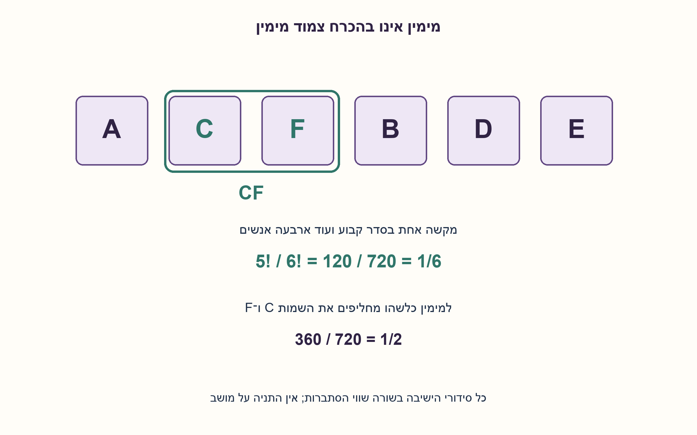
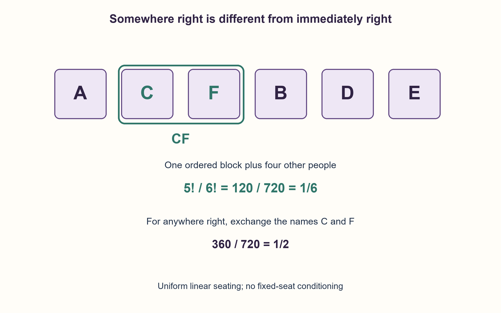

# PREP-192 — שישה על ספסל: מימין לעומת צמוד מימין

פתרון מוצע בסיוע AI; ביקורת מקצועית אנושית ממתינה. הקושי אינו מכויל.

[צילום מקור פרטי](../sources/2026-10-30-batch110-10.png)

6 אנשים יושבים על ספסל: A,B,C,D,E,F. א. מה הסיכוי ש־F יושב צמוד מימין ל־C? ב. מה הסיכוי ש־F יושב איפשהו מימין ל־C (אפשר שיהיו אנשים ביניהם)?

שיוכי חברות שדווחו בצילום ולא אומתו עצמאית: Mellanox.

## עברית

שישה אנשים שונים A,B,C,D,E,F יושבים בשורה על ספסל בעל שישה מקומות. כל אחד מ־6! סידורי הישיבה נבחר באותה הסתברות.

א. מה ההסתברות ש־F יושב צמוד מימין ל־C?
ב. מה ההסתברות ש־F יושב במקום כלשהו מימין ל־C, גם אם אנשים יושבים ביניהם?

ימין מוגדר לפי סדר המקומות משמאל לימין במבט אחד קבוע. אין מקום קבוע לאדם מסוים ואין התניה על מיקומו של C. הספסל אינו מעגלי.

1. בסעיף הראשון הסדר בתוך הזוג חשוב: CF מתאים, אבל FC אינו מתאים.
2. התייחסו ל־CF כאל יחידה אחת. כמה עצמים שונים נשאר לסדר?
3. בסעיף השני החליפו רק את השמות C ו־F בכל סידור. מה קורה ליחס ימין–שמאל?

### צמוד מימין: מקבצים זוג בסדר קבוע
יש 6!=720 סידורים שווי הסתברות. כאשר F יושב צמוד מימין ל־C, הזוג CF הוא מקשה אחת. מסדרים את המקשה ואת A,B,D,E: חמישה עצמים, ולכן 5!=120 סידורים מתאימים. אין כפל ב־2 כי FC אינו עומד בתנאי.

```text
P(F immediately right of C) = 5!/6! = 1/6
```

### במקום כלשהו מימין: סימטריה מספיקה
לכל סידור שבו F מימין ל־C יש סידור יחיד שמתקבל בהחלפת שני השמות, ובו F משמאל ל־C. ההחלפה שומרת הסתברות ואין אפשרות שהם יושבים באותו מקום. לכן מחצית הסידורים מתאימים: 360 מתוך 720, וההסתברות היא 1/2.

לחלופין, נבחר רק את שני המקומות של C ו־F. קיימים 6·5=30 זוגות סדורים אפשריים. חמישה מהם מקיימים צמידות בכיוון הנכון, ו־15 מקיימים ימין כלשהו. מקבלים שוב 5/30 ו־15/30.

הטעות 1/5 בסעיף הראשון נובעת מהנחה של־C תמיד יש שכן מימין. אם C במושב הימני ביותר, האירוע בלתי אפשרי. בהתניה ש־C אינו שם ההסתברות אכן 1/5, אך ההתניה מתקיימת רק בסיכוי 5/6; הכפל מחזיר 1/6.

ל־n אנשים שונים באותו מודל התשובות הן 1/n ו־1/2. חישוב הנוסחאות דורש O(1) פעולות חשבון; מניית כל n! הסידורים היא רק כלי בדיקה, לא אלגוריתם נדרש. נבדקו כל 46,232 הסידורים עבור n=2..8, ובפרט כל 720 סידורי המקור.

```python
"""Exact probabilities for distinct people uniformly seated in a line."""

from fractions import Fraction


def right_of_probabilities(number_of_people):
    if not isinstance(number_of_people, int) or number_of_people < 2:
        raise ValueError("At least two distinct people are required")
    # Ordered adjacent block CF: (n-1)! of n! orders.
    immediate_right = Fraction(1, number_of_people)
    # Swapping C and F bijects right-of and left-of arrangements.
    anywhere_right = Fraction(1, 2)
    return immediate_right, anywhere_right
```




## English

Six distinct people A,B,C,D,E,F sit in a line of six seats. Every one of the 6! seating permutations is equally likely.

(a) What is the probability that F sits immediately to C's right?
(b) What is the probability that F sits somewhere to C's right, possibly with other people between them?

Right means increasing seat position in one fixed view. Nobody has an assigned seat, and we do not condition on C's position. The bench is not circular.

1. For the first part, the order inside the adjacent pair matters: CF qualifies, FC does not.
2. Treat CF as one ordered block. How many distinct objects remain to arrange?
3. For the second part, exchange only C and F in every arrangement. What happens to their left/right relationship?

### Immediately right: form one ordered block
There are 6!=720 equally likely arrangements. If F sits immediately to C's right, the ordered pair CF is one block. Arrange this block together with A,B,D,E: five objects, giving 5!=120 favorable arrangements. Do not multiply by two: FC does not qualify.

```text
P(F immediately right of C) = 5!/6! = 1/6
```

### Somewhere right: use a symmetry
Every arrangement with F to C's right has exactly one partner obtained by exchanging the two names, with F to C's left. This exchange preserves probability, and the two people cannot occupy the same seat. Exactly half the arrangements qualify: 360 of 720, so the probability is 1/2.

Alternatively, inspect only their two seat positions. There are 6·5=30 ordered pairs of distinct seats. Five put F immediately right of C, while 15 put F anywhere right of C. Thus the probabilities are again 5/30 and 15/30.

The erroneous first answer 1/5 assumes C always has a right-hand neighbor. If C occupies the far-right seat, the event is impossible. Conditional on C not being there, the answer is indeed 1/5, but that condition has probability 5/6; multiplying gives 1/6.

For n distinct people in this model the answers generalize to 1/n and 1/2. Evaluating the formulas takes O(1) arithmetic operations. Enumerating n! arrangements is only a verification method, not the required algorithm. Every one of the 46,232 arrangements at n=2..8 was checked, including all 720 source arrangements.

```python
"""Exact probabilities for distinct people uniformly seated in a line."""

from fractions import Fraction


def right_of_probabilities(number_of_people):
    if not isinstance(number_of_people, int) or number_of_people < 2:
        raise ValueError("At least two distinct people are required")
    # Ordered adjacent block CF: (n-1)! of n! orders.
    immediate_right = Fraction(1, number_of_people)
    # Swapping C and F bijects right-of and left-of arrangements.
    anywhere_right = Fraction(1, 2)
    return immediate_right, anywhere_right
```




## חומר משלים / Supporting material

```json
{
  "assumptions": {
    "he": [
      "שישה אנשים שונים, שישה מושבים בשורה, וכל סידור שווה הסתברות.",
      "אין התניה על המושב של C; ימין קבוע ביחס לסדר המושבים."
    ],
    "en": [
      "Six distinct people, six seats in a line, equally likely permutations.",
      "No condition on C's seat; right is defined by the fixed seat order."
    ]
  },
  "optimality": {
    "he": "התוצאות המדויקות הן 1/6 ו־1/2. נוסחאות כלליות 1/n ו־1/2 נובעות מספירה ומסימטריה; אין צורך בסימולציה.",
    "en": "Exact results are 1/6 and 1/2. General formulas 1/n and 1/2 follow from counting and symmetry without simulation."
  },
  "verification": {
    "he": "כל 46,232 הסידורים עבור 2–8 אנשים נמנו ונבדקו לפי מיקומים. עבור שישה: 120 סמוכים בכיוון הנכון ו־360 מימין מתוך 720.",
    "en": "All 46,232 permutations at sizes 2..8 were checked by seat positions. For six: 120 immediately right and 360 anywhere right of 720."
  },
  "edge_cases": {
    "he": [
      "C בקצה הימני: אין אפשרות לשכן מימין; זה חלק מהמרחב המקורי.",
      "אם מבקשים צמידות בלי כיוון, התוצאה 2/6=1/3.",
      "לשני אנשים: צמוד מימין ומימין כלשהו הם אותו אירוע, בסיכוי 1/2."
    ],
    "en": [
      "C at the far-right endpoint has no right neighbor; those arrangements remain in the sample space.",
      "Adjacency without direction has probability 2/6=1/3.",
      "With two people, immediate right and anywhere right coincide at probability 1/2."
    ]
  },
  "common_mistakes": {
    "he": [
      "להכפיל את CF ב־2 ולכלול גם FC.",
      "לענות 1/5 בלי להכפיל בסיכוי של־C יש בכלל שכן מימין.",
      "להשתמש במודל מעגלי או להניח סידור לא אחיד בלי לציין זאת."
    ],
    "en": [
      "Multiplying the ordered CF block by two and also counting FC.",
      "Answering 1/5 while ignoring the chance that C has no right neighbor.",
      "Using circular or nonuniform seating without stating it."
    ]
  },
  "interview_answer": {
    "he": "לצמוד מימין אאחד את CF למקשה אחת: 5! מתוך 6!, כלומר 1/6. למימין כלשהו אחליף C ו־F כדי לקבל התאמה חד־חד־ערכית לימין ולשמאל, ולכן 1/2.",
    "en": "For immediate right, merge CF into one ordered block: 5!/6!=1/6. For anywhere right, swapping C and F pairs every right arrangement with a left arrangement, giving 1/2."
  },
  "source_ambiguities": {
    "he": [
      "המקור שואל הסתברות בלי לתאר אקראיות; שוויון ההסתברויות של כל הסידורים נוסף במפורש."
    ],
    "en": [
      "The source asks probabilities without specifying a random mechanism; uniform seating is explicitly added."
    ]
  },
  "solution_extensions": {
    "he": [
      {
        "question": "מה ההסתברות ש־F מימין ל־C אם ידוע שהם סמוכים?",
        "answer_direction": "מתוך שני הסדרים CF ו־FC רק אחד מתאים, ולכן 1/2. זו הסתברות מותנית אחרת מ־1/6.",
        "principle": "שומרים על מרחב דגימה והתניה עקביים."
      }
    ],
    "en": [
      {
        "question": "What is the probability F is right of C given that they are adjacent?",
        "answer_direction": "Only one of CF and FC qualifies, so 1/2. This conditional probability differs from 1/6.",
        "principle": "Keep the sample space and conditioning consistent."
      }
    ]
  }
}
```
