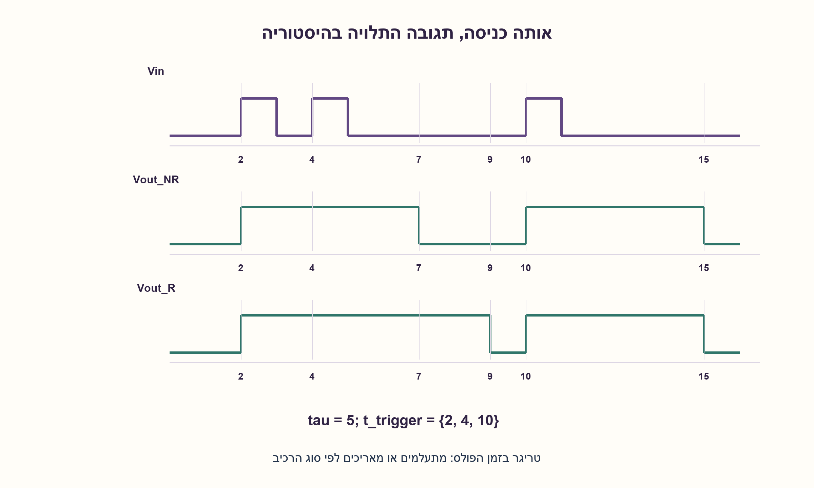
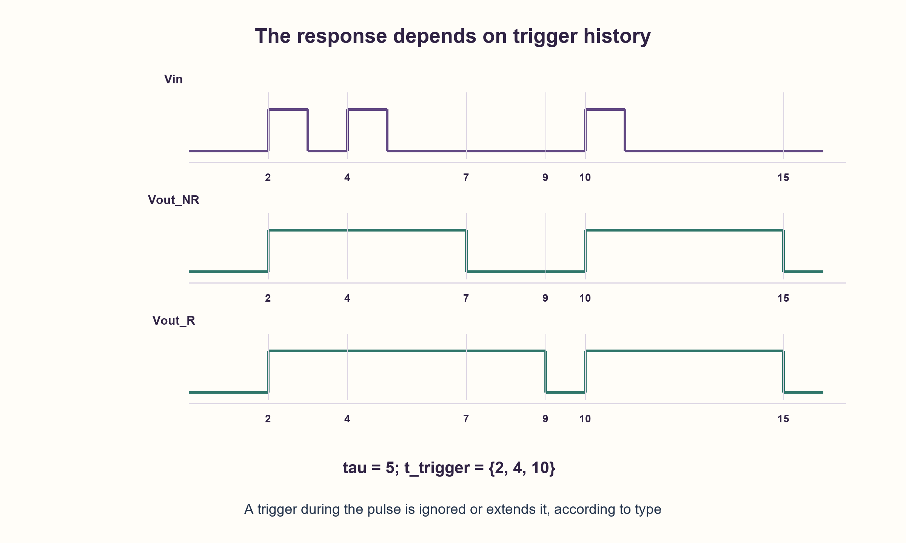

# PREP-193 — חד־יציב: טריגר, פולס והיסטוריית כניסה

פתרון מוצע בסיוע AI; ביקורת מקצועית אנושית ממתינה. הקושי אינו מכויל.

[צילום מקור פרטי](../sources/2026-10-30-batch110-11.png)

הסבר את פעולת העבודה של מעגל חד־יציב וצייר מתחי יציאה כתלות במתח כניסה.

חברות לפי הדיווח בצילום בלבד: Mellanox.

## עברית

הסבירו כיצד פועל מעגל חד־יציב, ושרטטו את מתח היציאה בתגובה למתח הכניסה. הסבירו אם אפשר לתאר את המעגל באמצעות עקומה יחידה Vout(Vin). הבחינו בין חד־יציב שמאפשר טריגר חוזר לבין כזה שמתעלם ממנו בזמן הפולס.

הבהרת עריכה: לא סופק מעגל, מתחי סף או רכיב מסוים. לשם הדוגמה נבחר מודל אידאלי: מצב מנוחה נמוך, טריגר בעליית הכניסה מעבר לסף, פולס גבוה ברוחב קבוע τ, ו־reset שמפסיק מיד את הפולס. הדוגמה הראשית אינה ניתנת להפעלה חוזרת בזמן הפולס; מוצגת גם החלופה הניתנת להפעלה חוזרת. אין להסיק מכך מתחי סף או נוסחת RC כללית לכל רכיב.

1. האם היציאה תלויה רק במתח שיש עכשיו, או גם באירוע שהתרחש קודם?
2. חד־יציב חוזר בעצמו למצב מנוחה אחרי זמן קצוב, גם אם הכניסה כבר חזרה למתח הקודם.
3. ציירו Vin(t) ולצדו Vout(t). סמנו טריגר בזמן t0, סיום בזמן t0+τ וטריגר נוסף בתוך הפולס; החליטו במפורש אם הוא מאריך את הפולס.

### זיכרון קצר של אירוע
לחד־יציב יש מצב מנוחה יציב אחד. טריגר מתאים מעביר אותו זמנית למצב פעיל; לאחר פרק זמן שנקבע במעגל התזמון הוא חוזר בעצמו למנוחה. במודל שנבחר, היציאה נמוכה במנוחה וגבוהה במהלך הפולס.

בזמן t0 מתרחשת עלייה תקפה בכניסה. ללא reset, חד־יציב שאינו ניתן לטריגר חוזר מפיק Vout=V_H לאורך [t0, t0+τ), ואחר כך Vout=V_L. ירידת הכניסה לפני תום τ אינה מקצרת את הפולס. עלייה חדשה בזמן שהפולס פעיל נזנחת. כניסה שנשארת גבוהה אינה רצף של טריגרים חדשים. בדוגמה τ=5 יחידות, ויש עליות בזמנים 2,4,10: הפולסים הם [2,7) ו־[10,15); העלייה ב־4 אינה משנה את הסיום ב־7.

בחלופה הניתנת לטריגר חוזר, עלייה תקפה בזמן הפעולה מעדכנת את זמן הסיום ל־t_trigger+τ. באותו רצף, הפולס הראשון מוארך עד 9, והבא מתחיל ב־10. אם מגיע reset, הוא קודם לטריגר ומפסיק את הפולס. במודל הדגימה המצורף, פקיעת הזמן נבדקת לפני טריגר באותה נקודת זמן; טריגר בדיוק בסיום יכול להתחיל פולס חדש. מתח הכניסה נעקב גם בזמן reset, ולכן שחרור reset כשהכניסה כבר גבוהה אינו ממציא עלייה.

### מדוע אין עקומת מעבר סטטית יחידה
באותו רגע שבו Vin נמוך, היציאה יכולה להיות נמוכה אם לא התקבל טריגר, או גבוהה אם טריגר התקבל לפני פחות מ־τ. לכן אין פונקציה חד־ערכית של Vin בלבד. דרושים זמן, מצב פנימי והיסטוריית טריגרים. השרטוט הנכון הוא תגובה בזמן או תיאור מצבים, ולא עקומת מגבר סטטית.

ברכיב ממשי סוג הטריגר, אפשרות ההפעלה החוזרת, מתחי הסף, זמני התאוששות וקשר רוחב הפולס לרכיבי התזמון נקבעים בדף הנתונים. לדוגמה, [TI CD74 HC221](https://www.ti.com/product/CD74HC221) מתאר התעלמות מטריגרים נוספים בזמן הפולס, ואילו [TI CD74 HC123](https://www.ti.com/product/CD74HC123) מתאר הארכת פולס באמצעות טריגר חוזר. אלה דוגמאות לסוגים שונים, ולא זיהוי של הרכיב שבצילום.

### מודל לוגי בפייתון שהורץ

```python
"""Ideal sampled one-shot model; not an analog circuit simulation."""

from dataclasses import dataclass


@dataclass
class Monostable:
    duration: int = 4
    retriggerable: bool = False
    previous: int = 0
    time: int = 0
    deadline: int | None = None

    def __post_init__(self):
        if self.duration < 1:
            raise ValueError("duration must be a positive integer number of ticks")

    def tick(self, vin: int, *, reset: bool = False) -> int:
        if vin not in (0, 1):
            raise ValueError("vin must already be thresholded to zero or one")
        now = self.time
        if self.deadline is not None and now >= self.deadline:
            self.deadline = None
        rising = self.previous == 0 and vin == 1
        if reset:
            self.deadline = None
        elif rising and (self.deadline is None or self.retriggerable):
            self.deadline = now + self.duration
        self.previous = vin
        self.time += 1
        return int(self.deadline is not None)


def waveform(inputs, duration=4, *, retriggerable=False, resets=()):
    device = Monostable(duration, retriggerable)
    reset_times = set(resets)
    return [device.tick(vin, reset=t in reset_times) for t, vin in enumerate(inputs)]
```




### assumptions

```json
[
  "נבחר טריגר בעלייה, מצב מנוחה נמוך ורוחב τ חיובי וקבוע.",
  "המודל בפייתון דוגם רמות בינאריות בזמני יחידה, ואינו מדמה מתח אנלוגי, ספי Schmitt, רעש או השהיות התפשטות."
]
```

### optimality

אין בשאלה יעד אופטימיזציה או מספיק פרטי מעגל לספירת רכיבים. במודל הדיגיטלי נדרשים זיכרון הרמה הקודמת וזמן סיום או מונה זמן; כל דגימה מתעדכנת בזמן קבוע.

### verification

40,960 תרחישים ממצים של 12 דגימות, עבור חמישה רוחבי פולס ושני מצבי טריגר חוזר, הושוו לאורקל נפרד הבונה קטעי זמן. נבדקו גם 2,048 תרחישי reset, גבול פקיעה ודוגמה המפריכה עקומה סטטית. לא בוצעו SPICE, בדיקת חומרה או אימות אנלוגי.

### edge_cases

```json
[
  "טריגר בזמן הפעולה: נזנח או מאריך לפי הסוג.",
  "רמה גבוהה ממושכת אינה חזית חדשה.",
  "טריגר בדיוק בפקיעה וטריגר יחד עם reset דורשים סדר קדימויות מפורש."
]
```

### common_mistakes

```json
[
  "לשרטט Vout כתלות ב־Vin בלבד בלי היסטוריה.",
  "להניח שכל חד־יציב נמתח מטריגר חוזר.",
  "להצמיד נוסחת RC או סף של רכיב מוכר בלי שניתן מעגל מתאים."
]
```

### interview_answer

חד־יציב זוכר טריגר לזמן קצוב ואז חוזר למנוחה. צריך להציג את הכניסה והיציאה בזמן; אותו Vin יכול לתת שתי יציאות לפי ההיסטוריה. לפני השרטוט אברר קוטביות, רוחב פולס והאם טריגר חוזר נזנח או מאריך.

### source_ambiguities

לא צורפו סכימה, רמות מתח, ספים, קוטביות, אופן reset או התנהגות בהפעלה חוזרת. לא ניתן להסיק מהם גל אנלוגי מספרי יחיד. ההרחבה מבהירה זאת ומדגימה שתי התנהגויות מוכרות.

### solution_extensions

```json
[
  {
    "question": "מה קורה אם מרווחי הטריגרים קצרים מ־τ בחד־יציב הניתן לטריגר חוזר?",
    "answer_direction": "הסיום נדחה בכל טריגר תקף, ולכן היציאה יכולה להישאר גבוהה עד τ אחרי הטריגר האחרון, בכפוף למגבלות התאוששות של רכיב אמיתי.",
    "principle": "הבדל בין זיכרון אירוע לבין פונקציה סטטית."
  }
]
```

## English

Explain how a monostable works and draw the output-voltage response to its input voltage. Can a single-valued curve Vout(Vin) describe it? Distinguish retriggerable operation from a one-shot that ignores triggers while its pulse is active.

Editorial clarification: no circuit, thresholds or particular device were supplied. For the example choose an ideal model with a low resting output, a rising threshold-crossing trigger, a fixed high pulse width τ, and reset that terminates the pulse. The main example is nonretriggerable while active; the retriggerable alternative is also shown. This does not specify universal thresholds or an RC formula for every device.

1. Does the output depend only on the current input voltage, or also on an earlier event?
2. A monostable returns to its resting state after a timed interval even if its input has already returned to its previous level.
3. Draw Vin(t) and Vout(t). Mark a trigger at t0, expiration at t0+τ, and another trigger during the pulse; explicitly decide whether it extends the pulse.

### A short memory of an event
A monostable has one stable resting state. A qualifying trigger temporarily activates it; its timing mechanism then returns it to rest. In the chosen model the resting output is low and the active pulse is high.

A valid rising input transition occurs at t0. Without reset, a nonretriggerable one-shot holds Vout=V_H on [t0, t0+τ), then returns to V_L. An input falling before τ expires does not shorten the pulse. A new rising edge during the active interval is ignored. A continuously high input does not constitute repeated new edges. With τ=5 and rising transitions at times 2,4,10, the pulses are [2,7) and [10,15); the edge at 4 does not change expiration at 7.

For the retriggerable alternative, a qualifying edge during the pulse updates its deadline to t_trigger+τ. In the same example the first pulse extends to 9, and the next begins at 10. Reset has priority and terminates the output. In the attached sampled model expiration is processed before a trigger at the same instant, so an edge exactly at expiration can start a new pulse. Input level is tracked during reset, so releasing reset with an already high input does not invent an edge.

### Why there is no unique static transfer curve
With the same current low Vin, Vout can be low if no trigger occurred, or high if a trigger occurred less than τ ago. Thus Vin alone does not define a single-valued output. Time, internal state and trigger history are required. Draw time responses or a state description rather than an amplifier's static transfer curve.

A real device's datasheet specifies trigger polarity, retriggering, thresholds, recovery requirements and the relation between pulse width and timing components. For example, [TI CD74 HC221](https://www.ti.com/product/CD74HC221) describes ignoring further triggers during a pulse, whereas [TI CD74 HC123](https://www.ti.com/product/CD74HC123) describes extension by retriggering. These illustrate distinct device types; they do not identify the unspecified source circuit.

### Executed Python logical model

```python
"""Ideal sampled one-shot model; not an analog circuit simulation."""

from dataclasses import dataclass


@dataclass
class Monostable:
    duration: int = 4
    retriggerable: bool = False
    previous: int = 0
    time: int = 0
    deadline: int | None = None

    def __post_init__(self):
        if self.duration < 1:
            raise ValueError("duration must be a positive integer number of ticks")

    def tick(self, vin: int, *, reset: bool = False) -> int:
        if vin not in (0, 1):
            raise ValueError("vin must already be thresholded to zero or one")
        now = self.time
        if self.deadline is not None and now >= self.deadline:
            self.deadline = None
        rising = self.previous == 0 and vin == 1
        if reset:
            self.deadline = None
        elif rising and (self.deadline is None or self.retriggerable):
            self.deadline = now + self.duration
        self.previous = vin
        self.time += 1
        return int(self.deadline is not None)


def waveform(inputs, duration=4, *, retriggerable=False, resets=()):
    device = Monostable(duration, retriggerable)
    reset_times = set(resets)
    return [device.tick(vin, reset=t in reset_times) for t, vin in enumerate(inputs)]
```




### assumptions

```json
[
  "Rising-edge trigger, low resting output and a positive fixed duration τ are editorial choices.",
  "The Python model samples binary levels at integer times. It does not simulate analog voltages, Schmitt thresholds, noise or propagation delay."
]
```

### optimality

The source gives no optimization target or circuit sufficient for a component count. The digital model retains the previous level and an expiration time or timer; each sample updates in constant time.

### verification

40,960 exhaustive twelve-sample scenarios across five pulse widths and both retrigger modes were compared with an independent interval-construction oracle. Another 2,048 reset scenarios, expiration boundaries and a static-curve counterexample were checked. No SPICE, physical hardware or analog validation was performed.

### edge_cases

```json
[
  "Trigger while active: ignored or extends the pulse according to type.",
  "A sustained high level is not a new edge.",
  "An edge exactly at expiration, or together with reset, needs an explicit priority rule."
]
```

### common_mistakes

```json
[
  "Drawing Vout as a function of Vin alone without history.",
  "Assuming every monostable extends its pulse when retriggered.",
  "Applying a familiar RC formula or threshold to an unspecified circuit."
]
```

### interview_answer

A monostable remembers a trigger for a timed interval and then returns to rest. Plot input and output against time: the same Vin can produce different outputs depending on history. First specify polarity, pulse width and whether retriggering is ignored or extends the pulse.

### source_ambiguities

No schematic, voltage levels, thresholds, polarity, reset behavior or retriggering policy were supplied. A unique quantitative analog waveform cannot be inferred. The explanation states this gap and illustrates two common behaviors.

### solution_extensions

```json
[
  {
    "question": "What happens if qualifying triggers are spaced less than τ apart in a retriggerable one-shot?",
    "answer_direction": "Each trigger postpones expiration, so the output can remain high until τ after the final trigger, subject to a real device’s recovery limitations.",
    "principle": "Distinguish event memory from a static transfer function."
  }
]
```
