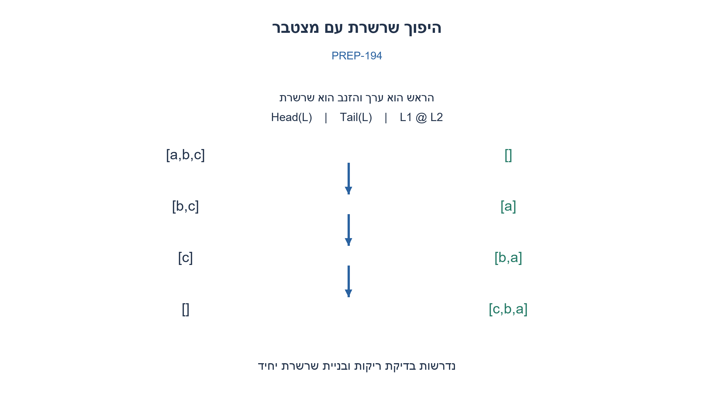
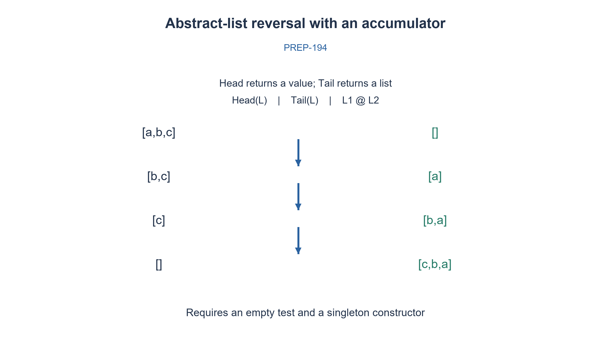

# PREP-194 — היפוך שרשרת באמצעות Head, Tail ושרשור

פתרון מוצע בסיוע AI; ביקורת מקצועית אנושית ממתינה. הקושי אינו מכויל.

[צילום מקור פרטי](../sources/2026-10-30-batch110-13.png)

נתון מבנה נתונים אבסטרקטי של שרשרת המאפשר את הפעולות: Head(List L) מחזירה את האיבר הראשון; Tail(List L) מחזירה את הזנב, כלומר ללא האיבר הראשון; L1@L2 משרשרת שתי שרשרות. כתוב פונקציה המקבלת שרשרת והופכת אותה. ה־hhh בצילום הוא לצורך יישור השורה בלבד.

## עברית

נתונה שרשרת סופית עם הפעולות Head(L) המחזירה את ערך האיבר הראשון, Tail(L) המחזירה את השרשרת בלעדיו, ו־L1@L2 המשרשרת שתי שרשרות. כתבו היפוך שרשרת והסבירו אילו השלמות לממשק נדרשות ומהי העלות.

המקור אינו מגדיר בדיקת ריקות, שרשרת ריקה או יצירת שרשרת יחיד מערך. נציג תחילה מדוע שלוש הפעולות לבדן אינן חוזה מספיק, ואז פתרון תחת השלמה מפורשת: Empty, is_empty ו־singleton. במודל המימוש Head,Tail ובניית יחיד עולים O(1); @ מעתיק את השדרה השמאלית ומשתף את הימנית. אין לשנות את הקלט. hhh בצילום הוא סימון יישור בלבד.

1. מהו מקרה העצירה, ואיך הופכים ערך שחזר מ־Head לשרשרת שאפשר לשרשר?
2. לאחר השלמת הממשק אפשר להפוך רקורסיבית את הזנב ולהוסיף את הראש בסוף, אבל חשבו מה עולה @.
3. לפתרון עם מצטבר הוסיפו בכל צעד singleton(Head(L)) בתחילת התוצאה. הצד השמאלי של השרשור אז באורך אחד.

### ממשק חסר הוא חלק מהשאלה
אם Head מחזירה ערך ולא שרשרת, אי אפשר לכתוב ‎Head(L)@result בלי פעולת יצירת שרשרת. גם מקרה השרשרת הריקה דורש יכולת זיהוי. לדוגמה, בשרשרת [a,b] עם ערכים שונים, Tail ושרשור של שרשרות זמינות אינם יכולים לייצר [a] המסתיימת ב־a: בכל מקטע זמין שמכיל a, אחריו עדיין נמצא b. קריאה של a באמצעות Head אינה מספקת שרשרת [a]. לכן בהבנה המילולית המחמירה אין די בממשק הנתון; אין להוסיף Cons בסתר.

לאחר שמאשרים Empty, בדיקת ריקות ו־singleton, נוסחה טבעית היא reverse(L)=reverse(Tail(L))@[Head(L)], ובסיס reverse(Empty)=Empty. היא נכונה אך אם @ מעתיק את הצד השמאלי, העלות המצטברת היא 0+1+...+(n−1)=Θ(n²), ומחסנית הרקורסיה בגובה n.

### מחליפים סוף בהתחלה
נחזיק result ריקה. בכל צעד נשרשר את שרשרת היחיד של הראש בתחילת result, ואז נעבור ל־Tail. אחרי k צעדים result היא היפוך k האיברים שכבר נקראו, והשרשרת הנוכחית היא בדיוק הסיומת שטרם נקראה. הוספת הראש לפנים שומרת את האינווריאנט; כשהסיומת ריקה, המצטבר הוא ההיפוך המלא. למשל [a,b,c] נותנת []→[a]→[b,a]→[c,b,a].

במודל שנבחר הצד השמאלי הוא תמיד יחיד ולכן כל @ עולה O(1), בסך הכול Θ(n) זמן ו־Θ(n) תאים לפלט, עם O(1) משתני עזר ומחסנית קבועה. הקלט נשאר ללא שינוי. לעומת זאת אם @ מעתיק גם את הצד הימני, גם פתרון המצטבר נעשה Θ(n²). בלי עלויות הפעולות אי אפשר לטעון לחסם זמן מה־ADT לבדו. מימוש concat להלן מדגים במפורש העתקת צד שמאל ושיתוף סיומת; רשימת העזר הפנימית שלו באורך אחד בכל קריאה מתוך reverse. אין זו דרישת המקור להשתמש ברשימת Python כאחסון נוסף לפתרון.

נבדקו כל 3,280 השרשרות באורכים 0–7 מעל שלושה ערכים מול היפוך עצמאי, כולל שמירת תוכן הקלט. זו בדיקה של ה־ADT שהושלם, ולא הוכחה שלממשק החסר המקורי יש constructor שלא הוגדר.

```python
"""Completed ADT contract: Empty, is_empty, singleton, Head, Tail and @.

concat copies only its left spine and shares its right suffix. Source did not
define constructors, empty tests or costs: these are explicit extra assumptions.
"""
from dataclasses import dataclass


@dataclass(frozen=True)
class Node:
    value: object
    next: object = None

def is_empty(chain):
    return chain is None

def singleton(value):
    return Node(value)

def Head(chain):
    if is_empty(chain):
        raise ValueError('Head of empty chain')
    return chain.value

def Tail(chain):
    if is_empty(chain):
        raise ValueError('Tail of empty chain')
    return chain.next

def concat(left, right):
    prefix = []
    while not is_empty(left):
        prefix.append(Head(left)); left = Tail(left)
    for value in reversed(prefix):
        right = Node(value, right)
    return right

def reverse(chain):
    result = None
    while not is_empty(chain):
        result = concat(singleton(Head(chain)), result)
        chain = Tail(chain)
    return result
```




## English

A finite list provides Head(L), returning its first element value; Tail(L), returning the remaining list; and L1@L2, concatenating two lists. Reverse it and explain missing interface assumptions and cost.

The source does not supply an empty test, empty list or constructor for a singleton from a value. First explain why the three operations alone are insufficient; then explicitly complete the interface with Empty, is_empty and singleton. In the implementation model, Head, Tail and singleton are O(1); @ copies the left spine and shares its right suffix. Leave the input unchanged. The source hhh is an alignment artifact only.

1. What is the base case, and how does a Head value become a list suitable for concatenation?
2. With the completed interface, reverse the tail and append the head, but account for @ cost.
3. Use an accumulator and prepend singleton(Head(L)); the left operand of each concatenation then has length one.

### A missing interface is part of the problem
If Head returns a value rather than a list, Head(L)@result is ill-typed without a singleton constructor. Empty-list termination also needs detection. For [a,b] with distinct values, Tail and concatenations of available lists cannot produce [a] ending in a: every available segment containing a still has b after it. Reading a with Head does not create [a]. Thus the strictly literal interface is insufficient; do not silently introduce Cons.

Once Empty, an empty test and singleton are authorized, the natural recursion is reverse(L)=reverse(Tail(L))@[Head(L)], with reverse(Empty)=Empty. It is correct, but if @ copies its left operand, total work is 0+1+...+(n−1)=Θ(n²), with recursion depth n.

### Replace append-at-end with prepend
Start with empty result. At each step concatenate the singleton of the head in front of result, then move to Tail. After k steps result reverses the processed prefix and the current list is exactly the unread suffix. Prepending its head preserves this invariant; an empty suffix means the result reverses the whole input. For [a,b,c], accumulation is []→[a]→[b,a]→[c,b,a].

In the chosen model, the left operand always has one item, so each @ costs O(1): Θ(n) total time and Θ(n) output cells, O(1) auxiliary variables and constant stack. Input remains unchanged. If @ copies both operands instead, this accumulator also costs Θ(n²). The ADT alone gives no unconditional time bound without operation costs. The concat implementation explicitly copies its left spine and shares its right suffix; its internal temporary list has length one in every call from reverse. This is an implementation of the completed abstraction, not a claim that the original source supplied constructors.

All 3,280 lists of lengths 0..7 over three values were checked against independent reversal, including unchanged input contents. These tests validate the completed ADT, not a constructor absent from the literal source.

```python
"""Completed ADT contract: Empty, is_empty, singleton, Head, Tail and @.

concat copies only its left spine and shares its right suffix. Source did not
define constructors, empty tests or costs: these are explicit extra assumptions.
"""
from dataclasses import dataclass


@dataclass(frozen=True)
class Node:
    value: object
    next: object = None

def is_empty(chain):
    return chain is None

def singleton(value):
    return Node(value)

def Head(chain):
    if is_empty(chain):
        raise ValueError('Head of empty chain')
    return chain.value

def Tail(chain):
    if is_empty(chain):
        raise ValueError('Tail of empty chain')
    return chain.next

def concat(left, right):
    prefix = []
    while not is_empty(left):
        prefix.append(Head(left)); left = Tail(left)
    for value in reversed(prefix):
        right = Node(value, right)
    return right

def reverse(chain):
    result = None
    while not is_empty(chain):
        result = concat(singleton(Head(chain)), result)
        chain = Tail(chain)
    return result
```




## חומר משלים / Supporting material

```json
{
  "assumptions": {
    "he": [
      "שרשרת סופית ולא מחזורית; empty test ובניית יחיד הותרו כהשלמה; השיתוף בלתי משתנה."
    ],
    "en": [
      "Finite acyclic list; empty testing and singleton construction explicitly added; suffix sharing is immutable."
    ]
  },
  "optimality": {
    "he": "Θ(n) עם העתקת צד שמאל בלבד; Θ(n²) אם השרשור מעתיק את שני הצדדים. פלט Θ(n) תאים.",
    "en": "Θ(n) when concatenation copies only the left side; Θ(n²) if both sides are copied. Output uses Θ(n) cells."
  },
  "verification": {
    "he": "כל 3,280 הרשימות באורכים 0–7; בדיקה עצמאית של הפלט ושל אי־שינוי הקלט.",
    "en": "All 3,280 lists at lengths 0..7, independently checking output and unchanged input."
  },
  "edge_cases": {
    "he": [
      "ריקה; יחיד; ערכים חוזרים; רשימה ארוכה; מחזור אינו קלט חוקי."
    ],
    "en": [
      "Empty; singleton; duplicates; long lists; cycles are outside the contract."
    ]
  },
  "common_mistakes": {
    "he": [
      "Head מחזירה ערך, לא שרשרת.",
      "אין להתעלם מעלות @ או להניח ריקות שלא ניתנת לזיהוי."
    ],
    "en": [
      "Head returns a value, not a list.",
      "Do not ignore @ cost or assume an unavailable empty test."
    ]
  },
  "interview_answer": {
    "he": "צריך להשלים את הממשק. אחר כך מקדימים כל ראש לשרשרת המצטברת; העלות ליניארית רק כששרשור עם צד שמאל יחיד קבוע בזמן.",
    "en": "Complete the interface, then prepend each head to an accumulator; linear time requires constant-time concatenation with a singleton left operand."
  },
  "source_ambiguities": {
    "he": [
      "אם Head הוגדרה להחזיר שרשרת יחיד במקום ערך, חלק מההשלמה כבר כלול — חייבים לברר זאת."
    ],
    "en": [
      "If Head actually returns a singleton list rather than a value, part of the completion already exists; clarify it."
    ]
  },
  "solution_extensions": {
    "he": {
      "question": "מה העלות של reverse(Tail(L))@[Head(L)]?",
      "direction": "סכום אורכי הצד השמאלי ריבועי במודל העתקה, בעוד מצטבר מקדים מעתיק יחיד בכל צעד.",
      "integration": "מוכן בתוכן; לא מחובר לתור."
    },
    "en": {
      "question": "What does reverse(Tail(L))@[Head(L)] cost?",
      "direction": "Copied left lengths sum quadratically; a prepending accumulator copies one cell per step.",
      "integration": "Prepared in content; not connected to the queue."
    }
  }
}
```
