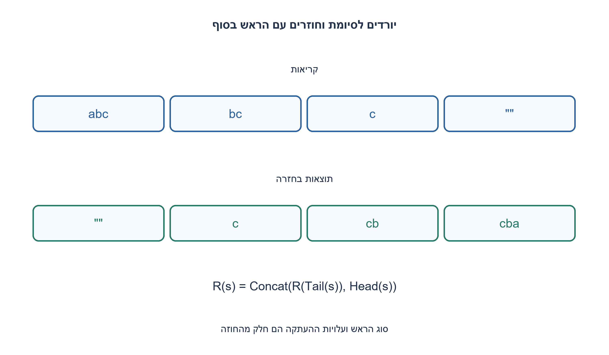
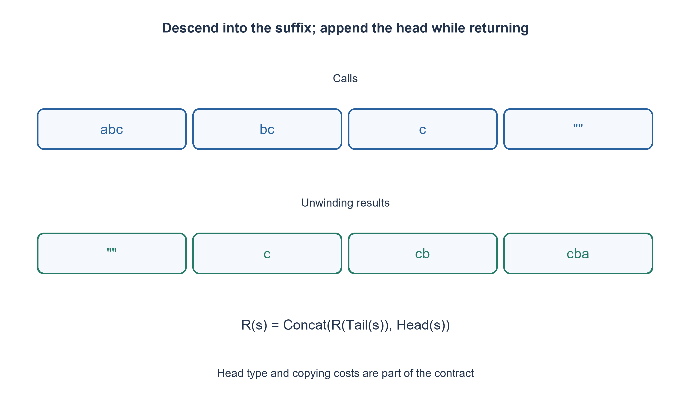

# PREP-194 — היפוך שרשרת באמצעות Head, Tail ושרשור

פתרון מוצע בסיוע AI; ביקורת מקצועית אנושית ממתינה. הקושי אינו מכויל.

## עברית

### וריאציה: מחרוזת ורקורסיה באמצעות ארבע פעולות
הפכו מחרוזת באמצעות רקורסיה ורק הפעולות Head, Tail, Concat ו־ Length בגוף פונקציית ההיפוך.

השלמת חוזה: Head מחזירה מחרוזת באורך תו אחד, Tail את הסיומת ללא התו הראשון, Concat מאחדת שתי מחרוזות ו־ Length מחזירה אורך. המחרוזת הריקה זמינה כתוצאת בסיס; אין לקרוא Head או Tail עליה. תו הוא נקודת קוד, לא צבר גרפי. הפלט אינו משנה את הקלט; דוגמאות ההרצה מוגבלות לאורך 200 בגלל מחסנית Python. נתחו את האלגוריתם גם לאורך n פרמטרי תחת מודל מחרוזות שטוחות, שבו Tail ו־ Concat מעתיקות תווים. אין לייבא לכאן אוטומטית את עלויות ADT הרשימה מהשאלה הקודמת.

1. איזה תנאי מאפשר לעצור בלי להפעיל Head על מחרוזת ריקה?
2. התו הראשון צריך לעבור לסוף, אחרי שהפכתם רקורסיבית את כל מה שאחריו.
3. באורך אפס החזירו מחרוזת ריקה; אחרת Concat(reverse(Tail(s)), Head(s)). Head כבר מחזירה מחרוזת של תו אחד לפי החוזה.

### התו הראשון עובר לסוף
מקרה הבסיס הוא Length(s)=0, ואז מחזירים מחרוזת ריקה. אחרת קודם הופכים את Tail(s), ורק אז מצרפים את Head(s) מימין. ל־ abc הירידה היא abc→bc→c→ריק; בחזרה מתקבלים c, אחר כך cb ואז cba.

באינדוקציה על האורך: ההיפוך של סיומת באורך n−1 נכון לפי הנחת האינדוקציה. צירוף התו הראשון בסוף מציב את כל התווים בדיוק בסדר ההפוך, והתו מופיע פעם אחת. האורך קטן בכל קריאה ולכן מגיעים למקרה הבסיס.

### סוגים ועלות אינם פרטים חופשיים
Concat מקבלת מחרוזות. אם Head הייתה מחזירה char שאינו מחרוזת, היה צריך בנאי של מחרוזת יחיד או חתימת concat מתאימה; בגרסה זו בחרנו מראש תוצאה באורך אחד. המחרוזת הריקה ו־ Length מספקות את ההשלמות שחסרו בממשק הרשימה המקורי, בלי למחוק את הניתוח ההוא.

במודל מחרוזת שטוחה, סיומת מעתיקה O(k) תווים ושרשור התוצאה באורך k מעתיק שוב O(k). סכום העבודה לאורך הירידה והחזרה הוא Θ(n²). עומק הרקורסיה Θ(n). נוסף לפלט באורך n, הקריאות הפעילות יכולות להחזיק יחד סיומות שהועתקו באורכים n−1, n−2, ..., ולכן השיא יכול להיות Θ(n²) תווים, לא רק O(n) מילות מחסנית. במימוש עם תצוגות משותפות או ropes העלויות משתנות ויש לנתחן מחדש.

קוד ההדגמה של ארבע הפעולות משתמש בפעולות Python כדי לממש את הפרימיטיבים. גוף reverse_string עצמו אינו עושה slicing או היפוך מובנה, אלא קורא רק לרקורסיה ולארבע הפעולות. מגבלת המחסנית המעשית נפרדת מהוכחת האלגוריתם. סימני Unicode משולבים יכולים להיראות שונים לאחר היפוך נקודות הקוד; לא הובטח היפוך של צברים גרפיים.

```python
"""A string variant of the completed ADT; flat string operations copy."""


def Head(text):
    return text[0]  # One-character string, not an unwrapped scalar character.


def Tail(text):
    return text[1:]


def Concat(left, right):
    return left + right


def Length(text):
    return len(text)


def reverse_string(text):
    if Length(text) == 0:
        return ""
    return Concat(reverse_string(Tail(text)), Head(text))
```




## English

### Variant: recursive string reversal through four primitives
Reverse a string recursively using only Head, Tail, Concat and Length inside the reversing function.

Chosen contract: Head returns a one-character string, Tail the suffix after the first character, Concat joins strings, and Length reports length. The empty string is available as the base result; never call Head/Tail on it. Characters mean code points, not grapheme clusters. Preserve input; executable examples have length at most 200 because of the Python stack. Also analyze parameterized n under a flat-copy string model where Tail/Concat copy characters. Do not silently inherit the earlier linked-list ADT operation costs.

1. Which condition stops before applying Head to an empty string?
2. The first character belongs at the end, after reversing the remaining suffix.
3. Return empty at length zero; otherwise Concat(reverse(Tail(s)), Head(s)). By contract Head already returns a one-character string.

### Move the first character to the end
When Length(s)=0, return the empty string. Otherwise reverse Tail(s) first, then append Head(s) on the right. For abc, descent is abc→bc→c→empty; unwinding produces c, then cb, then cba.

Induct on length: the n−1 suffix is reversed correctly by the induction hypothesis. Appending the original first character puts every character exactly once in reverse order. Length decreases at each call, ensuring termination.

### Types and operation costs must be specified
Concat accepts strings. If Head returned an unwrapped character rather than a string, a singleton-string constructor or a different concat signature would be necessary. Here Head explicitly returns a one-character string. Empty and Length supply interface details missing from the original list question, without erasing that analysis.

In the flat-string model, Tail copies O(k) characters and concatenation at length k copies O(k) again. Total work across descent/unwinding is Θ(n²), and recursion depth is Θ(n). In addition to the n-character output, active frames may retain separately copied suffixes of lengths n−1, n−2, ..., producing Θ(n²) peak live characters, not merely O(n) stack words. Shared suffix views or ropes have different costs that require fresh analysis.

The four primitive implementations use Python operations to realize the chosen abstraction. The reverse_string body itself has no slicing or built-in reversal, only recursion and calls to the four primitives. Practical recursion limits are distinct from algorithm correctness. Reversing Unicode code points can change the appearance of combining sequences; grapheme reversal is not promised.

```python
"""A string variant of the completed ADT; flat string operations copy."""


def Head(text):
    return text[0]  # One-character string, not an unwrapped scalar character.


def Tail(text):
    return text[1:]


def Concat(left, right):
    return left + right


def Length(text):
    return len(text)


def reverse_string(text):
    if Length(text) == 0:
        return ""
    return Concat(reverse_string(Tail(text)), Head(text))
```




## חומר משלים / Supporting material

```json
{
  "assumptions": {
    "he": [
      "Head מחזירה מחרוזת תו, Empty זמין, Length קבוע, Tail ו־ Concat מעתיקות במודל שטוח."
    ],
    "en": [
      "Head returns a one-character string, empty exists, Length is constant, and flat Tail/Concat copy."
    ]
  },
  "optimality": {
    "he": "Θ(n²) זמן במודל השטוח, Θ(n) עומק וייתכנו Θ(n²) תווי סיומות פעילות.",
    "en": "Θ(n²) flat-copy time, Θ(n) depth and potentially Θ(n²) live suffix characters."
  },
  "verification": {
    "he": "1,093 מחרוזות מעל שלושה תווים עד אורך 6 מול אורקל slicing חיצוני; AST מאמת רקורסיה ושימוש רק בארבע הפעולות בגוף ההיפוך.",
    "en": "1,093 strings over three characters through length six against an external slicing oracle; AST checks recursion and the four-primitive-only function body."
  },
  "edge_cases": {
    "he": [
      "ריקה, תו יחיד, חזרות, נקודות קוד בעברית ומגבלת עומק הרקורסיה."
    ],
    "en": [
      "Empty, singleton, repeated characters, Hebrew code points and recursion-depth limits."
    ]
  },
  "common_mistakes": {
    "he": [
      "לא לשרשר תו שאינו מחרוזת בלי חוזה; לא להניח שסיומת או שרשור זולים; לא להחליף ברקורסיה מדומה עם היפוך מובנה."
    ],
    "en": [
      "Do not concatenate incompatible character types, assume free suffix/concat, or replace the task with built-in reversal."
    ]
  },
  "interview_answer": {
    "he": "הפכו את הסיומת והוסיפו את הראש לסופה; בסיס ריק וסוג Head מפורש הופכים את הנסיגה למוגדרת.",
    "en": "Reverse the suffix and append its head; an empty base and typed Head make the recurrence well-defined."
  },
  "source_ambiguities": {
    "he": "זהו ממשק מחרוזת נוסף, עם Length ורקורסיה מחייבת. הוא אינו משנה את חוזה הרשימה הישן.",
    "en": "This additional string interface supplies Length and mandates recursion; it leaves the original list contract intact."
  },
  "solution_extensions": {
    "he": [
      {
        "question": "מה צריך לשנות כדי לחסוך העתקת סיומות?",
        "answer_direction": "שקלו תצוגת טווח או אינדקס משותף; זו הרחבה של הממשק ויש לחשב גם את עלות השרשור.",
        "principle": "הרחבת חוזה באופן מפורש"
      }
    ],
    "en": [
      {
        "question": "What would avoid copying every suffix?",
        "answer_direction": "Consider a shared range view or index; this extends the interface, and concatenation costs still matter.",
        "principle": "Make an extension explicit"
      }
    ]
  }
}
```
