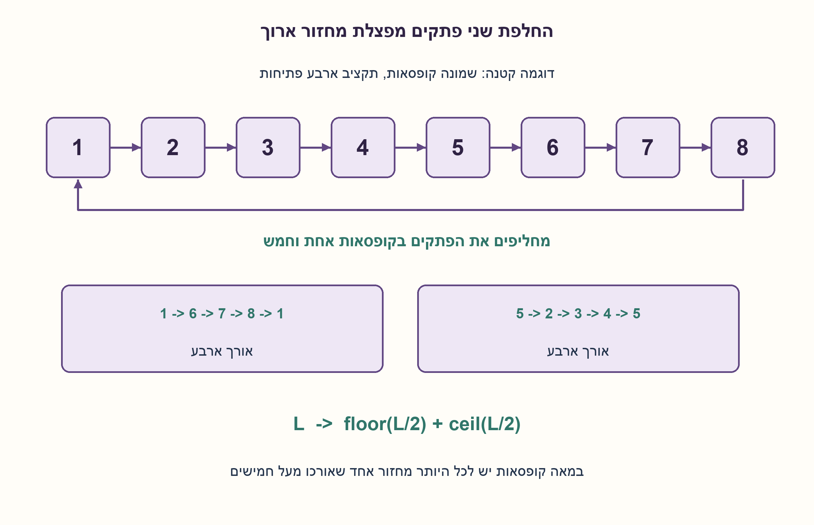
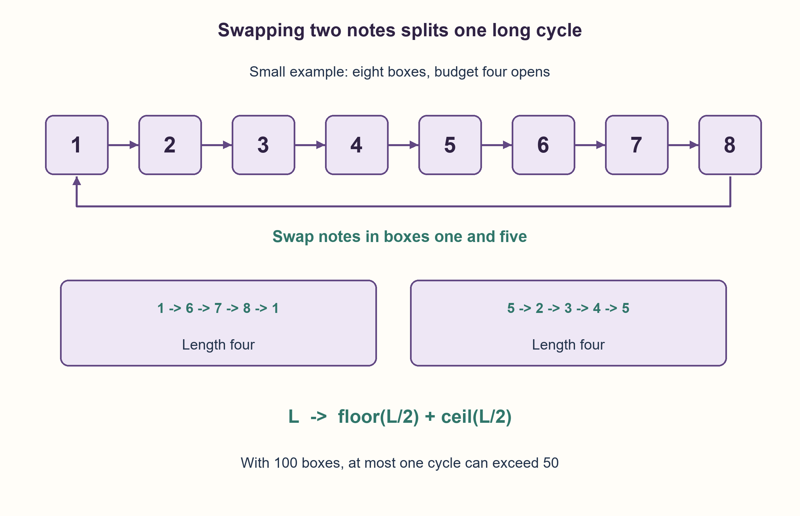

# PREP-195 — מאה קופסאות: החלפה אחת שמבטיחה חיפוש בחמישים

פתרון מוצע בסיוע AI; ביקורת מקצועית אנושית ממתינה. הקושי אינו מכויל.

[צילום מקור פרטי](../sources/2026-10-30-batch110-15.png)

ישנן מאה קופסאות ובתוכן מאה פתקים המסומנים במספרים 1–100 באופן אקראי. אדם נכנס ורואה את כל הפתקים בקופסאות ויכול לבחור לבצע החלפה אחת בין שני פתקים. לאחר מכן נכנס אדם אחר שעליו למצוא פתק עם מספר ספציפי בתוך 50 ניסיונות לכל היותר. כיצד ניתן לעשות זאת?

שיוכי חברות שדווחו בצילום ולא אומתו עצמאית: Google.

## עברית

100 קופסאות מכילות את הפתקים 1–100, כל מספר פעם אחת, בסידור אקראי. עוזר יכול לראות את התוכן של כולן ולבחור לבצע לכל היותר החלפה אחת בין שני פתקים. אחריו נכנס מחפש שצריך למצוא פתק שמספרו נתון לו, תוך פתיחת לכל היותר 50 קופסאות.

תכננו הסכמה מראש שמבטיחה הצלחה בכל סידור, אפילו אם העוזר אינו יודע מה יהיה מספר היעד. אין תקשורת נוספת אחרי פעולת העוזר.

הבהרות המודל: הקופסאות מסומנות בסימון קבוע וידוע 1–100; המספר שעל קופסה אינו תוכנה. הסידור הוא תמורה של 100 פתקים שונים. כל פתיחה חושפת פתק אחד ונחשבת ניסיון; המחפש רשאי להשתמש במספר שנמצא כדי לבחור את הפתיחה הבאה. לעוזר מותר גם לא להחליף. זו וריאציה עם עוזר שרואה הכול ומשנה את הסידור, ולא החידה הקלאסית ללא החלפה.

1. המספרים שעל הקופסאות ועל הפתקים יכולים ליצור מסלול: פותחים קופסה וממשיכים לקופסה שמספרה כתוב בפתק.
2. תמורה מתפרקת למחזורים. כמה מחזורים שאורכם גדול מ־50 יכולים להתקיים יחד במאה קופסאות?
3. אם יש מחזור ארוך יחיד, החלפת שני הפתקים בשתי נקודות מתאימות מפצלת אותו לשניים. בחרו מרחק של מחצית אורך המחזור.

### קודם הופכים חיפוש אקראי להליכה במחזור
נסמן ב־p(i) את הפתק שנמצא בקופסה i. זו תמורה, ולכן החצים `i -> p(i)` מתפרקים למחזורים נפרדים. כדי למצוא יעד t, המחפש פותח תחילה את קופסה t. אם נמצא שם t הוא מסיים. אחרת הוא פותח את הקופסה שמספרה כתוב בפתק, וממשיך כך.

אם המחזור של t הוא `t -> v1 -> ... -> vk -> t`, הפתק t נמצא בקופסה האחרונה לפני החזרה. לפיכך מוצאים אותו אחרי מספר פתיחות השווה בדיוק לאורך המחזור, כולל הפתיחה האחרונה. די להבטיח שכל המחזורים יהיו באורך לכל היותר 50.

### מה העוזר מתקן?
שני מחזורים שאורכם לפחות 51 היו דורשים לפחות 102 פתקים. לכן יש לכל היותר מחזור אחד ארוך מ־50. אם אין כזה, העוזר אינו משנה דבר.

אם יש מחזור ארוך באורך L, כאשר 51≤L≤100, נכתוב אותו לפי סדר החצים `v0,v1,...,v(L−1)`. בוחרים m=floor(L/2) ומחליפים את הפתקים בקופסאות v0 ו־vm. ההחלפה משנה רק שני חצים יוצאים. מתקבלים שני מחזורים באורכים m ו־L−m, כלומר floor(L/2) ו־ceil(L/2). שניהם לכל היותר 50. כל המחזורים האחרים לא השתנו והיו קצרים ממילא.

לדוגמה, במחזור `1 -> 2 -> ... -> 100 -> 1` מחליפים את הפתקים בקופסאות 1 ו־51. כלומר מחליפים את הפתק 2 בפתק 52, ולא את תוויות הקופסאות. מתקבלים שני מחזורים באורך 50. המחפש אינו צריך לדעת אם בוצעה החלפה או אילו קופסאות נבחרו; הוא תמיד מפעיל את אותו כלל הליכה.

זהו פתרון דטרמיניסטי שמצליח לכל יעד ולכל אחת מ־100! התמורות במודל. האקראיות בניסוח אינה דרושה להבטחה. בלי פעולת העוזר, מחזור של 100 הוא דוגמה נגדית להבטחה של 50, ולכן אין להחליף את התשובה בחישוב הסתברות מהחידה הקלאסית.

עבור n פתקים, העוזר סורק את המחזורים בזמן O(n) תוך שימוש ב־O(n) מקום במימוש המצורף, הכולל עותק וסימון ביקורים. המחפש מבצע לכל היותר 50 קריאות ומשתמש רק בממשק פתיחת קופסה, במספר הקופסה ובמונה: O(1) מילות עזר. הוא אינו סורק את התמורה כדי לאמת אותה. בדיקת המודל מונה את כל 46,233 התמורות בגדלים 1–8 ומשווה לכל יעד, ובודקת בנפרד כל אורך מחזור ארוך בין 51 ל־100.

```python
"""At most one helper swap guarantees every target within ceil(n/2) opens.

Box labels and note labels are 1..n; permutation[i-1] is the note in box i.
The helper does not need to know the later target. No message is sent afterward.
"""


def validate_permutation(permutation):
    n = len(permutation)
    seen = [False] * (n + 1)
    for note in permutation:
        if not isinstance(note, int) or not 1 <= note <= n or seen[note]:
            raise ValueError("Notes must be a permutation of labels 1..n")
        seen[note] = True


def prepare_boxes(permutation, limit=50):
    """Return a prepared copy and the swapped box labels, or None."""
    validate_permutation(permutation)
    n = len(permutation)
    if not isinstance(limit, int) or limit < 1 or n > 2 * limit:
        raise ValueError("This guarantee requires positive limit and n <= 2*limit")
    result = list(permutation)
    seen = [False] * (n + 1)
    for start in range(1, n + 1):
        if seen[start]:
            continue
        cycle = []
        current = start
        while not seen[current]:
            seen[current] = True
            cycle.append(current)
            current = result[current - 1]
        if len(cycle) > limit:
            # There can be at most one such cycle when n <= 2*limit.
            first, second = cycle[0], cycle[len(cycle) // 2]
            result[first - 1], result[second - 1] = result[second - 1], result[first - 1]
            return result, (first, second)
    return result, None


def find_target(read_note, target, limit=50, number_of_boxes=100):
    """Use only the query interface; return the number of boxes actually opened."""
    if target not in range(1, number_of_boxes + 1) or limit < 1:
        raise ValueError("Invalid target or query limit")
    box = target
    for count in range(1, limit + 1):
        note = read_note(box)
        if note == target:
            return count
        if note not in range(1, number_of_boxes + 1):
            raise ValueError("Query returned an invalid note label")
        box = note
    raise LookupError("Target was not found within the query limit")
```




## English

100 boxes contain notes 1–100, each exactly once, in a random arrangement. A helper may inspect every box and optionally swap the contents of one pair of boxes. A later searcher must find a specified note by opening at most 50 boxes.

Agree on a strategy beforehand that guarantees success for every arrangement, even if the helper does not know the later target. There is no further communication after the helper's action.

Explicit model: boxes have fixed agreed labels 1–100, distinct from their contents. The notes form a permutation. Opening one box reveals its one note and costs one attempt; that note can determine the next box. The helper may also leave the arrangement unchanged. This helper-and-swap variant differs from the classic puzzle without a helper.

1. Box labels and note labels define a path: after opening a box, continue to the box named by its note.
2. A permutation decomposes into cycles. How many cycles longer than 50 can coexist in 100 boxes?
3. If there is one long cycle, swapping the notes at two suitable positions splits it. Choose positions about half a cycle apart.

### Turn random search into a cycle walk
Let p(i) be the note inside box i. This is a permutation, so the arrows `i -> p(i)` decompose into disjoint cycles. To find target t, open box t first. Stop if it contains t; otherwise open the box named by the note and repeat.

If t's cycle is `t -> v1 -> ... -> vk -> t`, note t lies in the final box before the cycle returns. Thus the number of openings is exactly the cycle length, including the last opening. It suffices to ensure that every cycle has length at most 50.

### What does the helper repair?
Two cycles of length at least 51 would require at least 102 notes, so at most one cycle can exceed 50. If none does, the helper changes nothing.

Otherwise let the long cycle have length L, with 51≤L≤100, and list its vertices in arrow order as `v0,v1,...,v(L−1)`. Set m=floor(L/2) and swap the notes in boxes v0 and vm. Only their two outgoing arrows change. The original cycle splits into cycles of lengths m and L−m, namely floor(L/2) and ceil(L/2). Both are at most 50. Every other cycle remains unchanged and was already short enough.

For example, in `1 -> 2 -> ... -> 100 -> 1`, swap the notes in boxes 1 and 51. These are notes 2 and 52: box labels are not swapped. The result has two 50-cycles. The searcher need not know whether a swap occurred or which boxes it used; the same pointer-following rule always applies.

This deterministic strategy succeeds for every target in all 100! permutations under the stated model. Randomness is not needed for the guarantee. Without the helper, an untouched 100-cycle is a counterexample to guaranteed success within 50 opens; the classic no-swap puzzle's probability is not an answer to this variant.

For n notes the helper scans cycles in O(n) time using O(n) space in the supplied implementation, including its copy and visited set. The searcher makes at most 50 query calls and keeps only a box label and counter, using O(1) extra words. It never scans the permutation to validate it. Checks exhaust all 46,233 permutations at sizes 1..8 with every target and separately test every long-cycle length from 51 through 100.

```python
"""At most one helper swap guarantees every target within ceil(n/2) opens.

Box labels and note labels are 1..n; permutation[i-1] is the note in box i.
The helper does not need to know the later target. No message is sent afterward.
"""


def validate_permutation(permutation):
    n = len(permutation)
    seen = [False] * (n + 1)
    for note in permutation:
        if not isinstance(note, int) or not 1 <= note <= n or seen[note]:
            raise ValueError("Notes must be a permutation of labels 1..n")
        seen[note] = True


def prepare_boxes(permutation, limit=50):
    """Return a prepared copy and the swapped box labels, or None."""
    validate_permutation(permutation)
    n = len(permutation)
    if not isinstance(limit, int) or limit < 1 or n > 2 * limit:
        raise ValueError("This guarantee requires positive limit and n <= 2*limit")
    result = list(permutation)
    seen = [False] * (n + 1)
    for start in range(1, n + 1):
        if seen[start]:
            continue
        cycle = []
        current = start
        while not seen[current]:
            seen[current] = True
            cycle.append(current)
            current = result[current - 1]
        if len(cycle) > limit:
            # There can be at most one such cycle when n <= 2*limit.
            first, second = cycle[0], cycle[len(cycle) // 2]
            result[first - 1], result[second - 1] = result[second - 1], result[first - 1]
            return result, (first, second)
    return result, None


def find_target(read_note, target, limit=50, number_of_boxes=100):
    """Use only the query interface; return the number of boxes actually opened."""
    if target not in range(1, number_of_boxes + 1) or limit < 1:
        raise ValueError("Invalid target or query limit")
    box = target
    for count in range(1, limit + 1):
        note = read_note(box)
        if note == target:
            return count
        if note not in range(1, number_of_boxes + 1):
            raise ValueError("Query returned an invalid note label")
        box = note
    raise LookupError("Target was not found within the query limit")
```




## חומר משלים / Supporting material

```json
{
  "assumptions": {
    "he": [
      "קופסאות ופתקים מסומנים 1–100; הפתקים הם תמורה ללא חזרות.",
      "הסכמה מראש, עוזר שרואה הכול ומבצע לכל היותר החלפה אחת; אין מסר נוסף.",
      "המחפש רואה רק קופסאות שהוא פותח ויכול לעקוב אחרי המספר שנמצא."
    ],
    "en": [
      "Boxes and distinct notes are labeled 1..100, with notes forming a permutation.",
      "Prior agreement; helper inspects all notes and makes at most one swap, with no later message.",
      "The searcher sees only queried boxes and may follow each revealed label."
    ]
  },
  "optimality": {
    "he": "החלפה אחת מספיקה להבטחת 50 פתיחות לכל יעד, לפי פירוק מחזורים. העוזר O(n) זמן ומקום במימוש; המחפש O(k) קריאות ו־O(1) מילים, k≤50. אין טענת מינימום מקום לעוזר או חסם תחתון לכל אסטרטגיית חיפוש אפשרית.",
    "en": "One swap suffices for the 50-open guarantee by cycle splitting. Helper O(n) time/space in this implementation; searcher O(k) queries and O(1) words, k≤50. No minimum helper-space or universal search-optimality claim."
  },
  "verification": {
    "he": "נבדקו כל 46,233 התמורות בגדלים 1–8, לכל יעד, עם 1,042,153 קריאות ממשק אמיתיות במודל. נבדקו גם 50 אורכי מחזור ארוך עבור מאה קופסאות וכל מאה היעדים; מחזור 100 ללא החלפה נכשל כמצופה.",
    "en": "Checked all 46,233 permutations at sizes 1..8 for every target, recording 1,042,153 actual model query calls. Also covered 50 long-cycle lengths at 100 boxes with all 100 targets; an unswapped 100-cycle fails as expected."
  },
  "edge_cases": {
    "he": [
      "כל המחזורים כבר באורך עד 50: אין צורך בהחלפה.",
      "מחזור 51 מתפצל ל־25 ו־26; מחזור 100 לשני מחזורי 50.",
      "פתק t בקופסה t נמצא בפתיחה אחת.",
      "פתקים כפולים, קופסאות ללא תוויות או דרישה לבצע החלפה גם כשאין צורך הם חוזים אחרים."
    ],
    "en": [
      "All cycles already have length at most 50: make no swap.",
      "A 51-cycle splits into 25 and 26; a 100-cycle into 50 and 50.",
      "Note t in box t is found in one opening.",
      "Duplicate notes, unlabeled boxes or a compulsory swap even when unnecessary are different contracts."
    ]
  },
  "common_mistakes": {
    "he": [
      "להשתמש בהסתברות ההצלחה של חידת האסירים ללא עוזר במקום בהבטחה לאחר החלפה.",
      "להחליף תוויות קופסה במקום שני פתקים.",
      "לחבר שני מחזורים שונים; הפעולה הדרושה היא לפצל את המחזור הארוך היחיד.",
      "לאמת את כל התוכן מצד המחפש ובכך לחרוג מ־50 פתיחות."
    ],
    "en": [
      "Substituting the no-helper prisoner's success probability for the post-swap guarantee.",
      "Swapping box labels instead of two notes.",
      "Joining different cycles rather than splitting the sole long one.",
      "Letting the searcher inspect the entire permutation before its query loop."
    ]
  },
  "interview_answer": {
    "he": "נסכם על הליכה מהקופסה שמספרה הוא היעד אל הקופסה שמספרה נחשף. זמן החיפוש הוא אורך המחזור. יש לכל היותר מחזור אחד מעל 50, והעוזר מפצל אותו לשתי מחציות בהחלפת שני פתקים. אחר כך כל יעד נמצא בתוך 50 פתיחות, בלי שהעוזר יידע מהו.",
    "en": "Start at the target's box and follow the revealed labels. Search length equals cycle length. At most one cycle exceeds 50; the helper swaps two notes about halfway apart to split it into halves. Every target then takes at most 50 opens, without the helper knowing the target."
  },
  "source_ambiguities": {
    "he": [
      "סימון הקופסאות, ההסכמה מראש ו'לכל היותר החלפה אחת' נוספו בגלוי. ההבטחה החזקה לכל יעד אינה דורשת לדעת מהו היעד לפני ההחלפה."
    ],
    "en": [
      "Box labels, prior agreement and at-most-one swap are explicit clarifications. The stronger guarantee for every target does not require the helper to know the target beforehand."
    ]
  },
  "solution_extensions": {
    "he": [
      {
        "question": "לאילו n ומגבלת פתיחות k אותה בנייה מבטיחה הצלחה?",
        "answer_direction": "כאשר n≤2k יש לכל היותר מחזור אחד ארוך מ־k, והוא מתפצל לשניים באורך עד k. זו הבטחת הבנייה, לא הוכחת הכרח לכל שיטה אפשרית.",
        "principle": "מפרידים תנאי מספיק לבנייה מטענת חסם אוניברסלי."
      }
    ],
    "en": [
      {
        "question": "For which n and query budget k does this construction guarantee success?",
        "answer_direction": "When n≤2k, at most one cycle exceeds k and it can be split into two cycles of length at most k. This is a sufficient condition for the construction, not a universal impossibility theorem.",
        "principle": "Separate a construction's sufficient condition from a universal lower bound."
      }
    ]
  }
}
```
