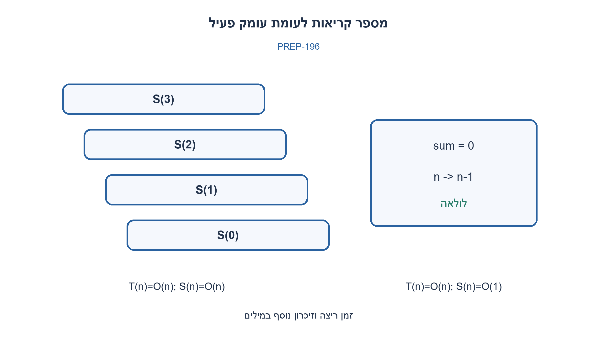
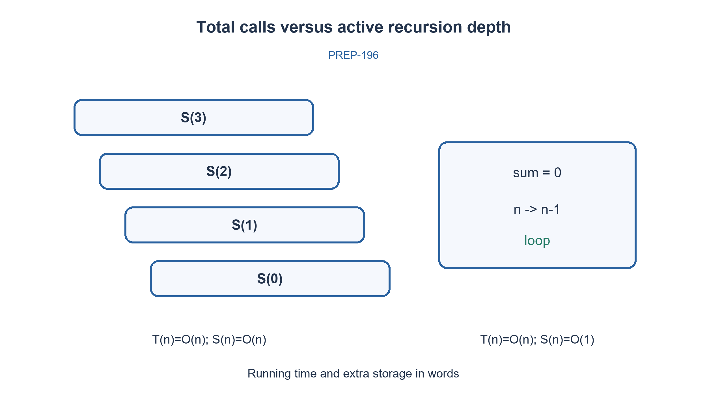

# PREP-196 — מתי רקורסיה עוזרת ומה המחיר שלה?

פתרון מוצע בסיוע AI; ביקורת מקצועית אנושית ממתינה. הקושי אינו מכויל.

[צילום מקור פרטי](../sources/2026-10-30-batch110-16.png)

מה היתרונות ומה החסרונות בשימוש ברקורסיה?

## עברית

הסבירו את היתרונות והחסרונות של רקורסיה. התייחסו לקריאות הקוד, הוכחת נכונות, זמן, עומק מחסנית ומקרי עצירה. הציגו חישוב רקורסיבי ואיטרטיבי מקבילים והסבירו מדוע עצם השימוש ברקורסיה אינו קובע שהזמן אקספוננציאלי.

הדוגמה היא סכום 1..n עבור n אי שלילי ב־Python. אין להניח אופטימיזציית רקורסיית זנב או מגבלת עומק מספרית קבועה לכל סביבה.

1. באילו מבנים הבעיה הקטנה דומה באופן טבעי לבעיה הגדולה?
2. הפרידו בין מספר הקריאות הכולל לבין מספר הקריאות הפעילות באותו זמן.
3. הסכום n+sum(n−1) יוצר שרשרת אחת: זמן ליניארי ומחסנית ליניארית. פיבונאצ׳י נאיבי יוצר חישובים חוזרים, וזו בעיה אחרת.

### רקורסיה היא דרך לתאר את פירוק הבעיה
עץ, חלוקה וכיבוש ו־backtracking לעיתים נכתבים באופן הקרוב להגדרה המתמטית: מגדירים בסיס, פותרים בעיות קטנות ומשלבים. כך אפשר להוכיח נכונות באינדוקציה. הקוד עשוי להיות קצר ומקומי יותר מהנהלה ידנית של מחסנית. אלה יתרונות תלויי בעיה, ולא הבטחה שרקורסיה תמיד קריאה יותר.

כל קריאה יכולה לשמור פרמטרים, משתנים וכתובת חזרה. העלות הנוספת נקבעת לפי עומק הקריאות הפעילות, לא רק גודל הקלט או מספר הקריאות הכולל. עצירה נכונה מחייבת בסיס וקטינה של מדד לכיוונו; בסיס לבדו אינו מספיק אם לא מגיעים אליו. קלט עמוק עלול להגיע למגבלת מחסנית, ויש עלות של קריאות פונקציה. ב־Python אין להסתמך על ביטול קריאת זנב.

בדוגמת הסכום, S(0)=0 ו־S(n)=n+S(n−1). כל רמה עושה עבודה קבועה במודל פעולות מספרים ביחידה: Θ(n) זמן ו־Θ(n) מסגרות מחסנית. לולאה שומרת סכום ומשתנה מונה, ולכן Θ(n) זמן ו־O(1) מילות עזר. בניתוח ביטים המספרים גדלים ועלות החיבור אינה קבועה; הניתוח הנ״ל הוא מודל מילים. נוסחת n(n+1)/2 היא חלופה טובה יותר לדוגמה המסוימת, אך אינה מחליפה אלגוריתם כללי לעצים.

לעומת זאת פיבונאצ׳י נאיבי קורא שוב ושוב לאותם מצבים, ולכן זמןו אקספוננציאלי ועומקו ליניארי. memoization מצמצם עבודה חוזרת במחיר זיכרון. merge sort רקורסיבי הוא O(n log n), ולכן “רקורסיה=אקספוננציאלי” אינה כלל. החלפה בלולאה מתאימה לשרשרת פשוטה; ב־DFS או backtracking אפשר להשתמש במחסנית מפורשת, אבל המידע על המסלול עדיין דרוש ולא נעלם.

שני מימושי הסכום נבדקו ב־300 קלטים קטנים מול הנוסחה העצמאית. אין זו בדיקת כל עומק אפשרי או הבטחה שהגרסה הרקורסיבית מתאימה ל־n גדול. בראיון כדאי לבחור לפי צורת הבעיה, עומק צפוי, מגבלות השפה וקריאות, ואז לנתח זמן ומקום בנפרד.

```python
"""Same triangular sum, recursive versus iterative; nonnegative n only."""

def recursive_sum(n):
    if type(n) is not int or n < 0:
        raise ValueError('Nonnegative integer required')
    if n == 0:
        return 0
    return n + recursive_sum(n-1)

def iterative_sum(n):
    if type(n) is not int or n < 0:
        raise ValueError('Nonnegative integer required')
    result = 0
    while n:
        result += n
        n -= 1
    return result
```




## English

Explain recursion advantages and drawbacks: readability, correctness arguments, running time, stack depth and base cases. Give equivalent recursive and iterative examples and explain why recursion alone does not imply exponential time.

Use summation 1..n for nonnegative n in Python. Do not assume tail-call optimization or one fixed recursion-depth limit across environments.

1. Which structures naturally contain smaller instances of the same problem?
2. Distinguish total calls from simultaneously active calls.
3. n+sum(n−1) creates one chain: linear time and linear stack. Naive Fibonacci repeats subproblems, which is a different issue.

### Recursion describes how the problem decomposes
Trees, divide-and-conquer and backtracking often map directly to a recursive definition: establish a base case, solve smaller instances and combine. This supports induction proofs and can be clearer than manually managing a stack. Readability depends on the problem; recursion is not automatically clearer.

Each call can retain parameters, locals and a return address. Extra storage depends on simultaneously active depth, not simply input length or total calls. Correct termination requires a base case and a decreasing measure that actually reaches it. Deep inputs can hit stack limits, and function calls add overhead. Do not rely on tail-call elimination in Python.

For summation, S(0)=0 and S(n)=n+S(n−1). Each level does constant work in a unit-cost arithmetic model, so time is Θ(n) and stack depth Θ(n). A loop keeps a sum and counter: Θ(n) time and O(1) auxiliary words. In bit complexity, growing integer additions are not constant; the stated analysis is a word model. n(n+1)/2 is a better alternative for this particular example, but does not replace general tree algorithms.

Naive Fibonacci repeats the same states, yielding exponential work with linear active depth. Memoization avoids repeated work at a storage cost. Recursive merge sort is O(n log n), disproving “recursion means exponential.” A simple chain can become a loop; DFS/backtracking can use an explicit stack, but required path information does not disappear.

Both summation implementations passed 300 small inputs against the independent closed form. This is not a test of arbitrary depths or a guarantee that large n is safe recursively. Choose based on problem structure, expected depth, language constraints and clarity; analyze time and space separately.

```python
"""Same triangular sum, recursive versus iterative; nonnegative n only."""

def recursive_sum(n):
    if type(n) is not int or n < 0:
        raise ValueError('Nonnegative integer required')
    if n == 0:
        return 0
    return n + recursive_sum(n-1)

def iterative_sum(n):
    if type(n) is not int or n < 0:
        raise ValueError('Nonnegative integer required')
    result = 0
    while n:
        result += n
        n -= 1
    return result
```




## חומר משלים / Supporting material

```json
{
  "assumptions": {
    "he": [
      "דוגמת Python עם n≥0; חישוב סופי; ניתוח מילים מצוין בנפרד מעלות ביטים."
    ],
    "en": [
      "Python example with n≥0, finite computation; word-model analysis is distinguished from bit cost."
    ]
  },
  "optimality": {
    "he": "לסכום: שתי הגרסאות Θ(n) זמן; מחסנית רקורסיבית Θ(n), לולאה O(1) מילות עזר.",
    "en": "For summation both versions take Θ(n) time; recursive stack Θ(n), loop O(1) auxiliary words."
  },
  "verification": {
    "he": "300 קלטים מול n(n+1)/2. לא נטענת בטיחות מחסנית לעומק לא חסום.",
    "en": "300 inputs versus n(n+1)/2; no unbounded-depth stack-safety claim."
  },
  "edge_cases": {
    "he": [
      "n=0; שלילי נדחה; עומק גדול; תתי־בעיות חוזרות; עצים לא מאוזנים."
    ],
    "en": [
      "n=0; negative input rejected; large depth; repeated subproblems; unbalanced trees."
    ]
  },
  "common_mistakes": {
    "he": [
      "מבלבלים בין מספר קריאות לעומק פעיל.",
      "המרה ללולאה אינה מבטיחה שמידע DFS ייעלם.",
      "אין להבטיח tail-call optimization בכל שפה."
    ],
    "en": [
      "Confusing total calls with active depth.",
      "Converting to iteration does not remove required DFS state.",
      "Never assume universal tail-call optimization."
    ]
  },
  "interview_answer": {
    "he": "רקורסיה מתאימה למבנה רקורסיבי ומקלה על הוכחה. משלמים על קריאות ועומק, וחייבים בסיס והתקדמות; זמן לא נובע מרקורסיה לבדה.",
    "en": "Recursion fits recursive structure and induction. Calls/depth cost resources; base cases and progress are required, while time does not follow from recursion alone."
  },
  "source_ambiguities": {
    "he": [
      "המקור אינו דורש שפה או דוגמה; בחירת הסכום מדגימה את ההשוואה בלבד."
    ],
    "en": [
      "The source specifies no language or example; summation is an explicit illustration only."
    ]
  },
  "solution_extensions": {
    "he": {
      "question": "איך memoization משנה פיבונאצ׳י נאיבי?",
      "direction": "מחשבים כל אינדקס פעם אחת: O(n) חיבורים ו־O(n) זיכרון במודל מילים; איטרציה יכולה להחזיק שני ערכים.",
      "integration": "מוכן בתוכן; לא מחובר לתור."
    },
    "en": {
      "question": "How does memoization change naive Fibonacci?",
      "direction": "Each index is computed once: O(n) additions and O(n) storage in the word model; iteration can retain two values.",
      "integration": "Prepared in content; not connected to the queue."
    }
  },
  "technical_references": {
    "he": [
      {
        "title": "תיעוד Python — מגבלת רקורסיה",
        "url": "https://docs.python.org/3/library/sys.html#sys.getrecursionlimit"
      }
    ],
    "en": [
      {
        "title": "Python documentation — recursion limit",
        "url": "https://docs.python.org/3/library/sys.html#sys.getrecursionlimit"
      }
    ]
  }
}
```
