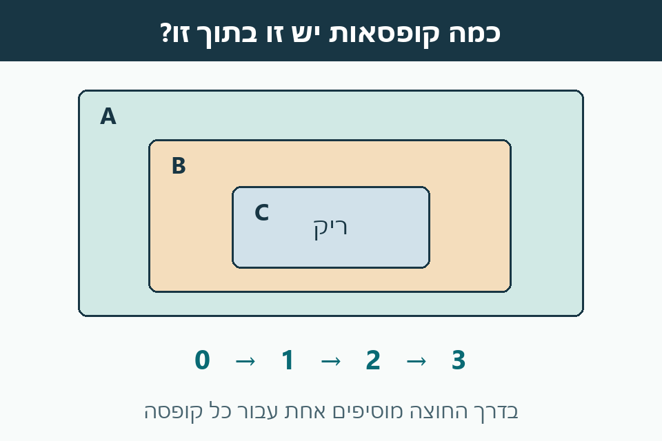
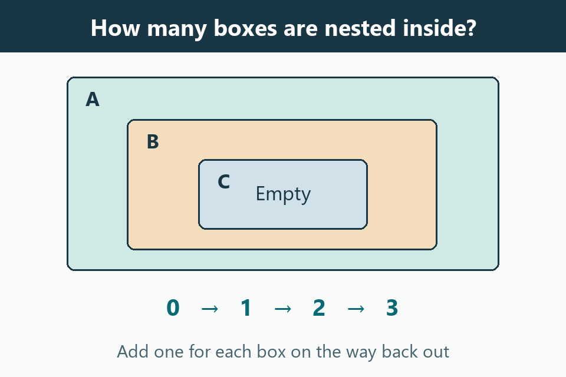

# PREP-196 — איך מסבירים רקורסיה לילד?

[צילום מקור פרטי](../sources/2026-11-18-batch21-07.png)

### הרחבה: איך מסבירים רקורסיה לילד?

ילדה פותחת קופסה ובתוכה יכולה להיות קופסה קטנה יותר. כיצד תסבירו לה איך לספור את הקופסאות, בלי להניח שהיא מכירה פונקציות? הסבירו מתי עוצרים ואיך חוזרת התשובה אם יש שלוש קופסאות.

### רמזים

1. בחרו משימה אחת שהילדה יכולה לבקש ממישהו אחר לבצע על הקופסה הפנימית.
2. אם אין עוד קופסה, כמה נשאר לספור?
3. כל ילדה סופרת את הקופסה שבידה ומוסיפה את התשובה שקיבלה מבפנים.

### פתרון להרחבה: איך מסבירים רקורסיה לילד?

אפשר לומר לה: ״אם אין לפניי קופסה, אספר אפס. אם יש, אספור אחת ואבקש ממך להשתמש באותו הכלל על מה שבפנים. כשתחזרי עם מספר, אוסיף לו אחת״. בשלוש קופסאות זו בתוך זו מגיעים בסוף למקום ריק. התשובות חוזרות בסדר 0, אחר כך 1, אחר כך 2 ולבסוף 3. כל בקשה עוסקת בקופסה אחת פחות, ולכן בסוף מגיעים למקום הריק. במחשב כל קריאה ממתינה לתשובה הפנימית ושומרת את עבודתה עד אז.

```python
def count_boxes(box):
    """Each nonempty box holds one smaller box. None means no box."""
    if box is None:
        return 0
    return 1 + count_boxes(box["inside"])
```



יש מספר סופי של קופסאות, וכל קופסה מכילה לכל היותר קופסה אחת.

קופסה ריקה מבפנים עדיין נספרת כאחת. כשאין קופסה כלל, התוצאה היא אפס.

הוראה ״תעשי שוב״ לבדה אינה מסבירה מה מצטמצם, איפה עוצרים וכיצד משתמשים בתשובה שחוזרת.

נבדקה ספירה של שרשראות מקוננות באורכים 0 עד 99.

סופרים אחת ומבקשים אותה משימה על מה שבפנים. מקום ריק מחזיר אפס.

### Follow-up: How would you explain recursion to a child?

A child opens a box that may contain one smaller box. Explain how to count the boxes without assuming the child knows what a function is. Say when to stop and how the answer comes back for three nested boxes.

### Hints

1. Give the child one job they can pass to someone looking at the inner box.
2. How many boxes remain when there is no box?
3. Each child counts their own box and adds the answer from inside.

### Follow-up solution: How would you explain recursion to a child?

Try saying, “If I see no box, I say zero. If I see a box, I count one and ask you to follow the same rule with what is inside it. When you come back with a number, I add one.” Three nested boxes lead to an empty space. The answers come back as 0, then 1, then 2, then 3. Every request has one fewer box to inspect, so eventually someone reaches the empty space. On a computer each call waits for the inner answer, remembering what remains to do.

```python
def count_boxes(box):
    """Each nonempty box holds one smaller box. None means no box."""
    if box is None:
        return 0
    return 1 + count_boxes(box["inside"])
```



There are finitely many boxes, each containing at most one smaller box.

An empty box counts as one. No box at all counts as zero.

Saying “do it again” leaves out the smaller input, the stopping condition and the return step.

Verified nested chains of every length from 0 to 99.

Count one and ask the same question of the inside. Empty space answers zero.

[solutions/prep_196_recursion_nesting_boxes.py](../solutions/prep_196_recursion_nesting_boxes.py)

[checks/prep-196-1118b-verification.json](../checks/prep-196-1118b-verification.json)
