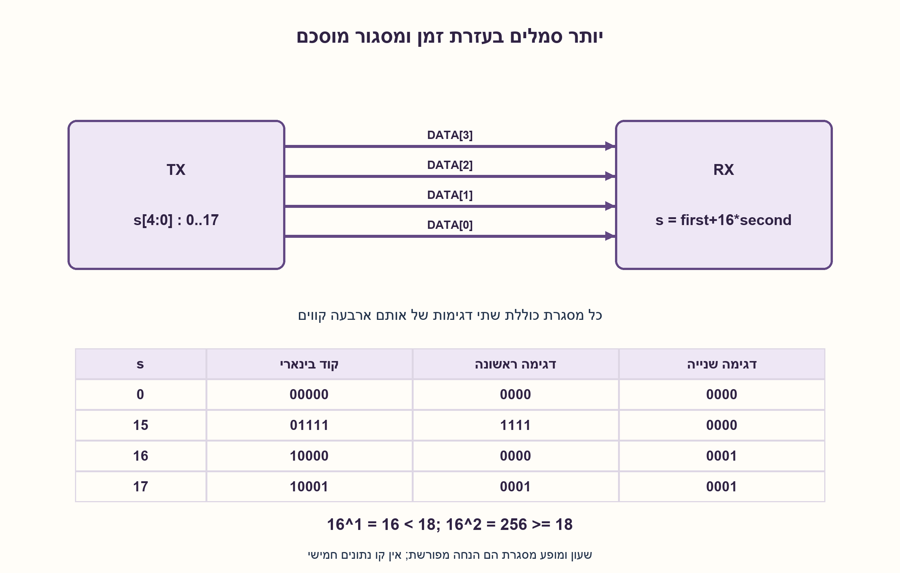
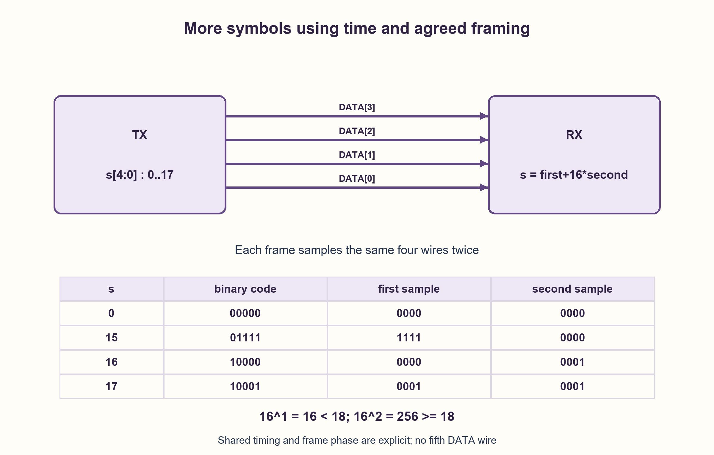

# PREP-197 — ארבעה קווי DATA: העברת 16 או 18 סמלים

פתרון מוצע בסיוע AI; ביקורת מקצועית אנושית ממתינה. הקושי אינו מכויל.

[צילום מקור פרטי](../sources/2026-10-30-batch110-17.png)

יש 2 קופסאות המחוברות בארבעה קווי DATA. א. כיצד ניתן להעביר 16 סימבולים בין הקופסאות? ב. כיצד ניתן להעביר 18 סימבולים בין הקופסאות?

חברות לפי הדיווח בצילום בלבד: Samsung.

## עברית

שתי קופסאות מחוברות בארבעה קווי DATA. א. כיצד אפשר להעביר ביניהן 16 סמלים שונים? ב. כיצד אפשר להעביר 18 סמלים שונים? ציינו מהו קידוד, מה נחשב שימוש אחד בקווים ומה נדרש מבחינת תזמון.

הבהרת עריכה: כל קו בינארי, וכל דגימה משותפת של ארבעת הקווים היא העברה אחת. עבור 16 סמלים די בהעברה אחת. עבור 18 סמלים נבחן תחילה את אי־האפשרות בהעברה אחת, ואחר כך נתיר שתי העברות לסמל. בשתי ההעברות נניח שעון ומופע מסגרת משותפים שכבר סוכמו; אין הוספה סמויה של קו DATA חמישי. המקור אינו מציין אם תזמון כזה זמין.

1. כמה תבניות שונות יכולים ארבעה קווים בינאריים להציג באותו רגע?
2. סמל הוא מידע, ולא חוט. האם חייבים לשלוח את כל הקוד שלו באותה דגימה?
3. מספרו 18 סמלים מ־0 עד 17 בחמש סיביות. שלחו את ארבע הסיביות הנמוכות בדגימה הראשונה ואת הסיבית שנותרה בדגימה השנייה, עם מסגור מוסכם.

### רוחב קווים ומספר שימושים הם משאבים שונים
בארבעה קווים בינאריים יש 2^4=16 תבניות. עבור 16 סמלים, ממספרים s=0..15 ושולחים את ארבע סיביות הקוד יחד. המקלט קורא את אותו מספר. אין צורך בחוט נפרד לכל סמל.

עבור 18 סמלים בהעברה אחת, 18 קודים נדרשים אבל יש רק 16 תבניות. לפי עקרון שובך היונים שני סמלים יקבלו אותה תבנית, ולכן אי אפשר לפענח אותם בוודאות. דרושות לפחות ceil(log2(18))=5 סיביות מידע. אם דורשים העברה יחידה ובינארית, צריך לפחות חמישה קווי נתונים; אם משאירים ארבעה קווים, צריך לשנות את חוזה השימוש בזמן.

### פתרון פשוט בשתי העברות קבועות
נבחר קודים 0..17. בכל מסגרת בת שתי דגימות שולחים תחילה first=s&15, ואחר כך second=s>>4 על ארבעת הקווים, כאשר שלוש הסיביות הגבוהות בדגימה השנייה הן אפס. המקלט משחזר s=first+16·second ומקבל רק s<18. לדוגמה סמל 17, שקודו 10001, נשלח כ־0001 ואחריו 0001; סמל 15 נשלח כ־1111 ואחריו 0000. כל 18 המסגרות שונות: שארית בחלוקה ל־16 ומנה בחלוקה ל־16 קובעות יחד את s באופן יחיד.

שתי דגימות מציעות 16^2=256 מסגרות אפשריות; רק 18 משויכות לסמלים והיתר מסומנות כלא תקינות. זהו קידוד קבוע ופשוט, לא טענה לניצול רוחב פס מרבי. הקצב הוא סמל אחד לכל שתי העברות. במודל של מספר העברות קבוע לסמל, שתיים הן המינימום עם ארבעה קווים, משום שאחת אינה מספיקה.

המקלט חייב לדעת מתי לדגום ואיזו דגימה היא הראשונה. שעון משותף ומופע מסגרת מאותחל הם הנחה נוספת; הם יכולים להיות ידועים מראש ואין פירושם קו DATA חמישי. אם אין שום תזמון, שיתוף פאזה או מסגור, הקידוד לבדו אינו פותר את בעיית הסנכרון. שימוש ברמות מתח נוספות או בקידוד עצמי בזמן הוא חוזה פיזי אחר שצריך להגדיר במפורש.

### מודל לוגי בפייתון שהורץ

```python
"""Four binary DATA lines: one-use alphabet and framed two-use extension."""


def encode16(symbol: int) -> int:
    if not 0 <= symbol < 16:
        raise ValueError("one four-bit transfer encodes only symbols 0..15")
    return symbol


def encode18(symbol: int) -> tuple[int, int]:
    if not 0 <= symbol < 18:
        raise ValueError("symbol must lie in 0..17")
    return symbol & 15, symbol >> 4


def decode18(first: int, second: int) -> int:
    if not 0 <= first < 16 or not 0 <= second < 16:
        raise ValueError("each transfer has exactly four binary DATA bits")
    symbol = first | (second << 4)
    if symbol >= 18:
        raise ValueError("unassigned two-transfer word")
    return symbol
```




### assumptions

```json
[
  "ארבעה קווים בינאריים חד־כיווניים, ללא רעש, ושולח ומקלט מסכימים על מיפוי הסמלים.",
  "בפתרון 18 הסמלים יש שתי דגימות למסגרת עם התחלה ידועה. לא מניחים קו תקפות או קו נתונים נוסף."
]
```

### optimality

העברה יחידה מכילה לכל היותר 16 סמלים שונים. עבור 18 סמלים שתי העברות הן מינימליות תחת מסגרת באורך קבוע וארבעה קווים בינאריים; אין טענת אופטימליות בקידוד באורך משתנה או בניצול ספקטרום.

### verification

נבדקה חד־חד־ערכיות של 16 קודי העברה אחת ושל 18 מסגרות, וכן כל 256 המסגרות האפשריות בשתי העברות: 18 מתקבלות ו־238 נדחות. זהו אימות קודק דיגיטלי, לא בדיקת קישור פיזי.

### edge_cases

```json
[
  "סמלים 0,15,16,17 מדגימים גבולות בין המנות.",
  "איבוד מופע מסגרת עלול להפוך מידע חוקי לשגוי או להפך.",
  "קוד לא משויך מזוהה, אך לא כל שגיאת סיבית מביאה לקוד לא משויך."
]
```

### common_mistakes

```json
[
  "להניח שארבעה חוטים פירושם ארבעה סמלים בלבד.",
  "לנסות למפות 18 סמלים ל־16 תבניות באותה דגימה.",
  "להוסיף זמן, שעון, רמות מתח או חוט בלי להצהיר על כך."
]
```

### interview_answer

ארבעה קווים בינאריים נותנים 16 תבניות, ולכן 16 סמלים עוברים בדגימה אחת. 18 לא יכולים לעבור כך. אם מותרות שתי דגימות עם מסגור מוסכם, אשלח קוד בן חמש סיביות בשני חלקים על אותם קווים.

### source_ambiguities

הצילום אינו מגביל את מספר הדגימות או קובע שעון, כיוון, מסגור ורמות חשמליות. נפרדים במפורש אי־האפשרות בדגימה בינארית אחת והפתרון המותנה בשתי דגימות. התג 2312313 נשמר כמקור בלבד, ללא משמעות חברה או מיומנות.

### solution_extensions

```json
[
  {
    "question": "איך לשפר את הקצב הממוצע כאשר רוב הסמלים הם מ־0 עד 14?",
    "answer_direction": "אפשר לשמור 1111 כתו בריחה ולשלוח אחריו קוד משלים עבור הסמלים הנותרים, אך צריך לקבוע מסגור חד־משמעי וקצב ממוצע לפי הסתברויות.",
    "principle": "קידוד באורך משתנה דורש חוזה פענוח וניתוח התפלגות."
  }
]
```

## English

Two boxes are connected by four DATA wires. (a) How can sixteen distinct symbols be transmitted? (b) How can eighteen distinct symbols be transmitted? State the encoding, what constitutes one use of the wires, and the timing requirements.

Editorial contract: each wire is binary, and a simultaneous sample of all four wires is one transfer. Sixteen symbols fit in one transfer. For eighteen, first explain impossibility in one transfer, then allow two transfers per symbol. The two-transfer construction assumes an agreed sampling clock and frame phase; it does not silently add a fifth DATA wire. The source does not say whether such timing is available.

1. How many distinct simultaneous patterns can four binary wires carry?
2. A symbol is information rather than a physical wire. Must its complete code be sent in one sample?
3. Number eighteen symbols from zero through seventeen using five bits. Send the lower four bits in the first transfer and the remaining bit in the next, with an agreed frame boundary.

### Wire count and number of uses are different resources
Four binary wires provide 2^4=16 patterns. For sixteen symbols, label them s=0..15 and transmit their four-bit codes simultaneously. The receiver reads the same number. One wire per symbol is unnecessary.

For eighteen symbols in one transfer, eighteen codes are required but only sixteen patterns exist. By the pigeonhole principle, two symbols would share a pattern, preventing certain decoding. At least ceil(log2(18))=5 information bits are required. A single binary transfer therefore needs at least five DATA wires. Keeping four wires requires changing the time-use contract.

### A simple fixed two-transfer solution
Assign codes 0..17. Each two-sample frame sends first=s&15, followed by second=s>>4 on the same four wires; the upper three bits of the second sample are zero. Decode s=first+16·second and accept only s<18. For example, symbol seventeen has code 10001 and sends 0001 followed by 0001. Symbol fifteen sends 1111 followed by 0000. All eighteen frames are distinct because quotient and remainder on division by sixteen uniquely determine s.

Two samples provide 16^2=256 possible frames; eighteen are assigned and the others are invalid. This is a simple fixed encoding, not a maximum bandwidth-efficiency claim. Its rate is one symbol per two transfers. Two is the minimum fixed number of transfers per symbol with four binary wires, because one cannot suffice.

The receiver must know when to sample and which sample begins a frame. A shared clock and initialized frame phase are extra assumptions; these may already be agreed and do not imply a fifth DATA wire. Without any timing, phase agreement or framing, the encoding alone does not solve synchronization. Additional voltage levels or self-timed coding would define a different physical contract that must be stated explicitly.

### Executed Python logical model

```python
"""Four binary DATA lines: one-use alphabet and framed two-use extension."""


def encode16(symbol: int) -> int:
    if not 0 <= symbol < 16:
        raise ValueError("one four-bit transfer encodes only symbols 0..15")
    return symbol


def encode18(symbol: int) -> tuple[int, int]:
    if not 0 <= symbol < 18:
        raise ValueError("symbol must lie in 0..17")
    return symbol & 15, symbol >> 4


def decode18(first: int, second: int) -> int:
    if not 0 <= first < 16 or not 0 <= second < 16:
        raise ValueError("each transfer has exactly four binary DATA bits")
    symbol = first | (second << 4)
    if symbol >= 18:
        raise ValueError("unassigned two-transfer word")
    return symbol
```




### assumptions

```json
[
  "Four noiseless, unidirectional binary DATA wires with an agreed symbol mapping.",
  "The eighteen-symbol construction uses two samples per frame with a known beginning. No extra valid or DATA wire is assumed."
]
```

### optimality

One transfer represents at most sixteen distinct symbols. Two transfers are minimal for eighteen symbols under fixed-length framing over four binary wires. No variable-length coding or spectral-efficiency optimum is claimed.

### verification

Uniqueness was checked for sixteen one-transfer codes and eighteen frames. All 256 two-transfer words were checked: eighteen accepted and 238 rejected. This verifies a digital codec, not a physical link.

### edge_cases

```json
[
  "Symbols zero, fifteen, sixteen and seventeen exercise quotient boundaries.",
  "Losing frame phase can turn valid data into another value or an invalid word.",
  "Unassigned codes can be rejected, but not every bit error produces an unassigned code."
]
```

### common_mistakes

```json
[
  "Confusing four wires with an alphabet of only four symbols.",
  "Mapping eighteen symbols to sixteen patterns in one sample.",
  "Adding time slots, a clock, voltage levels or a wire without declaring the change."
]
```

### interview_answer

Four binary wires give sixteen patterns, so sixteen symbols fit in one sample; eighteen cannot. If two samples with agreed framing are permitted, send a five-bit code in two parts over the same wires.

### source_ambiguities

The source does not specify sample count, clock, direction, framing or electrical levels. The single-binary-sample impossibility and conditional two-sample construction are kept separate. Source tag 2312313 is retained as provenance without inventing a company or skill meaning.

### solution_extensions

```json
[
  {
    "question": "How could average rate improve if most symbols lie between zero and fourteen?",
    "answer_direction": "Reserve 1111 as an escape and send an additional code for the remaining symbols, with unambiguous framing and an average-rate analysis based on probabilities.",
    "principle": "Variable-length encoding needs a decoding contract and a distribution model."
  }
]
```
