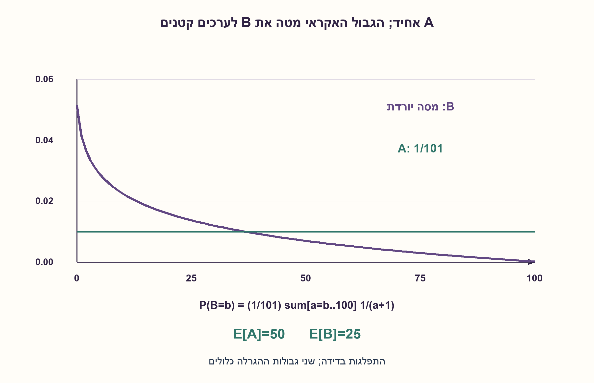
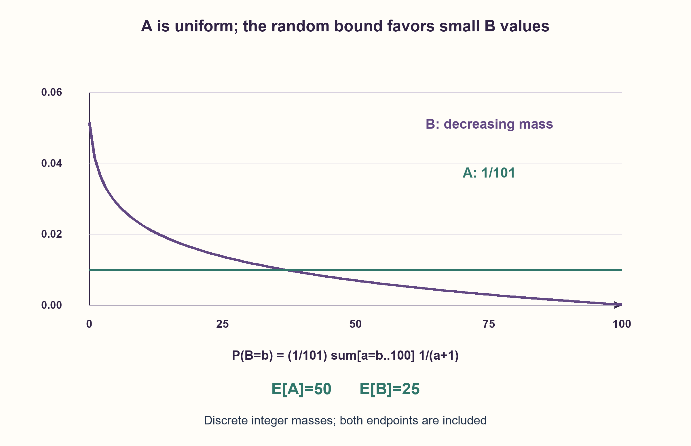

# PREP-198 — הגרלה אחידה בתוך גבול אקראי

פתרון מוצע בסיוע AI; ביקורת מקצועית אנושית ממתינה. הקושי אינו מכויל.

[צילום מקור פרטי](../sources/2026-10-30-batch110-18.png)

נתונים שני משתנים ופונקציית Rand המגרילה מספרים שלמים בצורה אחידה בין הארגומנט הראשון לארגומנט השני. A=rand(0,100); B=rand(0,A). איך תיראה ההתפלגות של A ושל B?

שיוכי חברות שדווחו בצילום ולא אומתו עצמאית: Samsung.

## עברית

הפונקציה rand(lo,hi) מחזירה מספר שלם אחיד בין שני הגבולות, כולל שניהם. מבצעים:

```text
A = rand(0,100)
B = rand(0,A)
```

תארו את ההתפלגות של A ושל B, הסבירו אם B אחיד, וכתבו נוסחה מדויקת להסתברות של כל ערך אפשרי. לצורך בדיקת הבנה אפשר לחשב גם את התוחלות.

ההגרלה השנייה אחידה מותנה בערך A שהתקבל; בפרט rand(0,0) מחזירה 0. A ו־B אינם מוכרזים כבלתי תלויים. זו התפלגות בדידה, לא בחירה רציפה במקטע.

1. הערך B=100 אפשרי רק כש־A=100, אבל B=0 יכול להתקבל עבור כל ערך של A.
2. התנו על A=a: מה ההסתברות לקבל אז B=b, וכאשר אילו a היא אפס?
3. חברו עבור a=b,...,100 את ההסתברויות 1/101 כפול 1/(a+1). לתוחלת אפשר להשתמש ב־E[B|A=a]=a/2.

### A אחיד; B אינו אחיד
לכל a בין 0 ל־100 מתקיים P(A=a)=1/101. לאחר בחירת a, ההגרלה השנייה בוחרת בין a+1 ערכים, ולכן:

```text
P(B=b | A=a) = 1/(a+1)  if 0<=b<=a
P(A=a, B=b) = 1/[101(a+1)]  if 0<=b<=a<=100
P(B=b) = (1/101) * sum_{a=b}^{100} 1/(a+1),  b=0,...,100
```

מחוץ לתחומים ההסתברות היא אפס. סכום ההסתברויות של B שווה 1: כאשר מחליפים את סדר החיבור, כל a תורם a+1 ערכים שכל אחד מהם שווה 1/[101(a+1)], כלומר 1/101 בסך הכול.

הערכים הקטנים נפוצים יותר כי הם יכולים להתקבל תחת יותר גבולות A. זו גם ירידה חדה מבחינה מדויקת: ההפרש בין P(B=b) לבין P(B=b+1) הוא 1/[101(b+1)] וחיובי לכל b<100. לכן ההתפלגות יורדת ממש. בפרט:

```text
P(B=0) = H_101/101 ≈ 0.0514582
P(B=100) = 1/101^2 = 1/10201 ≈ 0.0000980296
```

H_101 הוא רק קיצור לסכום 1+1/2+...+1/101. אין צורך להכיר שם זה כדי לפתור. גם A ו־B אינם בלתי תלויים: למשל P(B=100 | A=0)=0, בעוד ההסתברות הלא־מותנית ל־B=100 חיובית.

### התוחלת ממחישה את ההבדל
E[A]=50. כאשר A=a, הממוצע של המספרים 0..a הוא a/2. לכן E[B]=E[A/2]=25, ולא 50. זהו ממוצע משוקלל של התפלגויות אחידות שונות, שאינו חייב להיות אחיד בעצמו.

המימוש מחשב את המסות של B בסריקה לאחור: מוסיפים בכל צעד 1/[101(b+1)] לסכום שכבר מייצג את הערכים הגדולים יותר של A. עבור גבול M משתנה יש O(M) חיבורי שברים ו־O(M) שברים בפלט; עלות החשבון בביטים אינה קבועה כי המונים והמכנים גדלים. עבור 100 זהו חישוב סופי קבוע. הבדיקה בנתה בנפרד טבלת הסתברויות משותפת מדויקת עבור כל M=0..100, בסך 176,851 תאים, ואימתה נרמול, מסות, ירידה ותוחלות.

אם API משתמש בגבול עליון שאינו כלול, אין להעתיק את התשובה: הקריאה rand(0,0) אינה טווח חוקי בשגרות כאלה, ולכן יש להגדיר תחילה טיפול ב־A=0. נוסחת צפיפות רציפה אינה תחליף לנוסחה הבדידה בצילום.

```python
"""Exact discrete marginals for inclusive A~Uniform{0..M}, B|A~Uniform{0..A}."""

from fractions import Fraction


def nested_marginals(upper=100):
    if not isinstance(upper, int) or upper < 0:
        raise ValueError("Inclusive upper bound must be a nonnegative integer")
    a_mass = [Fraction(1, upper + 1)] * (upper + 1)
    b_mass = [Fraction()] * (upper + 1)
    suffix = Fraction()
    for value in range(upper, -1, -1):
        suffix += Fraction(1, (upper + 1) * (value + 1))
        b_mass[value] = suffix
    return a_mass, b_mass


def joint_probability(a, b, upper=100):
    if not isinstance(upper, int) or upper < 0:
        raise ValueError("Invalid inclusive upper bound")
    if not isinstance(a, int) or not isinstance(b, int):
        raise TypeError("A and B must be integers")
    return Fraction(1, (upper + 1) * (a + 1)) if 0 <= b <= a <= upper else Fraction()
```




## English

The function rand(lo,hi) returns a uniformly chosen integer including both endpoints. Execute:

```text
A = rand(0,100)
B = rand(0,A)
```

Describe the distributions of A and B, determine whether B is uniform, and give an exact probability formula for each possible value. Expected values are a useful additional check.

The second draw is conditionally uniform given the realized A. In particular rand(0,0) returns 0. A and B are not assumed independent. This is a discrete integer model, not a continuous draw from an interval.

1. B=100 requires A=100, but B=0 is possible for every value of A.
2. Condition on A=a: what is the chance of B=b, and for which a is it zero?
3. Sum 1/101 times 1/(a+1) over a=b,...,100. For the mean, use E[B|A=a]=a/2.

### A is uniform; B is not
For each a from 0 through 100, P(A=a)=1/101. Given a, the second draw chooses among a+1 integers. Therefore:

```text
P(B=b | A=a) = 1/(a+1)  if 0<=b<=a
P(A=a, B=b) = 1/[101(a+1)]  if 0<=b<=a<=100
P(B=b) = (1/101) * sum_{a=b}^{100} 1/(a+1),  b=0,...,100
```

Probabilities outside the specified domains are zero. B's masses sum to one: reversing the finite summation order, each a contributes a+1 values of mass 1/[101(a+1)], totaling 1/101.

Small B values are more frequent because they are possible under more A bounds. More precisely, P(B=b)−P(B=b+1)=1/[101(b+1)], which is positive for every b<100. Thus the distribution strictly decreases. In particular:

```text
P(B=0) = H_101/101 ≈ 0.0514582
P(B=100) = 1/101^2 = 1/10201 ≈ 0.0000980296
```

H_101 merely abbreviates 1+1/2+...+1/101; knowing its name is unnecessary. The variables are also dependent: P(B=100 | A=0)=0, whereas the unconditional mass at B=100 is positive.

### The mean illustrates the difference
E[A]=50. Given A=a, the mean of 0..a is a/2, so E[B]=E[A/2]=25 rather than 50. A mixture of different uniform distributions need not itself be uniform.

The implementation computes B's masses by scanning backward, adding 1/[101(b+1)] to the suffix mass from larger A values. For a variable upper bound M, this uses O(M) rational additions and outputs O(M) fractions; bit arithmetic is not constant cost because numerators and denominators grow. At the fixed bound 100 it is a fixed finite calculation. The checker independently builds exact joint tables for every M=0..100, covering 176,851 cells, and verifies normalization, masses, monotonicity and means.

For an upper-exclusive API this answer cannot be copied unchanged: rand(0,0) is not a valid range in such APIs, so the A=0 case must first be specified. A continuous density is not a substitute for the screenshot's discrete probability law.

```python
"""Exact discrete marginals for inclusive A~Uniform{0..M}, B|A~Uniform{0..A}."""

from fractions import Fraction


def nested_marginals(upper=100):
    if not isinstance(upper, int) or upper < 0:
        raise ValueError("Inclusive upper bound must be a nonnegative integer")
    a_mass = [Fraction(1, upper + 1)] * (upper + 1)
    b_mass = [Fraction()] * (upper + 1)
    suffix = Fraction()
    for value in range(upper, -1, -1):
        suffix += Fraction(1, (upper + 1) * (value + 1))
        b_mass[value] = suffix
    return a_mass, b_mass


def joint_probability(a, b, upper=100):
    if not isinstance(upper, int) or upper < 0:
        raise ValueError("Invalid inclusive upper bound")
    if not isinstance(a, int) or not isinstance(b, int):
        raise TypeError("A and B must be integers")
    return Fraction(1, (upper + 1) * (a + 1)) if 0 <= b <= a <= upper else Fraction()
```




## חומר משלים / Supporting material

```json
{
  "assumptions": {
    "he": [
      "שני גבולות rand כלולים, והפלט הוא מספר שלם.",
      "B אחיד מותנה ב־A; קריאה עם שני גבולות 0 חוקית ומחזירה 0."
    ],
    "en": [
      "Both rand endpoints are inclusive and outputs are integers.",
      "B is conditionally uniform given A; the degenerate 0..0 range is valid and returns zero."
    ]
  },
  "optimality": {
    "he": "A אחיד: 1/101 לכל ערך. B יורד ממש לפי סכום הזנב של 1/[101(a+1)]; E[A]=50, E[B]=25. חישוב כל המסות דורש O(M) חיבורי שברים ופלט בגודל O(M).",
    "en": "A has mass 1/101 at each value. B strictly decreases according to the suffix sum of 1/[101(a+1)]; E[A]=50 and E[B]=25. All masses use O(M) rational additions and O(M) output fractions."
  },
  "verification": {
    "he": "176,851 תאים משותפים עבור M=0..100 חושבו בשברים מדויקים מול אורקל נפרד. אומתו שתי ההתפלגויות, סכום 1, הפרשי מסות ותוחלות; עבור 100 גם Var(B)=500.",
    "en": "176,851 joint cells for M=0..100 were enumerated with exact fractions against an independent oracle. Both marginals, unit sums, adjacent differences and means matched; at 100, Var(B)=500 was also verified."
  },
  "edge_cases": {
    "he": [
      "A=0 גורר B=0 בהסתברות 1.",
      "B=100 דורש A=100 וגם בחירה אחת מתוך 101.",
      "M=0 בהכללה: שתי ההתפלגויות מרוכזות ב־0.",
      "גבול עליון שאינו כלול דורש הגדרה חדשה עבור rand(0,0)."
    ],
    "en": [
      "A=0 forces B=0 with probability one.",
      "B=100 requires A=100 and one particular outcome of its 101-value draw.",
      "At generalized M=0, both variables are concentrated at zero.",
      "Upper-exclusive bounds require a new definition for rand(0,0)."
    ]
  },
  "common_mistakes": {
    "he": [
      "לטעון ששתי קריאות לפונקציה אחידה מבטיחות ש־B אחיד.",
      "לשקלל כל זוג (a,b) במשקל זהה; השורות בטבלה מכילות מספר שונה של תוצאות.",
      "לחלק ב־a במקום ב־a+1 ולשכוח את האפשרות אפס.",
      "להחליף התפלגות בדידה בצפיפות רציפה עם סינגולריות באפס."
    ],
    "en": [
      "Assuming two uniform calls make B uniform.",
      "Assigning every pair (a,b) equal mass even though rows have different sizes.",
      "Dividing by a instead of a+1 and forgetting zero.",
      "Replacing the discrete mass law with a continuous density singular at zero."
    ]
  },
  "interview_answer": {
    "he": "A אחיד על 101 ערכים. עבור B=b אסכם על כל A=a שגדול או שווה b: בכל שורה התרומה היא 1/101 כפול 1/(a+1). לכן ערכי B קטנים נפוצים יותר, P(B=0) בערך 5.15%, והתוחלת של B היא 25 לפי תוחלת מותנית.",
    "en": "A is uniform over 101 values. For B=b, sum over every A=a≥b; each contributes 1/101 times 1/(a+1). Small B values are more likely; B=0 has mass about 5.15%, and conditional expectation gives E[B]=25."
  },
  "source_ambiguities": {
    "he": [
      "כוללניות הגבולות אינה כתובה בצילום; היא מוגדרת בגלוי. ללא הגדרה כזו התוצאה תלויה בספריית ההגרלה ובטיפול בטווח הריק."
    ],
    "en": [
      "Endpoint inclusion is not specified by the screenshot and is explicitly chosen. Otherwise the answer depends on the RNG API and empty-range handling."
    ]
  },
  "solution_extensions": {
    "he": [
      {
        "question": "איך אפשר לחשב את השונות של B בלי לפתח שוב את כל ההתפלגות?",
        "answer_direction": "השתמשו ב־E[B²|A=a]=a(2a+1)/6. עבור הגבול 100 מתקבל E[B²]=1125 ולכן Var(B)=1125−25²=500.",
        "principle": "תוחלת מותנית מאפשרת לחשב מומנטים של התפלגות מעורבת."
      }
    ],
    "en": [
      {
        "question": "How can B's variance be found without expanding its entire marginal again?",
        "answer_direction": "Use E[B²|A=a]=a(2a+1)/6. At upper bound 100, E[B²]=1125 and Var(B)=1125−25²=500.",
        "principle": "Conditional moments simplify mixture-distribution calculations."
      }
    ]
  }
}
```
