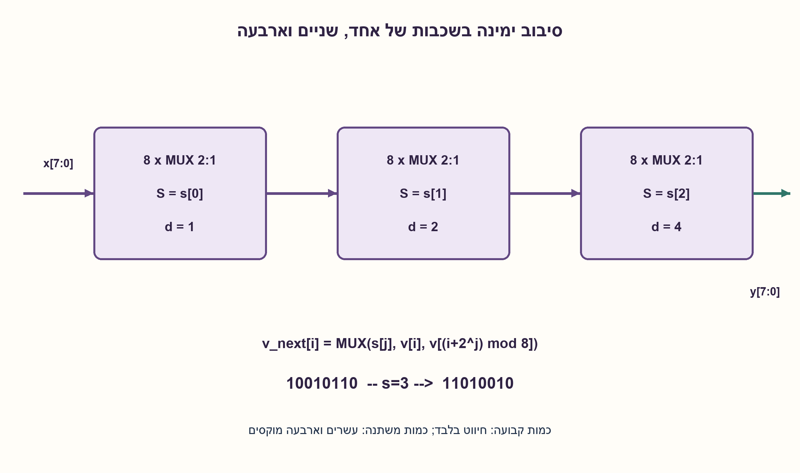
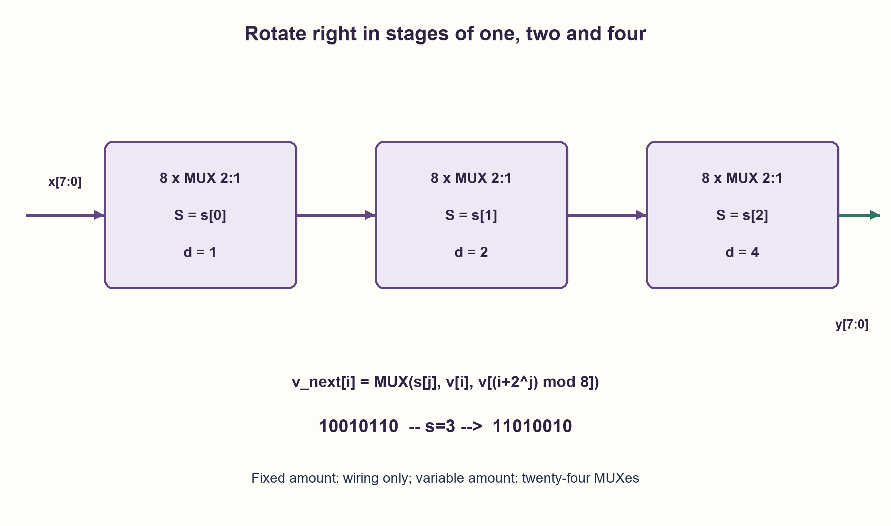

# PREP-199 — הזזה ציקלית ימינה באמצעות MUX בלבד

פתרון מוצע בסיוע AI; ביקורת מקצועית אנושית ממתינה. הקושי אינו מכויל.

[צילום מקור פרטי](../sources/2026-10-31-batch21-01.png)

ממש Shift Right ציקלי בעזרת רכיבי MUX 2:1 בלבד.

חברות לפי הדיווח בצילום בלבד: PMC-Sierra.

## עברית

ממשו הזזה ציקלית ימינה בעזרת רכיבי MUX 2:1 בלבד. הסבירו מה קורה לביט שיוצא מהקצה, ואיך משתנה המימוש כאשר ההזזה קבועה או נשלטת.

המקור אינו מגדיר רוחב או כניסת כמות. לצורך המימוש הראשי נבחר אפיק מקביל בן שמונה ביטים, וכמות s[2:0] בתחום 0..7. נדרשת רוטציה צירופית: אין שעון או זיכרון, אין שערים אחרים, ומותר חיווט ו־fanout. דונו גם ברוטציה קבועה של מקום אחד ובבחירה בין אפס למקום אחד. להכללה נבחר W=2^k.

1. ברוטציה, בניגוד להזזה לוגית, הביט שיוצא חוזר בקצה השני. איזה ביט כניסה צריך להגיע לכל ביט פלט?
2. אפשר לפרק כל כמות הזזה בת שלוש סיביות לסכום של 1,2,4.
3. בכל שכבה כל MUX בוחר בין הביט באותו מיקום לבין ביט במרחק 2^j, עם אינדוקס מודולו שמונה. חברו שלוש שכבות.

### מפרקים את הכמות לשכבות
נסמן x[7] כ־MSB ו־x[0] כ־LSB. ברוטציה ימינה במקום אחד y[i]=x[(i+1) mod 8], ובפרט x[0] עובר אל y[7]. הזזה קבועה כזו היא רק החלפת חוטים: אם החיווט מותר, אין צורך ב־MUX. אין להוסיף זיכרון רק בגלל המילה „הזזה”.

אם e בוחר בין אפס למקום אחד, כל ביט הוא y[i]=MUX(e, x[i], x[(i+1) mod 8]): שמונה MUXes מקבילים. עבור כמות כללית נשתמש בשלוש שכבות, עם מרחקים 1,2,4. בכל שכבה j נחשב v_next[i]=MUX(s[j], v[i], v[(i+2^j) mod 8]), והקלט לשכבה הראשונה הוא x. כל אינדקס מתייחס לפלט השכבה הקודמת, ולא לפלט חלקי של אותה שכבה.

אחרי j שכבות, כל ביט הוזז בסכום המרחקים שנבחרו עד אז, מודולו שמונה. שכבת הרוטציה הבאה מוסיפה את מרחקה או אפס, ולכן באינדוקציה הפלט הוא רוטציה ימינה ב־s. לדוגמה 10010110 ברוטציה של שלוש נותן 11010010.

המבנה הזה משתמש ב־8·3=24 MUXes ובשלוש שכבות תלות. עבור W=2^k: Wk MUXes ועומק k, ללא FF. זו עלות הבנייה המוצעת ולא הוכחת מינימום כללית בכל ספריית תאים. עבור W=1 הכול חיווט. ברוחב שאינו חזקה של שתיים צריך להגדיר את טווח הכמות והטיפול בקודים שאינם חוקיים; אין להניח שהמונה מתאפס מעצמו ב־W.

### מודל לוגי בפייתון שהורץ

```python
"""Combinational power-of-two-width barrel rotation, using only 2:1 MUXes."""


def mux(select, first, second):
    return second if select else first


def rotate_right(value, width=8, amount=0):
    if width < 1 or width & (width - 1):
        raise ValueError("width must be a positive power of two")
    if not 0 <= value < 1 << width or not 0 <= amount < width:
        raise ValueError("value and amount exceed their declared widths")
    bits = [(value >> i) & 1 for i in range(width)]
    for stage in range(width.bit_length() - 1):
        distance = 1 << stage
        bits = [mux((amount >> stage) & 1, bits[i], bits[(i + distance) % width])
                for i in range(width)]
    return sum(bit << i for i, bit in enumerate(bits))
```




### assumptions

```json
[
  "אפיק מקביל, ביטי כמות יציבים ו־MUX הבוחר D0 כש־S=0.",
  "רוחב שמונה הוא הנחת עריכה; רוטציה קבועה ורוטציה נשלטת הן חוזים נפרדים."
]
```

### optimality

24 MUXes ועומק שלוש עבור הרשת המתוארת; אין טענת מינימום שערים או זמן פיזי. חיווט קבוע דורש אפס MUXes.

### verification

נבדקו כל 2,122 זוגות המילה והכמות ברוחבים 1,2,4,8 מול רוטציית מחרוזת עצמאית. לא בוצעו הידור HDL, סינתזה או בדיקת תזמון.

### edge_cases

```json
[
  "s=0 שומר את המילה.",
  "אפסים ואחדות מלאים נשמרים; ביט יחיד מדגים כיוון וגלישה ציקלית."
]
```

### common_mistakes

```json
[
  "למלא אפס בקצה כמו בהזזה לוגית.",
  "לספור 24 שכבות במקום שלוש שכבות של שמונה רכיבים."
]
```

### interview_answer

אבנה שכבות רוטציה של 1,2,4, ובכל אחת MUX לכל ביט הנשלט בביט הכמות המתאים. רוטציה קבועה היא חיווט בלבד.

### source_ambiguities

רוחב, כמות, שעון וזיכרון אינם מוגדרים בצילום. הם הופרדו במפורש כדי לא להפוך רוטציה צירופית לאוגר הזזה בטעות.

### solution_extensions

```json
[
  {
    "question": "מה משתנה ברוחב שאינו חזקה של שתיים?",
    "answer_direction": "שמרו אינדוקס מודולו W והגדירו אם כמויות W ומעלה אסורות או ממופות מודולו W; מספר קודי הבקרה אינו בהכרח W.",
    "principle": "רוחב קוד הבקרה אינו מגדיר אוטומטית תחום חוקי."
  }
]
```

## English

Implement cyclic right rotation using only 2:1 MUXes. Explain where the bit leaving the edge goes and distinguish fixed from controlled rotation.

The source gives neither width nor a shift-amount input. For the main construction choose a parallel eight-bit bus with s[2:0] selecting 0..7 positions. Rotation is combinational: no clock or storage, no other gates, with wiring and fanout allowed. Also discuss a fixed one-position rotation and a choice between zero and one position. Generalize to W=2^k.

1. Unlike a logical shift, rotation wraps the departing bit around. Which input bit belongs at each output position?
2. Every three-bit amount is a sum of selected distances one, two and four.
3. At stage j, each MUX selects its current bit or the bit 2^j positions away, with indices modulo eight. Cascade three stages.

### Decompose the amount into stages
Let x[7] be the MSB and x[0] the LSB. A one-position right rotation gives y[i]=x[(i+1) mod 8], so x[0] becomes y[7]. If this amount is fixed, the circuit is just a wire permutation: no MUX is needed when wiring is allowed. The word “shift” does not imply storage.

If e selects between no rotation and one position, use y[i]=MUX(e, x[i], x[(i+1) mod 8]), eight parallel MUXes. For an arbitrary amount, cascade stages of distances one, two and four. Stage j computes v_next[i]=MUX(s[j], v[i], v[(i+2^j) mod 8]), starting with v=x. Every index reads the previous stage, never a partially updated current stage.

After j stages each bit has rotated by the sum of the selected distances so far, modulo eight. The next stage adds its distance or zero. Induction therefore gives rotation by s. For example, rotating 10010110 right by three produces 11010010.

This construction uses 8·3=24 MUXes and three dependency layers. For W=2^k it uses Wk MUXes and depth k, without flip-flops. These are construction costs, not a global cell-library minimum. At W=1 only wiring remains. A non-power-of-two width needs an explicit amount range and policy for unused codes; do not assume binary control wraps at W automatically.

### Executed Python logical model

```python
"""Combinational power-of-two-width barrel rotation, using only 2:1 MUXes."""


def mux(select, first, second):
    return second if select else first


def rotate_right(value, width=8, amount=0):
    if width < 1 or width & (width - 1):
        raise ValueError("width must be a positive power of two")
    if not 0 <= value < 1 << width or not 0 <= amount < width:
        raise ValueError("value and amount exceed their declared widths")
    bits = [(value >> i) & 1 for i in range(width)]
    for stage in range(width.bit_length() - 1):
        distance = 1 << stage
        bits = [mux((amount >> stage) & 1, bits[i], bits[(i + distance) % width])
                for i in range(width)]
    return sum(bit << i for i, bit in enumerate(bits))
```




### assumptions

```json
[
  "Parallel input, stable amount bits and MUX selecting D0 for S=0.",
  "Eight-bit width is an editorial choice; fixed and controlled rotations are separate contracts."
]
```

### optimality

The described network has 24 MUXes and depth three; no gate-count or physical-delay optimum is claimed. Fixed wiring needs zero MUXes.

### verification

All 2,122 word/amount pairs at widths 1,2,4,8 matched an independent string-rotation oracle. No HDL compilation, synthesis or timing check.

### edge_cases

```json
[
  "s=0 preserves the word.",
  "All-zero and all-one words stay unchanged; one-hot words expose direction and wraparound."
]
```

### common_mistakes

```json
[
  "Zero-filling an edge as in a logical shift.",
  "Counting twenty-four layers rather than three layers of eight cells."
]
```

### interview_answer

Use stages of one, two and four positions, each with one MUX per bit controlled by the corresponding amount bit. A fixed rotation is wiring only.

### source_ambiguities

Width, amount, clock and storage are unspecified. The contracts are separated to avoid silently replacing a combinational rotation with a shift register.

### solution_extensions

```json
[
  {
    "question": "What changes for a width that is not a power of two?",
    "answer_direction": "Use indices modulo W and specify whether amounts at least W are invalid or reduced modulo W; the control code count need not equal W.",
    "principle": "Control width alone does not define the valid domain."
  }
]
```
