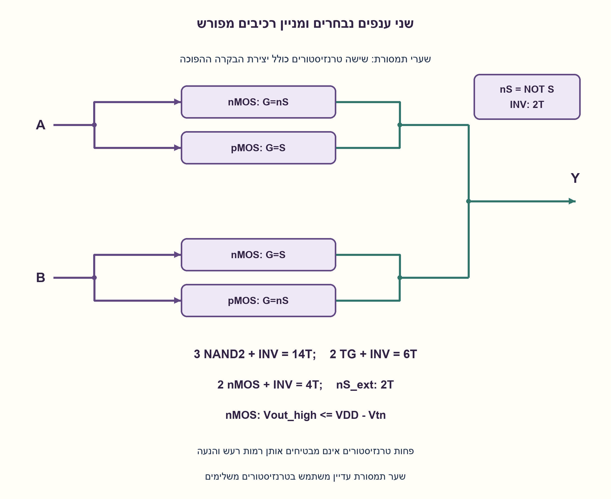
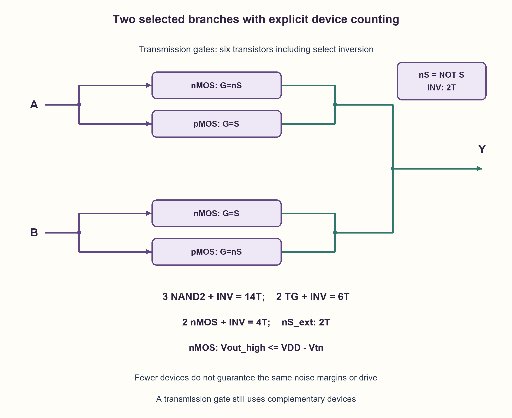

# PREP-200 — MUX משערים, משערי תמסורת ומטרנזיסטורי מעבר

פתרון מוצע בסיוע AI; ביקורת מקצועית אנושית ממתינה. הקושי אינו מכויל.

[צילום מקור פרטי](../sources/2026-10-31-batch21-02.png)

השאלה התחילה במימוש פשוט של Mux על ידי כל רכיב שאני רוצה. לאחר מכן היה צריך לממש בפחות רכיבים, ואחרי זה ביקשו להוריד שוב את מספר הרכיבים, אבל ניתן ללא לוגיקת CMOS.

חברות לפי הדיווח בצילום בלבד: NVIDIA.

## עברית

ממשו MUX שתיים לאחד, ואז הציעו מימושים עם פחות רכיבים, כולל אפשרות שאינה לוגיקת CMOS סטטית משלימה. פרטו את החיבורים ואת ההבדל בין מספר שערים, מספר טרנזיסטורים ותקינות רמות המתח.

נבחר Y=A כאשר S=0 ו־Y=B כאשר S=1, עם כניסות בטווח 0..VDD. ספרו גם את יצירת NOT S כאשר אינה מסופקת מבחוץ. המקור אינו קובע ספריית תאים, סוג טרנזיסטורים או מדד עלות, ולכן אין מספר מינימלי מוחלט שאפשר להסיק ממנו. אין צורך ב־SPICE כדי להציג את המבנה, אך בדיקה בוליאנית לבדה אינה מאמתת ביצועים אנלוגיים.

1. התחילו ממשוואת הבחירה. אילו שערים מממשים אותה, ומה נכלל במניין?
2. MUX יכול גם לחבר ישירות את הנתון הנבחר דרך מתג, במקום לחשב אותו ברשת שערים.
3. שני שערי תמסורת משתמשים בארבעה טרנזיסטורים ועוד מהפך לבקרה. שני NMOS בודדים חוסכים במתגים, אך אינם מעבירים רמה גבוהה עד המסילה.

### מגדירים קודם מה סופרים
הפונקציה היא Y=(NOT S AND A) OR (S AND B). שתי AND, שער OR ומהפך הם ארבעה שערים, אבל לא ארבעה טרנזיסטורים. ברשת NAND נשתמש ב־nS=NOT S, p=NAND(A, nS), q=NAND(B, S), Y=NAND(p, q). שלושה NAND בני שתי כניסות ומהפך דורשים 14 טרנזיסטורים במימוש CMOS סטטי בסיסי: 3·4+2. זו אינה הוכחת מינימום; תאים מורכבים יכולים לשנות את הספירה.

### חיבור נתונים דרך שערי תמסורת
TG0 מחבר A ל־Y כאשר S=0: שער ה־NMOS שלו מקבל nS ושער ה־PMOS מקבל S. TG1 מחבר B ל־Y כאשר S=1: ה־NMOS מקבל S וה־PMOS nS. כל שער תמסורת הוא NMOS ו־PMOS במקביל, ולכן שני TG ומהפך יצירת nS הם שישה טרנזיסטורים. אם nS כבר מסופק, ליבת הבחירה היא ארבעה. משתמשים בשני סוגי הטרנזיסטורים כדי להעביר הן רמות נמוכות והן גבוהות; שער תמסורת הוא עדיין מבנה בטכנולוגיית CMOS, אף שאינו רשת שערים סטטית משלימה רגילה.

### ליבה זולה יותר, במחיר רמות מתח
אפשר להשאיר רק NMOS אחד מ־A ל־Y הנשלט ב־nS, ו־NMOS אחד מ־B ל־Y הנשלט ב־S. הליבה כוללת שני טרנזיסטורים; יחד עם מהפך CMOS של הבקרה מתקבלים ארבעה. ל־NMOS שער ב־VDD אין מתח שער־מקור מספיק כדי להעלות את היציאה מעבר בקירוב ל־VDD−Vtn. לכן אפס עובר היטב, אבל אחד עלול להיות מוחלש, ובאפקט גוף ההנחתה יכולה לגדול. אין להציג זאת כמחליף דיגיטלי מובטח לשישה טרנזיסטורים בלי לבדוק סף מקלט, שיקום רמה, עומס והשהיה. שיקום או buffering מוסיפים רכיבים.

אם „ללא CMOS” אוסר גם מהפך בקרה עם PMOS, יש לספק nS מבחוץ או להצהיר על מהפך NMOS עם עומס מותר, למשל נגד וטרנזיסטור. במקרה האחרון יש שלושה NMOS ונגד, עם זרם סטטי ומגבלות יחס חוזק; זו ספרייה אחרת, לא ספירה שקולה של ארבעה טרנזיסטורים. אסור לכנות TG „ללא CMOS” רק מפני שסופרים פחות.

הטופולוגיה המשלימה מתוארת ב[מדריך שערי התמסורת של Analog Devices](https://www.analog.com/en/resources/technical-articles/what-is-a-transmission-gate-analog-switch.html). מגבלת מעבר NMOS וחלופת TG מתוארות ב[TI — מבני מתגי אותות](https://www.ti.com/lit/an/szza030e/szza030e.pdf). המספרים לעיל נגזרים מסכימת הרכיבים המוצעת; הם אינם נתוני תא ספרייה או תוצאות SPICE.

### מודל לוגי בפייתון שהורץ

```python
"""Boolean connectivity and illustrative NMOS voltage limit, not SPICE."""


def nand(a, b):
    return 1 - (a & b)


def gate_mux(a, b, select):
    complement = nand(select, select)
    return nand(nand(a, complement), nand(b, select))


def transmission_gate_mux(a, b, select):
    # TG0 has n-gate !S and p-gate S; TG1 has n-gate S and p-gate !S.
    tg0_on, tg1_on = select == 0, select == 1
    assert tg0_on != tg1_on
    return a if tg0_on else b


def nmos_pass_level(a_volts, b_volts, select, vdd=1.0, threshold=0.25):
    if select not in (0, 1) or not 0 < threshold < vdd:
        raise ValueError("valid binary select and 0 < threshold < vdd required")
    if not 0 <= a_volts <= vdd or not 0 <= b_volts <= vdd:
        raise ValueError("data voltages must lie between the supply rails")
    selected = a_volts if select == 0 else b_volts
    return min(selected, vdd - threshold)


TRANSISTOR_COUNTS = {
    "three_static_cmos_nand2_and_select_inverter": 3 * 4 + 2,
    "two_transmission_gates_and_select_inverter": 2 * 2 + 2,
    "two_nmos_pass_devices_and_cmos_select_inverter": 2 + 2,
    "two_nmos_pass_devices_with_external_complement": 2,
}
```




### assumptions

```json
[
  "כניסות ובקרה יציבות אחרי זמן התייצבות; S ו־nS משלימים במודל האידאלי.",
  "סופרים טרנזיסטורים בנפרד משערים, ואת מהפך הבקרה כאשר אינו חיצוני."
]
```

### optimality

מושווים 14,6,4 טרנזיסטורים תחת ספירות מפורשות; שתי גרסאות המעבר אינן מבטיחות אותו מרווח רעש. אין טענת מינימום כללי.

### verification

כל שמונה שורות הנתונים והבקרה נבדקו ברשת NAND ובמתגי TG אידאליים. מודל המחשת NMOS מציג תקרה 0.75 V כאשר VDD=1 V, Vtn=0.25 V. זה אינו חישוב תהליך או SPICE.

### edge_cases

```json
[
  "שינוי S בזמן שהנתונים שונים עלול לייצר הפרעה או זמן high-Z בהתאם לתזמון המתגים.",
  "nS מסופק מראש משנה את המניין."
]
```

### common_mistakes

```json
[
  "להשוות ארבעה שערים לארבעה טרנזיסטורים.",
  "להסתיר מהפך או שיקום רמה.",
  "להבטיח רמה גבוהה מלאה דרך NMOS יחיד."
]
```

### interview_answer

אציג NAND ומהפך, אחר כך שני TG ומהפך: שישה טרנזיסטורים. שני NMOS ומהפך נותנים ארבעה, אבל האחד נחלש ולכן אציין שיקום וספי מקלט. המינימום תלוי בספרייה ובדרישת רמות.

### source_ambiguities

המקור אינו מגדיר „רכיב”, מספר שלבי האופטימיזציה או אם „ללא CMOS” אוסר טכנולוגיה או רק לוגיקה סטטית משלימה. החלופות והנחות הספירה נשמרות בנפרד.

### solution_extensions

```json
[
  {
    "question": "מה קורה למניין אם צריך יציאה מחודשת ברמות מלאות ובעלת הנעה מוגדרת?",
    "answer_direction": "יש להוסיף שלבי שיקום או buffers בהתאם לקוטביות, סף, עומס וספרייה. מימוש פסיבי קטן אינו בהכרח התא הדיגיטלי הזול ביותר.",
    "principle": "עלות פונקציונלית ועלות חשמלית אינן אותו מדד."
  }
]
```

## English

Implement a two-input MUX, then propose versions with fewer components, including a design outside static complementary CMOS gate logic. Specify connections and distinguish gate count, transistor count and valid voltage levels.

Choose Y=A for S=0 and Y=B for S=1, with inputs within 0..VDD. Count generation of NOT S unless externally provided. The source defines no cell library, transistor type or cost metric, so it does not imply an absolute minimum. A topology can be explained without SPICE, but Boolean checking does not establish analog performance.

1. Start with the selection equation. Which gates implement it, and what does the count include?
2. A MUX can connect the selected data through a switch rather than recompute it with a gate network.
3. Two transmission gates need four switching transistors plus a select inverter. Two NMOS-only switches reduce the switching core but degrade a high level.

### Define the counting unit first
Y=(NOT S AND A) OR (S AND B). Two ANDs, an OR and an inverter are four gates, not four transistors. A NAND network uses nS=NOT S, p=NAND(A, nS), q=NAND(B, S), Y=NAND(p, q). Three two-input NANDs plus a select inverter use fourteen transistors in basic static CMOS: 3·4+2. This is not a minimum proof; complex cells can change the count.

### Select data with transmission gates
TG0 connects A to Y when S=0: its NMOS gate receives nS and its PMOS gate receives S. TG1 connects B when S=1: its NMOS gate receives S and its PMOS gate nS. Each TG is an NMOS and PMOS in parallel. Two TGs plus the nS inverter therefore use six transistors, or four in the switching core if nS is supplied externally. Complementary devices pass both rail levels. A transmission gate still uses CMOS technology, even though this is not an ordinary static complementary gate network.

### A smaller core at a voltage-level cost
Use one NMOS between A and Y controlled by nS and one between B and Y controlled by S. The core has two devices, or four including a CMOS select inverter. With its gate at VDD, an NMOS lacks the gate-source voltage to raise the output above approximately VDD−Vtn. It passes a low well but may degrade a high, with body effect potentially increasing the loss. It is not a guaranteed digital replacement without receiver-threshold, restoration, loading and delay checks. Buffers or restoration add devices.

If “without CMOS” also forbids a PMOS-containing select inverter, supply nS externally or explicitly permit an NMOS inverter with a load, such as one resistor and transistor. That version has three NMOS devices and a resistor, with static current and strength-ratio constraints. It is a different library, not the same four-transistor count. Calling a TG “non-CMOS” merely because it has fewer devices is incorrect.

The complementary switch structure is described by [Analog Devices' transmission-gate guide](https://www.analog.com/en/resources/technical-articles/what-is-a-transmission-gate-analog-switch.html). NMOS voltage limitations and the TG alternative appear in [TI's signal-switch structures](https://www.ti.com/lit/an/szza030e/szza030e.pdf). Counts above follow from the proposed topology; they are not characterized library-cell or SPICE results.

### Executed Python logical model

```python
"""Boolean connectivity and illustrative NMOS voltage limit, not SPICE."""


def nand(a, b):
    return 1 - (a & b)


def gate_mux(a, b, select):
    complement = nand(select, select)
    return nand(nand(a, complement), nand(b, select))


def transmission_gate_mux(a, b, select):
    # TG0 has n-gate !S and p-gate S; TG1 has n-gate S and p-gate !S.
    tg0_on, tg1_on = select == 0, select == 1
    assert tg0_on != tg1_on
    return a if tg0_on else b


def nmos_pass_level(a_volts, b_volts, select, vdd=1.0, threshold=0.25):
    if select not in (0, 1) or not 0 < threshold < vdd:
        raise ValueError("valid binary select and 0 < threshold < vdd required")
    if not 0 <= a_volts <= vdd or not 0 <= b_volts <= vdd:
        raise ValueError("data voltages must lie between the supply rails")
    selected = a_volts if select == 0 else b_volts
    return min(selected, vdd - threshold)


TRANSISTOR_COUNTS = {
    "three_static_cmos_nand2_and_select_inverter": 3 * 4 + 2,
    "two_transmission_gates_and_select_inverter": 2 * 2 + 2,
    "two_nmos_pass_devices_and_cmos_select_inverter": 2 + 2,
    "two_nmos_pass_devices_with_external_complement": 2,
}
```




### assumptions

```json
[
  "Settled data/select inputs; S and nS are complementary in the ideal model.",
  "Count transistors separately from gates and include select inversion when it is not external."
]
```

### optimality

Compare fourteen, six and four devices under explicit counts; pass-only and TG versions do not guarantee identical noise margins. No global minimum claim.

### verification

All eight data/select rows passed NAND and ideal-TG connectivity checks. An illustrative NMOS cap is 0.75 V at VDD=1 V, Vtn=0.25 V; this is not a process or SPICE calculation.

### edge_cases

```json
[
  "Changing S with unequal data can cause transients or high-Z intervals depending on switch timing.",
  "An externally supplied nS changes the count."
]
```

### common_mistakes

```json
[
  "Comparing four gates with four transistors.",
  "Hiding select inversion or level restoration.",
  "Promising a full high rail through one NMOS."
]
```

### interview_answer

Show three NANDs plus inversion, then two TGs plus inversion: six transistors. Two NMOS switches plus inversion use four, but degrade a high, so receiver thresholds and restoration matter. Minimum count depends on the library and electrical contract.

### source_ambiguities

The source does not define a component, optimization stages or whether “without CMOS” excludes technology or only static complementary logic. Alternatives and counting assumptions remain separate.

### solution_extensions

```json
[
  {
    "question": "What happens if a restored full-level output with specified drive is required?",
    "answer_direction": "Add restoration or buffers according to polarity, thresholds, loading and library. A small passive core need not be the cheapest compliant digital cell.",
    "principle": "Functional and electrical cost are different metrics."
  }
]
```
