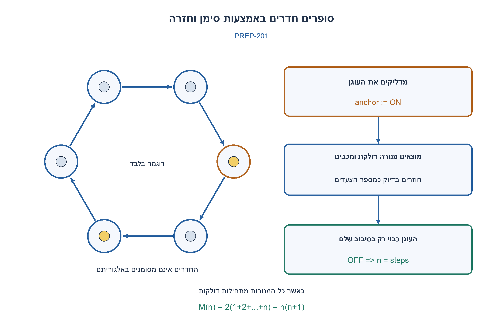
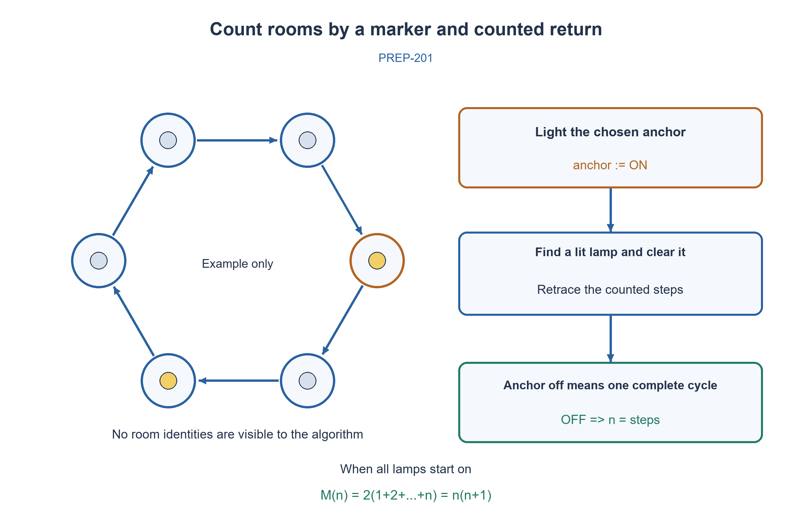

# PREP-201 — כמה חדרים יש במעגל? סימון באמצעות מנורה ותנועה בלבד

פתרון מוצע בסיוע AI; ביקורת מקצועית אנושית ממתינה. הקושי אינו מכויל.

[צילום מקור פרטי](../sources/2026-10-31-batch21-03.png)

ישנם n≥1 חדרים שמסודרים בצורה מעגל, ומכל חדר יש שני מעברים לחדרים הסמוכים אליו. כל החדרים זהים זה לזה ובכל חדר יש מנורה עם מתג שניתן להדליק או לכבות אותה. המצב ההתחלתי של המנורות אקראי. אתה מתעורר בחדר רנדומלי והמטרה היא לגלות כמה חדרים יש במעגל, כאשר אפשר לעבור ביניהם ולהדליק או לכבות מנורות ללא הגבלה.

## עברית

יש n≥1 חדרים זהים במעגל, עם שני מעברים בכל חדר לחדרים הסמוכים. בכל חדר מנורה שמצבה ההתחלתי יכול להיות שרירותי. אתם מתחילים בחדר כלשהו, יכולים לקרוא ולשנות רק את המנורה בחדר שבו אתם נמצאים, ולעבור בין חדרים. מצאו אלגוריתם שתמיד מחזיר את מספר החדרים. אין כתובות, שמות חדרים או סימוני דרך נוספים.

הבהרות המודל: מותר לזכור מונה צעדים ולנוע במסלול גם בכיוון ההפוך. אפשר לשמור כיוון הליכה עקבי סביב המעגל ולחזור באותו מספר צעדים. הפעולות אמינות ואין אדם אחר שמשנה מנורות. מותר להרוס את המצבים ההתחלתיים. בשונה מזיכרון מעגלי עם כתובות, אי אפשר לקרוא מרחוק את מנורת נקודת ההתחלה.

1. בחרו את חדר ההתחלה כעוגן וצרו בו סימן ידוע. מנורה דולקת בחדר אחר עלולה להטעות.
2. כשמוצאים מנורה דולקת, אפשר לכבות אותה ולחזור בדיוק את מספר הצעדים שנספרו. מה יקרה לסימן בעוגן?
3. הדליקו את העוגן. לכו קדימה עד המנורה הדולקת הראשונה, כבו וחזרו במספר הצעדים שספרתם. אם העוגן כבוי סגרתם סיבוב שלם; אחרת מחקתם סימן מטעה וחוזרים על התהליך.

### מזהים את העוגן באמצעות ניסוי, לא באמצעות מראה החדר
מדליקים את המנורה בחדר ההתחלה. בכל ניסיון מתחילים מאותו עוגן וסופרים צעדים קדימה עד שמגיעים למנורה דולקת. מכבים אותה וחוזרים לאחור בדיוק באותו מספר צעדים, בלי לשנות מנורות בדרך. בודקים את מנורת העוגן: אם היא כבויה, המספר שנספר הוא n; אם היא עדיין דולקת, חוזרים על הניסיון.

מדוע ההמתנה למנורה דולקת תמיד מסתיימת? בתחילת כל ניסיון העוגן דולק, ולכן בתוך לכל היותר n צעדים נפגוש אותו שוב. אם פגשנו מנורה דולקת לפני כן, היא בחדר אחר: כיבויה אינו משנה את העוגן. החזרה בספירה מחזירה אותנו פיזית לעוגן, לא לחדר שרק נראה דומה לו. לכן העוגן נשאר דולק והניסיון הבא מסיר עוד מנורה מטעה. יש לכל היותר n−1 מנורות מטעות כאלה.

בניסיון האחרון המנורה הדולקת הראשונה שנפגוש היא העוגן עצמו, בדיוק לאחר n צעדים. כיבויה וחזרה n צעדים מחזירים לעוגן הכבוי. אי אפשר לעצור בטעות בכפולה מאוחרת של n, כי המפגש הראשון עם עוגן דולק כבר קורה ב־n. גם n=1 תקין: מעבר אחד חוזר לאותו חדר; מכבים וחוזרים צעד אחד, ומחזירים 1.

לדוגמה, במעגל בן ארבעה חדרים שכולם דולקים, הניסיונות סופרים 1,2,3,4. בשלושת הראשונים נכבית מנורה אחרת והעוגן נשאר דולק; ברביעי נכבה העוגן. אין להניח מראש שכל מנורה דולקת מסמנת ביקור קודם שלנו.

בכל ניסיון הולכים k צעדים קדימה ו־k אחורה, כאשר k≤n. לכל היותר n ניסיונות נותנים O(n²) תנועות. במקרה שכל המנורות דולקות, הסכום הוא 2(1+...+n)=n(n+1), ולכן זהו גם חסם גרוע־ביותר Θ(n²) לאלגוריתם המוצג. זו אינה טענה שלא קיים אלגוריתם אחר בעל עלות שונה. נשמרים מספר קבוע של מונים, שכל אחד דורש O(log n) ביטים; אין מערך חדרים.

נבדקו 18,439 הרצות: כל 2,046 מצבי המנורות בגדלים 1..10 וכל חדר התחלה, ועוד חמישה מקרי כל־המנורות־דולקות המאמתים את מספר התנועות המדויק. האלגוריתם מקבל רק את ממשק החדר הנוכחי; שמות ומיקומים קיימים בסימולטור בלבד.

```python
"""Count anonymous physical rooms using only movement and the current lamp.

The room interface exposes move_clockwise(), move_counterclockwise(),
lamp_is_on(), set_lamp(bool). It exposes no length, address or room identity.
Reliable reversible movement and exclusive control of lamps are assumed.
"""

def count_rooms(room):
    room.set_lamp(True)
    while True:
        steps = 0
        while True:
            room.move_clockwise()
            steps += 1
            if room.lamp_is_on():
                break
        room.set_lamp(False)
        for _ in range(steps):
            room.move_counterclockwise()
        if not room.lamp_is_on():
            return steps
```




## English

There are n≥1 identical rooms arranged in a cycle, with two passages per room to neighboring rooms. Each lamp has arbitrary initial state. Start anywhere; inspect/change only the current room’s lamp and move between neighbors. Give an algorithm that always returns the number of rooms. No room addresses, identities or extra physical markers are available.

Model clarifications: local step counting and reversing the walk are allowed. Maintain a consistent direction around the cycle and retrace the same number of steps. Operations are reliable, no other person changes lamps, and initial lamp contents need not survive. Unlike addressable circular memory, the starting lamp cannot be read remotely.

1. Choose the initial room as an anchor and establish a known marker; another initially lit lamp may be misleading.
2. After finding a lit lamp, switch it off and retrace the counted steps. What happens to the anchor marker?
3. Light the anchor. Walk forward to the first lit lamp, clear it and walk back the counted steps. An unlit anchor means a complete circuit; otherwise a misleading marker was removed, so repeat.

### Identify the anchor by an experiment, not by appearance
Light the initial room. In each attempt start at that anchor, walk forward and count until reaching the first lit lamp. Clear it and retrace exactly that many steps without changing lamps en route. If the anchor is now off, return the count n. If it remains on, repeat.

The search always terminates because the anchor is lit at the start of an attempt and is reached within n forward steps. Any earlier lit lamp belongs to another room; clearing it leaves the anchor unchanged. Counted backtracking physically returns to the anchor, not merely a similar-looking room. Each unsuccessful attempt removes one misleading lit lamp, of which there are at most n−1.

Eventually the first lit lamp reached is the anchor itself, after exactly n steps. Clearing it and returning n steps leaves an unlit anchor. A later multiple of n cannot be reported: the first lit-anchor encounter already occurs at n. For n=1, one passage returns to the same room; clear it, retrace one step and return 1.

For four initially lit rooms, successive attempts count 1,2,3,4. The first three clear other lamps; the fourth clears the anchor. An initially lit lamp is not evidence of a previous visit by us.

Each attempt costs 2k movements with k≤n. At most n attempts give O(n²) movements. With all lamps initially lit the exact sum is 2(1+...+n)=n(n+1), so the displayed algorithm has worst-case Θ(n²) movement cost. This is not a global optimality claim over all algorithms. A constant number of counters use O(log n) bits each; no room array is stored.

18,439 runs covered all 2,046 lamp configurations at sizes 1..10 and every initial room, plus five all-on cases checking the exact movement bound. The algorithm sees only the current-room interface; identities and physical positions exist solely in the test simulator.

```python
"""Count anonymous physical rooms using only movement and the current lamp.

The room interface exposes move_clockwise(), move_counterclockwise(),
lamp_is_on(), set_lamp(bool). It exposes no length, address or room identity.
Reliable reversible movement and exclusive control of lamps are assumed.
"""

def count_rooms(room):
    room.set_lamp(True)
    while True:
        steps = 0
        while True:
            room.move_clockwise()
            steps += 1
            if room.lamp_is_on():
                break
        room.set_lamp(False)
        for _ in range(steps):
            room.move_counterclockwise()
        if not room.lamp_is_on():
            return steps
```




## חומר משלים / Supporting material

```json
{
  "assumptions": {
    "he": [
      "מעגל סופי וחיובי; שתי תנועות הפוכות אמינות; מותר מונה מקומי; בלעדיות על המנורות."
    ],
    "en": [
      "Finite positive cycle, reliable reversible movement, local counter permitted and exclusive lamp control."
    ]
  },
  "optimality": {
    "he": "Θ(n²) תנועות במקרה הגרוע לאלגוריתם הנתון; O(1) מונים ו־O(log n) ביטים.",
    "en": "Worst-case Θ(n²) movements for this algorithm; O(1) counters requiring O(log n) bits."
  },
  "verification": {
    "he": "18,439 הרצות עם כל המצבים וההתחלות ל־n=1..10 ומקרי חסם תנועה נוספים; לא בדיקה פיזית.",
    "en": "18,439 runs covering every state/start for n=1..10 plus directed movement-bound cases; no physical-room experiment."
  },
  "edge_cases": {
    "he": [
      "n=1; כל המנורות כבויות; כולן דולקות; המנורה בעוגן התחילה כבויה; סימן מטעה בחדר הסמוך."
    ],
    "en": [
      "n=1; all lamps off; all on; initially off anchor; a misleading lamp in the adjacent room."
    ]
  },
  "common_mistakes": {
    "he": [
      "אין לקרוא את העוגן מרחוק או להניח כתובות כמו ב־PREP-178.",
      "לא מחזירים את המרחק למנורה הדולקת הראשונה בלי בדיקת העוגן.",
      "חייבים לחזור בדיוק k צעדים, בלי לכבות סימנים נוספים בחזרה."
    ],
    "en": [
      "Do not read the anchor remotely or assume addresses as in PREP-178.",
      "Do not report the first lit-lamp distance without checking the anchor.",
      "Retrace exactly k steps and leave other lamps unchanged on the return."
    ]
  },
  "interview_answer": {
    "he": "אני מדליק עוגן. בכל ניסיון מכבה את המנורה הדולקת הראשונה וחוזר בספירה; רק אם העוגן כבה המרחק הוא אורך המעגל.",
    "en": "Light an anchor, clear the first lit lamp and backtrack by counting. Only an extinguished anchor proves that the count is the cycle length."
  },
  "source_ambiguities": {
    "he": [
      "הצילום אינו מפרט כיווניות או זיכרון מקומי; יכולת ספירת צעדים וחזרה אמינה הן השלמות מפורשות."
    ],
    "en": [
      "The source omits orientation and local-memory details; reliable reversible walking and counted steps are explicit assumptions."
    ]
  },
  "solution_extensions": {
    "he": {
      "question": "למה באותו רעיון זיכרון עם כתובות יכול לחסוך תנועה?",
      "direction": "ב־PREP-178 קוראים את כתובת העוגן אחרי כל כתיבה מרוחקת. כאן כל בדיקה מחייבת חזרה פיזית.",
      "integration": "מוכן בתוכן; לא מחובר לתור אינטראקטיבי."
    },
    "en": {
      "question": "Why can addressable memory save movement?",
      "direction": "PREP-178 can read the anchor after remote writes; physical rooms require walking back for each check.",
      "integration": "Prepared in content; not connected to an interactive queue."
    }
  }
}
```
